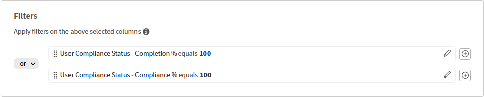

# 在報表建構器中建立自訂報表

## 概觀

從零開始建立最適合你，當你對需要的欄位和輸出有清晰的了解，且沒有任何現有範本符合你的使用情境。 如果您是 Report Builder 的新手，建議先從範本開始。

## 建立自訂報告

在此範例中，您將找出每位經理下面臨合規課程風險的學習者。

1. 以管理員身分登入 Adobe Learning Manager。
2. 選擇 **「報告」**，然後選擇 **「報告建立器**」。
3. 選取「**報告」標籤，然後選擇**「建立報告&#x200B;**&#x200B;**」。
4. 輸入報告名稱。 需要一個名字。 可選擇性地輸入描述。

   

5. 在欄位面板中，選取下列資料集並展開：

   * 使用者
   * 學習物件
   * 使用者合規狀態

6. 在您想包含的下列欄位旁選擇 **+** 。 所選欄位會顯示在報表畫布中。

   * 使用者名稱
   * 使用者-管理員名稱
   * 學習物件- 學習物件名稱
   * 使用者合規狀態-完成率百分比
   * 使用者合規狀態-合規率

   

7. 在畫布中拖曳欄位以重新排序。
8. 若要重新命名欄位，請在欄位的 **別名** 欄位輸入名稱。 如果您指定別名，該別名將用作欄位標題。 如果您未指定別名，預設欄位標題會包含資料集名稱。 例如，Learning Object 資料集中的 Name 會顯示為 Learning Object - Name。

   **欄位標題**

   報表建立器會在預設欄位標題中包含資料集名稱，以協助區分不同資料集名稱相似的欄位。 例如，如果您從學習物件資料集中選擇名稱，欄位標題會顯示為學習物件 - 名稱。

   如果您為欄位指定自訂別名，報告建立器會使用該別名而非預設的欄位標題。

   **對現有報告的影響**

   升級後，使用預設欄位名稱且未使用自訂別名的現有報表會顯示更新後的欄位標題。 例如，Learning Object 資料集中的 Name 會從 Name 變成 Learning Object - Name。

   報告資料、篩選條件與排程不會受到影響。

   如果您在腳本、試算表、BI 儀表板或以標題引用欄位的整合中使用報告輸出，請檢查下游系統，並視需要更新前一欄標題的參考。

   若要保留特定的欄位標題，請為該欄位設定自訂別名。

9. 選擇 **「儲存報告**」。

## 下載報告

1. 在右上角選擇 **「動作** 」。

   

2. 選擇 **下載**。 當報告準備好時，您可以從通知圖示下載。

下載的報告（csv）包含以下欄位：

* 名稱
* managerName
* 名稱
* 完成Pct
* 合規性Pct

## 套用群組、篩選條件與排序

### 篩選

現在您已下載報表，請套用一個篩選器，使 completionPct 或 compliancePct 等於 100。

1. 開啟報告，並在右上角選擇 **「編輯** 」。
2. 選取 **「新增篩選器** 」，並在您想要套用篩選條件的欄位中搜尋。

   

3. 選擇 **新增**。
4. 將篩選器與 AND/OR 邏輯結合;選取篩選列間的運算子切換。

   

5. 選擇 **「儲存報告** 」並下載報告。

下載的報表包含 completionPct OR compliancePct 等於 100 的紀錄。

### 分組

依管理者將紀錄分組為：

* 依管理者彙整學習者資料
* 計算管理員層級的平均值
* 在每位管理者下計算學習者數量

1. 開啟報告，並在右上角選擇 **「編輯** 」。
2. 選擇「 **群組依據:Select** 」，並選擇 **「使用者-管理員名稱** 」欄位。

   

3. 將下列欄位彙整：

   * 使用者名稱
   * 學習物件 - 學習物件名稱

4. 選擇 **「計數** 」作為欄位的彙總函數。

   

   **彙總欄位的欄位標題：**

   套用聚合函數時，預設欄位標題會包含聚合函數。 例如，當您對學習物件 - ID 套用&#x200B;**計數**&#x200B;**時，欄位標題會顯示為**&#x200B;學習物件計數&#x200B;**&#x200B;**- ID **。**&#x200B;如果您指定了自訂別名，該別名將保持不變。

5. 對學習物件 - 學習物件名稱重複此步驟。

   

6. 選擇 **「儲存報告** 」並下載報告。

下載的報告包含針對學員訓練表現的經理分類摘要。 它顯示每位經理的平均完成率、平均合規分數，以及總學習人數。 數據顯示所有群組普遍完成訓練，但各經理的合規表現差異顯著。

### 排序

請依每位經理的學習者數量，從高至低排序報告。

1. 開啟報告，並在右上角選擇 **「編輯** 」。
2. 選取 **「**&#x200B;新增排序」。
3. 搜尋使用者名稱並選擇 **「使用者名稱**」。
4. 選擇 **「**&#x200B;遞減」。

   

5. 選擇 **新增**。
6. 選擇 **「儲存報告** 」並下載報告。

下載的報告會依從小到低排列列出每位經理的學習者人數。
