# 管理 Learning Manager 訂單與帳單

信用卡購買僅在 [美國地區](http://learningmanager.adobe.com/)提供。

管理 Learning Manager 帳單、使用信用卡下訂單、透過採購訂單訂閱，或透過每月有效使用者方案訂閱。

Adobe Learning Manager 擁有彈性、客戶友善且最佳的定價模式，能滿足您的組織需求。 如需更多資訊，請參閱 [Learning Manager](https://www.adobe.com/products/learningmanager.html) 頁面。

只有您組織的管理員可以管理帳單。

如果您想聯絡 Adobe 以取得更多關於 Learning Manager 訂閱與帳單的資訊，請寫信至 learningmanagersales@adobe.com](mailto:learningmanagersales@adobe.com) 與我們[聯繫。

## 帳單頁面

若要進入帳單頁面，請以管理員身分登入 Adobe Learning Manager，並在左側導覽窗格中選擇 **[!UICONTROL Billing]** 。

帳單頁面包含以下標籤：

| 分頁 | 目的 |
|---|---|
| **訂閱** | 查看帳戶詳細資料、授權權限及席位使用量。 管理計畫啟用。 |
| **訂單歷史** | 請檢視帳戶上過去的訂單。 |

### 訂閱標籤

**帳戶詳情**

**訂閱標籤頂端****的帳戶詳細資料**&#x200B;卡片會顯示您帳戶的四個唯讀識別碼。

| 場地 | 說明 |
|---|---|
| **ECCID** | Adobe 為您帳戶提供的參考編號。 聯絡 Adobe 支援時請引用此段。 |
| **帳號 ID** | 您獨一無二的 Adobe Learning Manager 帳戶識別碼。 |
| **帳號名稱** | 您的 Adobe Learning Manager 帳戶的顯示名稱。 |
| **IMS 組織識別碼** | 與此帳戶連結的 Adobe 管理主控台組織。 如果還沒連結，則空白。 |

**授權**

**「授權**」區塊列出帳戶上所有有效授權或權限，包括 Ultimate 方案的 Live Hub 訓練時數。每個區塊會顯示授權名稱、適用時的方案說明，以及顯示當前合約期間的消耗數據的統計資料列。

>[!IMPORTANT]
>
> Live Hub 目前正處於 Prime 客戶的測試階段。

統計資料列的欄位會依授權類型而異：

| 授權類型 | 欄位顯示 |
|---|---|
| 付費授權（例如 Adobe Learning Manager Ultimate） | 已購買 / 已使用/由同儕帳戶使用 / 剩餘 |
| 試用授權（例如，虛擬教練） | 現貨/二手/剩餘 |

選取 **[!UICONTROL View Usage Details]** 統計資料列下方以展開內嵌分析。 擴充章節顯示：

- 一個 **「選擇期間** 」下拉選單，用來依合約期間（包括歷史期間）進行篩選
- **包含欄位的總使用量**&#x200B;表：購買/此帳戶使用/對等帳戶使用/剩餘
- 查看 **帳戶拆分** 連結，可查看各節點帳戶間的使用情況分布
- 下載 **詳細報告** 連結，可將使用資料匯出為檔案
- 在 Live Hub 標籤中，你的 Live Hub 訓練時數使用量（小時）。 請參閱 [Live Hub 培訓時數](#live-hub-training-hours) 以取得更多資訊。

**Agent Orchestrator 授權區塊**

當連結 Agent Orchestrator 授權時，統計資料列會顯示：

| 柱子 | 說明 |
|---|---|
| **已購買** | 合約期間內購買的總點數。 |
| **已使用** | 使用此授權的所有服務所消耗的點數。 |
| **ALM 所使用** | 專為 Adobe Learning Manager 所消耗的點數。 |
| **剩餘** | 積分仍可用。 |

如果您的組織使用父帳戶與子帳戶，父帳戶的 **授權** 區段會顯示 **「由同儕帳戶** 使用」欄位，反映所有連結子帳戶的信用消耗情況。 兒童帳戶會顯示其座位分配為 **「已** 核准」而非「已購買」。

## 將您的 Adobe Learning Manager 帳戶連結至 Adobe 管理主控台

在啟用 Gen AI 功能之前，您的 Adobe Learning Manager 帳戶必須先連結至 Adobe 管理控制台組織。 連結後，Adobe Learning Manager 會偵測 Agent Orchestrator 授權，並開放 **「點數** 」標籤。

當您的帳戶是透過 Adobe 標準訂購流程購買，或您使用啟用金鑰啟用帳戶時，連結會自動建立。 您可以在「訂閱&#x200B;**」標籤中驗證連結**——如果&#x200B;**帳戶詳細資料**&#x200B;中的 **IMS 組織 ID** 欄位已填入，表示該帳戶已連結。

### 手動連結您的帳戶

如果您的帳戶是獨立 **設定且 IMS 組織 ID** 欄位為空白，請手動連結。

**先決條件：**
- 您必須是 Adobe Learning Manager 帳戶的管理員。
- 您必須在想要連結的 Adobe 管理主控台組織中持有系統管理員角色。
- Adobe Admin Console 組織必須擁有有效的 Agent Orchestrator 授權。

1. 選擇 **[!UICONTROL Billing]**，然後選取該標籤。**[!UICONTROL Subscription]**
2. 在帳戶 **詳細資料** 卡片中，選擇 **[!UICONTROL Link IMS Org]**。
3. 登入視窗會開啟。 輸入您的 Adobe 帳戶憑證，並從清單中選擇您的組織。 Adobe Learning Manager 確認，登入的帳戶在 Adobe 管理控制台組織中擁有系統管理員角色，且該帳戶在 Adobe Learning Manager 中擁有管理員角色。
4. 如果兩次檢查都通過，連結就會建立。 **IMS 組織 ID** 欄位會更新為您的組織識別碼，且信用餘額會顯示在&#x200B;**授權**&#x200B;區段。
5. 如果任一檢查失敗，系統會顯示錯誤訊息。 確認上述先決條件後再試一次。

### 解除綁定您的帳戶

解除連結後，所有學習者都會停用 Gen AI 功能，且 **在帳號重新連結前，學分** 標籤將無法使用。

1. 選擇 **[!UICONTROL Billing]**，然後選取該標籤。**[!UICONTROL Subscription]**
2. 在帳戶 **詳細資料** 卡片中，選擇 **[!UICONTROL Unlink IMS Org]**。
3. 再次登入以確認您在組織中的管理員角色。
4. 連結已被移除。 **IMS 組織 ID** 欄位會回復空白，且&#x200B;**「Credits**」標籤頁隱藏。

若要恢復存取權，請重複上述手動連結步驟。

## 使用信用卡下訂單 {#placeordersusingcreditcards}

您可透過任何單一信用卡付款訂單購買最多3500名學習者的訂閱。 帳戶中的第一個訂單必須至少包含 10 位學習者。

1. 在系統管理員應用程式中，點選 **[!UICONTROL Billing]** 左側導覽窗格。

   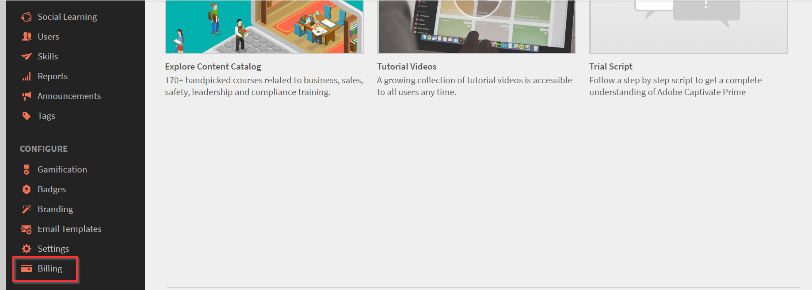

   *啟動 Adobe Learning Manager 帳單*

1. 在頁面 **[!UICONTROL Billing Information]** 上，將使用者 **[!UICONTROL Add Users]** 數量加入欄位。 使用信用卡訂閱預付訂閱時，您可以看到可新增的訂閱用戶數量。 您可新增的使用者數量不得超過「剩餘」章節中所列的數。1.

   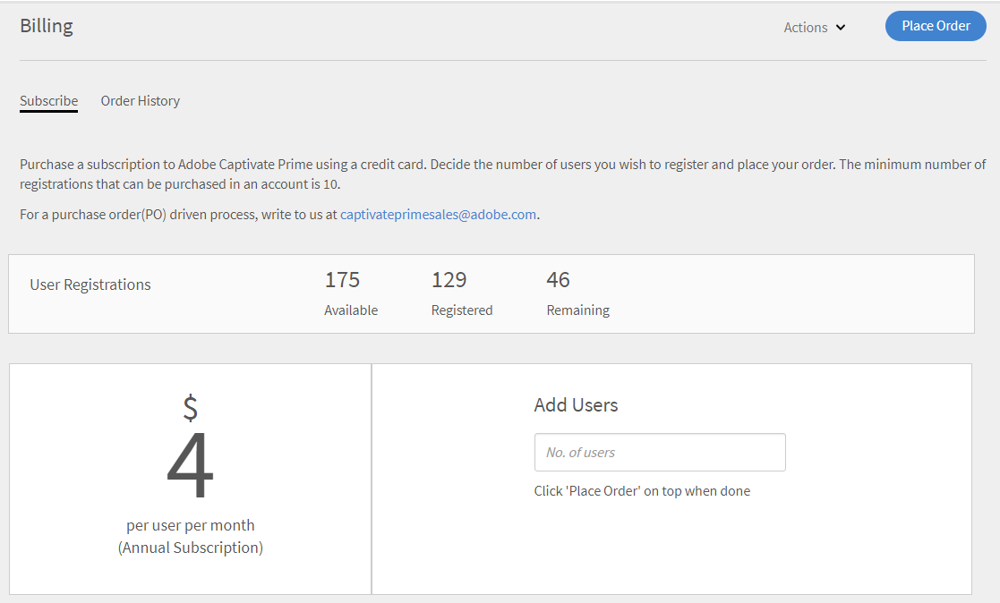

   *新增使用者數量*

1. 指定要新增的使用者數量後，點擊頁面右上角的「下單」。

   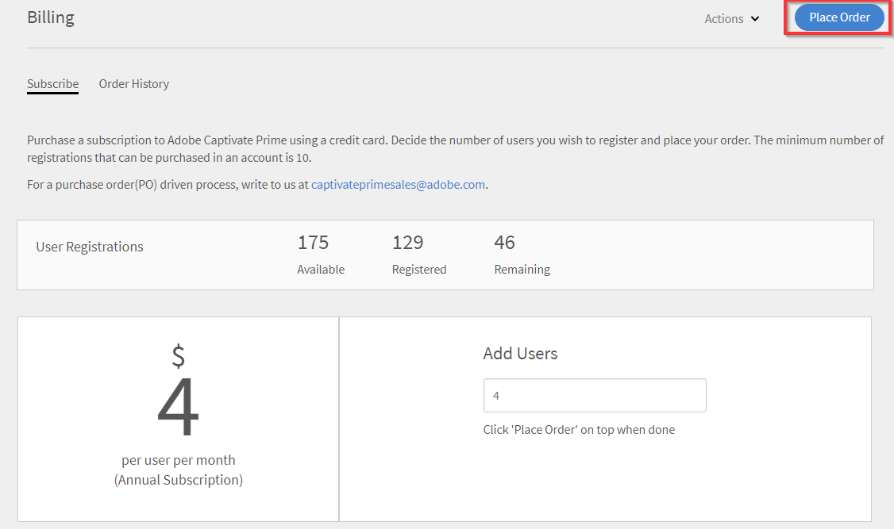

1. 檢視螢幕上顯示的估算。

   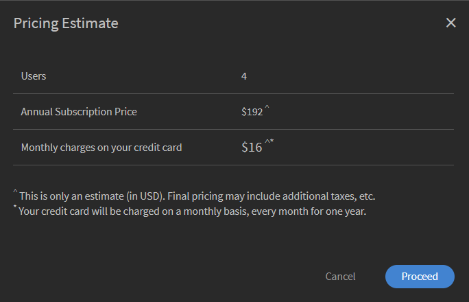

   *下訂單*

   年度訂閱費用是根據訂閱新增的使用者數量計算。 例如，若新增四位使用者，年費會使用表達式 4 usersX$4X$12 計算，回傳 $192。

   點擊 **[!UICONTROL Proceed]**。

   *檢視估算*

1. 在付款詳情頁面，您可以查看訂單的預估價格。 貨幣會根據目前的地區設定而顯示。

   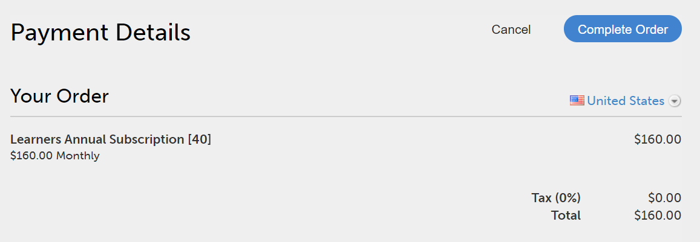

   *查看付款詳情*

   您也可以從下拉選單中選擇國家來變更地區設定。

   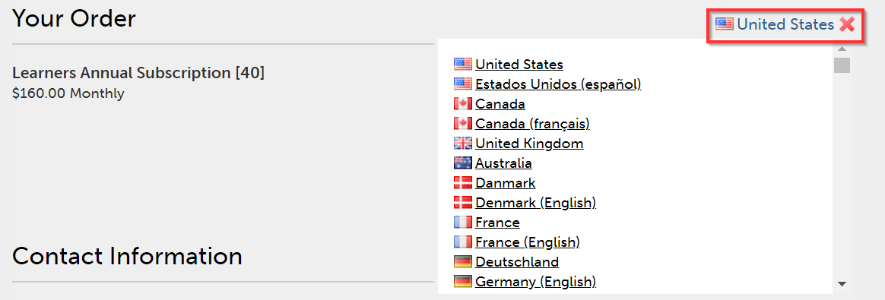

   *選擇帳單國家*

1. 輸入您的聯絡資訊，選擇信用卡類型，並提供信用卡的詳細資訊。 輸入所需資料後，請點擊 **[!UICONTROL Complete Order]**。
1. 下訂單後，若要查看最近訂購的包裹，請點擊頁面上的&#x200B;**[!UICONTROL Billing]**&#x200B;標籤&#x200B;**[!UICONTROL Order History]**。

   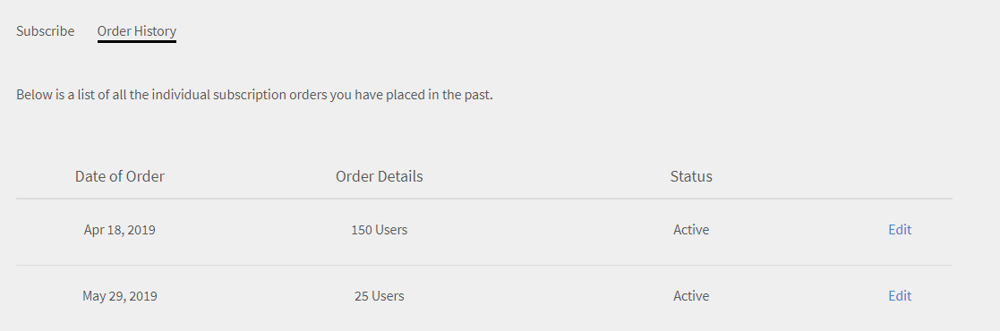

   *查看訂單歷史*

## 查詢訂單狀態 {#checkorderstatus}

所有訂單都可能具有以下四種狀態之一：

**啟用：** 訂單已生效，且使用者已成功註冊。

**暫停：** 訂單在以下情況下進入暫停狀態：

- 信用卡付款延遲
- 信用卡到期了。
- 任何定期付款週期均拒絕付款。

**已啟動取消：** 當 Learning Manager 管理員停用帳戶時，訂單會進入此狀態。 收到訂單取消確認後，訂單會進入取消狀態。

## 更新訂閱詳情 {#updatesubscriptiondetails}

1. 在訂單清單中，按一下 **[!UICONTROL Edit]**。

   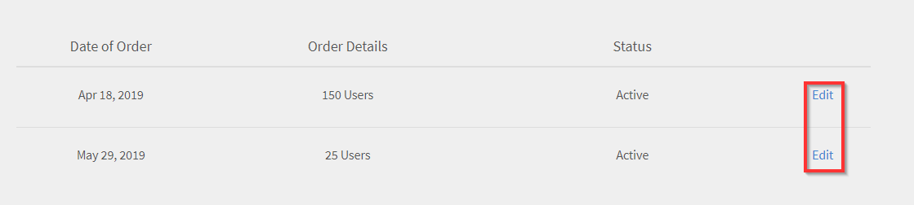

   *更新訂閱詳情*

1. 在訂閱詳細資料頁面，按一下 **[!UICONTROL Edit Subscription]**。
1. 選擇您想要編輯的項目：

   - 付款方式：使用此選項更新付款資料，例如信用卡。
   - 地址：使用此選項更新地址詳細資訊。

## 取消訂閱 {#cancelasubscription}

取消訂單的方法如下：

1. 在系統管理員頁面左側窗格中，點選「帳單」。
1. 在「帳單」頁面右上角，選擇 **[!UICONTROL Actions]** 「> **[!UICONTROL Deactivate Account]**」。
1. 一旦管理員停用帳戶，帳戶內所有現有訂單將從下一個帳單週期取消。

當帳戶被客戶停用時，該帳戶會進入接下來 30 天的試用狀態。 帳戶持有人會收到三封提醒電子郵件，以協助恢復帳戶。 如果擁有者未重新啟用帳戶，除了擁有者之外，其他使用者都無法存取 Learning Manager。

## 使用採購訂單下訂單 {#placeordersusingpurchaseorder}

您可以選擇採購訂單流程作為替代付款方式。 作為先決條件，您的組織帳戶必須在 Adobe 註冊。 您的組織帳戶將為此流程收費。 帳戶的收費依據學習者的活動而定。 只有學習物件層級的活動才會被收費。 使用 PO 下訂單的方法如下：

1. 寄電子郵件給 [learningmanagersales@adobe.com](mailto:learningmanagersales@adobe.com) ，並說明所需學習人數。
1. Learning Manager 團隊會寄送一組啟用金鑰給您。
1. 在管理員應用程式的「計費」頁面中，輸入啟用金鑰。
1. 點擊頁面右上角的「啟用」。

## 查詢帳戶狀態 {#checkaccountstatus}

帳戶啟用後，該帳戶可能處於以下任一狀態：

- **試用版** - 您可以建立 Adobe Learning Manager 帳戶，並在 30 天內免費使用。 試用期間註冊的學習者人數沒有限制。
- **啟用** 中 - 此狀態下，帳戶擁有有效學習者訂閱，並依訂閱訂單每月定期付款。
- **非啟用** - 帳戶在以下情況下會進入非啟用狀態：

  - 試用期結束後，若帳戶中沒有有效的訂閱訂單。
  - 管理員會停用該帳戶，導致下次訂閱帳單週期中帳戶內所有現有訂單被取消。
  - 即使有提醒，帳戶內的有效訂單仍會被拒絕付款。

非活躍狀態不會立即取消您的帳戶。 你會收到至少幾次來自 Learning Manager 團隊的提醒，要求你提供信用卡的最新資訊（如果信用卡已過期）。 在非啟用狀態下，只有管理員可以登入 Adobe Learning Manager 帳戶。 其他所有使用者無法存取該帳戶。

- **需要** 啟用 - 當 Learning Manager 管理員選擇停用該帳戶時，您的帳戶會進入此狀態。 這個帳戶的所有訂單都會被取消。 這些訂單的付款不會從下一個計費週期開始進行。 帳戶狀態會維持此狀態直到最後一次帳單週期當天。 在此狀態下，所有使用者可繼續使用應用程式，且不會受到任何影響，直到最後一次定期付款日期結束。

## 取消訂閱 {#Cancelasubscription-1}

若要取消有效訂閱，請聯絡 Learning Manager 支援團隊。

## 帳戶終止費 {#accountterminationfee}

若您想在年度期限結束前取消訂閱，將收取提前終止費用。 終止費相當於剩餘承諾期間訂閱價格的50%。

## 每月活躍用戶（MAU）方案 {#monthlyactiveusersmauplan}

您可以選擇 MAU 方案作為您偏好的帳單方式。 此選項會根據每月獨立活躍使用者數產生計費。 每月獨立活躍用戶數會從方案啟用月份起累積累積，持續 12 個月。 此號碼用於該期間的帳單。

請使用以下範例了解 MAU 是如何計算的。

假設每月使用者數如下：

- 第 1 個月 = 50
- 第 2 個月 = 500
- 第 3 個月 = 5000
- 第4至12個月 = 10

計費的每月活躍用戶總數 = 第 1 月 + 第 2 月 + 第 3 月 + 第 4 到 12 月 = 50 + 500 + 90 = 5640。

該期間的計費將為 5640 名使用者計費。

在 12 個月期間結束時，使用次數會重置回零，並開始新的 MAU 方案期間。 您可以新增多個啟用金鑰以增加已購買的座位數量。

任何執行下列動作或因他人行動而完成的使用者，均視為該曆月的每月獨立活躍使用者。

- 參加課程、學習計畫或認證課程。
- 閱讀、下載工作輔助工具或課程附件。
- 瀏覽、下載或建立個人筆記。
- 透過建立討論區、貼文或留言參與社交學習。
- 透過外部證書提交的核准或出席課堂/虛擬教室課程而達成完成。

## 查看使用詳情 {#viewusagedetails}

1. 若要查看按月的活躍使用者數量，請點擊 **[!UICONTROL View Usage Details]**。

   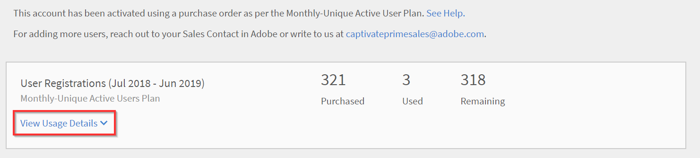

   *按月份查看活躍用戶*

1. 在顯示的頁面上，您可以檢視以下內容：

   - **整體使用情況：** 您可以查看活躍使用者總數、每月使用 Learning Manager 的使用者數，以及尚未報名任何課程的使用者人數。
   - **每月使用量：** 您可以查看每月獨立活躍使用者的表格。

## Live Hub 培訓時數 {#live-hub-training-hours}

Live Hub 包含在 Ultimate 訂閱方案中，且不需要另行購買 Live Hub 基礎授權或啟用。 Live Hub 的使用情況以訓練時數為單位，管理員可從 **帳單** 頁面追蹤。

### 訂閱方案訓練時數 {#subscription-plan-training-hours}

可用的 Live Hub 訓練時數取決於您的訂閱方案。

| 計畫 | 包含訓練時數 |
|---|---|
| 終極 | 無限。 使用情況仍會被記錄並顯示。 |
| 免費試用 | 整個試驗100小時。 試用期間餘額不會重置。 |

### Live Hub 工作階段限制 {#live-hub-session-limits}

終極方案提供相同的 Live Hub 功能與會話限制：

* 只有管理員、作者和講師可以啟動 Live Hub 課程。
* 與會者必須是經過 Adobe Learning Manager 驗證的使用者，無論是透過原生驗證或單一登入（SSO）。
* 一場療程可長達八小時。 您可以將療程延長兩次，每次 15 分鐘，最多延長 30 分鐘。

### 訓練時數的計算方式 {#how-training-hours-are-calculated}

訓練時數是根據 Live Hub 課程的排定時長計算，而非課程實際執行的時間。

計算訓練時數使用時，請考慮以下事項：

* 如果一個工作階段提前結束，則計算其完整的排程時長。
* 在預定開始時間前取消的會話不計入。 若您在課程開始後取消，即使沒有參加者加入，排定的時長仍會被計算。
* 每次重複工作階段的發生都會被單獨計算。
* 重複的會話會被視為獨立的工作階段。
* 如果您更改了已傳送工作階段的開始或結束時間並重複使用，該重複使用的工作階段將被視為獨立的事件。
* 分組討論室和延長課程不會增加訓練時數的使用。
* 透過其他連接器（例如 Zoom 或 Microsoft Teams）提供的課程，不會計入 Live Hub 的訓練時數。
* 如果您將預定課程移至不同的授權年度，該課程的訓練時數將計入該課程目前排定的授權年度。
* 訓練時數沒有四捨五入。 例如，一場 90 分鐘的課程就算作 1.5 小時的訓練時間。

#### 跨越多天的會話 {#sessions-spanning-multiple-days}

若課程涵蓋超過一天，每段完整的24小時訓練時間計作 **八小時**&#x200B;訓練。 剩餘時間依實際長度計算，最多八小時。

例如：

* 一場分兩天進行的 30 小時訓練，合計 14 小時，前 24 小時計 8 小時，其餘 6 小時。
* 一場分兩天進行的 10 小時課程，合計計作八小時的訓練。

### 查看您的 Live Hub 使用情況 {#view-live-hub-usage}

1. 以管理員身份登入 Adobe Learning Manager。
1. 選擇&#x200B;**「帳單」。**
1. 在訂閱標籤中導覽至&#x200B;**授權****。**
1. 選擇 **「檢視使用詳情**」。

   **「使用詳情**」區段會出現。

   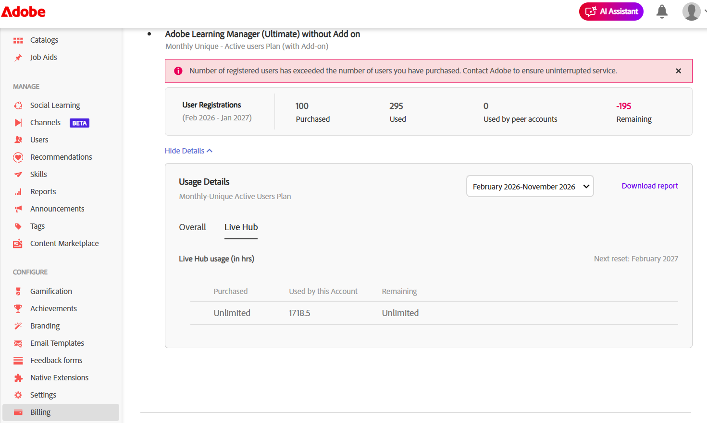

1. 選取 **Live Hub** 標籤。

   **Live Hub 使用情況（以小時計）**&#x200B;區塊顯示以下內容：

   | 場地 | 說明 |
   |---|---|
   | **已購買** | 帳戶可獲得的訓練時數，對終極會員而言是無限的。 |
   | **本帳戶所使用** | 目前的訓練時數已計入目前的執照期間。 |
   | **剩餘** | 訓練時數還剩。 顯示終極帳號的無限。 |
   | **下一次重置** | 餘額重置的日期，適用於下一個授權年度。 |

### 當所有訓練時數都被使用時 {#when-all-training-hours-are-used}

達到可用的訓練時數限制並不會阻止你使用 Live Hub。 免費試用帳號在完成 100 小時訓練後，仍可繼續使用 Live Hub。

* **管理員：**&#x200B;帳單&#x200B;**頁面會顯示**&#x200B;過度使用警告，並同時顯示其他授權警告。
* **作者：** 排程 Live Hub 課程時不會出現訓練時數警告。
* **Ultimate 帳號：** 不會出現過度使用警告，因為訓練時數無限。
* **MAU 父帳戶與子帳戶：** 父帳戶層級會顯示單一警告。 請參閱 [MAU 父帳戶及子帳戶](#mau-parent-and-sub-accounts) 以取得更多資訊。

如需購買額外訓練時數，請聯絡 learningmanagersales@adobe.com。

### MAU 父帳戶與子帳戶 {#mau-parent-and-sub-accounts}

對於已建立父/子帳戶關係的每月活躍用戶（MAU）帳戶，其子帳戶可使用該母帳戶全部 Live Hub 訓練時數的權利。 這個共享時數池包含家長包含的訓練時數以及任何購買的額外時數。 兒童帳號不會獲得獨立的 Live Hub 時數分配或上限。

家長帳戶及其 MAU 子帳戶所使用的 Live Hub 時數，會從同一個家長帳戶池中扣除。 家長的帳單&#x200B;**頁面會**&#x200B;顯示合併的權利、消耗量、剩餘工時，以及各子帳戶的使用量。請參閱 [「同儕帳戶](../feature-summary/peer-account.md) 」以取得更多資訊。

## 下載使用報告 {#downloadusagereport}

您也可以下載按月份和年度分類的活躍用戶數資料。 若要下載，請點擊 **[!UICONTROL Download Detailed Report]**。

在「產生報告請求&#x200B;**」對話框中**，輸入所需的月份與年份，然後點擊 **[!UICONTROL Generate]**。

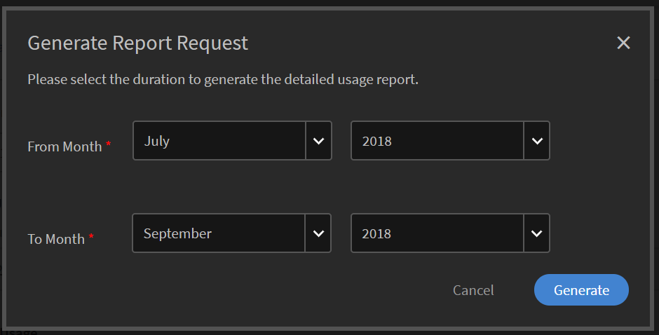

*下載活躍使用報告*

如果您關閉瀏覽器視窗，下載會在您下次造訪 Learning Manager 時開始。

報告會儲存在瀏覽器的下載資料夾中。

## 取消訂閱

若要取消有效訂閱，請聯絡 Learning Manager 支援團隊。

<!--
## Gen AI credits {#genaicredits}

### How Gen AI credits work

Gen AI credits are consumed each time a learner interacts with an AI-powered feature — for example, when asking a question through the AI Assistant or generating a personalized learning recommendation. Before each interaction begins, Adobe Learning Manager checks that credits are available. If credits are available, the interaction proceeds. If the balance has been exhausted, the learner sees a message that the feature is temporarily unavailable.

Credits are purchased as part of an Adobe Experience Platform Agent Orchestrator license. That license is managed in your Adobe Admin Console, and Adobe Learning Manager connects to it automatically to detect available credits.

**Credit priority rule:** If your Adobe Learning Manager plan includes bundled Gen AI credits and you also have an Agent Orchestrator license, the bundled credits are consumed first. Agent Orchestrator credits are used only after the bundled credits are exhausted.

**Shared credit pools:** If your organization has multiple Adobe Learning Manager accounts all linked to the same Adobe Admin Console organization, all accounts draw from a single shared credit pool.

>[!IMPORTANT]
>
>All Gen AI features are turned off by default. You must enable each feature and set a credit usage limit before learners can access it.

### Access the Gen AI Credits tab

1. Select **[!UICONTROL Admin]** > **[!UICONTROL Billing]**.
2. Select the **[!UICONTROL Credits]** tab.

The **Credits** tab is visible only when Gen AI credits have been purchased or were historically active on the account. If the tab is not visible, verify that your account is linked to an Adobe Admin Console organization that has an active Agent Orchestrator license.

### Gen AI Features table

The **Gen AI Features** table lists every AI feature available on the account.

| Column | Description |
|---|---|
| **Feature Name** | Name of the AI feature. Select the name to go to that feature's settings page. |
| **Status** | Whether the feature is on or off. Toggle the feature from its settings page. |
| **Max Credits Usage Limit** | Maximum credits this feature can consume during the contract period. Must be set before the feature can be enabled. Applies to learner-facing features only. |
| **Credits Used** | Total credits consumed by this feature since the contract start date, updated in real time. |

### Enable a Gen AI feature

1. On the **[!UICONTROL Credits]** tab, locate the feature in the **Gen AI Features** table.
2. In the **Max Credits Usage Limit** column, enter the maximum number of credits this feature can consume during the contract period.
3. Select the feature name to go to its **Feature Settings** page.
4. On the **Feature Settings** page, toggle the feature on.
5. Complete any additional configuration, such as assigning learners and catalogs to the AI Assistant.

### What happens when credits run out

- If a feature reaches its **Max Credits Usage Limit**, learners see a message that the feature is temporarily unavailable. Raise the limit at any time from the **Credits** tab.
- If overall account credits are exhausted, all Gen AI features stop working for learners until additional credits are purchased. Usage reports and credit metrics remain accessible to admins.
- If a learner is mid-interaction when credits are exhausted, that interaction completes. All subsequent interactions are blocked.
- Admins can set a credit limit higher than the number of purchased credits. Over-allocation is permitted, and a true-up can happen at renewal.

### Monthly Credits Usage chart

Below the Gen AI Features table, a **Monthly Credits Usage** chart shows credits consumed per feature per month. By default, the chart shows the current contract year period based on the Agent Orchestrator contract start date. Select **[!UICONTROL Download]** to export the monthly report for the selected period. Report generation is asynchronous — you receive an in-app notification and email when the file is ready.

### Gen AI usage reports

Adobe Learning Manager provides two Gen AI usage reports under **[!UICONTROL Reports]** > **[!UICONTROL AI Reports]**.

**Monthly credits usage report**

Shows credits consumed per feature per month. Useful for budget planning and contract renewal.

- **Columns:** Month | Feature | Credits Used
- **Filter:** Select a date range spanning one or more contract periods
- **Download:** Asynchronous — you receive an in-app notification and email when the file is ready

**Learner Gen AI credits usage report**

An audit trail showing which learners used which features and how many credits each interaction consumed.

- **Columns:** Date | Learner Name | Learner Email | Feature | Credits Used
- **Filter:** Select the date range you want to audit
- **Download:** Asynchronous — you receive an in-app notification and email when the file is ready

### Credit usage alerts

Adobe Learning Manager automatically notifies you when credit consumption crosses key thresholds. Notifications are delivered both in-app and by email.

| Trigger | Notification |
|---|---|
| Account credits reach 90% of total purchased | Warning — credits are nearly exhausted at the account level |
| Account credits reach 100% of total purchased | Alert — all credits are consumed and Gen AI features stop for learners |
| A feature reaches its individual Max Credits Usage Limit | Alert — names the specific feature; that feature stops for learners |

When you receive a 90% warning, contact your Adobe account team to purchase additional credits before the 100% threshold is reached.
-->

## 常見問題 {#frequentlyaskedquestions}

**如何從帳戶新增或移除訂閱？**

若要在帳戶中新增訂閱，請為您希望購買訂閱的使用者數量加入。 然後在右上角點擊 **[!UICONTROL Place Order]**。 檢視估算並點擊 **[!UICONTROL Proceed]**。 請輸入您的帳戶資料以及信用卡資料。 接著若要購買訂閱，請點擊 **[!UICONTROL Complete Order]**。

若要移除有效訂閱，請聯絡 Learning Manager 支援團隊。

**如何為訂閱卡更換信用卡？**

在標籤中 **[!UICONTROL Order History]** ，對於一個啟用中的帳戶，點選 **[!UICONTROL Edit]**。 然後在訂閱詳細資料頁面，點擊 **[!UICONTROL Edit Subscription]**。 輸入您的新信用卡資料並點擊 **[!UICONTROL Update Payment Method]**。

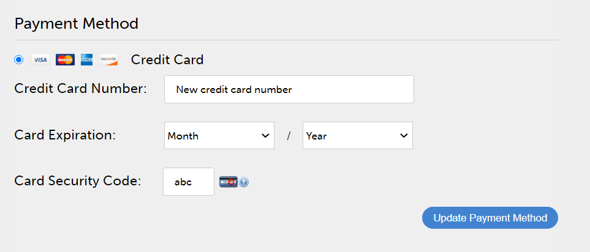

*查看信用卡資料*

**如何在 Learning Manager 上更新帳單資訊？**

若要更新帳單資訊，請依照以下步驟操作：

1. 以管理員身份登入&#x200B;**並點擊&#x200B;**[!UICONTROL Billing]**。**
1. 在訂單清單中，按一下 **[!UICONTROL Edit]**。
1. 在訂閱詳細資料頁面，按一下 **[!UICONTROL Edit Subscription]**。

選擇您想要編輯的項目：

1. **[!UICONTROL Payment method]：** 使用此選項可更新付款資料，例如信用卡。
1. **[!UICONTROL Address]：** 使用此選項以更新地址詳細資訊。

**我可以部分取消訂閱嗎？**

不，您無法部分取消訂閱。 如果您需要減少已購買的座位數，可以在計費週期結束時取消訂閱，然後再購買所需的座位數量。

**我要如何取得信用卡付款的發票？**

聯絡 [FastSpring](https://fastspring.com/) 以取得付款的發票，方式如下：

- 使用 FastSpring 建立服務請求，使用連結 `https://questionacharge.com`。
- 在申請發票時 `orders@fastspring.com` ，請寄電子郵件給 FastSpring。

**Live Hub 授權是否適用於 Prime 客戶？**

沒有。 Live Hub 目前正處於 Prime 帳戶的測試階段，因此在測試期間，Prime 客戶不適用訓練時數的授權與使用追蹤。 這些要求將在 Live Hub 結束 Beta 後適用於 Prime 帳戶。 對於 Ultimate 帳戶，可包含訓練時數授權及使用追蹤。

**我需要另外購買 Live Hub 嗎？**

沒有。 Live Hub 包含在 Ultimate 訂閱方案中，且不需要另外啟用。 終極方案包含無限訓練時數。

**取消的 Live Hub 課程會計入我的訓練時數嗎？**

這取決於你什麼時候取消課程。 在預定開始時間前取消的會話不計入。 如果你在場次開始後取消，即使沒有參加者加入，也會計算該場次的完整排定時長。

**當我用完所有 Live Hub 訓練時數時數，會發生什麼事？**

在你用完所有訓練時數後，Live Hub 仍然可用。 免費試用帳號仍可持續安排並執行 Live Hub 課程。 管理員會在帳單&#x200B;**頁面看到過度使用警告**。如需購買額外訓練時數，請聯絡 learningmanagersales@adobe.com。

**未使用的訓練時數或額外時數會累積嗎？**

沒有。 未使用的包含訓練時數不會累積到下一個執照年度。 額外訓練時數也會在您基礎方案目前授權期間結束時到期。

**我可以用信用卡購買訓練時數附加服務嗎？**

沒有。 培訓時數附加元件僅可透過 Adobe 銷售部門取得。 如需購買額外訓練時數，請聯絡 learningmanagersales@adobe.com。

**Live Hub 提供多少額外訓練時數？**

您目前無法購買額外的培訓時數。

**MAU 子帳號可以使用其父帳號的 Live Hub 訓練時數嗎？**

是的。 MAU 子帳戶會共用父帳戶的 Live Hub 訓練時數池。 每個子帳戶可在無需獨立分配的情況下存取整個可用池。 子帳戶所消耗的訓練時數會從父帳戶的共享餘額中扣除。

<!--
## Troubleshoot Gen AI credit issues

| Issue | Solution |
|---|---|
| **Credits tab is not visible** | Gen AI credits have not been purchased or applied to this account. Verify your Agent Orchestrator license in your Adobe Admin Console, then confirm an organization is linked under **[!UICONTROL Billing]** > **[!UICONTROL Subscription]** > **Account details**. |
| **IMS Org ID field is blank** | Your account is not yet linked. Select **[!UICONTROL Link IMS Org]** in the **Account details** card and follow the linking steps above. |
| **Linking fails with an error** | Confirm that you have the Administrator role in both Adobe Learning Manager and the Adobe Admin Console organization you are trying to link. Both checks must pass for the link to be established. |
| **IMS Org ID field is blank after applying an activation key** | Automatic linking occurs only for accounts activated through Adobe's standard ordering flow. For independently set-up accounts, complete the manual linking steps above after activating the key. |
| **After unlinking, Gen AI features are unavailable** | Unlinking removes access to all Gen AI features and hides the Credits tab. Re-link your account to an Adobe Admin Console organization with an active Agent Orchestrator license to restore access. |
-->

<!-- 
# Manage Learning Manager orders and billing

Credit card-based purchase is only available in the [US region](http://learningmanager.adobe.com/).

Manage Learning Manager billing, place orders by using a credit card, subscribe using a Purchase Order, or via a Monthly Active Users plan.

Adobe Learning Manager has a flexible, customer-friendly, and one of the best pricing models to cater to your organization needs. For more information, see the [Learning Manager](https://www.adobe.com/products/learningmanager.html) page.

Only the Administrators of your organization can manage billing.

If you want to contact Adobe for more information about Learning Manager subscription and billing, write to us at [learningmanagersales@adobe.com](mailto:learningmanagersales@adobe.com).

## Place orders using credit cards {#placeordersusingcreditcards}

You can buy a subscription for a maximum of 3500 learners through any single credit card payment order. The first order in the account must be for a minimum of 10 learners.

1. On the Administrator app, click **[!UICONTROL Billing]** on the left navigation pane.

   

   *Launch Adobe Learning Manager billing*

1. On the **[!UICONTROL Billing Information]** page, add the number of users in the **[!UICONTROL Add Users]** field. When using a credit card for pre-paid subscriptions, you can see the number of users that you can add for the subscription. The number of users you can add must not exceed the number mentioned in the section Remaining.1. 

   

   *Add number of users*

1. After specifying the number of users to add, click Place Order in the upper-right corner of the page.

   

1. Review the estimate that appears on the screen.

   

   *Place an order*

   The annual subscription fee is calculated based on the number of users who are added for the subscription. For example, if four users are being added, the annual fee is calculated using the expression 4 usersX$4X$12, which returns $192.

   Click **[!UICONTROL Proceed]**.

   *Review the estimate*

1. On the Payment Details page, you can view the estimated price of the order. The currency appears based on the current locale.

   

   *View payment details*

   You can also change the locale by choosing the country from the drop-down list.

   

   *Select the country of billing*

1. Enter your contact information, choose the credit card type, and provide the details of the credit card. After you've entered the required details, click **[!UICONTROL Complete Order]**.
1. After you've placed the order, to see the recently ordered packages, click the **[!UICONTROL Order History]** tab on the **[!UICONTROL Billing]** page.

   

   *View order history*

## Check order status {#checkorderstatus}

All orders can have one of the four statuses:

**Active:** An order is active, and users are registered successfully.

**Suspended:** An order moves into suspended state in the following scenarios:

* Delay in receipt of payment from the credit card
* Expiry of the credit card.
* Payment is declined for any recurring payment cycle.

**Canceled initiated:** An order moves into this state when the Learning Manager Administrator deactivates the account. The order then moves into a canceled state after receiving the cancellation confirmation of the order.

## Update subscription details {#updatesubscriptiondetails}

1. In the list of orders, click **[!UICONTROL Edit]**.

   

   *Update subscription details*

1. In the Subscription details page, click **[!UICONTROL Edit Subscription]**.
1. Choose the item that you want to edit:

   * Payment method: Use this option to update payment details, such as, credit card.
   * Address: Use this option to update address details.

## Cancel a subscription {#cancelasubscription}

To cancel an order:

1. In the left pane of the Administrator page, click Billing.
1. In the Billing page, on the upper-right corner, choose **[!UICONTROL Actions]** > **[!UICONTROL Deactivate Account]**.
1. Once the Administrator deactivates the account, all existing orders in the account are canceled from the next billing cycle.

When an account is deactivated by the customer, it enters a trial state for the next 30 days. The account owner receives three reminder emails to revive the account. If the owner does not reactivate the account, none of the users are able to access Learning Manager apart from the owner.

## Place orders using Purchase Order {#placeordersusingpurchaseorder}

You can choose purchase order process as an alternative mode of payment. As a pre-requisite, your organization's account must be registered with Adobe. Your organization account is charged for this process. The account is charged based on a learner's activities. Only Learning Object-level activities are charged. To place an order using PO:

1. Send an email to [learningmanagersales@adobe.com](mailto:learningmanagersales@adobe.com) and mention the number of required learners.
1. The Learning Manager team sends you an activation key.
1. In the Billing page of the Administrator app, enter the activation key.
1. Click Activate in the upper-right corner of the page.

## Check account status {#checkaccountstatus}

After an account gets activated, the account can be in any of the following states:

* **Trial** - You can create an Adobe Learning Manager account and use it without any payment for a period of 30 days. There is no limit on the number of learners registered during the trial period.
* **Active** - In this state, the account has active learner subscriptions with recurring monthly payment as per the subscription order.
* **Inactive** - An account moves into inactive state in the following scenarios:

  * After the trial period if there are no active subscription orders in the account.
  * Administrator deactivates the account, which results in canceling all the existing orders in an account from the next billing cycle of subscription.
  * Payment is declined for active orders in an account even after reminders.

An inactive state does not cancel your account with immediate effect. You receive at least a couple of reminders from the Learning Manager team asking you to provide the latest information about

your credit card if it has expired. In an inactive state, only an administrator can log in to the Captivate

Learning Manager account. All other users cannot access the account.

* **Activation required** - Your account moves into this state when the Learning Manager administrator chooses to deactivate the account. All the orders of this account get canceled. The collection of payment for these orders does not happen from the next billing cycle. The status of the account remains in this state until the day of the last billing cycle. In this state, all users can continue to use the application without any impact until the end of the last recurring payment date.

## Cancel a subscription {#Cancelasubscription-1}

To cancel an active subscription, contact the Learning Manager support team.

## Account termination fee {#accountterminationfee}

If you want to cancel the subscription before the completion of the annual term, an early termination fee is charged. The termination fee is equivalent to 50% of the subscription price of the remaining commitment period.

## Monthly Active Users (MAU) plan {#monthlyactiveusersmauplan}

You can choose a MAU plan as your preferred way of billing. This option generates billing based on the number of monthly unique active users. The monthly unique active users are added cumulatively for a period of 12 months starting from the month of plan activation. This number is used for billing for the period.

Use the following example to understand how MAU is calculated.

Let there be a case where the number of users per month are as follows:

* Month 1 = 50
* Month 2 = 500
* Month 3 = 5000
* Month 4 to 12 = 10

Total Monthly Active Users that are billed = Month 1 + Month 2 + Month 3 + Month 4 to 12 = 50 + 500 + 5000 + 90 = 5640.

The billing for the period would be for 5640 users.

At the end of the 12-month period, the usage count is reset back to zero and a new period for MAU plan starts. You can add multiple activation keys to increase the purchased number of seats.

Any user who performs the following actions or achieves completions due to actions taken by others is considered as a monthly unique active user for that calendar month.

* Consuming a course, learning program or certification.
* Consuming, downloading a Job Aid or course attachments.
* Consuming, downloading or creating personal notes.
* Participating in Social Learning by creating Boards, posts or comments.
* Achieving completions due to External Certificate submission approvals or attendance for a classroom/virtual classroom sessions.

## View usage details {#viewusagedetails}

1. To view the number of active users by month, click **[!UICONTROL View Usage Details]**.

   

   *View active users by month*

1. On the page that displays, you can view the following:

   * **Overall usage:** You can check the total number of active users, users who are consuming Learning Manager in a month, and the number of users who have not yet signed up for any course.

   * **Monthly usage:** You can see a table of unique active users per month.

## Download usage report {#downloadusagereport}

You can also download the data of the number of active users by month and year. To download, click **[!UICONTROL Download Detailed Report]**.

On the **Generate Report Request** dialog, enter the required months and year, and click **[!UICONTROL Generate]**.

*Download active usage report*

If you close the browser window, the download starts the next time you visit Learning Manager.

The reports are saved in the Downloads folder of your browser.

## Cancel a subscription

To cancel an active subscription, contact the Learning Manager support team.

## Frequently Asked Questions {#frequentlyaskedquestions}

+++How to add/remove subscriptions from an account?

To add subscriptions in an account, add the number of users for who you'd like to purchase subscriptions. Then on the upper-right corner, click **[!UICONTROL Place Order]**. Review the estimate and click **[!UICONTROL Proceed]**. Enter your account details and also your credit card details. Then to purchase the subscriptions, click **[!UICONTROL Complete Order]**.

To remove an active subscription, contact the Learning Manager support team.
+++

+++How to change a credit card for subscriptions?

In the **[!UICONTROL Order History]** tab, for an active account, click **[!UICONTROL Edit]**. Then on the Subscription Details page, click **[!UICONTROL Edit Subscription]**. Enter your new credit card details and click **[!UICONTROL Update Payment Method]**.

*View credit card details*
+++

+++How to update the Billing information on Learning Manager?

To update the billing information, follow the steps below:

1. Log in as **Admin** and click **[!UICONTROL Billing]**.
1. In the list of orders, click **[!UICONTROL Edit]**.
1. In the Subscription details page, click **[!UICONTROL Edit Subscription]**.

Choose the item that you want to edit:

1. **[!UICONTROL Payment method]:** Use this option to update payment details, such as, credit card.
1. **[!UICONTROL Address]:** Use this option to update address details.
+++

+++Can I partially cancel a subscription?

No, you cannot cancel a subscription partially. If you need to reduce the number of seats that you have purchased, you can cancel the subscription at the end of the billing cycle and then purchase the number of seats required.
+++

+++How do I get an Invoice for my Credit card payments?

Contact [FastSpring](https://fastspring.com/) to get an invoice for your payments, using one of the following ways:

* Create a service request with FastSpring using the link `https://questionacharge.com`.
* Send an email to FastSpring on `orders@fastspring.com` requesting for the invoice.
-->
