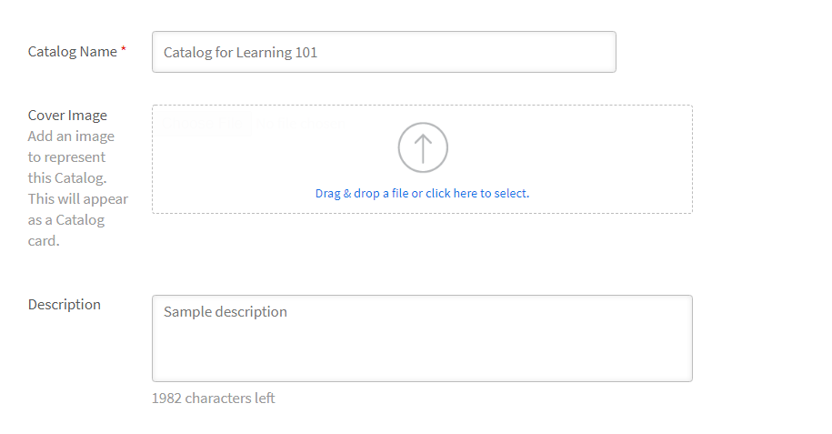
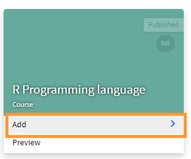
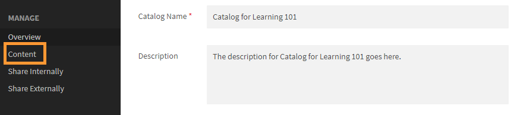
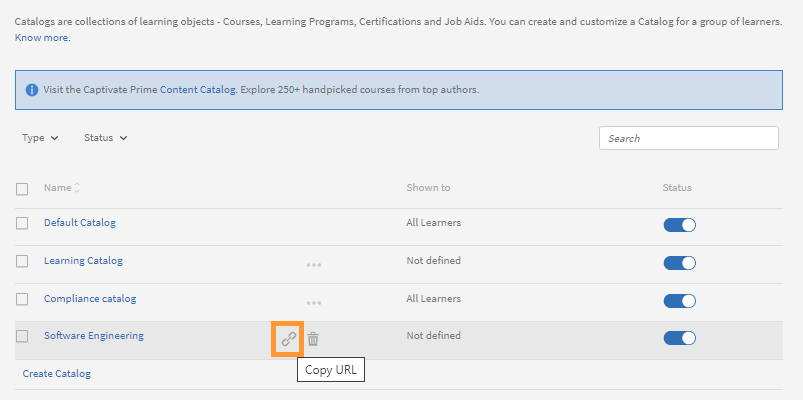
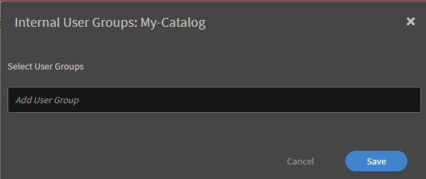
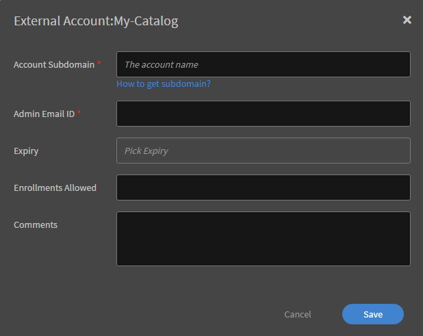
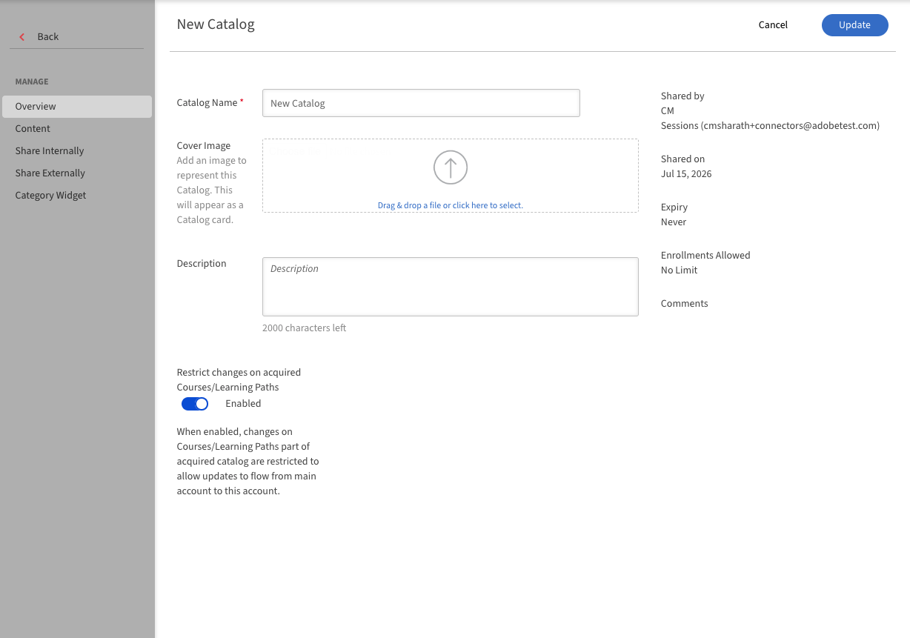

# 型錄

目錄是學習內容的集合——課程、學習計畫和認證。 使用目錄為學習者提供自訂學習資源。 您可以在建立新目錄時將學習與目錄關聯。

作為管理員，您可以建立自訂目錄，讓您在帳戶內或跨帳戶中，讓不同學習者能使用選擇性課程。

## 目錄導論

在本訓練中，您將學習如何建立和管理目錄。

如果您無法啟動訓練，請寫入 <almacademy@adobe.com>。

## 搜尋目錄 {#search-catalogs}

目錄搜尋會依相關性對結果進行排名。 與您的搜尋詞完全匹配的關鍵字會出現在列表頂端，接著是下一個最接近的匹配。 這能幫助你在不捲動冗長相似名稱清單的情況下，找到你想要的目錄。

### 關於基於相關性的目錄搜尋

目錄搜尋會依相關性由高至低回傳結果。 它採用與其他 Adobe Learning Manager 搜尋體驗中已為學習者與管理員提供相同的搜尋排名與詞語匹配方式。

在 2026 年 12 月推出 Adobe Learning Manager 之前，搜尋結果並非依相關性排序。 如果您的帳戶中有許多名稱相似的目錄，例如共用前綴後接日期、月份或 ID，您想要的目錄可能會排在清單後面很後面。

透過相關性導向搜尋：

* 與您的搜尋詞完全匹配的字詞會先顯示。
* 下一個最接近的匹配會排在第二。
* 其餘結果依相關性由高至低排列。

### 搜尋目錄

1. 以管理員身分登入 Adobe Learning Manager。

1. 在左側導覽窗格中選擇&#x200B;**「目錄」。**

1. 在搜尋框中輸入目錄名稱或其部分名稱。

檢視結果。 最接近的匹配會顯示在清單的最上方。 從清單中選擇所需的目錄。

### 範例搜尋結果

假設你的帳戶包含名稱只差幾個字元的目錄。 下表顯示搜尋 March 5 這個詞時，結果的排序方式。

| 搜尋關鍵字 | 成績排名 | 比賽類型 |
|---|---|---|
| 3月5日 | 首先 | 完全匹配 |
| March 5 之後還有其他角色，例如 March 52 | 第二 | 下一個最接近的匹配 |
| 其他包含類似文字的目錄 | 在最接近的比賽之後 | 較低相關性 |

如果你搜尋 March 52，標題為 March 52 的目錄會先出現，接著是下一個最接近的匹配項目。

若您的組織管理數百甚至數千個目錄，相關性導向搜尋最為有用。 它幫助你：

* 無需捲動或手動搜尋，即可找到特定目錄。
* 區分具有常見命名模式的型錄。
* 取得與其他 Adobe Learning Manager 搜尋體驗一致的搜尋行為。

## 建立目錄 {#createacatalog}

要建立目錄，請執行以下步驟：

1. 作為管理員，在左側窗格點選「目錄」。 在此頁面上，有一個預設目錄，當您建立 Learning Manager 帳戶時會自動建立。 預設情況下，此目錄中的所有學習物件都會與所有學習者共享。
1. 若要建立目錄，請在頁面右上角點擊 **[!UICONTROL Create]**。 您也可以選擇點擊 **[!UICONTROL Create Catalog]**&#x200B;位於目錄清單下方的 。
1. 在頁面 **[!UICONTROL Create Catalog]** 上，輸入您想要建立的目錄名稱與描述。

   

   若要繼續，請點擊 **[!UICONTROL Next]**。

   縮圖只能在沉浸式介面中查看，無法在經典介面中查看。

1. 在目錄頁面，您可以在新目錄中新增以下項目：

   * [課程](catalogs.md#course)
   * [學習計畫](catalogs.md#lp)
   * [認證](catalogs.md#cert)
   * [工作輔助工具](catalogs.md#job)

## 將課程新增至目錄 {#course}

1. 從課程清單中選擇您想新增至目錄的課程。

   

   *建立目錄*

   您可以將多個課程加入目錄。
1. 你可以依技能、角色和語言篩選課程。 所選課程將推薦給對相關技能與角色有興趣的學習者。

   * **[!UICONTROL Skills]**：技能篩選功能讓使用者能找到專注於特定技能的課程。
   * **[!UICONTROL Roles]**： 角色篩選器協助使用者存取符合不同角色職責與需求的課程。
   * **[!UICONTROL Language]**：語言篩選器協助使用者選擇以偏好或必修語言提供的課程

1. 儲存變更。 回到目錄清單，並點選清單中的新目錄。
1. 在新目錄的頁面左側窗格中，按一下 **[!UICONTROL Content]**。

   

   *選擇一門課程以新增至目錄*

   您新增的課程會顯示在標籤 **[!UICONTROL Courses]** 中。

## 將學習計畫新增至目錄 {#lp}

1. 從學習程式清單中選擇您想要新增至目錄的學習程式。
1. 儲存變更。 回到目錄清單，並點選清單中的新目錄。
1. 在新目錄的頁面左側窗格中，按一下 **[!UICONTROL Content]**。

   您新增的學習計畫會顯示在標籤中 **[!UICONTROL Learning Programs]** 。

## 將認證新增至目錄 {#cert}

1. 從「認證」清單中選擇您想新增至目錄的一項認證。
1. 儲存變更。 回到目錄清單，並點選清單中的新目錄。
1. 在新目錄的頁面左側窗格中，按一下 **[!UICONTROL Content]**。

   您新增的認證會顯示在標籤 **[!UICONTROL Certifications]** 中。

## 將工作輔助資料新增至目錄 {#job}

1. 從工作輔助工具清單中選擇您想要新增至目錄的作業輔助工具。
1. 儲存變更。 回到目錄清單，並點選清單中的新目錄。
1. 在新目錄的頁面左側窗格中，按一下 **[!UICONTROL Content]**。

   您新增的作業輔助工具會顯示在標籤中 **[!UICONTROL Job Aids]** 。

如果帳戶中已有內容，內容會顯示在這些標籤中。 否則，你必須先創造內容。 例如，如果您尚未在 Learning Manager 應用程式中新增任何課程或學習計畫，就必須先開始建立它們。

## 課程、學習路徑或工作輔助工具的批量移除

管理員或自訂管理員可以批量移除課程、學習路徑或工作輔助工具。 前往 **[!UICONTROL Catalogs]** 並選擇一個目錄。 在頁面 **[!UICONTROL Content]** 上，選擇 **[!UICONTROL Edit Content]**。 接著，在課程、學習路徑或工作輔助工具旁選擇 **[!UICONTROL Remove]** 選項，然後選擇 **[!UICONTROL Save]**。

## 學習者目錄深度連結 {#deep-link}

管理員可以為目錄產生一個深度連結，引導學習者前往特定的目錄頁面。

在頁面 **[!UICONTROL Catalogs]** 上，將滑鼠移至您深度連結的目錄上，然後點擊被高亮的圖示。

*為學習者建立深度連結*

## 啟用目錄 {#enablethecatalog}

建立目錄並新增學習物件後，若要讓學習者可見該目錄，必須啟用該目錄。

要啟用目錄，

1. 在目錄清單中，切換您想啟用的目錄附近的選項。 或者，您也可以勾選目錄旁的核取方塊，點擊 **[!UICONTROL Actions]** 右上角，然後點擊 **[!UICONTROL Enable]**。

1. 您也可以在清單中啟用多個目錄。 選取目錄，然後從 **[!UICONTROL Action]** 選單中選擇選項 **[!UICONTROL Enable]**。

## 停用目錄 {#disablethecatalog}

若要停用目錄，請關閉目錄附近的選項。

或者，您也可以勾選目錄旁的核取方塊，點擊右上角的「動作」，然後點擊 **[!UICONTROL Disable]**。

您也可以在清單中停用多個目錄。 選取目錄，然後從「動作」選單中選擇該選項 **[!UICONTROL Disable]**。

## 刪除目錄 {#deletethecatalog}

若要刪除目錄，請在清單中選取一個目錄。 點擊目錄旁的「刪除」按鈕或點擊 **[!UICONTROL Actions]** 「> **[!UICONTROL Delete]**」。

您也可以刪除多個目錄。

## 分享目錄 {#shared}

管理員可以與組織內部使用者或任何外部使用者分享目錄。 然而，分享是排他性的。 換句話說，內部共享的目錄無法與外部群組共享，反之亦然。

課程、學習計畫、工作輔助工具及認證是您想要分享的目錄中支援的學習物件。

### 分享目錄

本訓練將教您如何與內部使用者群組及外部 Adobe Learning Manager 帳戶分享目錄。

如果您無法啟動訓練，請寫入 <almacademy@adobe.com>。

## 在內部共享目錄 {#int}

選擇您想要內部共享的目錄。

在左側窗格中，按一下 **[!UICONTROL Share Internally]**。

如果沒有群組存在，您必須新增一個內部使用者群組。

若要新增內部使用者群組，請點選 **[!UICONTROL Add User Groups]**。

*在內部分享目錄*

沒有可用選項來啟用或停用共用使用者群組。 要停用，必須刪除使用者群組。 要刪除，將滑鼠移至三點上，然後點擊刪除圖示。 或者，點擊頁面右上角的「動作」下拉選單，然後點選「刪除」。

## 將目錄外部分享 {#ext}

在目錄頁面中，點選您想要分享的目錄。 在左側面板點擊 **[!UICONTROL Share Externally]**。

*外部分享目錄*

輸入與您的 Learning Manager 帳戶相關聯的子網域。 點擊 **[!UICONTROL How to get subdomain?]** 了解子網域的使用情況。 您也可以點擊 **[!UICONTROL Branding]** 系統管理員首頁左側窗格，查看與您組織帳戶相關聯的子網域。

**報名人數上限**

您可以在共用目錄中， **將每門課程的報名數量設定為「允許**&#x200B;報名次數」欄位。 共享目錄的接收者無法在學習計畫中使用報名限制的課程。

**到期**

您可以在欄位中設定到期日，以設定共用目錄的有效性 **[!UICONTROL Expiry]** 。 共享目錄到期後，課程不再允許報名。 現有學習者仍可存取內容。 學習道具會被淘汰，但徽章和技能仍然有效。 在此狀態下，共享目錄接收器無法將已退休的學習物件恢復退休。

在輸入所有必要資訊後點擊 **[!UICONTROL Save]** 。 點擊 **[!UICONTROL Actions]** 頁面右上角的下拉選單，然後點擊 **[!UICONTROL Share]** 與外部帳戶分享目錄。

共享帳戶持有人所擁有的目錄僅允許與外部帳戶共享。 您無法將其他帳戶已共享的目錄分享給您。

外部共用帳戶的管理員會在應用程式和電子郵件中收到通知。 收件人必須點擊電子郵件中提供的唯一網址，或點擊通知訊息並接受共享目錄請求。 在應用程式中，接收者可選擇點擊「接受」或「拒絕」。 在接受共享目錄前，接收者可以查看目錄細節，例如「誰分享」、「分享日期」、「到期日」等。

共享目錄會出現在接收者帳戶中。 與共用目錄相關聯的學習物件會顯示在應用程式的各自管理員與作者角色中。 您可以透過定位 &lt;-- arrow icon displayed for the catalogs acquired by you.

註冊時處於開啟/啟用狀態的學習物件只會被加入共享目錄中。

**取消共享目錄**

取消分享目錄就是在應用程式中停用外部帳戶。 若要取消分享目錄，請點擊 **[!UICONTROL Actions]** 頁面右上角並點擊 **[!UICONTROL Unshare]**。 您可以隨時取消分享目錄。 當目錄被取消共享時，該共享目錄中的所有學習物件都會移入退休狀態。 在接收人申請中，停用的目錄顯示為已退休。

您只能在接收者接受請求之前，從共用清單中移除外部帳戶。

**刪除目錄**

若要刪除共用目錄，請點選 **[!UICONTROL Actions]** 下拉選單並點選 **[!UICONTROL Delete]**。

* 您無法與外部帳戶共享預設目錄。
* 您無法刪除已由您外部共享的目錄。
* 您無法刪除從其他帳戶分享給您的目錄。

## 限制已取得課程/學習路徑的變更 {#restrictchangesonacquiredcourseslp}

在使用帳號共享的組織中，學習內容通常會在主要帳號中撰寫與維護，然後透過共享目錄與同儕帳號分享。 雖然此模式有助於維持多個帳戶內容一致，但也可能在接收帳戶時造成意想不到的修改。

這有助於保護共享學習物件，防止接收帳戶的作者做出可能破壞來源帳戶與共享內容關係的變更。 這讓內容擁有者能維持集中式治理，同時確保來自來源帳號的更新持續流向接收帳號。

此功能協助組織：

* 保留來源帳戶所分享內容的完整性。
* 防止意外修改，導致與來源帳戶的同步中斷。
* 減少跨多個帳戶的內容管理負擔。
* 確保來源帳戶中所做的更新能持續傳遞至接收帳戶。
* 當作者試圖修改共用內容時，請提供明確警告。

當目錄從來源帳戶分享到接收帳戶時，課程、學習路徑及認證等學習對象會在接收帳戶中可用。

如果接收帳戶啟用「限制已取得課程/學習路徑的變更」，Adobe Learning Manager 會限制編輯來自共享目錄的繼承內容。 作者仍可瀏覽並使用共享內容，但無法做出可能切斷與來源帳號關聯的變更。

### 為共用目錄內容啟用編輯限制

**先決條件**

帳戶必須已經接收來自共用目錄的內容。

1. 以管理員身分登入 ALM。
2. 選擇&#x200B;**「目錄」。**
3. 選擇共用目錄。
4. 在共用目錄的「**概覽**」區段，勾選「限制已取得課程/學習路徑&#x200B;**變更」的切換**&#x200B;選項。啟用後，課程/學習路徑部分的變更會被限制，以允許更新從主帳戶流向此帳戶。

   

5. 選擇「 **更新** 」以儲存設定。

### 作者經驗

當作者開啟透過共享目錄取得的課程時，系統會顯示一則資訊訊息，說明：

* 課程源自共享目錄。
* 已啟用編輯限制。
* 某些內容修改受到限制。

### 嘗試編輯受限制的內容

如果作者嘗試修改受保護的內容：

* 作者可能會看到警告，指出該課程是從來源帳號取得的。
* 警告說明修改內容可能會破壞與來源帳號的關聯。
* 根據設定，系統會限制或阻止對受影響內容的變更。

這有助於作者在做出修改前，了解自己行動的影響。

**哪些變更是受限制的？**

啟用編輯限制時，對繼承課程內容的修改會受到限制，因為這些元件是由來源帳戶維護的。 這些限制旨在維持帳戶間的同步。

通常由來源帳號管理的內容範例包括：

* 課程元資料
* 共享課程結構
* 共享學習內容
* 共享學習路徑配置

其目標是防止變更導致接收帳號的副本與來源版本產生偏差。

**還允許哪些變更？**

部分設定仍可在接收帳戶內獨立管理，並保持可編輯。 這些包括：

* 電子郵件範本自訂
* 實例管理
* 其他非來源帳戶的帳戶層級設定。

### 範例情境

#### 限制前

企業學習團隊會在來源帳戶中維護合規課程，並與多個區域帳戶共享。

區域帳號的作者會直接編輯已取得的課程。 因此，與原始課程的連線可能會中斷，導致來源帳戶的後續更新無法順利進行。

#### 限制後

接收帳戶啟用 **「限制已取得課程/學習路徑**&#x200B;的變更」。

當區域作者存取共用課程時，他們可以檢視並指派內容，但受保護欄位無法修改。 來源帳號所做的更新會持續不中斷地傳送到接收帳號。

## 啟用對共用目錄的完全控制 {#enablefullcontrolofsharedcatalog}

您可以授予外部帳戶完整存取目錄的權限。 帳戶管理員接著可以接受該目錄，並可依此新增或刪除學習內容或模組。

欲了解更多資訊，請參閱「 [完全控制共用目錄](shared-catalog-full-control.md)」。

## 共用目錄學習物件屬性 {#sharedcataloglearningobjectsproperties}

在擁有者應用程式中對學習物件所做的任何修改都會被帶到共享目錄接收器。 以下列出反映在接收器應用程式中的學習物件屬性：

<table>
 <tbody>
  <tr>
   <td>
    
<strong>河道</strong>
</td>
   <td>
    
課程物件上的名稱、描述及其他欄位，但遊戲化點數、徽章除外
</td>
  </tr>
  <tr>
   <td>
    
<strong>學習計畫</strong>
</td>
   <td>
    
LP 物件上的名稱、描述及其他欄位（badgeId）正在退休
</td>
  </tr>
  <tr>
   <td>
    
<strong>認證</strong>
</td>
   <td>
    
認證物件的所有屬性，除徽章外，認證已停用
</td>
  </tr>
  <tr>
   <td>
    
<strong>徽章</strong>
</td>
   <td>
    
名稱與徽章退役
</td>
  </tr>
  <tr>
   <td>
    
<strong>類別 </strong>
</td>
   <td>
    
類別名稱、描述、顏色及退役，新增新關卡
</td>
  </tr>
  <tr>
   <td>
    
<strong>就業援助</strong>
</td>
   <td>
    
jobAid 物件的所有屬性
</td>
  </tr>
  <tr>
   <td>
    
<strong>模組</strong>
</td>
   <td>
    
模組物件的所有屬性
</td>
  </tr>
 </tbody>
</table>

## 接收器應用程式中的共享目錄功能 {#sharedcatalogfeaturesinreceiverapplication}

* 來自共用目錄的學習物件會出現在作者與管理員應用程式中;然而，這些模組不會列出，因為它們已被隱藏。
* 共享學習物件可用於接收者帳戶中的所有工作流程。 例如，將共享課程加入學習對象，例如認證（永久與重複）、學習路徑及目錄;但這些學習對象無法再次共享（因為它們已從其他帳戶擁有共享學習對象）。
* 所有與課程/學習計畫/認證相關但不在目錄中的工作輔助工具，都會被複製到收件人的帳戶中。
* 共用目錄接收器不允許將學習物件新增至共用目錄。
* 共用目錄接收器無法修改共用學習物件的模組。
* 共用目錄接收器無法將課程新增至共享學習計畫/認證。
* 不允許重複或重新分享共享的學習物件。
* 新加入共享目錄的資產會自動對接收者可見。
* 與 Learning 物件相關的技能會被複製到共用目錄接收者帳戶。

* 如果共享目錄接收者帳號已經有相同的技能名稱，則會在名稱後面新增 &#42; 新技能。
* 課程與學習計畫預設實例中的資料（例如徽章、L1、L3、通知）也會連同課程和學習計畫一併複製到接收者的帳戶。

重複認證不得包含在外部共享目錄中。 若目錄中已設定報名限制或到期日，接收者不得將已取得的學習物件用於重複認證。

## 共享目錄特徵的傳播 {#propagation}

組織內跨帳戶的管理員可以將目錄分享給多個帳戶。 共享目錄的接收者可以取得與共享目錄相關的學習物件。 除了此功能外，自 2016 年 11 月 Learning Manager 版本起，接收者還能取得透過目錄共享的學習對象的屬性。

在分享目錄後，如果某帳戶的管理員對學習物件做了任何變更，相同的變更也會傳導到所有由共享目錄接收者取得的學習物件。

此傳播功能所支援的學習物件如下：

* 技能
* 課程
* 學習計畫
* 認證
* 工作輔助工具
* 課程與學習計畫的預設實例

如果共享目錄的接收者修改了 Learning Manager 應用程式中接收到的任何學習物件欄位，則這些學習物件的更新將不會再進行。 例如，如果接收者編輯課程欄位，例如課程名稱或簡短說明，則當擁有者更改這些欄位時，不會發生傳播。 換句話說，這些編輯過的學習物件欄位會成為接收者的 Learning Manager 帳戶本地區域。

## 常見問題 {#frequentlyaskedquestions}

+++如何將課程、LP 和認證加入目錄？

若要將課程、認證及學習計畫新增至目錄，請參閱 [將這些內容納入目錄的步驟](catalogs.md#q1) 。

+++

+++如何在外部與內部共享目錄？

若要在內部或外部共享目錄，請參閱以下章節：

* [內部分享](catalogs.md#int)
* [外部分享](catalogs.md#ext)

+++

+++如何讓學習者看到他們所屬的所有目錄？

目錄可以透過使用者群組與組織內的學習者分享。 若要讓學習者或多個學習者查看其所屬目錄，請依照以下步驟操作：

1. 開啟目錄並點擊 **[!UICONTROL Share Internally]**。
1. 若要新增學習者，請在頁面右上角點擊 **[!UICONTROL Add]**。
1. 在對話框中 **[!UICONTROL User Groups]** ，開始新增學習者。
1. 點擊 **[!UICONTROL Save]**。

當學習者登入 Learning Manager 時，他/她必須查看與他/她共享的目錄。

+++

+++如何建立與使用型錄標籤？

目錄標籤讓您能將學習物件與相關的欄位值資訊關聯起來。 目錄標籤與數值僅對管理員與作者可見。 欲了解更多資訊，請參閱 [***「目錄標籤***](/help/migrated/administrators/feature-summary/catalog-labels.md)」。

建立目錄標籤後，您可以依照以下步驟將其套用到特定目錄：

1. 從左側窗格開啟目錄。
1. 選取目錄並套用到標籤上。
1. 從左側窗格開啟目錄標籤。
1. 點擊 **[!UICONTROL Edit]** 右上角。 頁面顯示可用的目錄標籤清單。
1. 若要在目錄中新增標籤，請點擊 **[!UICONTROL Add to Catalog]**。
1. 若要移除已新增至目錄的現有標籤，請點擊 **[!UICONTROL Remove]**。

+++

+++我該如何向新建立的外部使用者提供特定目錄的存取權限？

1. 作為管理員，選擇您想要提供存取外部使用者設定檔的目錄。
1. 內部共享 > 新增更多 >選擇相應的外部使用者設定檔
1. 切換以啟用目錄。

+++

+++我該如何限制使用者只看到特定目錄？ 

停用預設目錄，只啟用已建立且授權外部使用者存取的目錄。

+++
