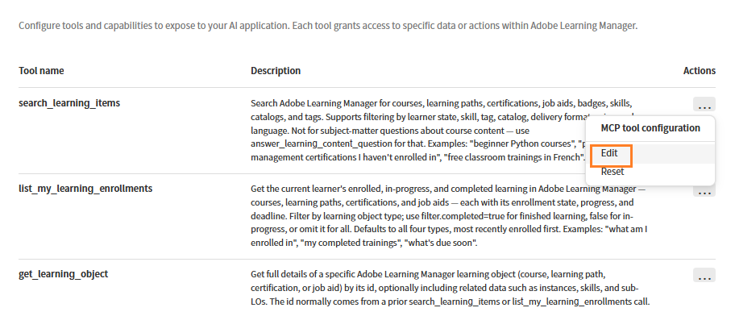

# 設定模型上下文協定伺服器

作為管理員，你建立伺服器，複製其憑證，然後交給 AI 用戶端管理員，由他完成連線。 您可以隨時重新訪問伺服器，編輯它、更新工具、複製其憑證、變更狀態或刪除它。

## 建立 MCP 伺服器

1. 以管理員身分登入 Adobe Learning Manager。
2. 請前往 **AI 的學習** \> **MCP 伺服器**。
3. 選擇「 **新增 MCP 伺服器**」。
4. 輸入伺服器詳細資訊，包括描述。

   * **伺服器名稱：** 輸入最多 50 個字元的名稱。
   * **說明：** 輸入最多 150 個字元的簡短描述。
   * **URL：** 輸入您的公司或應用程式 URL。
   * **重新導向網域：** 輸入每個將連線的 AI 用戶端網域，例如 [http://\*.chatgpt.com](https：//encoded-592c9deb-987b-4562-aa3c-9fa3d37d83e9.uri/http%3a%2f%2f*.chatgpt.com) 或 [http://\*.claude.ai](https：//encoded-592c9deb-987b-4562-aa3c-9fa3d37d83e9.uri/http%3a%2f%2f*.claude.ai)。 此欄位為必填欄位。

     

5. 選擇「 **下一步**」。
6. 在「可用工具&#x200B;**」**&#x200B;頁面，檢視伺服器所提供的學習工具。為 MCP 工具提供詳細、具情境性且具目的性的描述。 撰寫良好的工具說明有助於相容 MCP 的用戶端更準確地發現並調用適當的工具。 包含工具的用途、支援的任務、預期輸入及典型使用情境。 清晰且簡潔的說明，能提升工具選擇與整體使用者體驗，當學習者與 AI 助理互動時。

   

   為每個工具選擇「 **檢視** 」，以查看判斷工具何時被選取及工具反應的指示。

   

7. 在左側導覽窗格中選擇 **用戶端認證** 。
8. 複製 **MCP 端點 URL**、 **用戶端 ID** 及 **祕密金鑰**。 在每個值旁選擇 **「複製** 」。

   

9. 選擇 **「關閉**」。

>[!NOTE]
>
>伺服器僅對具有學習者角色的使用者提供讀取權限。

將端點 URL、用戶端 ID 和秘密金鑰提供給你的 AI 用戶端管理員。

## 編輯工具描述

工具說明會告訴 AI 客戶端何時選擇該工具，以及工具會如何回應。 您也可以新增範例提示。 撰寫良好的工具說明有助於相容 MCP 的用戶端更準確地發現並調用適當的工具。 包含工具的用途、支援的任務、預期輸入及典型使用情境。

1. 在「可用工具&#x200B;**」**&#x200B;頁面上，選擇&#x200B;**工具的「動作**」選單。
2. 選擇 **MCP 工具配置** \> **編輯**。

   

3. 在 **「編輯工具** 」對話框中，更新 **「說明/說明**」。

   

4. 在「範例提示」**下**，編輯提示。若要新增提示，請選擇 **「新增另一個範例**」。
5. 選擇「 **儲存**」。

若要將工具恢復到原始文字，請選取 **該工具的「動作** 」選單，然後選擇 **MCP 工具設定** \> **重設**。

## 編輯 MCP 伺服器

1. 在學習&#x200B;**\>** MCP 伺服器&#x200B;**中選擇** AI。
2. 選擇伺服器名稱。
3. 選擇 **「編輯**」。
4. 更新應用程式詳細資料&#x200B;**頁面上的**&#x200B;欄位，然後儲存您的變更。

## 刪除 MCP 伺服器

1. 在學習&#x200B;**\>** MCP 伺服器&#x200B;**中選擇** AI。
2. 在伺服器列中，選擇 **「動作** 」選單。
3. 選擇 **「刪除**」。
4. 在確認對話框中，選擇 **「刪除**」。

>[!WARNING]
>
>刪除伺服器會移除其所有連接 AI 應用工具的存取權。 目前的會話可能會立即停止運作，且你無法還原刪除。

## 疑難排解

**刀具變更不會立刻顯示。**
對工具描述的編輯需要一些時間才能生效。 等一下再試一次。

**在伺服器被刪除後，一個 AI 客戶端停止運作。**
建立一台新伺服器，並將新的憑證提供給你的 AI 客戶端管理員。

**AI 客戶端使用了錯誤的工具。**
檢視您更改的任何工具描述。 請使用 **重設功能** 還原原始文字。

## 最佳實務

* 除非有特定理由要更改，否則請保留原始工具描述。
* 如果要編輯，請寫清楚且具體的工具說明和範例提示。
* 請妥善儲存秘密金鑰，並只與您的 AI 客戶端管理員分享。
* 為每個 AI 應用程式建立獨立伺服器，這樣你可以刪除其中一個而不影響其他應用程式。
* 在刪除伺服器之前，請確認沒有任何 AI 應用程式依賴該伺服器。
