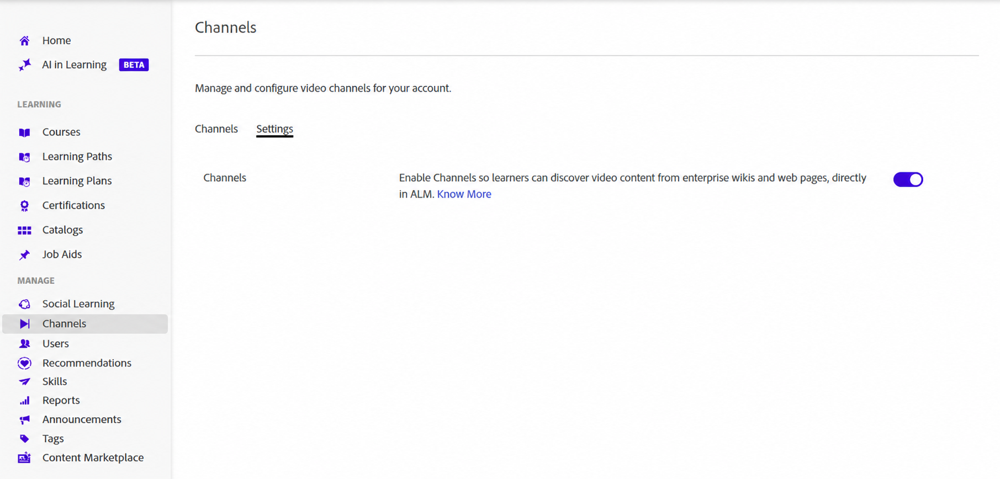
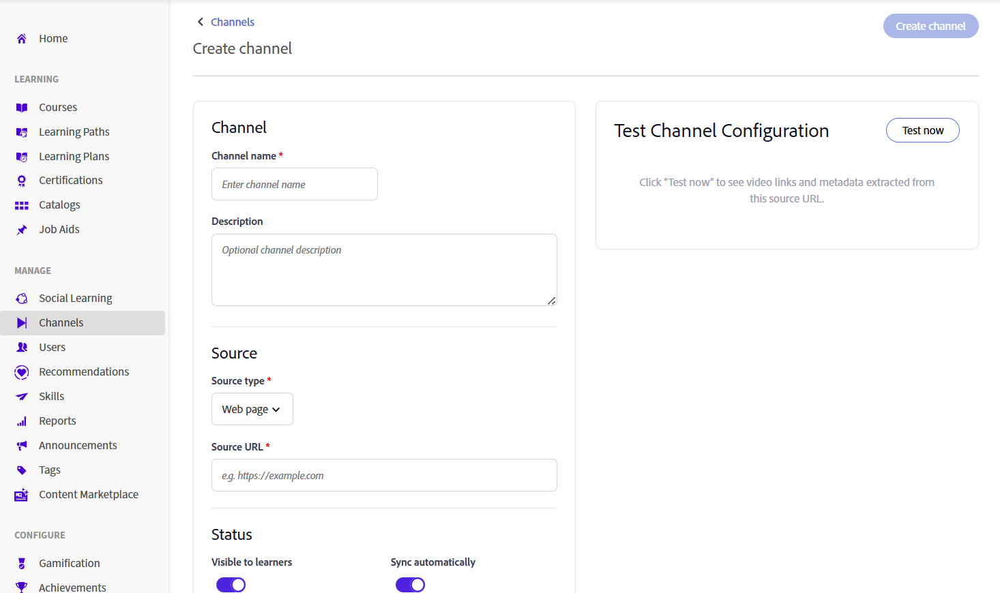
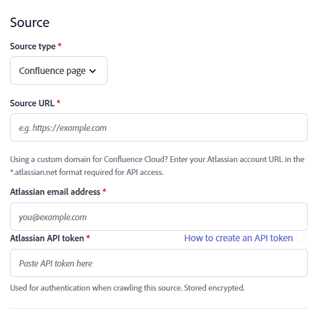
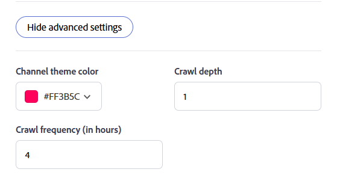
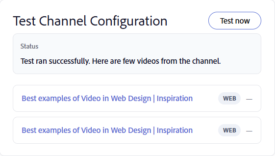
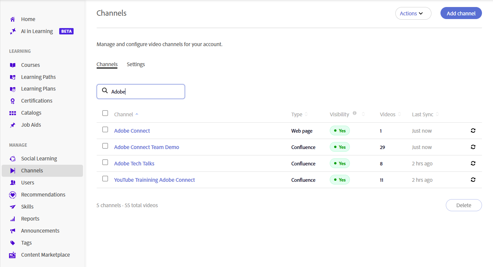
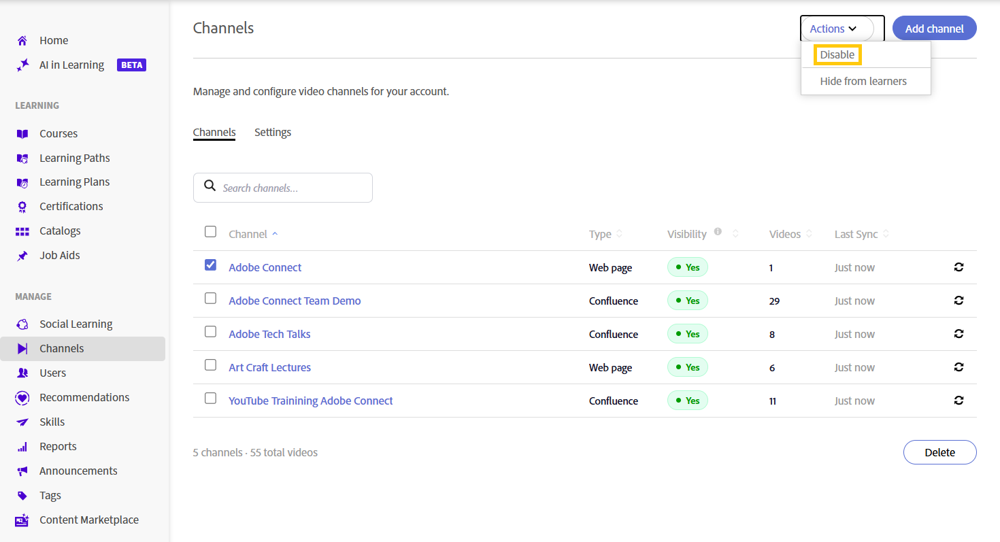
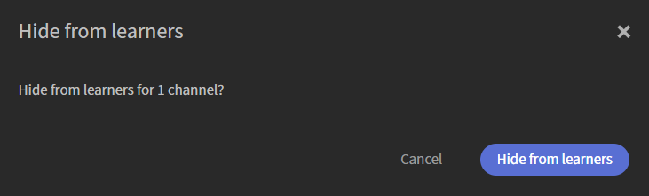
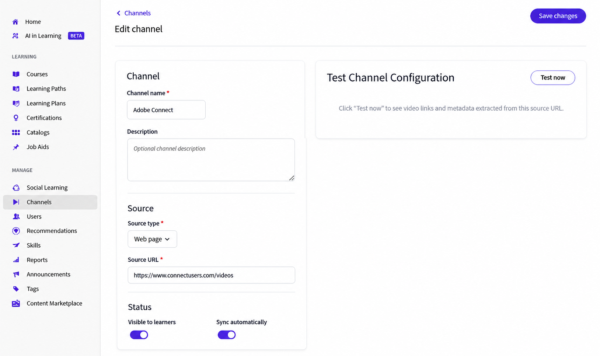
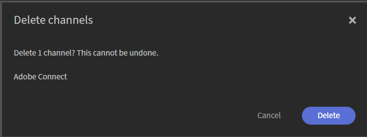

# 建立頻道

組織經常將知識分享課程、訓練錄影及其他影片內容儲存在非正式學習內容、精選的網頁及 Confluence Cloud 頁面上。 這些頻道將 Adobe Learning Manager 與這些內容來源連結，讓影片更容易被發現與觀看，而不必讓學習者在多個系統中穿梭。 頻道協助您將企業網頁與 Confluence Cloud 頁面的影片學習內容整理並分享於單一可搜尋的位置。 學習者不必在多個內部網站中搜尋，而是能直接從 Adobe Learning Manager 發現並存取相關錄影。 查看 [「探索與互動頻道](../../learners/feature-summary/discover-and-engage-with-channels.md) 」以取得更多資訊。

作為管理員，您可以建立和管理頻道、設定可見性設定、同步內容與來源，並在讓頻道對學習者開放前確認影片是否可用。 支援的影片格式為 **MP4** 和 **WebM**。

本文說明如何執行這些通道管理任務。

**主要優點**

- 將來自多個內部來源的影片學習內容整合於同一地點。
- 將多個內部網路位置的影片內容整理成網頁，然後在 ALM 中以頻道形式顯示。
- 讓學習者無需瀏覽多個網站，就能找到、遊玩並互動內容。
- 保持內容與原始來源同步。

## 啟用頻道

「頻道」是管理員為帳戶啟用的功能。 啟用後，您可以建立連接企業網頁及包含影片內容的 Cloud Confluence 頁面的頻道。

頻道爬蟲能可靠地從以下列格式呈現內容的來源頁面擷取影片：

- 表格
- 項目符號列表
- 文章

啟用 **「通道」** 功能的方法如下：

1. 以管理員身份登入 Adobe Learning Manager。

1. 從左側導覽欄選擇&#x200B;**「頻道」。**
    ****&#x200B;通道頁面開啟。

1. 選擇「 **設定** 」標籤。

   

   *在「設定&#x200B;**」**標籤中啟用「頻道」功能，讓管理員為該帳戶建立頻道。*

1. 啟用 **頻道功能**。

     該帳戶已啟用這些頻道。

## 建立頻道

建立一個頻道以定義 Adobe Learning Manager 掃描影片的內容來源，並自訂頻道與影片頁面的外觀。

1. 前往 **「頻道」** 標籤，選擇 **「新增頻道**」。
    **「建立頻道**」頁面隨即開啟。

   

   *在建立頻道時，定義內容來源並設定可見性與同步選項。*

1. 在 **「頻道** 」區段，輸入 **頻道名稱** 與 **描述**。

1. 從下拉選單中選擇來源 **類型** 。 以下選項可供選擇：

   1. **網頁**：選取此選項以爬取網頁並匯入影片連結及其相關中繼資料。

   1. **Confluence 頁面**：選擇此選項以從 Confluence Cloud 頁面擷取影片連結與元資料。 若要連接 Confluence Cloud，請提供以下資料：
      - **Atlassian 電子郵件地址**：輸入與您 Atlassian 帳戶相關聯的電子郵件地址。
      - **Atlassian API 代幣**：輸入您 Atlassian 帳戶產生的 API 代幣。 選擇「 **如何建立 API 令牌」以取得產生 API 令牌** 的說明。 此令牌用於爬取來源時的驗證，並以加密方式儲存。

      

      *輸入用於 Confluence Cloud 驗證的 Atlassian 電子郵件地址與 API 令牌。*

1. 輸入 **所選來源類型內容的來源 URL** 。

1. 在「 **狀態」** 區段中，設定以下選項：

   1. **「對學習者**&#x200B;可見」：啟用此選項以讓該頻道對學習者開放。 請將其停用以隱藏頻道，同時繼續設定或測試。

      >[!NOTE]
      >
      >只有當此設定啟用且至少包含一支影片時，「頻道」標籤才會對學習者顯示。

   1. **自動**&#x200B;同步：啟用此選項，當新增影片到來源時自動更新頻道。 如果你想手動同步頻道，請將其關閉。

1. （選用）選擇「 **顯示進階設定**」，然後依需求設定下列選項：

   1. **頻道主題色彩**：從下拉清單中選擇顏色，以自訂頻道的視覺外觀。

   1. **爬行深度**：輸入連結頁面的爬行深度以掃描影片內容。 它支援最大爬行深度為 **2**。

   1. **爬行頻率（小時）：**&#x200B;輸入 Adobe Learning Manager 檢查來源是否有新內容或更新內容的頻率。

      

      *選擇「顯示進階設定」以設定頻道主題色彩、爬行深度及爬行頻率。*

1. 選擇立即&#x200B;****&#x200B;測試以驗證來源。範例影片會從設定的來源擷取並顯示。

   

   *在建立頻道之前，請使用&#x200B;**「立即**測試」確認影片是否已從來源擷取。*

1. 選擇「 **建立頻道**」。 頻道會被建立並加入&#x200B;****&#x200B;頻道清單。

## 搜尋通路

使用搜尋框快速依名稱找到頻道。

1. 選擇「 **通道」** 標籤。
1. 選擇 **「搜尋頻道」** 方塊。
1. 在「搜尋頻道」**方塊中輸入頻道名稱或其**部分內容。
     清單會篩選只顯示符合您搜尋的頻道。

   

   *在搜尋框中輸入頻道名稱以篩選&#x200B;****頻道清單。*

## 管理管道可見性

使用 **「動作」** 選單同時停用或隱藏一個或多個頻道。

### 停用頻道

停用一個或多個頻道，以防止學習者在保留頻道設定的同時存取其內容。

停用頻道的方法如下：

1. 前往&#x200B;**「頻道」。**
1. 勾選一個或多個頻道旁的核取方塊，然後選擇 **「動作**」。

   
   *從動作選單中選擇「停用」以停用一個或多個已選取的頻道。*
1. 選擇 **「停用**」。  **「停用頻道**」彈出視窗會出現。
1. 選擇 **「停用**」。  所選頻道已停用。

### 隱藏頻道，不讓學習者看到

隱藏一個或多個頻道，使其對學習者無法使用，但不會刪除它們。

要對學習者隱藏頻道：

1. 前往&#x200B;**「頻道」。**
1. 勾選一個或多個頻道旁的核取方塊，然後選擇 **「動作**」。
1. 選擇 **「對學習**&#x200B;者隱藏」。  **「對學習**&#x200B;者隱藏」彈出視窗會出現。

   
   *在不刪除頻道設定的情況下，隱藏學習者所看到的頻道。*

1. 選擇 **「對學習**者隱藏」。
     所選頻道對學習者隱藏。

## 編輯頻道

您可以編輯現有頻道以更新其設定與設定。

編輯頻道的方法如下：

1. 從 **「通道」** 清單中選擇所需的頻道。
    **「編輯通道**」頁面會開啟並顯示目前的通道配置。

1. 視需要更新頻道設定。

   

   *從「編輯頻道&#x200B;**」頁面更新頻道名稱、描述、來源及設定**。*

1. （選填）選擇立即&#x200B;****&#x200B;測試。

1. 選擇 **「儲存變更**」。
     更新後的頻道設定會被保存。

## 刪除頻道

您可以刪除一個或多個不再需要的頻道。

1. 前往 **「頻道」** 標籤。

1. 勾選您想刪除的每個頻道旁的核取方塊。

1. 從頻道清單右下角選擇 **「刪除** 」。   **「刪除頻道**」彈出視窗會出現。

   

   *確認對話框會列出您所選擇的頻道。*

1. 選擇 **「刪除**」。
     所選頻道將被永久刪除。 這個行動無法撤銷。
