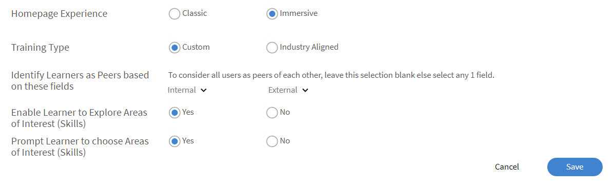
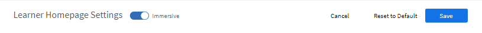
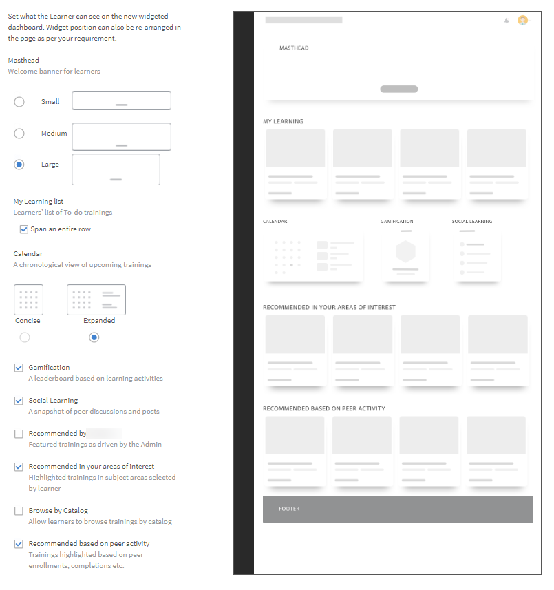
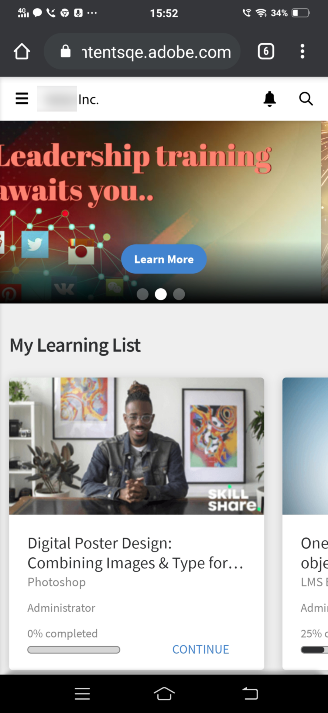
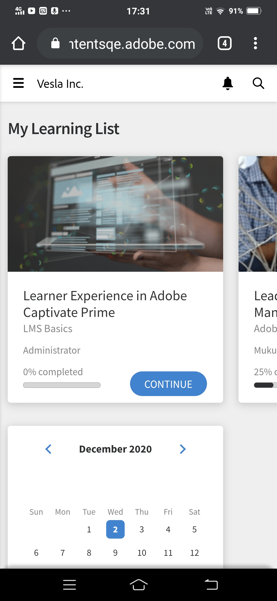
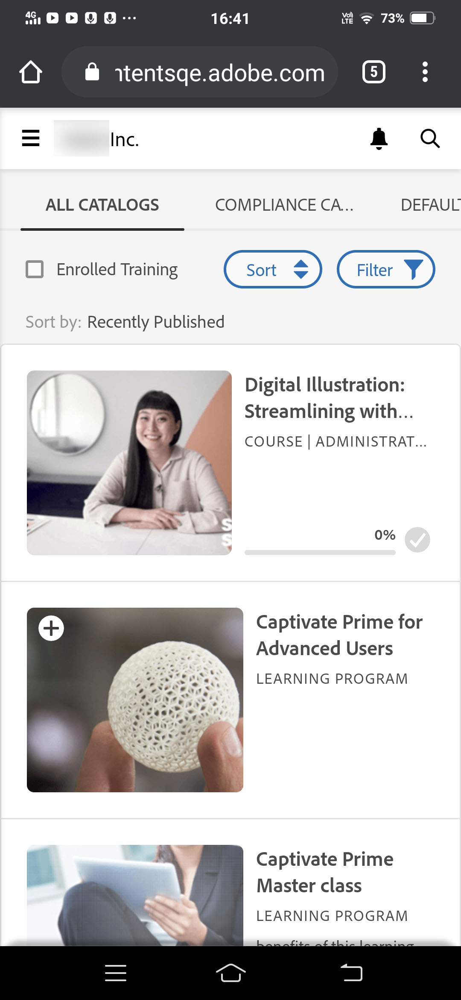
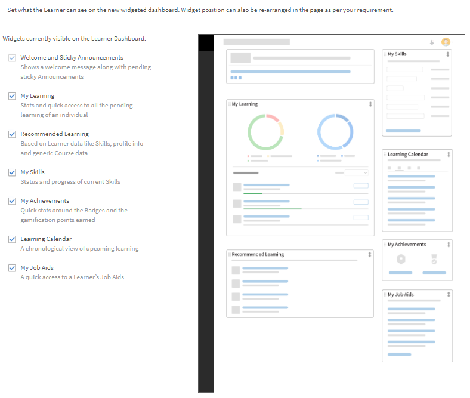

# 自訂學習者首頁

## 概觀 {#overview}

管理員可以自訂學習者的首頁，使其更現代化、內容導向，並更符合學習者的個人需求。

個人化方式提供以小工具為基礎的學習者首頁建置方式，組織管理員可在管理介面中以所見即所得方式設定。

體驗由 AI 演算法提供個人化訓練建議，分析第三方內容以提升產業技能，結合同儕活動與學習者興趣領域，並結合顯性與隱性資料。

### 自訂學習者首頁

在本訓練中，您將探索自訂學習者首頁的方法。

如果您無法啟動訓練，請寫入 <almacademy@adobe.com>。

## 設定學習者首頁 {#configurethelearnerhomepage}

在&#x200B;**「品牌>**&#x200B;**學習者首頁**」頁面上，管理員可以自訂學習者的首頁體驗，讓學習者登入學習者應用程式時，能看到全新設計的外觀與體驗。

管理員可以從管理應用程式&#x200B;**（品牌>**&#x200B;**學習者首頁**&#x200B;標籤）設定介面（外觀與感覺）。

管理員可以切換到沉浸式 UI 小工具檢視，依此自訂小工具/功能，然後啟用沉浸式使用者介面。

**學習者首頁**&#x200B;畫面包含以下區塊：

## 沉浸式版面配置選項 {#immersivelayoutoption}

若要檢視沉浸式頁面的版面配置，請啟用「沉浸式&#x200B;**」選項**。您可以在「品牌設定>一般&#x200B;**」中切換此選項**。

在先前版本中，學習者首頁選項位於設定中。

以下是您可以設定的選項：

**首頁體驗：** 啟用 **經典模式** 或 **沉浸式**&#x200B;模式。 若選擇沉浸式，將顯示以下選項：

* **訓練類型：** 選擇 **產業** 或 **自訂對齊**。 客製化訓練則由內部製作。 與產業相符的培訓課程包含來自第三方供應商的現成內容。

*透過選擇「產業」或「自訂對齊」來設定首頁體驗*

「允許學習者探索感興趣&#x200B;**領域」選項**&#x200B;適用於經典與沉浸式體驗。

<table>
 <tbody>
  <tr>
   <td>
    
<b>如果您選擇自訂...</b>
</td>
   <td>
    
<b>如果您選擇 Industry Aligned...</b> 
</td>
  </tr>
  <tr>
   <td>
    
您最多只能選擇一個內部與外部活動欄位。
</td>
   <td>
    
你最多可以選擇五個欄位，至少一個欄位。 預設情況下， <b>選項為「設定檔 </b>」。
</td>
  </tr>
 </tbody>
</table>

若學習者少於 1000 人，整個帳戶視為單一範圍。 這特別適用於自訂訓練類型。 如果帳戶少於 1000 名使用者，系統會將整個帳戶視為其範圍。

>[!NOTE]
>
>「探索技能&#x200B;**」核取方塊**&#x200B;已移至「設定」>「一般」。

若選擇沉浸式體驗，此功能將啟用並呈灰色。 此核取方塊僅適用於經典體驗。

*學習者首頁設定*

沉浸式版面是所有新帳號的預設配置。 版面配置由管理員可啟用或停用的小工具控制。 根據小工具的擺放方式，學習者首頁也會反映出同樣的效果。

以下是你可以啟用或停用的小工具。

透過此功能，您可以在學習者 UI 上線前預覽 Learner UI。

對於現有帳號，沉浸式選項將關閉&#x200B;**&#x200B;**。**&#x200B;**&#x200B;啟用新帳號時，社交與遊戲化功能已啟用。

*預覽學習者使用者介面*

<table>
 <tbody>
  <tr>
   <td>
    
<b>小工具</b>
</td>
   <td>
    
<b>說明</b>
</td>
  </tr>
  <tr>
   <td>
    
報頭
</td>
   <td>
    
<b>什麼是 Masthead？我該如何自訂 Learners Masthead？ </b> 

    
這是對學習者的歡迎旗幟。 橫幅可以是圖片或影片。 您可以將報頭鎖定給特定使用者群組，學習者一抵達首頁即可查看報頭。 使用者群組可依管理員設定的目標計畫看到多個主圖或影片。 

    
管理員上傳橫幅的方式如下：

    <ol>
     <li>在左側面板，點選 <b>「公告</b>」。 </li>
     <li>在頁面右上角，按一下 <b>「新增</b>」。</li>
     <li>從「<b>類型</b>」下拉清單中，選擇<b>「作為主頁」。</b></li>
     <li>寫一段會放在報頭上的訊息。</li>
     <li>上傳圖片或影片。</li>
     <li>選擇目標受眾。 選擇將顯示報頭的使用者群組或培訓項目。</li>
     <li>省下報頭公告。</li>
    </ol></td>
  </tr>
  <tr>
   <td>
    
我的學習
</td>
   <td>
    
顯示學習者最近造訪過的學習物件。 
</td>
  </tr>
  <tr>
   <td>
    
行事曆
</td>
   <td>
    
按月顯示各種即將進行的教室與虛擬教室訓練課程。 學習者可報名或已報名的課程會顯示，包括經理核准的訓練。 
</td>
  </tr>
  <tr>
   <td>
    
報名記錄顯示截止日期
</td>
   <td>
    
顯示逾期報名、即將截止日期或進度正常的報名。 
</td>
  </tr>
  <tr>
   <td>
    
遊戲化
</td>
   <td>
    
根據學習活動顯示排行榜。
</td>
  </tr>
  <tr>
   <td>
    
社會學習
</td>
   <td>
    
列出與學習者處於相同使用者範圍內的使用者所進行的活動與貼文。 
</td>
  </tr>
  <tr>
   <td>
    
由組織推薦
</td>
   <td>
    
啟用後，此小工具會建議特定使用者群組進行訓練。 每個使用者群組可以針對一項或多項訓練進行目標，目標計畫將依據時間框架制定。  

    <ul>
     <li>
      
首先，管理員<a href="announcements.md#recommendation">會建立一個「作為推薦</b>」類型的<b>公告</a>，然後選擇所需的訓練內容並使用群組。屬於使用者群組的學習者將能看到建議的訓練內容。
</li>
     <li>
      
其次，行政人員也可以決定這些建議是立即生效，還是在指定日期生效。
</li>
    </ul></td>
  </tr>
  <!--
  <tr>
   <td>
    
Recommendation based on area of interest
</td>
   <td>
    
Displays Learning Objects based on the learner's chosen area of interest. The recommendation is driven by a Machine Learning algorithm.
</td>
  </tr>
  -->
  <tr>
   <td>
    
依目錄瀏覽 
</td>
   <td>
    
在首頁以磁磚形式顯示目錄。 
</td>
  </tr>
  <!--
  <tr>
   <td>
    
Recommendation based on peer activity 
</td>
   <td>
    
Displays training based on what a learner's peers are taking. This is again driven by a Machine Learning algorithm.
</td>
  </tr>
  -->
 </tbody>
</table>

儲存變更後，學習者首頁會顯示所有變更。

當學習者透過瀏覽器登入學習者應用程式時，他們可以看到以下沉浸式的佈局：

<table>
 <tbody>
  <tr>
   <td>
    
<strong>首頁</strong>
</td>
   <td>
    
<strong>我的學習清單</strong>
</td>
   <td>
    
<strong>檢視目錄</strong>
</td>
  </tr>
 </tbody>
</table>

*檢視首頁各區塊的沉浸式版面配置*

## 經典版面配置選項 {#classiclayoutoption}

一直以來一直存在的使用者介面版面，現在被稱為經典版面配置。 選擇此選項後，學習者首頁檢視會回復為經典版面配置。

*預覽經典版面配置*

## 設定建議設定 {#configurerecommendationsettings}

在「品牌設定&#x200B;**>**&#x200B;一般&#x200B;**」中**，您可以為內部與外部學習者設定推薦範圍，並允許學習者在學習者首頁選擇技能。

在「一般」**&#x200B;**&#x200B;頁面上，您有以下選項：

<table>
 <tbody>
  <tr>
   <td>
    
組織名稱
</td>
   <td>
    
學習者所屬組織的名稱。
</td>
  </tr>
  <tr>
   <td>
    
子網域
</td>
   <td>
    
組織的子網域。
</td>
  </tr>
  <tr>
   <td>
    
標誌造型
</td>
   <td>
    
您的標誌和公司名稱將以這樣的方式顯示在 Learning Manager 上。 
</td>
  </tr>
  <tr>
   <td>
    
主題
</td>
   <td>
    
這個主題適用於 Learning Manager。
</td>
  </tr>
  <tr>
   <td>
    
自訂
</td>
   <td>
    
Adobe Learning Manager 允許您自訂帳戶，為使用者提供更豐富的體驗。 
</td>
  </tr>
  <tr>
   <td>
    
學習者首頁
</td>
   <td>
    
選擇 <b>經典模式 </b>或 <b>沉浸式</b>模式。 如果你選擇沉浸式，則會出現其他選項。
</td>
  </tr>
  <tr>
   <td>
    
訓練類型 
</td>
   <td>
    
選擇 <b>「客製化 </b>」或 <b>「產業對齊</b>」。 若學習者少於 1000 人，整個帳戶視為單一範圍。 這項建議是基於所有學習者的意見。 
</td>
  </tr>
  <tr>
   <td>
    
建議範圍設定 
</td>
   <td>
    
選擇一個或多個啟用欄位。 在 <b>自訂中</b>，您最多只能選擇一個啟用欄位。 在 <b>Industry Aligned</b> 中，您最多只能選擇五個活躍領域。 
</td>
  </tr>
  <tr>
   <td>
    
讓學習者能夠探索感興趣的領域
</td>
   <td>
    
僅限於經典體驗。 選擇 <b>「是 </b>」或 <b>「否</b>」。 
</td>
  </tr>
  <tr>
   <td>
    
提示使用者選擇「興趣領域（技能）」  
</td>
   <td>
    
只為了沉浸式體驗。 選擇 <b>「是</b> 」或 <b>「否</b>」。  
</td>
  </tr>
 </tbody>
</table>

>[!NOTE]
>
>對於新帳戶，學習者首頁、訓練類型及建議範圍設定將不會顯示。

## 在 Adobe Learning Manager 中新增並重新排序首頁條 {#add-reorder-homepage-strips}

在學習者首頁新增個人化學習路徑條與虛擬教練條紋，並拖放條條以設定學習者看到的順序。

作為管理員，您可以在 Adobe Learning Manager 的學習者首頁新增個人化學習路徑（PLP）與虛擬教練條。 您也可以在 **管理品牌設定**&#x200B;中使用拖放控制重新排序每個首頁條。 你現在可以決定學習者最先看到哪些條文。

您也可以在自訂頁面中新增個人化學習路徑小工具。

### 關於首頁條紋

首頁條紋是顯示在學習者首頁上的小工具（卡片）。 在管理品牌設定中，您可以控制哪些條紋出現，以及它們出現的順序。 在 2026 年 12 月版本的 ALM 中，提供了兩條 AI 驅動的條帶：

* **個人化學習路徑條：** 為每位學習者標示由 AI 生成的學習路徑。
* **虛擬教練條：** 協助學習者從首頁尋找並開啟教練體驗。

### 個人化學習路徑條帶

學習者可以利用這條條帶：

* 存取 AI 生成的學習路徑。
* 繼續先前生成的學習路徑。
* 探索推薦的學習旅程。

### 虛擬巴士條帶

學習者可以利用這條條帶：

* 探索虛擬教練的各種體驗。
* 恢復教練活動。
* 從首頁開始對話式 AI 教練。

### 重新排序首頁條紋

你可以將任何一條紙放在任何位置。 例如，您可以先顯示虛擬教練條，接著是個人化學習路徑、**推薦**&#x200B;**和目錄**&#x200B;條，最後&#x200B;**才顯示最近瀏覽**。

1. 在系統管理員應用程式中，於左側導覽窗格選擇 **「品牌設定** 」。
2. 選擇 **「學習者首頁**」。
3. 在條帶清單中，找到你想移動的條帶。
4. 將條帶拖曳到新位置。

   

5. 儲存您的變更。

發佈後，新排序會出現在學習者首頁。

>[!NOTE]
>
>如果「個人化學習路徑」或「虛擬教練」條不在清單中，請在重新排序前確認已將其加入首頁設定。

## 將個人化學習路徑小工具新增至自訂頁面

您可以在首頁外使用個人化學習路徑小工具。 將它加入自訂頁面，讓學習者有一個專門的地方尋找個人化學習建議。

1. 選擇 **「自訂頁面**」。
2. 建立頁面，或編輯現有頁面。
3. 新增個人化 **學習路徑** 小工具。

   

   檢視小工具。

   

4. 選擇 **「繼續**」。
5. 新增元件標題與描述。

   

6. 選取新增 **小工具**。
7. 儲存頁面。
8. 發佈頁面。
