## 基於元件的電子郵件建置器

Adobe Learning Manager 內建元件式電子郵件建構器，讓管理員與作者能使用現代視覺化編輯器，無需撰寫 HTML 即可製作企業級、完整品牌化的電子郵件。 您的組織每封電子郵件，從報名確認到課程提醒，都能精準符合品牌的外觀與氛圍。

**給管理員：** 設計一個全域版面版面一次*，一個可重複使用的頁首與頁尾，能自動包裹每封電子郵件，然後依需要自訂個別範本。 在內嵌拖放編輯器中，使用豐富元件撰寫電子郵件：具備完整富文字格式的文字、圖片、橫幅、按鈕、社群媒體連結、分隔線等。

**給作者：** 將相同的編輯器功能套用於針對特定課程與實例的電子郵件，讓訓練溝通能依不同學習經驗量身訂做，而不影響帳號整體設定。

建構器支援階層式模型：同一電子郵件範本可在實例、課程或帳戶層級設定。 當範本尚未被單獨編輯時，它會自動繼承其父層級的設定。 當你需要完全自訂的設計時，你就會解除綁定範本，並完全掌控。 內建預覽功能讓您在郵件寄出前，就能精確檢查郵件在收件者的收件匣中會如何顯示。

## 電子郵件範本系統的運作方式

Adobe Learning Manager 中的每封寄出電子郵件由三個結構部分組成：

* **頁首：** 橫幅圖片或顏色，以及組織名稱
* **內文：** 每種電子郵件類型獨有的動態內容區域;包含訊息文字及可變佔位符
* **頁尾：** 帳戶網址、電子郵件簽名、說明連結及其他元素

**全域版面配置**&#x200B;是同時套用於所有 130+ 電子郵件範本的主設計。當您更新全域版面配置時，所有仍連結到該配置的範本都會自動反映變更。 範本可隨時從全域版面中解除連結，以進行獨立自訂。

### 電子郵件階層結構

設定與設計會透過繼承從高階流向低階。 每個關卡都可以覆蓋或完全自訂它繼承的內容。

| 等級 | 誰負責設定 | 預設狀態 | 可編輯內容 |
| --- | --- | --- | --- |
| **全域佈局** | 管理員 | Root;無父 | 完整版面配置：所有零件、所有組件 |
| **帳戶電子郵件範本** | 行政 | 連結至全域版面配置 | 僅內文（已連結）;完整版面配置（未連結） |
| **作者-LO 版面配置** | 作者 | 連結至帳戶範本 | 完整版圖於 LO 範圍 |
| **作者 - LO 電子郵件範本** | 作者 | 連結至 LO 佈局 | 僅內文（已連結）;完整版面配置（未連結） |
| **作者 - 實例電子郵件範本** | 作者 | 連結至 LO 範本 | 僅內文（已連結）;完整版面配置（未連結） |

### 核心繼承規則

* 每個關卡一開始都會與其直接上層連結，直到明確更改為止。
* 編輯範本 **的主體** 不會將其解除連結。 頁首與頁尾仍反映父版。
* 編輯 **版面**&#x200B;配置或選擇 **「取消連結** 」只會中斷該範本的父連線。
* **還原至原始** 版本會將範本重新連結到父版本，並將版面配置與主體重設為父版本。
* 在某一層解除連結，對該層級之上或以下層級都沒有影響。

## 設定全域版面配置

全域版面定義了流向每封連結電子郵件的共用頁首、頁尾及結構包裝。 先設定它，讓所有範本一開始都以一致的品牌標示開始。

### 開啟全域版面配置編輯器

1. 以管理員身分登入 Adobe Learning Manager。
2. 在左側導覽欄中，選擇&#x200B;**「電子郵件範本」。**
3. 選取「 **全域版面配置** 」標籤。

   編輯器畫布會以目前的全域版面配置載入。 **動態主體**&#x200B;區域以佔位符形式顯示於中央，代表每個範本獨特訊息內容出現的區域。您無法從全域版面編輯動態實體。

   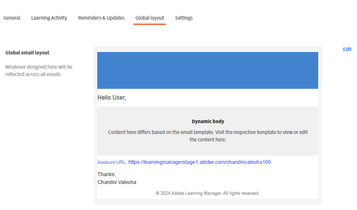

### 設定電子郵件容器

電子郵件容器是每封電子郵件的最外層包裝。 其設定會影響所有內容周圍的視覺框架。

1. 在全域電子郵件版面配置附近&#x200B;**選取**「編輯」**&#x200B;**
2. 在畫布上選取電子郵件容器。
3. 在 **右側的「屬性** 」面板中，設定：
   * **背景色：** 所有電子郵件內容背後的顏色

   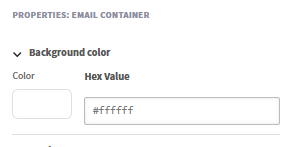

   * **邊框：** 外邊框的樣式、寬度與顏色

   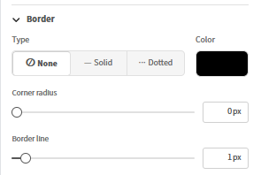

   * **間距：** 在電子郵件內容方向周圍填充

   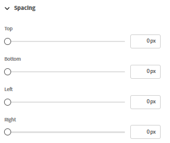

   * **列距：** 版面中所有列之間所施加的垂直間距

   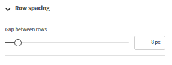

### 處理列與欄

電子郵件編輯器中的所有內容皆置於列&#x200B;**內**。每一列包含一個或多個 **欄位**，且每欄包含一個或多個 **元件**。

新增一列的方法如下：

1. 在畫布頂端選擇 **「列** 」。

   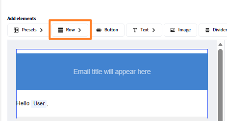

2. 選擇欄位配置： **1 欄**、 **2 欄**、 **3 欄**&#x200B;或 **4 欄**。

   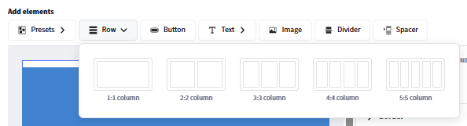

   新列會顯示在畫布上，準備加入元件。

設定一列的方法如下：

1. 選取畫布上的該列。

   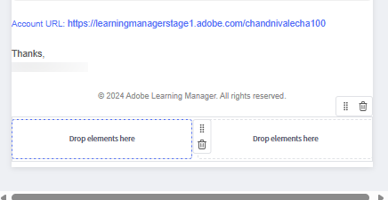

2. 在 **「屬性」** 面板中，設定：
   * **背景色：** 列層級背景，覆蓋本列的容器顏色
   * **邊框：** 列邊框樣式、寬度與顏色
   * **間距：** 本列欄間的水平間距

   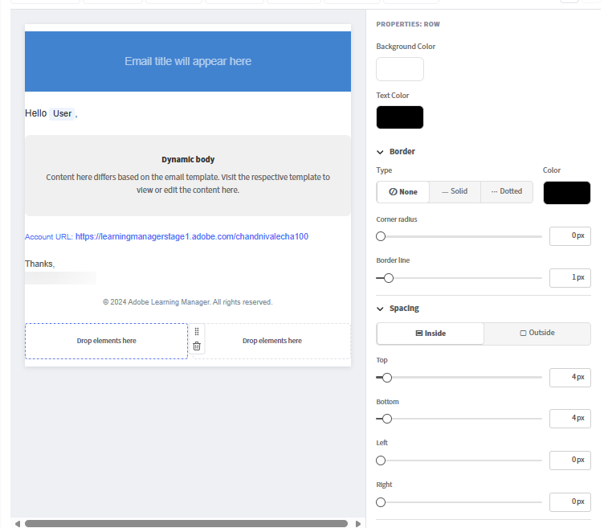

**重新排序資料列的方法如下：**

* 拖曳任意一列的控制柄（懸停左側邊緣時顯示）以向上或向下移動。

**刪除一列的方法：**

* 選取該列，並在列工具列中勾選 **刪除** 圖示。

### 新增與排列元件

元件是電子郵件內容的構成元件。 從頂部的元件&#x200B;**面板拖曳它們**，並拖放到任一欄位儲存格中。使用 **左側的屬性** 面板自訂所選元件。

拖放元件時，藍色「+」指示器會顯示元件可放置的位置。

**新增元件的方法如下：**

1. 在元件面板中，找到您想要的元件。

   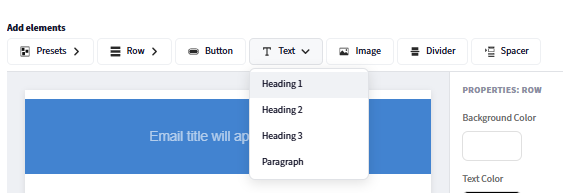

2. 將其拖曳到畫布上的欄位儲存格中。

   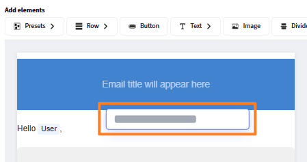

3. 元件會被加入該儲存格。 選取它即可在右側面板開啟其屬性。

   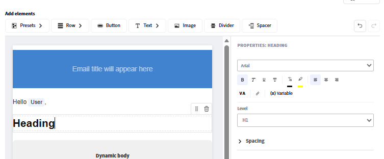

**移動元件的方法如下：**

* 將元件拖曳至不同的欄位或列位置。

**刪除元件的方法如下：**

* 選取元件，並在元件工具列中勾選 **「刪除** 」圖示。

### 編輯預設元件

**全域版面**&#x200B;包含內建的預設元件，對應於電子郵件設定中所設定的共用欄位。預設元件可以直接在畫布上編輯，或完全移除。

| 預設元件 | 預設內容 | 可以移除嗎？ |
| --- | --- | --- |
| **橫幅** | 預設橫幅圖片或顏色 | 是的 |
| **問候** | 「你好 {{user}}，」 | 是的 |
| **動態身體** | 每個範本內容的佔位符 | 不需要 |
| **帳戶網址** | 您帳戶的平台網址 | 是的 |
| **簽名** | 您設定的簽名文字 | 是的 |

**編輯預設元件的方法如下：**

1. 新增預設元件，例如橫幅。

   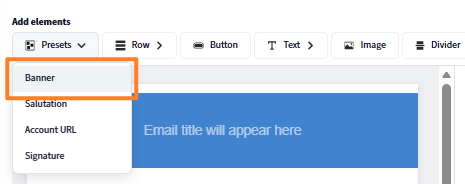

2. 選取畫布上的橫幅。
3. 在 **「屬性」** 面板中，變更 橫幅的字型、字型大小及其他視覺屬性。

   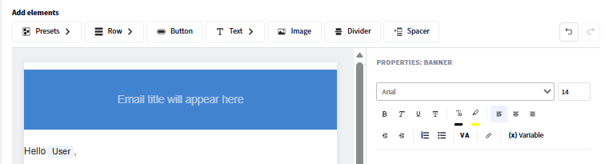

**若要從所有電子郵件中移除預設元件：**

1. 選取畫布上的預設元件。
2. 在元件工具列中選擇 **「刪除** 」。

從全域版面移除預設元件，會將該元件從所有連結的電子郵件中移除。 未連結的範本會保留元件，直到你手動從每個範本中移除。

### 儲存全域版面配置

當您的版面配置完成後，選擇 **儲存** 。 更新後的設計會立即套用到所有仍連結到全域版面的電子郵件範本。

## 設定全域電子郵件預設

定義共用元素，如橫幅、稱呼和簽名，以便在電子郵件中重複使用。 這些範本可用於全域版面配置，或是 Adobe Learning Manager 內個別事件導向的電子郵件範本中。 此處所做的變更會自動反映在使用這些預設的任何地方。 您也可以選擇覆寫這些預設，並直接在電子郵件建構器中設計自訂元素。

設定以下項目：

### 電子郵件橫幅

1. 在「電子郵件橫幅」旁&#x200B;**選擇**「編輯&#x200B;**」。**
2. 上傳橫幅圖片或設定純色背景。

   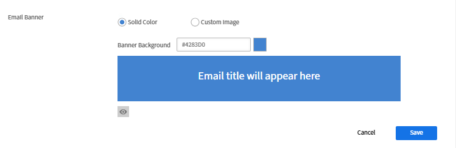

3. 選擇「 **儲存」。**

### 電子郵件 問候

1. 在電子郵件問候旁選擇&#x200B;**「編輯」** **&#x200B;**
2. 預設為「Hello {{user}}」—— {{user}} 變數會在執行時以收件人姓名填入。

   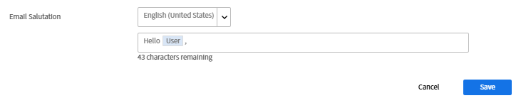

3. 修改問候文字或完全移除稱呼。
4. 選擇「 **儲存**」。

### 帳戶網址

1. 在「帳戶網址」旁&#x200B;**選擇**「編輯&#x200B;**」。**
2. 輸入您的學習平台網址;會出現在所有寄出電子郵件中。

   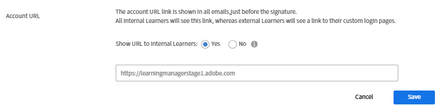

3. 選擇「 **儲存**」。

### 電子郵件簽名

1. 在電子郵件簽名旁&#x200B;**選擇**「編輯&#x200B;**」**
2. 輸入結尾文字。

   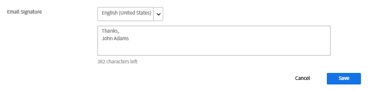

3. 選擇「 **儲存**」。

## 電子郵件建構器格式選項

查詢 Adobe Learning Manager 電子郵件建構器中可設定的字型、顏色、列與按鈕選項，以及格式覆蓋的適用方式。

使用這些選項來為整封電子郵件、單列、動態內容及按鈕進行樣式化。

### 電子郵件格式選項

| **選項** | **適用於** | **您可以設定的項目** |
|----|----|----|
| 電子郵件層級屬性 | 整封電子郵件 | 字型家族、字型大小、背景顏色及容器樣式 |
| 列層級屬性 | 每一列獨立樣式 | 強調公告區塊、區分行動呼籲區域或強調重要資訊的樣式 |
| 動態內容 | 動態內容區段 | 格式化，繼承自父容器 |
| 按鈕 | 動作按鈕 | 按鈕文字、樣式與視覺外觀 |

### 格式優先順序

你在較低層級設定的格式會覆蓋較高層級的格式設定。 例如，課程範本的變更會覆蓋管理員在帳戶範本中設定的預設值。

| **等級** | **典型用途** | **被覆寫** |
|----|----|----|
| 帳戶範本 | 整個帳戶的預設字型與顏色 | 課程與實例範本 |
| 課程範本 | 單一課程的變更 | 實例範本 |
| 實例範本 | 群組特定、會段特定或區域變更 | 什麼都沒有，因為這是最高層級的客製化 |

### 文字元件

文字元件支援完整的富文本編輯。

1. 將文字&#x200B;**元件拖曳**&#x200B;到欄位儲存格中。
2. 選取它以進入編輯模式。

   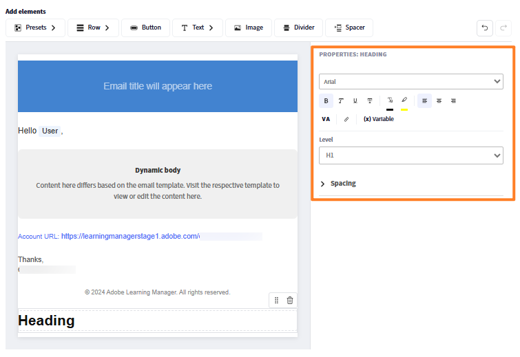

3. 輸入或貼上你的內容。
4. 套用以下格式選項：
   * **字型：** 可從網頁安全字型（Arial、Helvetica、Georgia 等）或為您的帳戶設定的自訂字型中選擇
   * **大小：** 字型大小（以點為單位）
   * **粗體**、 **斜體**、 **底線**、 **刪除線**
   * **上標** 與 **下標**
   * **文字顏色** 與 **背景顏色** （文字高亮）
   * **對齊方式：** 左、中、右或兩端對齊
   * **行距：** 行高乘數
   * **水平與垂直內距：** 文字區塊內的內部間距
5. 新增超連結的方法如下：
   * 選取您想要連結的文字
   * 在工具列中選取 **連結** 圖示
   * 輸入目的地 URL

   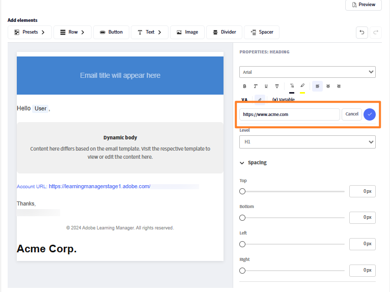

6. 選擇 **套用**

### 影像元件

1. 將影像&#x200B;**元件拖曳**&#x200B;到欄位儲存格中。
2. 選擇 **「上傳」** 以上傳新的影像檔案（支援 JPEG 和 GIF），或選擇 **「瀏覽** 」以從您的影像庫中選擇。
3. 選取影像後，請設定：

   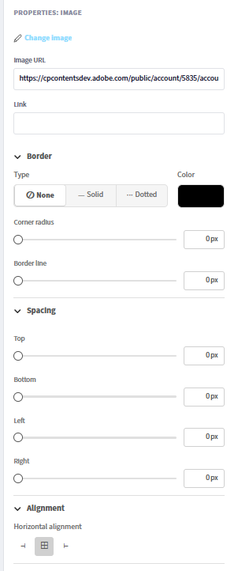

   * **變更圖片：** 上傳新圖片或替換目前選取的圖片。
   * **圖片 URL：** 指定要顯示圖片的來源 URL。 影像是從這個位置載入的。
   * **連結：** 為圖片新增可點擊的超連結。 當使用者點擊圖片時，會被重新導向到指定的 URL。
   * **邊框類型：** 定義影像邊框的樣式。 可用選項包括無、實心和虛點。
   * **邊框顏色：** 設定套用邊框樣式時影像邊框的顏色。
   * **角點半徑：** 控制影像角點的圓度。 數值越高，角位越圓潤。
   * **邊框線：** 調整影像邊框的粗細（寬度）。
   * **頂部間距：** 在影像上方增加空間。
   * **底部間距：** 在影像下方增加空間。
   * **左側間距：** 在影像左側增加空間。
   * **右行距：** 在影像右側增加空間。
   * **水平對齊：** 決定影像在其容器中的位置。 選項通常包括左對齊、中間對齊和右對齊。

### 按鈕元件

1. 將按鈕&#x200B;**元件拖曳**&#x200B;到欄位儲存格中。
2. 選取它並設定：

   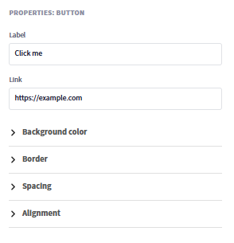

   * **標籤：** 按鈕文字
   * **連結：** 按鈕被點擊時的目的地 URL
   * **字型：** 按鈕標籤的字型家族與大小
   * **文字顏色：** 標籤顏色
   * **背景顏色：** 按鈕填色
   * **尺寸：** 按鈕寬度與高度
   * **角形樣式：** 圓角、方形或圓形
   * **對齊方式：** 欄位內的左、中或右
   * **內距：** 標籤文字與按鈕邊緣之間的內部間距

### 分隔器與間隔器元件

**分隔線：** 在內容區段之間新增可見的水平線。

1. 將分隔器&#x200B;**元件拖曳**&#x200B;到欄位中。
2. 在屬性面板中設定 **線條樣式** （實線、虛線、虛線 **）、顏色**、 **寬度**&#x200B;與 **高度** （線條上下垂直空間）。

   **間距器：** 在元素之間加入無可見線條的垂直間距。

3. 拖曳一個&#x200B;**間隔器**&#x200B;元件，並在屬性面板中設定其高度。**&#x200B;**

## 插入並管理變數

變數是動態佔位符，在發送電子郵件時會被實際資料取代。 可用的變數取決於特定範本類型。 報名確認電子郵件的變數與會話提醒不同。

### 使用選擇器插入變數

1. 將游標放在您希望變數出現的文字元件中。
2. 在文字編輯器工具列中選取 **「插入變數** 」。 變數選擇器會開啟，顯示此範本類型可用的所有變數。
3. 選擇一個變數。 例如， **課程名稱**、 **學習者名稱**&#x200B;或 **學習路徑名稱**。

   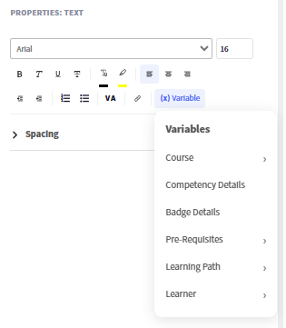

### 透過輸入插入變數

輸入變數名稱，並直接被雙大提號包圍：{\{variable_name}\}。 編輯器會自動辨識並標示為變數標記。

**常見變數的例子：**

| 變數 | 已被 |
| --- | --- |
| 收件人全名 | {\{learnerName}\} |
| 收件人電子郵件 | {\{learnerEmail}\} |
| 收件者的使用者名稱 | {\{user}\} |
| 使用者類型 | {\{userType}\} |
| 組織名稱 | {\{organizationName}\} |
| 課程名稱 | {\{courseName}\} |
| 課程說明 | {\{courseDescription}\} |
| 課程作者 | {\{courseAuthor}\} |
| 課程連結 | {\{courseLink}\} |
| 課程所需技能 | {\{courseSkillDetails}\} |
| 課程徽章 | {\{courseBadge}\} |
| 課程報名截止日期 | {\{courseEnrollmentDeadline}\} |
| 課程完成截止日期 | {\{courseCompletionDeadline}\} |
| 課程完成日期 | {\{courseCompletionDate}\} |
| 學習路徑名稱 | {\{LPName}\} |
| 學習路徑連結 | {\{LPLink}\} |
| 學習路徑報名截止日期 | {\{LPEnrollmentDeadline}\} |
| 學習路徑完成截止日期 | {\{LPCompletionDeadline}\} |
| 學習路徑完成日期 | {\{LPCompletionDate}\} |
| 認證名稱 | {\{certificationName}\} |
| 認證報名截止日期 | {\{certificationEnrollmentDeadline}\} |
| 認證完成日期 | {\{certificationCompletionDate}\} |
| 課程截止時間 | {\{deadlineDuration}\} |
| 課程到期期間 | {\{expiryDuration}\} |
| 課程到期日 | \{\{到期日\}\} |
| 工作階段名稱 | \{\{sessionName\}\} |
| 課程開始日期 | \{\{sessionDate\}\} |
| 會話結束日期 | \{\{結束SessionDate\}\} |
| 工作階段開始時間 | \{\{sessionTime\}\} |
| 會話結束時間 | \{\{endSessionTime\}\} |
| 場地名稱 | \{\{venueName\}\} |
| 場地資訊 | \{\{venueInfo\}\} |
| 場地網址 | \{\{venueURL\}\} |
| 場地區域 | \{\{venueRegion\}\} |
| 虛擬教室網址 | \{\{vcUrl\}\} |
| 需要虛擬教室提供者帳戶 | \{\{VCProviderAccountReq\}\} |
| 講師姓名 | \{\{instructorName\}\} |
| 模組名稱 | \{\{moduleName\}\} |
| 學習物件名稱 | \{\{learningObjectName\}\} |
| 學習物件完成日期 | \{\{loCompletionDate\}\} |
| 替代學習物件名稱 | \{\{alternateLoNameList\}\} |
| 替代學習物件連結 | \{\{alternateLoNameListLinks\}\} |
| 已移除替代學習物件 | \{\{removedAlternateLo\}\} |
| 先決文本 | \{\{先決文本\}\} |
| 先決數量 | \{\{preRequisiteCountText\}\} |
| CI 名稱 | \{\{ciName\}\} |
| 報告儀表板名稱 | \{\{reportDashboardName\}\} |
| 工作輔助名稱 | \{\{jobAidName\}\} |
| 公告內容 | \{\{公告內容文字\}\} |
| 個人檔案名稱 | \{\{profileName\}\} |
| 課程座位限制 | \{\{座位限制\}\} |
| 說明文件首頁連結 | \{\{captivatePrimeHelp\}\} |
| 說明頁面連結 | \{\{helpPageLink\}\} |
| 計數 | \{\{count\}\} |

>[!NOTE]
>
>變數是範本專屬的。 並非每個變數都能在每個範本中使用。 使用 **「插入變數** 選擇器」只顯示適用於您正在編輯範本的變數。 在大括號內輸入無法識別的變數名稱不會在編輯器中產生錯誤，但它會在已發送的電子郵件中以文字形式顯示。

### 橫幅中的變數

1. 電子郵件主旨也支援變數。 若要為主題新增變數：
2. 開啟範本並找到「 **電子郵件主旨** 」欄位。
3. 直接輸入變數。 例如：「您在 {\{course_name}\} 的註冊已確認」。 當電子郵件寄出時，變數會顯示實際的課程名稱。
4. 或者，選擇 **「新增變數**」，然後選擇 **「課程**」。

   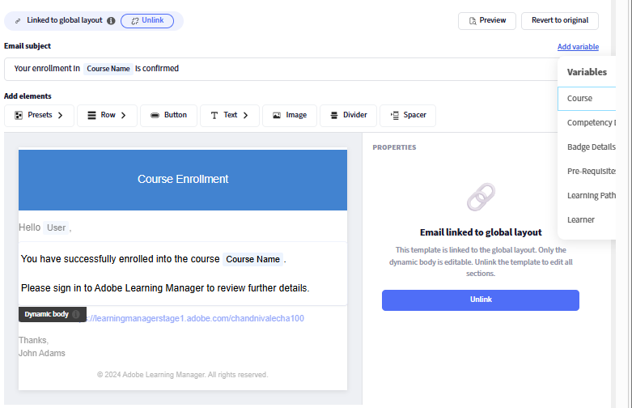

### 變數與全域佈局

全域版面中的變數與範本無關，且會根據上下文以不同方式解析。 在全域版面配置中僅使用通用的變數，例如 {\{user}\} 和 {\{account_url}\}。 範本專屬變數（例如 {\{course_name}\}）應放在個別範本主體中，而非全域版面配置中。

## 連結與解除連結範本

### 連結狀態與未連結狀態

每個範本要麼 **與其父模板連結** ，要麼 **不連結** 且完全獨立。

**連結時：**

* 頁首與頁尾在編輯器中顯示&#x200B;**為灰色。**&#x200B;這是表示範本已連結的視覺指示

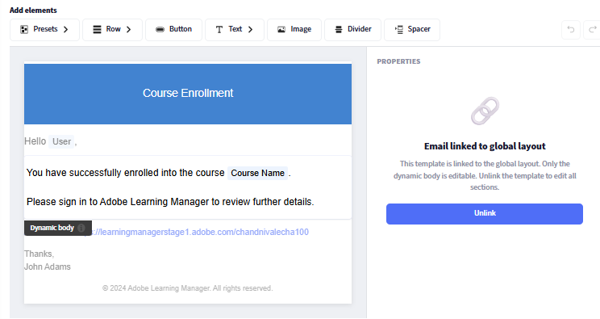

* 只有主體可編輯
* 自動對母版面配置進行變更，流程會自動流入此範本

**當未連結時：**

* 頁首與頁尾完全可編輯。 沒有灰色區域
* 範本完全獨立;父範本的變更不會影響它
* 範本從父程式在解除連結時的設計開始

**關鍵規則：** 編輯 **主體** 絕不取消範本連結。 編輯 **版面** 配置或明確選擇 **「取消連結** 」會中斷父連線。

### 何時連結（保持連結）

* 你希望全球品牌能自動持續流傳
* 您只需變更此範本中的訊息文字或變數
* 你正在維護龐大的範本庫，並希望有集中式的品牌控制

### 何時解除連結

* 你需要為特定範本設計不同的橫幅、配色方案或結構佈局
* 你正在為特定課程、認證或受眾打造獨特的品牌體驗
* 您是一位作者，希望對單一學習物件或實例擁有完整設計控制權

### 解除帳戶層級範本連結-管理員

1. 選擇 **「電子郵件範本」** 並開啟範本。 例如，課程 - 自我報名。
2. 選擇「 **解除連結**」。

   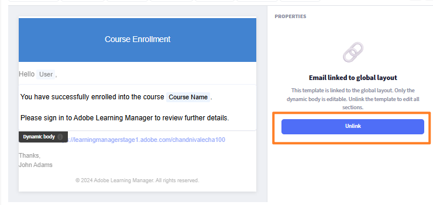

3. 閱讀確認訊息並選擇 **「是**」。
4. 頁首與頁尾將完全可編輯。
5. 自訂範本的任何部分。
6. 選擇「 **儲存**」。

範本會保留父版面配置作為起點，但不再接收未來的父版更新。

### 將範本還原為其父版本

回復原始範本會重新連結範本，並重設為父範本所提供的完全相同內容。

* 如果範本僅&#x200B;**&#x200B;**&#x200B;進行正文編輯（仍連結）：會將主體訊息還原為父版的預設值。頁首與頁尾未變，因為它們原本就來自父檔案。
* 如果範本完全 **取消連結**：會將所有內容（頁首、主體和頁尾）全部替換為父版本。 所有獨立自訂功能將永久移除。

>[!CAUTION]
>
>回復原始狀態無法撤銷。 在還原之前，先複製任何你想保留的內容。

**還原的方法：**

1. 在編輯器中開啟範本。
2. 選擇 **「還原為原始檔案**」。

   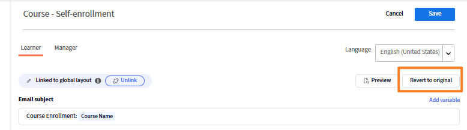

### 解除連結實例層級範本-作者

1. 開啟課程並選擇 **「電子郵件範本**」。
2. 開啟範本，例如「課程完成」。
3. 選擇「 **解除連結** 並確認」。
4. 進行變更後選擇 **儲存**。

這只影響此實例。 其他實例則不受影響。 實例範本是從解除連結時的 LO 層級範本設計開始，而非全域佈局。

管理範本會回復為全域版面版面版本，並重新連結到全域版面。 作者 LO 範本會回復為管理員帳戶範本版本。 作者實例範本會回復為 LO 範本版本（或若 LO 範本已連結則回復為帳戶範本）。

## 自訂個別範本

### 導覽至範本

1. 在 **「電子郵件範本」**&#x200B;中，從清單中選擇一個類別。 例如， **一般**、 **學習活動**&#x200B;或 **提醒與更新**。
2. 依名稱尋找範本。 範本會列出其觸發事件及目前啟用/停用狀態。
3. 選取範本名稱，在編輯器中開啟它。

### 編輯主體（連結範本）

當範本被連結時，只有主體可編輯。 頁首與頁尾顯示為灰色。

1. 打開範本。 確認頁首與頁尾為灰色（連結狀態）。
2. 選擇主體中的任意位置以進入編輯模式。
3. 編輯訊息文字、格式、變數及內文中的任何元件。
4. 選擇「 **儲存**」。

### 編輯完全自訂的範本（未連結）

解除連結後，頁首、主體與頁尾三個部分皆可用與全域版面相同的拖放編輯器編輯。

1. 在任何零件中新增、移除或重新排列列與元件。
2. 可獨立編輯預設元件（橫幅、稱呼、簽名、帳號網址）。
3. 插入此範本類型專屬的變數。
4. 選擇「 **儲存**」。

### 編輯多種語言範本

每個範本都支援您帳戶所設定的所有內容語言。

1. 打開範本。
2. 選擇「 **語言」** 下拉選單。 它會顯示你帳戶所有可用的語言。
3. 選擇您想要編輯的語言。
4. 編輯該語言的主體（以及未連結的版面配置）。
5. 選擇「 **儲存**」。

每種語言版本獨立儲存。 編輯一種語言不會影響其他語言。 如果語言版本未進行自訂，學習者會收到該語言的預設內容。

>[!NOTE]
>
>如果範本已解除連結，而您編輯其版面配置時只用一種語言，版面變更只會套用在該語言版本。 其他語言版本則保留各自的狀態。

### 在編輯器中預覽（視覺檢查）

1. 在編輯器工具列中選擇 **「預覽** 」。
2. 會開啟預覽視窗，顯示電子郵件將呈現給收件人的樣貌。
3. 檢視版面配置、間距、圖片及可變佔位符。
4. 關閉預覽以繼續編輯。

## 向下相容性

### 現有帳戶

所有先前設定的電子郵件範本都會完全保留原狀。 新建構工具可與現有編輯器一同使用。 更新前設定的範本不會自動移轉為新格式。 它們繼續照舊運作。

### 新帳號

先用新的建構器和乾淨的預設全域版面配置開始。 預設版面採用簡化設計，避免了舊版配置中已知的渲染問題（例如橫幅圖像顯示失敗）。

如果你的帳戶同時有舊格式和新格式範本，兩者可以共存且不會衝突。 你可以按照自己的節奏，將個別範本移轉到新格式，方法是在新編輯器中開啟並儲存。

## 排解電子郵件範本

**全域版面配置變更未顯示在範本中**

範本已解除連結。 確認並修正：

1. 打開範本。
2. 如果頁首與頁尾可 **編輯** （未呈灰色），範本將被取消連結。
3. 若要還原全域版面配置繼承，請選擇 **「還原為原始** 並確認」。

**範本看起來與全域版面配置不同**

原因和上面一樣。 模板被取消連結，可能是故意的，或是先前的版面編輯所致。 還原為原始檔案以重新連結。

**變數在已發送的電子郵件中以文字呈現**

變數名稱拼字錯誤或此範本類型無法使用。

1. 打開範本並找到該變數。
2. 刪除後使用插入變數&#x200B;**選擇器重新插入**。
3. 選擇器只會顯示對此範本有效的變數。 從清單中選擇以避免錯字。
