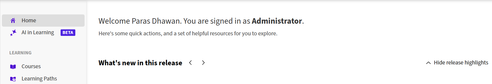
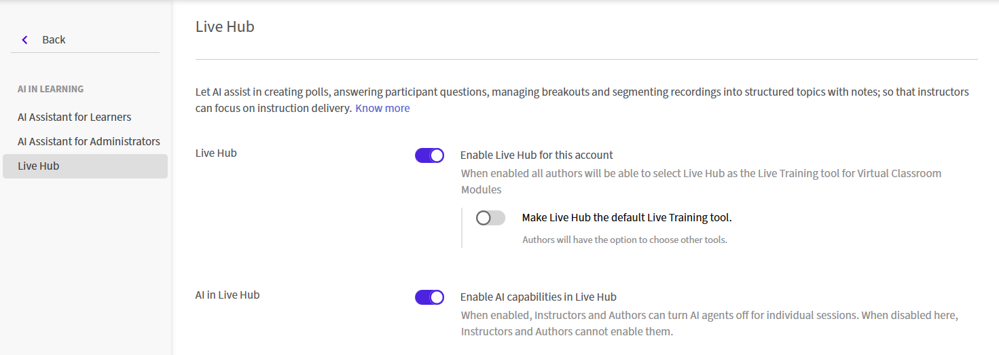
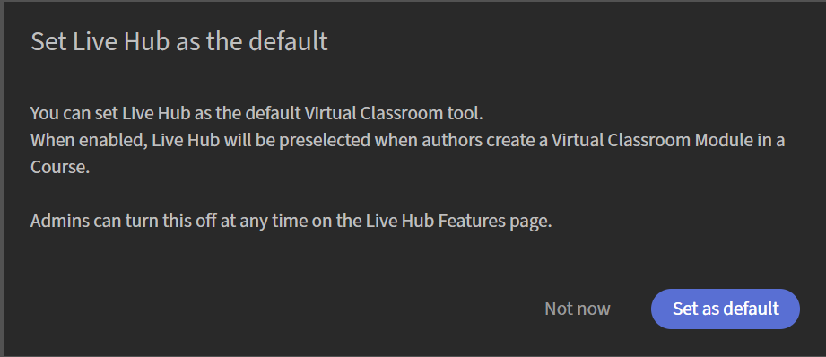
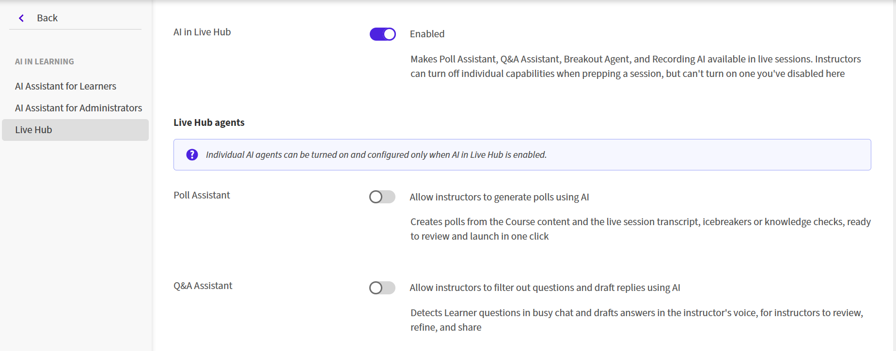

# 在 Adobe Learning Manager 中啟用 Live Hub

管理員可為 Adobe Learning Manager 帳戶啟用 Live Hub，並設定 AI 輔助人員，在線上課程中支援講師。 啟用 Live Hub 後，作者可以使用 Live Hub 虛擬訓練工具來建立和管理課程的虛擬教室模組。

啟用 Live Hub 的方法如下：

1. 以管理員身份登入 Adobe Learning Manager。

1. 在左側導覽窗格中選擇 **「學習** 」中的 AI。

   
   *在學習中選擇 AI，以啟用 Live Hub。*

1. 選擇 **Live Hub**。   **Live Hub** 頁面隨即開啟。

   
   *Live Hub 設定顯示在 ALM 中啟用 Live Hub 的選項。*

1. 為此帳戶&#x200B;**啟用** Live Hub。   **會出現「設定 Live Hub 為預設**」對話方塊。

   
   *在快顯視窗中選擇「設為預設」。*

1. 請選擇下列選項之一：

   1. **設為預設**：將 Live Hub 設為預設的虛擬教室提供者。 當作者為課程建立虛擬教室模組時，Live Hub 會預先被選取。

   1. **現在**&#x200B;不行：關閉對話方塊而不更改預設虛擬教室提供者。 您可以在稍後的 Live Hub 頁面啟用此設定。

1. 在 Live Hub **開啟** AI，讓 AI 驅動的助理能在即時會話中使用。

   
   *在 Live Hub 中啟用 AI，以啟用 Live Hub 代理程式。*

1. 啟用來自 Live Hub 代理程式的助理：

   1. **投票助理**：從課程內容與即時會議文字稿產生投票，創建破冰或知識檢查，隨時可一鍵檢視並啟動。 查看 [「建立並啟動投票](../../getting-started-with-live-hub/create-and-launch-a-poll.md#create-a-poll-using-ai) 」以取得更多資訊。

   1. **問答助理**：偵測課程聊天中的參與者問題，並根據上傳內容及課程逐字稿草擬答案，供講師審閱、精煉並分享。 請參閱 [「以講師](../../getting-started-with-live-hub/use-the-chat-panel-as-an-instructor.md#draft-replies-to-participant-questions-with-ai) 身分使用聊天面板」以取得更多資訊。

   1. **分組討論監控助理**：根據講師的目標閱讀每個分組討論室的逐字稿，每隔幾分鐘張貼一張狀態卡，並提供每教室的討論摘要，以及跨教室的主題、決策與空白綜合摘要，即時進行回顧。 請參閱 [「](../../getting-started-with-live-hub/create-and-manage-breakout-rooms.md#view-ai-generated-summaries-of-breakout-rooms) 建立與管理分組討論」以取得更多資訊。

   1. **錄製主題產生器：自動**&#x200B;將會議錄製分割成帶有時間戳記與結構化筆記的命名主題，讓參與者能直接進入所需內容，或從筆記中學習，無需觀看完整錄影。 請參閱 [「了解錄音與逐字稿](../../getting-started-with-live-hub/record-a-session.md#generate-topics-in-recording) 」以獲取更多資訊。

   1. **講師尋找助理**：根據技能、可預約時間、使用情況、偏好授課時數及其他標準，推薦授課教師。 請參閱 [「建立 Live Hub 會話](../../getting-started-with-live-hub/create-a-live-hub-session.md#add-instructors-using-instructor-finder) 」以取得更多資訊。

>[!NOTE]
>
> AI 助理僅在啟用 Live Hub 的 AI 時才能設定。 講師可以在準備課程時停用助理，但無法啟用已被管理員停用的助理。

請參閱 [「Live Hub](../../getting-started-with-live-hub/getting-started-live-hub.md) 入門指南」以取得更多資訊。