# 新增與設定小工具

## 行事曆小工具

行事曆小工具會顯示您排定的課程與訓練。 您可以瀏覽行事曆，查看未來幾個月的培訓安排。 它允許按月查看訓練課程，並可向左或向右捲動。

管理員可以將行事曆小工具新增至頁面，以顯示訓練行程表。 學習者可以透過滾動月份來與行事曆互動，查看即將到來的課程。 他們可以篩選課程，快速找到相關的訓練。

### 新增行事曆小工具

在擁有獨立銷售團隊與客戶成功經理（CSM）團隊的金融公司中，管理員可以使用此小工具標示團隊專屬的培訓課程。 例如：

* 銷售團隊可以看到即將舉辦的產品更新、合規訓練及簡報工作坊等課程。
* CSM 團隊可以查看客戶入職工作坊、客戶溝通訓練以及服務卓越計畫。

設定行事曆小工具的方法如下：

1. 以管理員身分登入 Adobe Learning Manager。
2. 在左側導覽窗格中選取 **[!UICONTROL Branding]** 。
3. 選擇 **[!UICONTROL Custom Pages]**。
4. 選擇所需的頁面，然後選擇 **[!UICONTROL Page Design]**。
5. 選取 **[!UICONTROL Edit]** 後再選擇版面配置。
6. 選擇 **[!UICONTROL Add Widget]**。
7. 選取 **[!UICONTROL Calendar]** ，然後選取 **[!UICONTROL Proceed]**。

   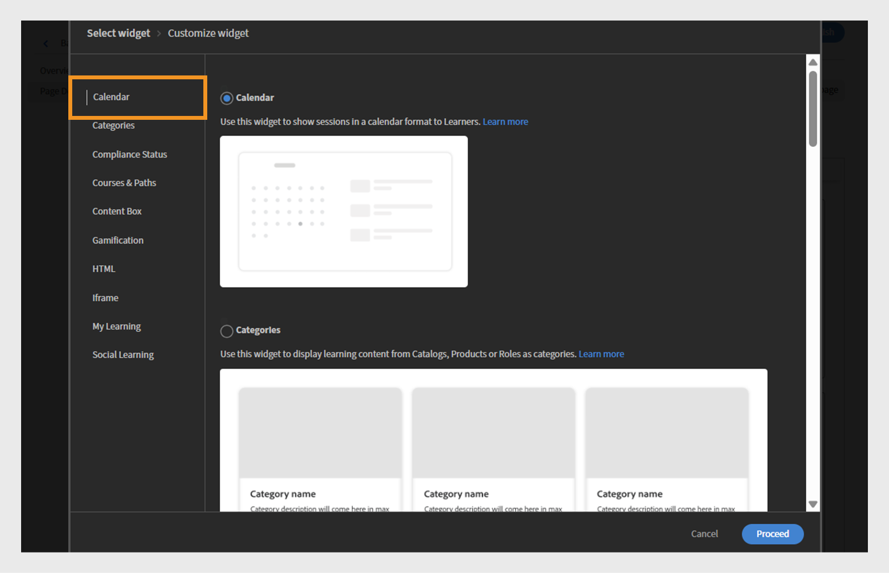
   _元件選擇畫面，突出顯示行事曆小工具選項，以顯示行事曆中的訓練課程_

8. 類型 a **[!UICONTROL Widget title]** 和 **[!UICONTROL Widget description]**。

   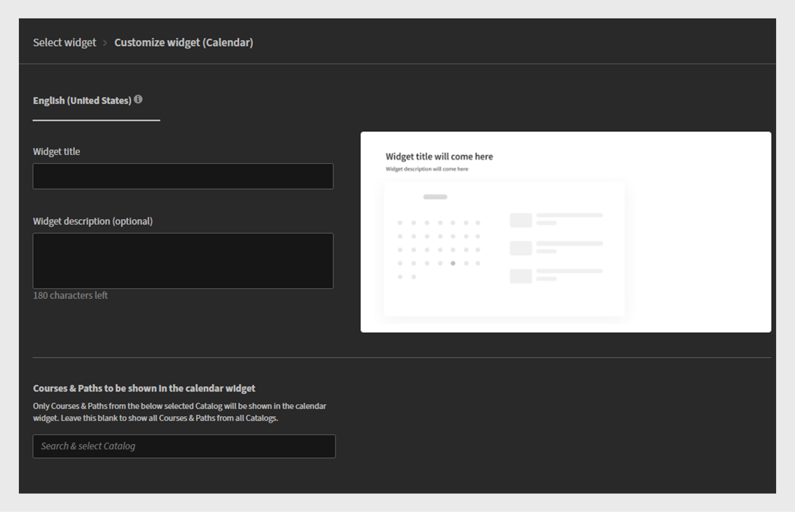
   _行事曆小工具自訂畫面，管理員可設定小工具標題、描述及選擇目錄_

9. 透過搜尋選擇目錄，即可在小工具中 **[!UICONTROL Calendar]** 顯示其課程與學習路徑。
10. 選擇 **[!UICONTROL Add Widget]**。

行事曆小工具將會被新增到頁面中。 管理員可以新增其他小工具並發佈頁面。

>[!NOTE]
>
>若未選擇目錄，則會顯示所有目錄的會話。

## 分類小工具

分類小工具會以分類方式顯示依目錄、產品或角色組織的學習內容。 它幫助學習者輕鬆瀏覽並找到依主題、部門、技能或其他相關分類分組的訓練內容。

管理員會在頁面新增分類小工具，以展示分類的學習選項。 學習者使用小工具選擇感興趣的類別來探索訓練內容，接著會顯示相關的課程或路徑。

請參閱 [「目錄](/help/migrated/administrators/feature-summary/catalogs.md) 與 [建議](/help/migrated/recommendations-adobe-learning-manager.md) 」文章，以進一步了解如何設定目錄與建議。

<b>注意</b>：在分類元件中，當選取「目錄」時，清單預設依建立日期排序。 較近期建立的型錄會先顯示。

### 新增分類小工具

在金融服務公司中，不同團隊通常需要針對特定職務的培訓。 分類小工具幫助將學習內容組織成清晰且可點擊的圖塊，讓銷售與客戶服務經理團隊能快速找到所需內容。

設定分類元件的方法如下：

1. 以管理員身分登入 Adobe Learning Manager。
2. 在左側導覽窗格中選取 **[!UICONTROL Branding]** 。
3. 選擇 **[!UICONTROL Custom Pages]**。
4. 選擇所需的頁面，然後選擇 **[!UICONTROL Page Design]**。
5. 選取 **[!UICONTROL Edit]** 後再選擇版面配置。
6. 選擇 **[!UICONTROL Add Widget]**。
7. 選取 **[!UICONTROL Categories]** ，然後選取 **[!UICONTROL Proceed]**。

   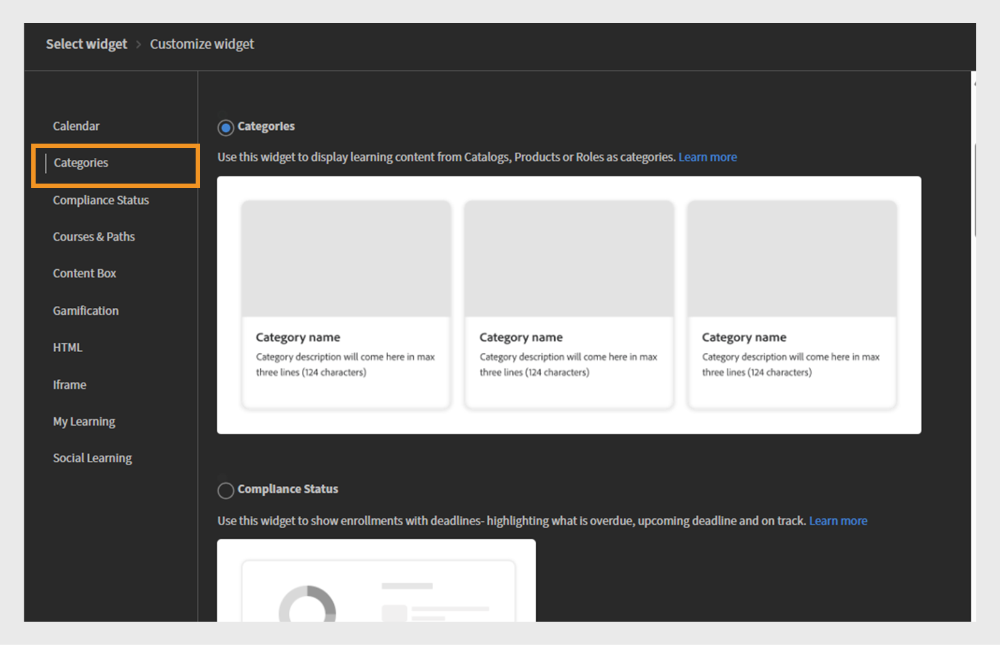
   _小工具選擇畫面，突出顯示「分類」小工具選項，可依目錄、產品或角色組織學習內容，方便瀏覽_

8. 選擇要顯示在類別卡片上的詳細資訊：

   * **[!UICONTROL Category Image]**
   * **[!UICONTROL Category Description]**

9. 類型 a **[!UICONTROL Widget title]** 和 **[!UICONTROL Widget description]**。
10. 從中搜尋並選擇一個目錄 **[!UICONTROL Category source]**。

    
    _設定分類元件選項以設定元件標題與描述，並選擇類別來源_

11. 選擇 **[!UICONTROL Add Widget]**。

分類小工具將會新增至頁面。 管理員可以新增其他小工具並發佈頁面。

## 合規小工具

合規狀態小工具會顯示學習者在達成合規或認證要求方面的進度。 它顯示分配給使用者的必修訓練狀態，包括已完成、待完成或逾期的課程。

管理員會在頁面中新增合規狀態小工具，以便掌握合規訓練進度。 學習者利用它快速檢查自己完成了哪些必修課程，哪些仍需注意。

### 新增合規狀態小工具

在金融服務公司中，銷售團隊與客戶成功經理（CSM）團隊都必須準時完成合規訓練。 合規狀態小工具讓學習者能直接從團隊專屬頁面追蹤即將到來的截止日期與訓練進度。

設定合規元件的方法如下：

1. 以管理員身分登入 Adobe Learning Manager。
2. 在左側導覽窗格中選取 **[!UICONTROL Branding]** 。
3. 選擇 **[!UICONTROL Custom Pages]**。
4. 選擇所需的頁面，然後選擇 **[!UICONTROL Page Design]**。
5. 選取 **[!UICONTROL Edit]** 後再選擇版面配置。
6. 選擇 **[!UICONTROL Add Widget]**。
7. 選取 **[!UICONTROL Compliance Status]** ，然後選取 **[!UICONTROL Proceed]**。

   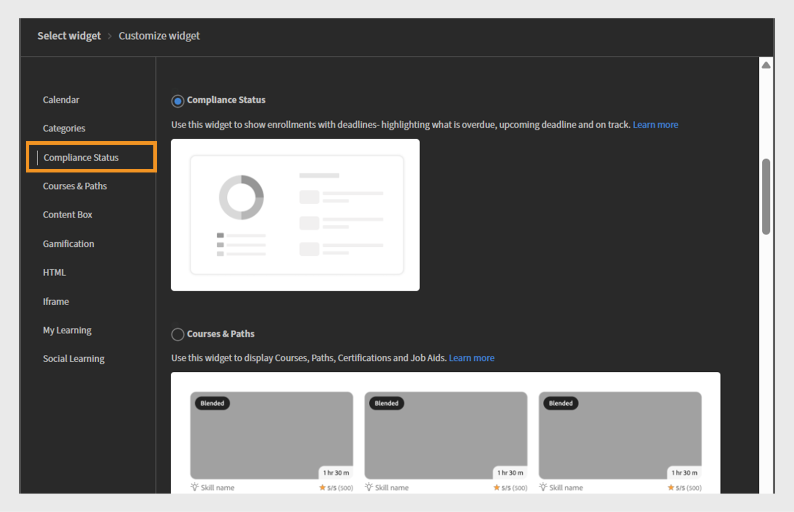
   _元件選擇畫面，標示用於顯示學員報名及截止日期及狀態指標的合規狀態元件_

8. 類型 a **[!UICONTROL Widget title]** 和 **[!UICONTROL Widget description]**。

   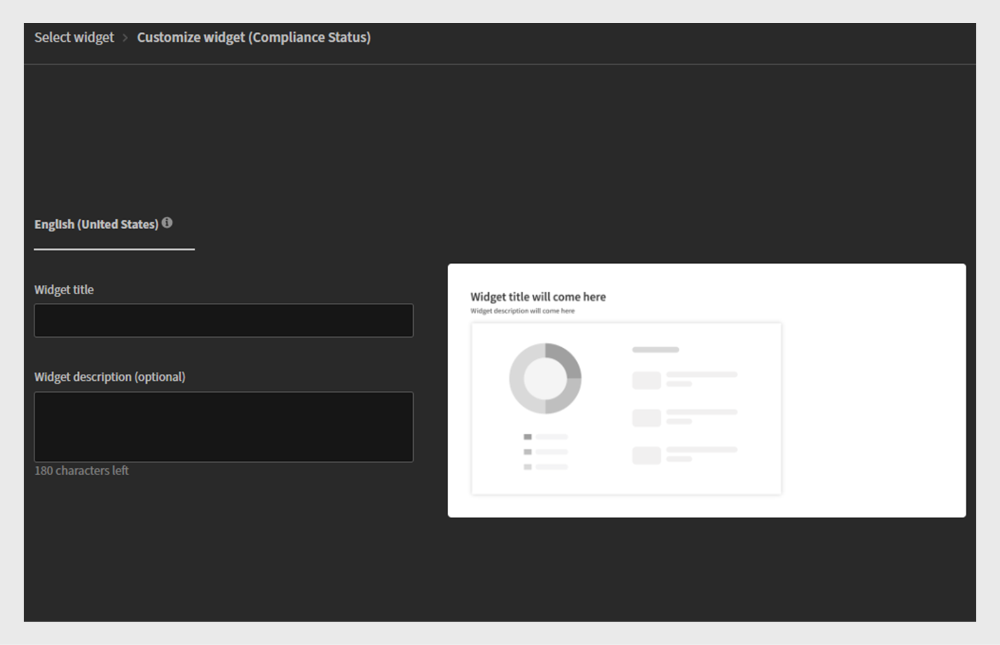
   _合規狀態小工具畫面，管理員可設定小工具標題與描述，以顯示學習者的報名截止日期及狀態_

9. 選擇 **[!UICONTROL Add widget]**。

合規狀態小工具將會新增至頁面中。 管理員可以新增其他小工具並發佈頁面。

## 課程與路徑小工具

課程與路徑小工具會顯示根據學習者角色、興趣或訓練需求量身打造的推薦課程與學習路徑。

管理員會在頁面上新增「課程與路徑」小工具，以突顯特定受眾的關鍵學習內容。 學習者可使用此小工具瀏覽推薦課程或路徑，並可直接報名課程。

### 新增課程與路徑小工具

一家金融公司希望為其兩個團隊——銷售經理與客戶成功經理（CSM）——建立專屬職務的培訓頁面。 課程與路徑小工具可用來顯示每個團隊最相關的學習計畫。

設定課程與路徑元件的方法如下：

1. 以管理員身分登入 Adobe Learning Manager。
2. 在左側導覽窗格中選取 **[!UICONTROL Branding]** 。
3. 選擇 **[!UICONTROL Custom Pages]**。
4. 選擇所需的頁面，然後選擇 **[!UICONTROL Page Design]**。
5. 選取 **[!UICONTROL Edit]** 後再選擇版面配置。
6. 選擇 **[!UICONTROL Add Widget]**。
7. 選擇 **[!UICONTROL Courses & Paths]**。

   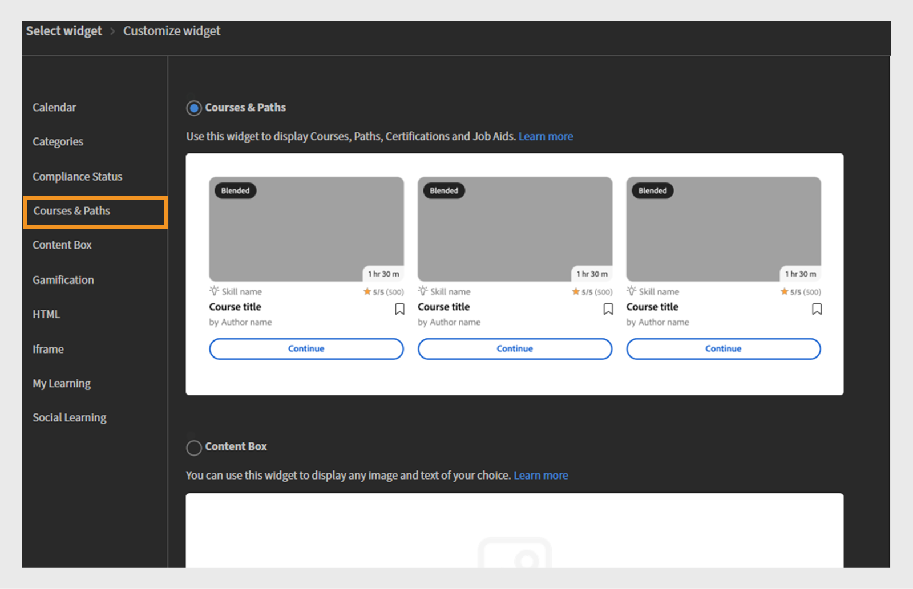
   _小工具選擇畫面，突出顯示課程與路徑小工具，以互動卡片形式顯示課程、學習路徑、認證及工作輔助工具_

8. 選擇 **[!UICONTROL Proceed]**。
9. 類型 **[!UICONTROL Widget title]** 與 **[!UICONTROL Widget description]**。
10. 選擇目錄或手動選擇最多 25 門課程以顯示。

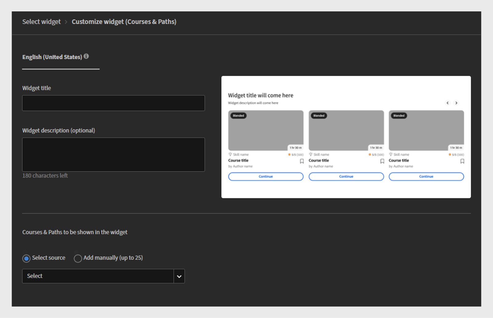
_課程與路徑元件，管理員可設定元件標題、描述，並選擇課程或學習路徑以互動卡片顯示_
&#x200B;11. 選擇 **[!UICONTROL Add widget]**。

「課程與路徑」小工具將會新增至頁面。 管理員可以新增其他小工具並發佈頁面。

## 內容方塊小工具

內容方塊小工具允許管理員新增自訂內容，例如文字、圖片、公告或頁面連結。 它提供一個彈性空間，讓學生能直接在學習環境中分享重要資訊、技巧、更新或宣傳訊息。

### 新增內容方塊小工具

一家金融公司希望為其兩個團隊——銷售經理與客戶成功經理（CSM）——建立專屬職務的培訓頁面。 內容框小工具可用來新增自訂的章節，包含標題、描述、圖片及行動呼籲按鈕，分享目標資源、更新與激勵訊息。

設定內容方塊小工具的方法：

1. 以管理員身分登入 Adobe Learning Manager。
2. 在左側導覽窗格中選取 **[!UICONTROL Branding]** 。
3. 選擇 **[!UICONTROL Custom Pages]**。
4. 選擇所需的頁面，然後選擇 **[!UICONTROL Page Design]**。
5. 選取 **[!UICONTROL Edit]** 後再選擇版面配置。
6. 選擇 **[!UICONTROL Add Widget]**。
7. 選取 **[!UICONTROL Content Box]** ，然後選取 **[!UICONTROL Proceed]**。

   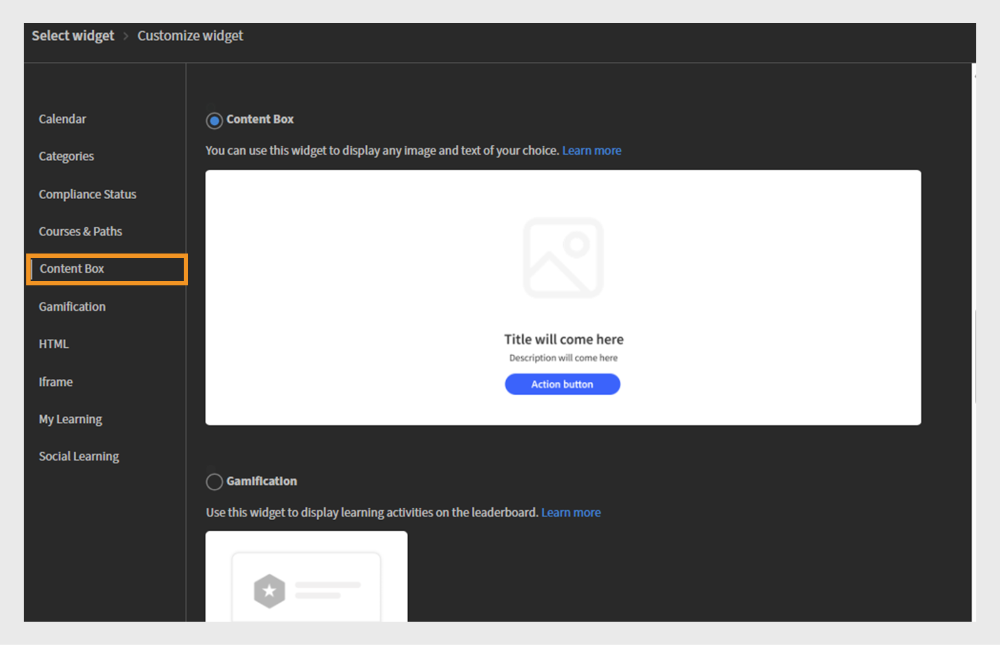
   _小工具選擇畫面，突出顯示內容方塊小工具，可顯示自訂圖片、文字及動作按鈕，以提升學習者的參與度_

8. 輸入 **[!UICONTROL Title]** 和 **[!UICONTROL Description]**。
9. 輸入文字並 **[!UICONTROL Action button label]** 提供連結。
10. 選擇背景填色的任一選項：

    * **[!UICONTROL Color]**：從色彩選擇器中選擇顏色，或在文字欄位輸入顏色代碼。
    * **[!UICONTROL Image]**&#x200B;瀏覽並上傳圖片。

11. 使用選項 **[!UICONTROL Content box height]** 調整方框高度。
12. 選擇文字格式選項。

    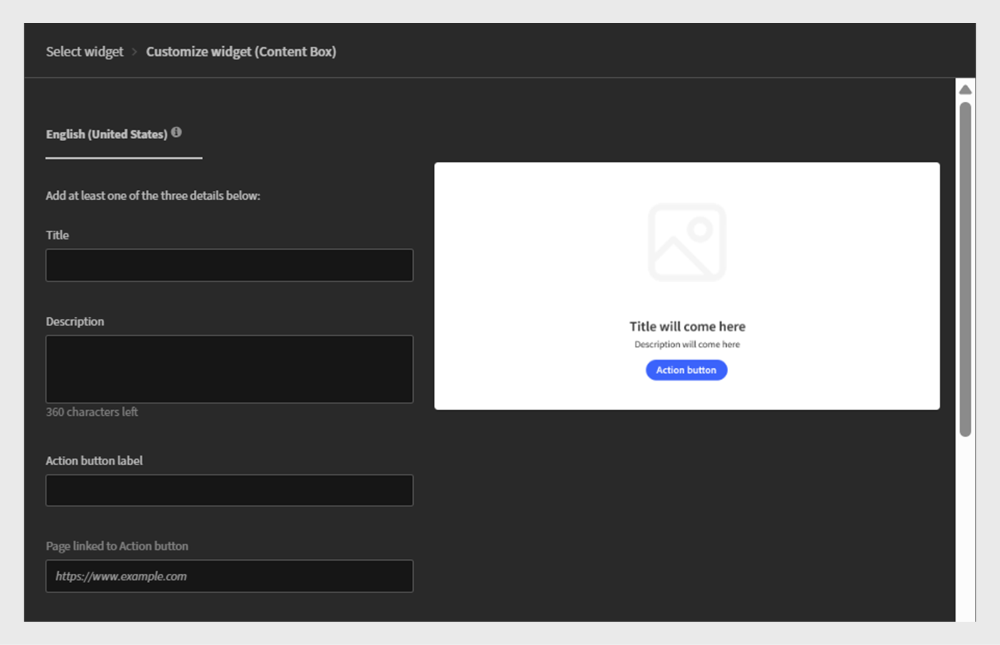
    _內容方塊小工具自訂畫面，管理員可在此輸入標題、描述、動作按鈕標籤及連結_

13. 選擇 **[!UICONTROL Add widgets]**。

內容方塊小工具將會被新增到頁面上。 管理員可以新增其他小工具並發佈頁面。

## 遊戲化小工具

管理員會在自訂頁面中加入遊戲化小工具，以展示學習者的成就，例如獲得的徽章、累積的積分與排行榜排名。 學習者可以追蹤自己的進度，並與同儕比較結果，這有助於激發動力並持續參與。

### 新增遊戲化小工具

一家金融公司希望提升其兩大團隊——銷售經理與客戶成功經理（CSM）——的學習者參與度與動力。 遊戲化小工具可用於獎勵完成訓練並積極參與的學習者，獲得積分、徽章和排行榜排名。

對銷售團隊而言，遊戲化可以著重於獎勵與銷售技巧、產品知識及客戶互動培訓相關的成就。 對 CSM 團隊而言，可能會強調客戶服務認證、合規訓練以及客戶管理技能。

設定遊戲化小工具的方法如下：

1. 以管理員身分登入 Adobe Learning Manager。
2. 在左側導覽窗格中選取 **[!UICONTROL Branding]** 。
3. 選擇 **[!UICONTROL Custom Pages]**。
4. 選擇所需的頁面，然後選擇 **[!UICONTROL Page Design]**。
5. 選取 **[!UICONTROL Edit]** 後再選擇版面配置。
6. 選擇 **[!UICONTROL Add Widget]**。
7. 選取 **[!UICONTROL Gamification]** ，然後選取 **[!UICONTROL Proceed]**。

   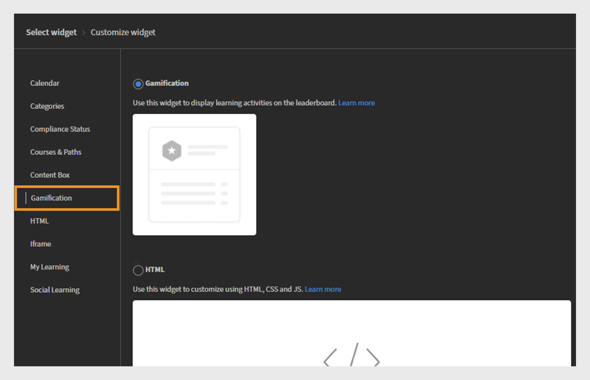
   _小工具選擇畫面，突出顯示用於在排行榜上顯示學習活動與成就的遊戲化小工具_

8. 輸入 **[!UICONTROL Widget title]** 和 **[!UICONTROL Widget description]**。
9. 選擇 **[!UICONTROL Add widgets]**。

遊戲化小工具將會被新增到頁面上。 管理員可以新增其他小工具並發佈頁面。

## HTML 小工具

HTML 元件允許管理員直接將自訂 HTML 程式碼嵌入頁面中。 這提供彈性，可以新增客製化內容、整合第三方工具，或加入超越標準小工具功能的互動元素。 它支援透過 HTML、CSS，甚至 JavaScript 進行豐富的客製化，讓學習平台能打造獨特的設計與外部整合。

### 新增 HTML 小工具

一家金融公司希望提供客製化且互動的內容，專為其兩大團隊量身打造：銷售經理與客戶成功經理（CSM）。 HTML 小工具可直接將自訂的 HTML 資源，如財務儀表板、資料視覺化、互動表單或市場分析工具，嵌入他們的培訓或團隊頁面中。

設定 HTML 小工具的方法如下：

1. 以管理員身分登入 Adobe Learning Manager。
2. 在左側導覽窗格中選取 **[!UICONTROL Branding]** 。
3. 選擇 **[!UICONTROL Custom Pages]**。
4. 選擇所需的頁面，然後選擇 **[!UICONTROL Page Design]**。
5. 選取 **[!UICONTROL Edit]** 後再選擇版面配置。
6. 選擇 **[!UICONTROL Add Widget]**。
7. 選取 **[!UICONTROL HTML]** ，然後選取 **[!UICONTROL Proceed]**。

   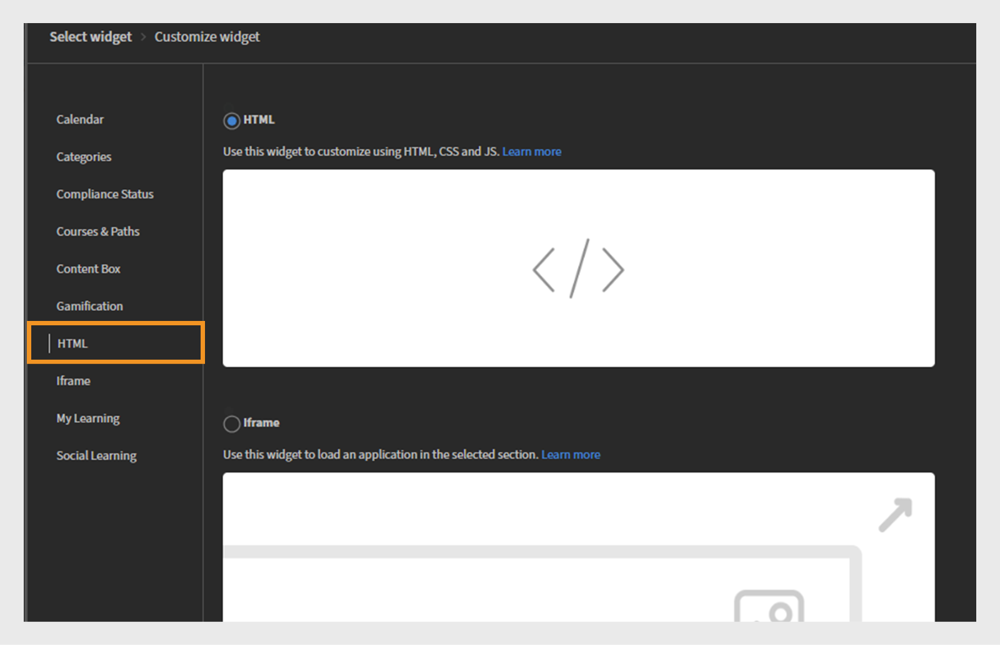
   _元件選擇畫面，突出顯示使用 HTML、CSS 與 JavaScript 程式碼自訂頁面的 HTML 元件_

8. 在相應欄位輸入您的 **[!UICONTROL HTML]**、 **[!UICONTROL CSS]**、 和 **[!UICONTROL JavaScript]** 程式碼。
9. 選擇 **[!UICONTROL Add widget]**。

HTML 元件將會被新增至頁面。 管理員可以新增其他小工具並發佈頁面。

## IFrame 小工具

Iframe 小工具可直接在學習平台的頁面中顯示來自外部 URL 的內容。 它將外部網站、工具或應用程式嵌入框架內，讓學習者在不離開 LMS 的情況下即可瀏覽與互動該內容。

### 新增 Iframe 小工具

一家金融公司希望將外部工具與資源無縫嵌入其內部的銷售與客戶成功經理（CSM）團隊的培訓與協作頁面中。 Iframe 小工具可用於直接在 LMS 介面內顯示第三方財務儀表板、市場分析平台或客戶管理入口網站。

設定 Iframe 元件的方法如下：

1. 以管理員身分登入 Adobe Learning Manager。
2. 在左側導覽窗格中選取 **[!UICONTROL Branding]** 。
3. 選擇 **[!UICONTROL Custom Pages]**。
4. 選擇所需的頁面，然後選擇 **[!UICONTROL Page Design]**。
5. 選取 **[!UICONTROL Edit]** 後再選擇版面配置。
6. 選擇 **[!UICONTROL Add Widget]**。
7. 選取 **[!UICONTROL Iframe]** ，然後選取 **[!UICONTROL Proceed]**。

   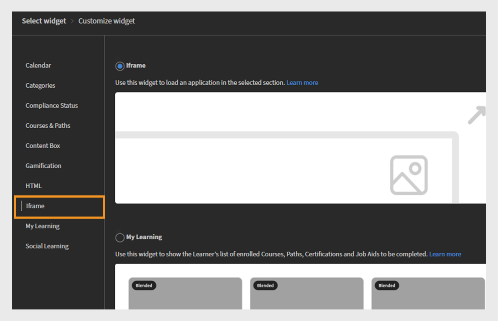
   _元件選擇畫面，突出顯示嵌入外部應用程式或網頁於所選區段中的 Iframe 元件_

8. 在選項 **[!UICONTROL Page linked to Action button]** 中輸入網址。
9. 使用選項 **[!UICONTROL Iframe height]** 調整 Iframe 高度。

   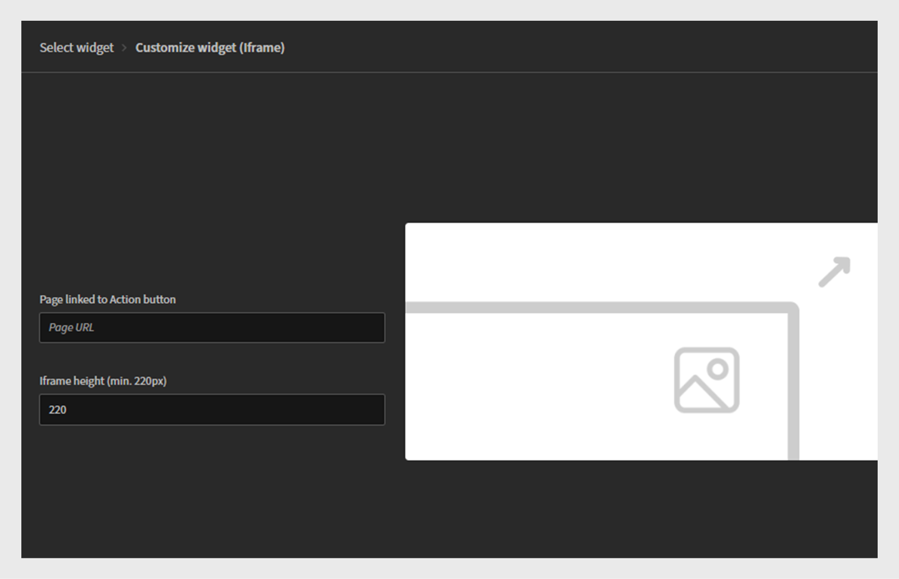
   _Iframe 小工具自訂畫面，管理員可輸入頁面 URL，並指定 iframe 高度以嵌入外部內容_

10. 選擇 **[!UICONTROL Add widget]**。

Iframe 小工具將會被新增到頁面中。 管理員可以新增其他小工具並發佈頁面。

管理員必須在 iframe URL 中將存取權杖作為查詢參數加入，才能取得正確的詳細資訊。 例如，若要在 iframe 內顯示來自 Adobe Learning Manager 的資訊，URL 應包含以下參數：

* userId：學習者的唯一識別碼
* accountId：與學習者相關聯的帳戶識別碼
* token：API 呼叫所需的驗證憑證
* 地區：學習者的語言或地區偏好

## 我的學習小工具

「我的學習」小工具為學習者提供個人化的檢視，了解所有由他們指派或註冊的課程、學習計畫及認證。 它依照學習類型與截止日期來組織學習內容，讓學習者能輕鬆追蹤進度並取得學習素材。 這個小工具幫助學習者專注於所需訓練，並簡要看到即將到來的截止日期。

### 新增「我的學習」小工具

一家金融公司希望為其兩大團隊——銷售經理與客戶成功經理（CSM）——量身打造個人化學習體驗。 「我的學習」小工具可讓每位團隊成員對其分配的課程、進行中的學習路徑及認證有更完整的檢視。

設定「我的學習」小工具的方法如下：

1. 以管理員身分登入 Adobe Learning Manager。
2. 在左側導覽窗格中選取 **[!UICONTROL Branding]** 。
3. 選擇 **[!UICONTROL Custom Pages]**。
4. 選擇所需的頁面，然後選擇 **[!UICONTROL Page Design]**。
5. 選取 **[!UICONTROL Edit]** 後再選擇版面配置。
6. 選擇 **[!UICONTROL Add Widget]**。
7. 選取 **[!UICONTROL My Learning]** ，然後選取 **[!UICONTROL Proceed]**。

   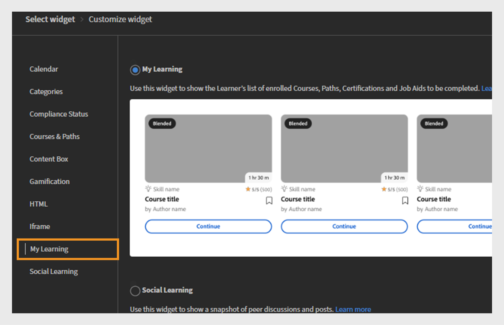
   _小工具選擇畫面，標示「我的學習」小工具，用來顯示學習者個人化的已報名課程清單_

8. 輸入 **[!UICONTROL Widget title]** 和 **[!UICONTROL Widget description]**。
9. 選擇 **[!UICONTROL Add widget]**。

我的學習小工具將會被新增到頁面中。 管理員可以新增其他小工具並發佈頁面。

## 個人化學習路徑小工具 {#add-a-plp}

個人化學習路徑小工具是您可以新增至體驗建構器中學習者頁面的內容條。 它會顯示學習者助理中個人化學習路徑（PLP）代理程式為其產生的學習路徑，讓學習者在不離開頁面的情況下，即可查看推薦課程並繼續學習。

使用個人化學習路徑小工具，在體驗建構器的頁面上向學習者展示個人化的課程組合。

## 開始之前

* 請確保您的帳戶啟用個人化學習路徑代理程式。 它包含在 Ultimate 等級中，或作為 Prime 等級的附加選項。
* 請確保在 AI 助理&#x200B;**設定中**&#x200B;啟用學習者助理及個人化學習路徑代理程式。
* 請確認您擁有管理員角色。

### 新增個人化學習路徑小工具

1. 以管理員&#x200B;**身份登入 Adobe Learning Manager**。

2. 在左側窗格中，選取 **「品牌設定**」。

3. 選擇 **「自訂頁面**」。

4. 選擇 **「編輯」** ，然後選擇版面配置。 然後，選擇

5. 選擇 **「新增元件**」，然後選擇 **「個人化學習路徑**」。

6. 在「元件標題&#x200B;**」下**，輸入元件的標題。

7. （選填）在「元件描述&#x200B;**」下**，輸入簡短描述。您最多可輸入 180 個字元。

8. 檢視螢幕右側的預覽。 每張卡片都會顯示課程格式、課程時長、技能、評分、標題與作者，並附有 **「繼續」** 按鈕。

9. 選取 **新增元件**，然後點選 **發佈** ，讓該頁面可供學習者使用。

## 由我儲存的小工具 {#bookmark-widget}

**「由我**&#x200B;儲存」小工具會顯示學習者已加入書籤以備日後使用的課程、學習路徑、認證及工作輔助工具。它讓學習者能在一個單一位置找到已標記為已儲存的內容，無需再次搜尋目錄。

作為管理員，您可以將 **「由我** 儲存」小工具新增至頁面，讓學習者能快速存取其書籤內容。 學習者可以使用小工具在瀏覽時重新瀏覽已儲存的課程，而不必重複原本的搜尋或導覽。

將此小工具加入頁面可以幫助：

* 透過提供一鍵存取常存取內容，簡化學習者的工作流程

* 減少重複的導航與尋找資源的時間

* 打造更具個人化的學習體驗，提升滿意度與參與度

### 新增「由我儲存」小工具

試想一家金融公司正在為其銷售與客戶成功經理（CSM）團隊推出超過50門新課程。  學習者瀏覽目錄時，會將與自身職務最相關的五、六門課程加入書籤。

這些已儲存的課程會自動出現在學習者個人化首頁的「由我儲存」小工具中。 他們不必再次瀏覽目錄，而是直接進入小工具，存取或註冊他們預留的內容。

設定 **「由我** 儲存」小工具的方法如下：

1. 以管理員身分登入 Adobe Learning Manager。
2. 在左側導覽窗格中選擇 **「品牌設定** 」。
3. 選擇 **「自訂頁面**」。
4. 選取所需的頁面，然後選擇 **頁面設計**。
5. 選擇版面配置。
6. 選取 **「新增小工具**」。
7. 選擇 **「由我** 儲存」，然後選擇 **「繼續**」。

   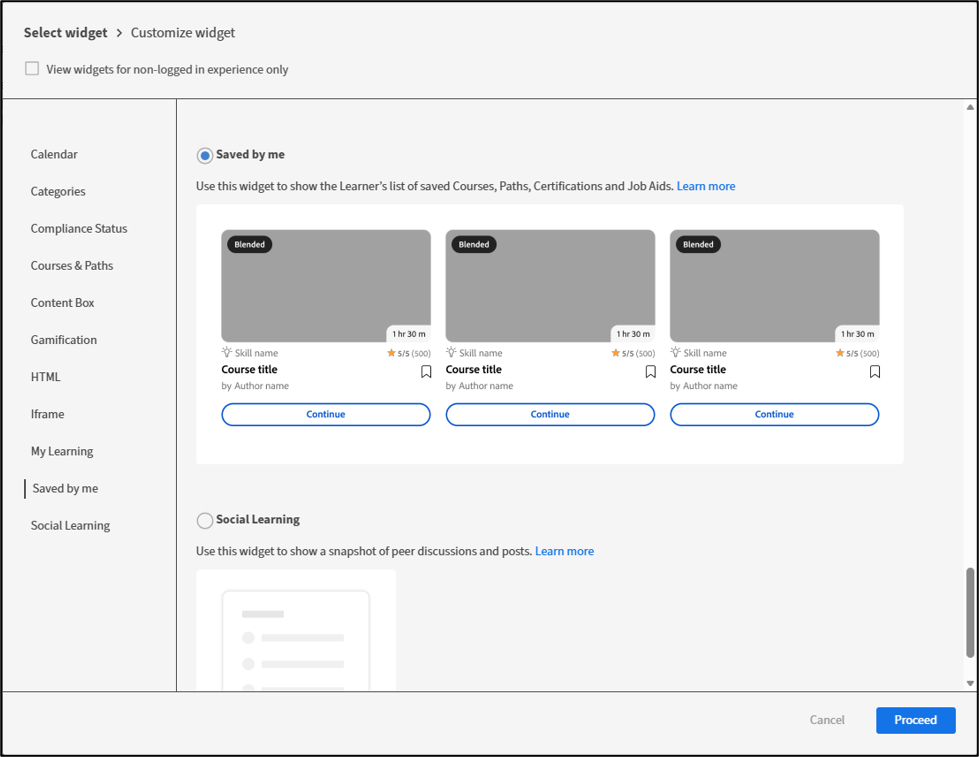

8. 輸入 **小工具標題** 及 **小工具描述**。

   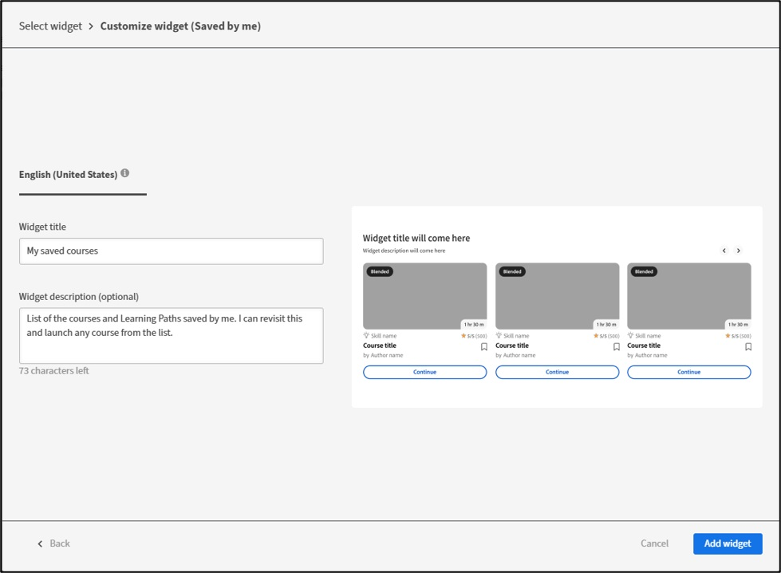

9. 選取新增 **小工具**。

**「由我**&#x200B;儲存」小工具將會被新增到頁面中。管理員可以新增其他小工具並發佈頁面。

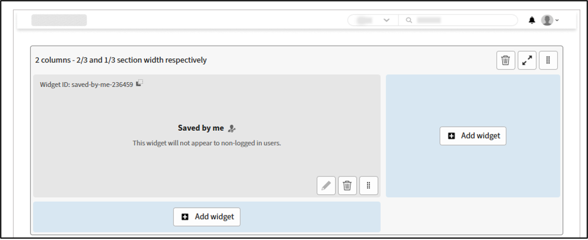

>[!NOTE]
>
>如果學習者沒有書籤任何內容，「由我儲存」小工具會在其頁面上顯示空白狀態。 當學習者將課程、學習路徑、認證或工作輔助書籤加入書籤時，這些項目會自動顯示在小工具中。

元件標題與描述支援本地化，方式與體驗建構器中的其他元件相同。 如果您的帳戶設定了多種語言，請為每種語言提供標題與描述，讓學習者能以偏好的語系看到小工具。

## 社交學習小工具

社交學習小工具讓學習者能在學習平台內互動、分享想法並協作。 它支援發佈各種類型的內容，例如文字、影片、音訊、截圖、問題和投票。 學習者可以留言、回覆、按讚或反對票，促進同儕間的知識分享與互動。 此小工具創造一個非正式學習空間，透過鼓勵社交互動與持續學習，補充正式訓練。

### 新增社交學習小工具

一家金融公司希望其兩大團隊——銷售經理與客戶成功經理（CSM）——之間能有合作與知識分享。 社交學習小工具可用於創建互動空間，讓團隊成員在此發問、分享最佳實務、上傳有用內容並參與討論。

設定社交學習元件的方法如下：

1. 以管理員身分登入 Adobe Learning Manager。
2. 在左側導覽窗格中選取 **[!UICONTROL Branding]** 。
3. 選擇 **[!UICONTROL Custom Pages]**。
4. 選擇所需的頁面，然後選擇 **[!UICONTROL Page Design]**。
5. 選取 **[!UICONTROL Edit]** 後再選擇版面配置。
6. 選擇 **[!UICONTROL Add Widget]**。
7. 選取 **[!UICONTROL Social Learning]** ，然後選取 **[!UICONTROL Proceed]**。

   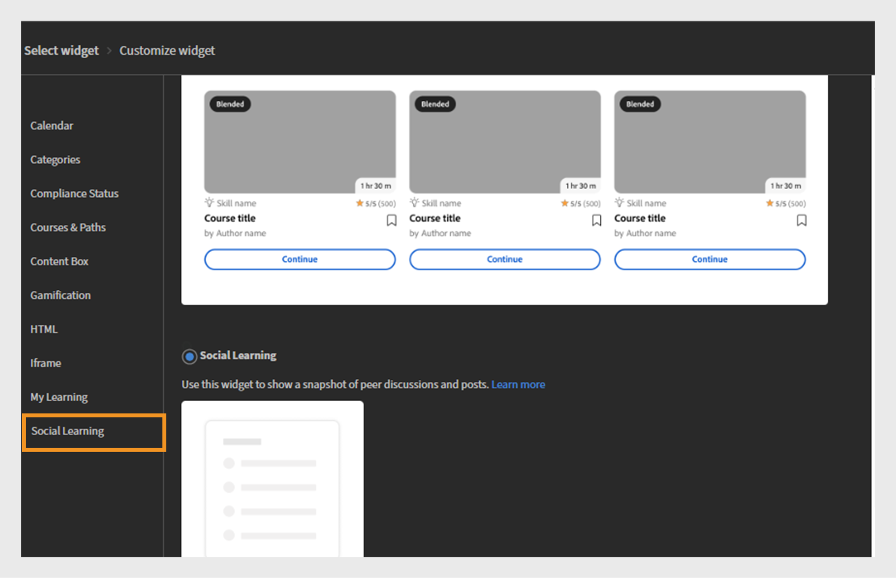
   _小工具選擇畫面，突出顯示「社交學習」小工具，以顯示貼文以促進協作與互動_

8. 輸入 **[!UICONTROL Widget title]** 和 **[!UICONTROL Widget description]**。
9. 選擇 **[!UICONTROL Add widget]**。

社交學習小工具將會被新增到頁面中。 管理員可以新增其他小工具並發佈頁面。

## 接下來是什麼

在頁面上設定小工具後，使用選單將頁面組織並分組在一起。
