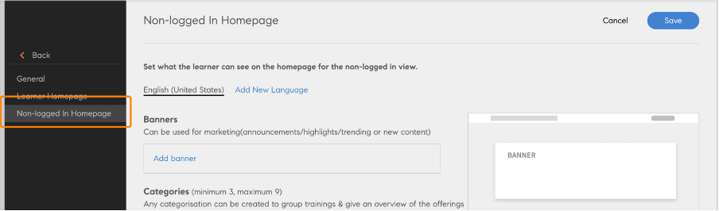
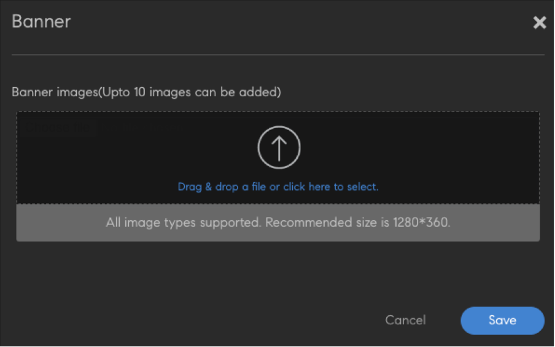
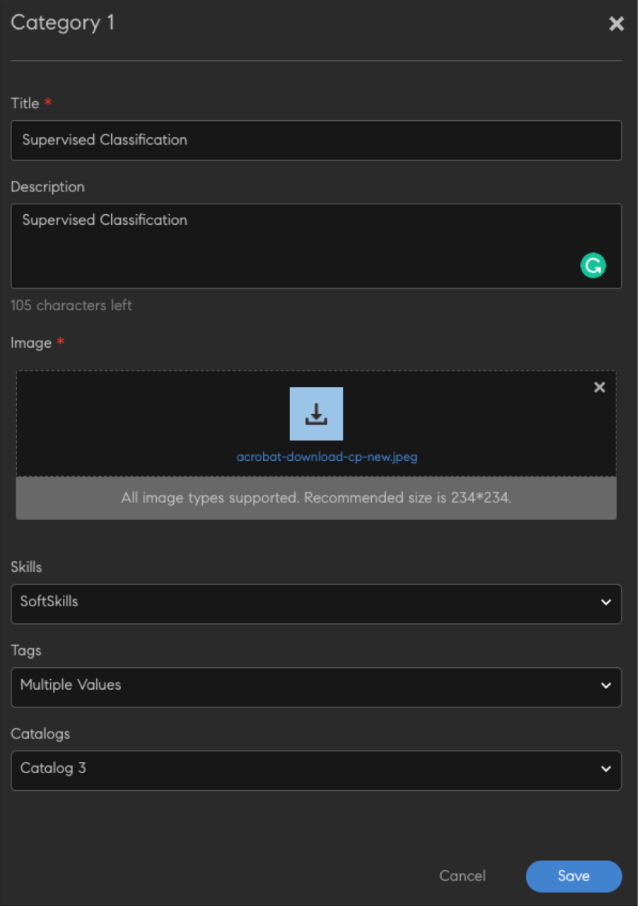
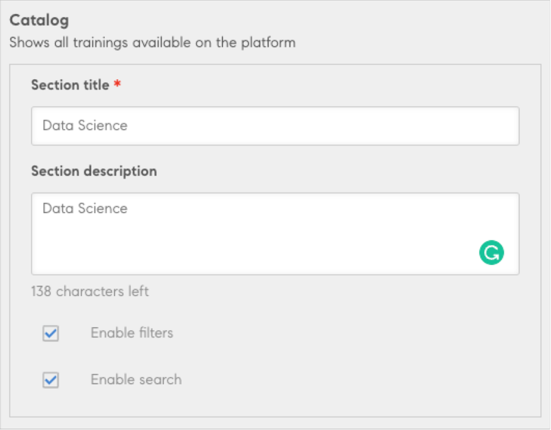

# Experience Builder 中的未登入體驗

## 簡介

Experience Builder 中的非登入體驗允許組織向所有訪客（包括尚未登入者）顯示其學習內容與入口網站頁面。 此功能旨在吸引、告知並吸引潛在學習者，透過在要求他們登入或報名前，提供流暢且具品牌特色的培訓預覽。

此功能讓您能使用與標準體驗建構器相同的使用者友善拖放介面，建立並自訂面向公開的頁面。 您可以展示課程目錄、分類、路徑，以及豐富的靜態內容，包括圖片、文字、HTML 和嵌入的 iframe，讓所有造訪您入口網站的人都能使用。 這讓您輕鬆推廣學習計畫、推廣新課程，並向更廣泛的受眾提供重要資訊。

訪客可瀏覽目錄、查看課程與實例詳細資訊，並利用全球搜尋功能探索可用的培訓機會。 然而，需要使用者身分的操作，例如報名課程、使用個人化功能（如行事曆、合規、排行榜或社交學習），或參加培訓，都會提示訪客登入。 此方法確保敏感且個人化資訊的安全，同時仍能提供完整的預覽體驗。

管理員可以設定哪些頁面和小工具對未登入的使用者可見，確保只顯示合適的內容。 頁面可設定為對已登入與未登入使用者皆開放，或僅限上述群組之一使用。 體驗建構器提供預覽模式，讓您在頁面發佈前，能精確看到頁面在訪客眼中呈現的樣貌。

要啟用此功能，您的 ALM 整合管理員必須啟用訓練資料存取連接器。 此連接器確保課程中繼資料對外開放。

品牌與在地化皆提供完整支援，讓您自訂頁面標題、網站圖示與語言設定，以符合組織身份並滿足受眾需求。 作為過渡至此增強體驗的一部分，針對未登入使用者的舊有首頁功能將被淘汰。 因此，所有新的公開內容都應使用 Experience Builder 來建立。

## 此功能的目的

Experience Builder 中的非登入體驗讓組織能公開向任何人展示其學習內容與入口網站頁面，無需使用者登入。 這有助於吸引、告知並吸引潛在學習者，透過在需要報名或驗證前先行預覽可用的訓練與資源。

## 非登入體驗的實際應用案例

- **行銷與推廣**：組織可以透過公開課程目錄與課程細節，向外部受眾推廣其培訓計畫，例如潛在客戶、合作夥伴或求職者。
- **報名前探索**：學習者可以在決定報名或登入前瀏覽可用課程、查看概覽並探索分類，幫助他們做出明智的報名決定。
- **企業培訓入口網站**：公司可以提供面向公眾的合規或入職資訊入口，讓新進員工或承包商在取得資格認證前，先了解可用的培訓內容。
- **活動或活動登陸頁**：執行學習活動或活動的組織可以建立專屬的公開頁面，突出重點課程、課程表或資源，提升能見度與互動度。
- **SEO 與可**&#x200B;被發現性：透過將部分頁面與目錄公開，組織提升搜尋引擎能見度，讓人們更容易在線上發現他們的學習服務。

## 非登錄體驗的關鍵概念

Experience Builder 的非登入體驗讓您公開展示學習內容與入口網站頁面，讓訪客無需登入即可瀏覽。

- **建立公開頁面與選單**：您可以設定頁面和單一選單，讓所有人都能存取，無論登入狀態如何。
- **只新增支援的小工具**：您可以包含不需要使用者上下文的小工具（類別、課程與學習路徑、內容框、HTML、iframe），而系統則隱藏使用者專屬的小工具。
- **設定自適應頁面行為**：您可以決定頁面是否同時顯示在登入與未登入的使用者身上，系統會根據登入狀態調整可見的小工具與內容。
- **預覽兩種體驗**：您可以使用預覽選項查看頁面在登入與未登入用戶間的呈現效果，以及小工具可見度與內容的差異。
- **啟用全球搜尋**：訪客搜尋課程與內容，但僅獲得基本搜尋功能，且未整合進階 AI。
- **讓訪客瀏覽目錄與課程概覽**：訪客可瀏覽目錄頁面、課程詳情及實例，但必須登入才能報名或使用個人化功能。
- **自訂品牌與在地化**：您可以設定網站圖示與語言設定，以符合組織的品牌與無障礙需求。
- **啟用訓練資料存取連接器**：啟用此連接器以匯出課程中繼資料以供公開顯示，並保持未登入頁面的最新。
- **利用共用基礎架構**&#x200B;處理高流量：系統利用共用資源與速率限制管理大量匿名訪客。
- **優化 SEO**：該平台會為搜尋引擎索引準備公開頁面，讓你的學習內容更容易被找到。

## 未登入經驗的先決條件

- 您必須在整合管理系統中啟用訓練資料存取連接器，才能使用未登入體驗。
- 連接器會將課程中繼資料匯出至公開儲存庫，該儲存庫會持續更新未登入的頁面。

### TDA 連接器初始化

訓練資料存取（TDA）連接器是啟用 ALM 中全新非登入體驗建構器功能的關鍵先決條件。 此連接器可協助匯出訓練中繼資料，讓您的入口網站向未登入的使用者顯示課程資訊。

- **連接器啟用**：您必須從整合管理面板啟用 TDA 連接器。 此步驟解鎖未登入體驗建構器功能，並在您的管理介面中顯示相關 UI 選項。
- **元資料匯出**：啟用後，連接器會將重要的訓練元資料（如課程名稱、說明、概述、評分、時長及技能）從 ALM 匯出至公開儲存庫。 這些資料用於填充未登入的頁面和小工具。
- **排程與同步**：匯出流程可排程（例如每日），以確保您的入口網站反映最新的課程更新。 在 ALM 中所做的變更，將在下一個匯出週期後顯示在您的未登入頁面上，並視快取與匯出頻率而定。
- **功能可用性**：未登入的體驗建構器功能，包括選單建立、元件支援及目錄可見性，僅在 TDA 連接器初始化後才能使用。 如果連接器未啟用，您的體驗建構器將僅限於已登入的使用者情境。
- **遷移與支援**：對於從舊有非登入首頁功能的帳戶，初始化 TDA 連接器是遷移的第一步。 它確保您能善用新體驗建構器的彈性與強化功能。

## 訪客在不登入的情況下可以做什麼

在未登入的 Experience Builder 網站上，訪客可透過開啟公開目錄的目錄頁面瀏覽訓練目錄。 他們可以依據您如何設定網站，使用目錄、產品、角色、類型、技能和標籤等篩選條件。 訪客也可以使用頁首的全域搜尋欄（若啟用）搜尋訓練課程，並直接在目錄頁面查看搜尋結果。

訪客可透過開啟課程、學習路徑及認證的總覽頁面來查看訓練詳情。 這些頁面會顯示關鍵的元資料，包括標題、描述、作者、時長、格式、標籤和技能。

此外，訪客還能探索靜態內容與宣傳內容。 他們可以閱讀文字與豐富內容區塊、檢視橫幅與圖片磚塊，並與嵌入的 iframe（如外部微型網站、影片或工具）互動。

如果訪客點擊「報名」或嘗試開始訓練，系統會提示他們登入或註冊。 成功登入後，訪客會被導向適當的頁面，無論是首頁、自訂頁面，或是他們所選擇的特定培訓。

## 未登入無法使用的項目

在未登入的 Experience Builder 網站上，訪客無法存取需要使用者驗證的功能或內容。 他們無法報名訓練、開始或修讀課程，或使用個人化小工具，例如我的學習、行事曆、合規、排行榜或社交學習。 這些小工具依賴使用者專屬資料，且僅在登入後可用。

訪客也無法執行報名課程或存取任何需要追蹤進度或使用者情境的內容等操作。 嘗試報名或開始訓練時，訪客會先登入或註冊後才能繼續。

## 未登入模式下支援的小工具

在非登入模式下，僅支援不需要使用者特定資料的小工具。 這些包括：

- 分類小工具，顯示可用的訓練分類。
- 課程與路徑小工具，顯示來自公開目錄的課程與學習路徑。 1
- 內容方塊，用於新增靜態文字、圖片或促銷內容。
- HTML 元件，用於嵌入自訂 HTML 內容。
- Iframe 小工具，用於在頁面內顯示外部網站、影片或工具。
- 需要使用者情境說明的小工具，如「我的學習」、行事曆、合規、排行榜及「社交學習」，在非登入模式下無法使用。

需要使用者情境說明的小工具，例如「我的學習」、行事曆、合規、排行榜和「社交學習」，在非登入模式下無法使用。

## 未登入體驗中的頁面與選單

- 僅支援一個未登入選單，所有訪客無需驗證即可查看。
- 頁面可以同時加入已登入與未登入選單;如果頁面同時在兩個選單中，它會根據使用者的登入狀態調整其小工具與內容。
- 未登入的選單不具備受眾目標鎖定或個人化功能。 大家看到的是同一組頁面。
- 不支援非登入模式的小工具會自動隱藏;頁面版面配置會調整以填補空隙。
- 選單與頁面管理（新增、預覽、刪除）類似登入模式，但會針對未登入的限制進行調整。

## 搜尋與目錄行為

在未登入模式下，使用者可進入目錄頁面，並使用搜尋功能瀏覽可用的課程與學習路徑。 目錄頁面會顯示所有公開課程，以及篩選條件與搜尋功能，並依照登入模式的帳號設定進行。 當使用者搜尋時，結果會顯示在目錄頁面上，使用者可在不登入的情況下瀏覽課程與實例概覽頁面。 不過，像是註冊這類操作需要登入。

如果使用者嘗試註冊，系統會要求他們先登入。 搜尋未登入用戶比已登入用戶更簡單，且不包含像 AI 助理整合這類進階功能。

## 技術實作

### 訓練資料存取連接器設定

您必須在整合管理面板啟用訓練資料存取連接器，才能使用未登入的體驗建構器功能。 此連接器會將訓練中繼資料從 ALM 匯出至公開儲存庫，透過 API 對未登入頁面進行存取。 連接器設定是啟用此功能的先決條件，確保您的入口網站顯示最新的訓練資訊。

元資料匯出與同步\
連接器匯出關鍵的元資料欄位，如課程名稱、概覽、描述、評分、時長及技能。 您可以排程匯出（例如每日匯出），以保持入口網站與 ALM 同步。 並非所有元資料欄位皆可包含;請諮詢工程部門以獲得完整清單。 匯出資料用於填充未登入頁面，ALM 的變更會在下一個匯出週期後顯示。

快取與匯出頻率\
系統使用後端匯出頻率與前端快取來管理資料更新。 在 ALM 中所做的變更會在排程匯出與快取刷新後反映在您的入口網站上。 由於這些機制，部分更新可能不會立即顯示。 如果您需要更快的更新，請調整匯出排程或視需要清除快取。

CSS/JS 自訂支援\
您可以使用自訂標籤，將自訂 CSS 和 JavaScript 套用到已登入與未登入的頁面。 這讓您能維持品牌一致性、加入自訂 UI 元素，並提升整個入口網站的使用者體驗。 所有客製化皆可全球適用，確保統一的外觀與感受。

URL 差異與品牌設定（favicon、頁面標題）\
未登入與已登入頁面可能會使用不同的網址，以區分使用者狀態。 你可以自訂入口網站的網站圖示和頁面標題，幫助強化品牌識別。 這些功能可在體驗建構器中取得;請向工程部門查詢未登入支援的最新狀態。

## 效能與擴充性

### 共享堆疊與高級堆疊

共享堆疊允許多位客戶在共用基礎架構上使用未登入的體驗建構器，並支援標準流量等級。 高級方案為付費方案，為有進階需求的客戶提供專用資源、即時功能及更高座位限制。 根據預期流量與業務需求選擇堆疊。

### 流量限制與速率限制

共享堆疊會強制執行流量限制，以確保客戶間的公平使用。 工程部門將實施速率限制，以防止任何單一客戶消耗所有資源。 如果您規劃行銷活動或預期流量高，請與工程部門協調，了解您的限制並避免服務中斷。 速率限制有助於維持系統的穩定性與效能，惠及所有使用者。

多租戶與 SEO 考量\
該平台支援多租戶，允許多個客戶在共享基礎設施上架設入口網站。 未登入頁面對 SEO 友善，並具備sitemap.xml與robots.txt以優化搜尋引擎能見度。 這確保你的入口網站能被搜尋引擎發現並適當地收錄。

## 遷移與淘汰

### 從現有未登入首頁轉換

舊有的非登入首頁功能將被棄用。 新帳戶將不會看到此選項，現有使用該選項的帳戶將收到遷移至體驗建構式解決方案的通知。 您應該使用新的體驗建構器重建首頁，以提升彈性、支援小工具並改善使用者體驗。 過渡計畫確保干擾降至最低並持續提供支持。

溝通計畫\
使用舊版首頁的客戶將收到關於棄用時間表及遷移步驟的明確通知。 我們將提供支援，協助您將首頁遷移至新的體驗建構平台，確保您能享受新功能與持續更新。

### 本地化與登入支援

區域備援邏輯\
系統會以所建立的語系顯示頁面。 如果使用者的語系無法使用，系統會使用備援邏輯選擇下一個最佳可用語系。 這確保使用者始終看到支援語言的內容，提升無障礙性與使用者滿意度。

支援的登入類型\
非登入體驗支援 ALM 中所有可用的登入類型，包括 SSO 與標準登入。 使用者可在不登入的情況下瀏覽內容，並在需要時（例如報名課程或使用個人化功能）系統會提示登入。 這讓瀏覽與互動之間能順暢過渡。

## 未登入的 API

### 管理學習物件 API

未登入的體驗建構器頁面與無頭入口網站通常會依據產品與角色來組織或篩選課程。 Admin LO API 已強化，以確保這些關聯對後端與無頭整合，以及 TDA 連接器都能持續存取。

**終點與行為**

您繼續使用現有的 Admin LO 端點：

GET /primeapi/v2/learningObjects/{loId}？enforcedFields learningObject[=]products，roles


其中：

- loId 是學習物件 ID（例如 course：12345）。
- enforcedFields[learningObject] 指示 API 明確包含該 LO 的產品與角色。

此目標透過確保在透過 enforcedFields 要求回應時，已包含 LO 的產品與角色關聯。 回應中會在屬性中包含計算或揭露推薦產品（rec_products）及角色（rec_roles）所需的產品與角色元資料，供 Experience Builder 及其他消費者使用。

來自管理員或整合的典型通話如下所示：

curl -X GET \
  “https://{your-domain}/primeapi/v2/learningObjects/course：12345？enforcedFields learningObject[=]products，roles” \
  -H「授權：持有人 {admin_token}」 \
  -h「接受：application/vnd.api+json」

回傳的 LO JSON 基本結構與之前相同，但現在你可以依賴在使用 enforcedFields 請求時，產品/角色欄位會存在。 未使用 enforcedFields 的整合仍維持先前的行為。

### 學習物件清單 – JobAid 支援於 effectiveModifiedDate 篩選器中

**目的**

訓練資料存取（TDA）連接器與無頭實作常需根據學習物件的有效修改日期&#x200B;**執行增量同步**。在此版本之前，JobAid（LO 型 jobAid）在與 effectiveModifiedDate 篩選器結合時並未被正確處理。 這次版本修正了這個問題，讓 JobAids 可以像課程和學習路徑一樣，以漸進式方式同步。

**終點與行為**

您使用現有的 LO 清單端點，並搭配日期篩選器和 LO 類型：

GET /primeapi/v2/learningObjects\
？filter.effectiveModifiedDate.fromDate=2025-03-15T13:14:56.000Z\
&amp;filter.effectiveModifiedDate.toDate=2025-03-20T13:14:56.000Z\
&amp;filter.loTypes=jobAid


過去，當 filter.loTypes=jobAid 與有效 ModifiedDate 範圍結合時，過濾器實際上排除了 JobAids，通話行為也顯示不支援 JobAids。

從這次更新開始，呼叫只會回傳 effectiveModifiedDate 位於指定視窗內的 JobAid 學習物件。

```
{  
  "links": {  
    "self": "https://acapapiserver/primeapi/v2/learningObjects?page[limit]=10&filter.effectiveModifiedDate.fromDate=2026-01-19T13:14:56.000Z&filter.effectiveModifiedDate.toDate=2026-01-21T13:14:56.000Z&filter.loTypes=jobAid"  
  },  
  "data": [  
    {  
      "id": "jobAid:144968",  
      "type": "learningObject",  
      "attributes": {  
        "authorNames": ["Sid"],  
        "dateCreated": "2026-01-20T08:48:55.000Z",  
        "datePublished": "2026-01-20T08:48:55.000Z",  
        "dateUpdated": "2026-01-20T08:48:55.000Z",  
        "effectiveModifiedDate": "2026-01-05T07:31:18.000Z",  
        "loType": "jobAid",  
        "loFormat": "Content",  
        "loResourceType": "Content",  
        "localizedMetadata": [  
          {  
            "description": "Link jobAid new",  
            "locale": "en-US",  
            "name": "Link jobAid new"  
          },  
          {  
            "description": "Link jobAid new fre",  
            "locale": "fr-FR",  
            "name": "Link jobAid new fre"  
          }  
        ],  
        "relationships": {  
          "authors": {  
            "data": [  
              { "id": "13385176", "type": "user" }  
            ]  
          },  
          "instances": {  
            "data": [  
              { "id": "jobAid:144891_-1", "type": "learningObjectInstance" }  
            ]  
          }  
        }  
      }  
    }  
  ]  
}
```

這表示您現在可以安全地根據 effectiveModifiedDate 實施增量式 JobAid 同步，就像您已經對其他類型所做的一樣。

如果您省略 filter.loTypes=jobAid，其他 LO 類型的行為將保持不變;變更僅影響 JobAid 與該篩選器的組合。

### **選單 API：未登入選單篩選器**

**目的**

Experience Builder 和無頭前端需要一個簡單直接的方法來取得 **未登入的選單，也就是定義公共訪客導航功能的選單** 。 在此版本之前，您必須擷取所有選單，然後套用自訂邏輯來辨識哪些選單代表未登入的導覽。 此版本新增了簡單的伺服器端過濾器。

**終點與行為**

您使用現有的選單清單端點並新增查詢參數：

GET /primeapi/v2/templates/menus？include=pages，subMenus.pages&amp;isNonLoggedIn=true


重點如下：

- include=pages，subMenus.pages 是可選的，但建議在需要在同一回應中同時包含頁面與子選單頁面詳細資訊。
- isNonLoggedIn=true 在此版本新增，指示伺服器只回傳被標記為未登入選單的選單。

若不設定 isNonLoggedIn 參數，端點將完全如前操作，並依據現有預設行為回傳選單。 在 isNonLoggedIn=true 中，通常會回傳未登入使用者在你帳戶中使用的單一選單（因為每個帳戶通常只有一個未登入選單）。

實務上，客戶現在可以發行：

curl -X GET \
  “https://{your-domain}/primeapi/v2/templates/menus？include=pages，subMenus.pages&amp;isNonLoggedIn=true” \
  -H「授權：持有人 {admin_token}」 \
  -h「接受：application/vnd.api+json」


並透過一次通話取得未登入的導覽結構，包含所有對匿名訪客應該可見的頁面。

當您正在建立一個無頭且未登入的網站，並希望鏡像與 Experience Builder 相同的導覽方式，或是在除錯未登入選單是否正確設定時，這特別有用。

## 允許自訂網域清單

未登入的堆疊包含：

- 一個公開的 CDN 網域（例如 cpcontents.adobe.com 或 yourdomain.example.com），用於提供版面配置、設定 JSON 及靜態資產。
- 一個公開的 Elasticsearch （ES） 端點，提供目錄與搜尋資料，但僅限於請求來自 **該 ALM 帳戶允許清單的網域** 時。

當您引入自訂網域時，它會無縫運作，無需依照現有新增自訂網域的流程進行額外努力。

### 先決條件

在為未登入者白名單自訂網域之前：

1. 自訂網域會為您的 ALM 帳戶設定（例如，academy.yourcompany.com 的 DNS 指向 Adobe / Akamai，且憑證會被配置）。
2. **訓練資料存取（TDA）連接器**&#x200B;已啟用該帳戶。
3. **未登入的體驗建構**&#x200B;器功能已啟用（Adobe 端）。

這些步驟確保：

- 您的帳戶有一個未登入 **的帳戶 JSON** （通常稱為 accountConfig / experienceBuilderConfig），其中包含 cpDomain、almDomain、almCdnBaseUrl、esBaseUrl 以及允許清單網域等欄位。
- 未登入的堆疊知道該在哪裡提供資料，以及應該從哪些網域接受請求。

### 允許清單的運作方式

允許清單儲存在 TDA 匯出且未登入堆疊讀取的設定中。 該配置包括：

- ALM 網域（cpDomain、almDomain）。
- **未登入內容的 CDN 基礎 URL**（almCdnBaseUrl）。
- **公開搜尋基底 URL**（esBaseUrl）。
- 允許為該帳戶進行公開未登入通話的網域清單。

若要讓未登入的 Experience Builder 在自訂網域上運作：

- 瀏覽器必須從該自訂網域（或依您的設定而定，從 ALM 未登入的 CDN 網域）載入未登入的 HTML。
- 必須接受該網域撥往公用 ES 和 CDN 端點的通話。 只有當該網域存在於允許清單中時才會發生這種情況。

此版本新增一個未登入的 CDN 網域 cpcontents.adobe.com，並指定必須將其置入 **TDA 連接器中允許列出的網域** 中。 對於現有且未登入的原生使用者，這需要更新。

### 將自訂網域加入允許清單

**在 ALM 中設定自訂網域**

與 Adobe 合作，將您的網域（例如 academy.yourcompany.com）註冊為 ALM 帳戶的自訂網域。 您依指示更新 DNS 指向 Adobe Akamai，並等待 SSL 與路由完成。

此時，無論是已登入或未登入的流量都可以透過該網域進入 ALM，但若該網域未被列入允許清單，未登入的搜尋與目錄呼叫仍可能被封鎖。

**啟用 TDA 及未登入的體驗建構器**

請確保：

- **訓練資料存取連接器**&#x200B;已啟用。
- **帳戶已啟用未登入的體驗建構**&#x200B;器功能。

啟用 TDA 會建立或更新未登入帳戶的 JSON。 對於新帳戶，流程預設也會將新的未登入 CDN 網域（cpcontent.adobe.com）列入允許清單，因此公開 ES 端點會預期該網域的呼叫。

對於已經使用舊版未登入堆疊的帳戶，M45 規範特別指出，必須刪除並重建現有連接器才能接入新網域。

**將自訂網域新增至允許清單**

關鍵在於要告訴未登入的 ES 堆疊 academy.yourcompany.com 是核准的來源。 有兩條常見的路徑。

1. **重新啟用 TDA 連接器（簡單、自助友善）**

   現有的原生未登入使用者需要刪除並重新啟用 TDA 連線，以便新網域自動列入允許清單。 這麼做能達成兩個目的：

   * 未登入帳戶的 JSON 會被重新生成。
   * 允許清單中的網域會更新，以包含新的未登入 CDN 網域以及您的自訂網域。

   建議當您帳號數量較少且能接受暫時停用並重新啟用連接器時。

2. **確認該網域確實已列入允許清單**

   在加入允許清單後，請在自訂網域上開啟您未登入的網站，並檢查瀏覽器網路通話。

你想看：

- 對 almCdnBaseUrl 的請求（例如 [https://cpcontent.adobe.com/](https://cpcontent.adobe.com/)...） 成功以200/304成功。
- 對 esBaseUrl 的請求（例如 [https://primeapps.adobe.com/almsearch/api/v1/](https://primeapps.adobe.com/almsearch/api/v1/)...） 成功後，回傳帶有搜尋/目錄資料的 JSON。

若這些呼叫回傳 4xx 或明確錯誤，提示「不受信任網域」或「來源不允許」，表示允許清單不完整或設定錯誤，支援需要調整。

未登入的 LLD 也會指出，帳戶設定可以儲存預期網域值。 執行時，網站會檢查 URL 中的網域是否符合設定中設定的內容;若不符合，使用者可能會被重新導向錯誤頁面。 這可防止一位客戶的設定被另一位客戶的網域存取。

## 在未登入的體驗建構器中使用推薦

未登入的體驗建構器讓您建立公開學習頁面，訪客可在登入前瀏覽您的目錄並查看重點內容。 即使這些訪客是匿名的，您仍可利用中繼資料和小工具呈現推薦的訓練內容。

在已登入的學習者應用程式中，推薦內容可以個人化：這些建議可以依據學習者的個人資料、歷史、技能與進度而定。 在 **未登入** 的體驗中，目前尚無學習者身份，因此平台無法為每位使用者進行個人化。

因此，在非登入模式下的建議如下：

- **精選或規則導**&#x200B;向：根據目錄、產品、角色、標籤、標籤及其他元資料。
- **分段導向**：「推薦給開發者」、「推薦給合作夥伴」、「精選新手」。
- **以行銷為重點**：用於吸引並引導訪客在登入後立即註冊。

### 支援建議的元資料與API

在幕後，未登入的頁面會使用：

- **TDA 連接器**，用於將學習物件的中繼資料（課程、路徑、認證、工作輔助工具）匯出至公開搜尋索引。
- **公開搜尋堆疊**&#x200B;用於回答來自未登入小工具（目錄、搜尋、課程與路徑、分類）的查詢。
- **Admin Learning Objects API** 用於揭露可用於建議規則的產品與角色元資料。

在此版本中，Admin LO API 進行了擴充，使產品與角色關聯能可靠地使用：

GET /primeapi/v2/learningObjects/{loId}？enforcedFields learningObject[=]products，roles

這讓小工具與無頭整合能夠一致地使用產品、角色、目錄標籤、標籤及其他欄位建立基於規則的推薦。

### 使用 Experience Builder 元件設計推薦區段

您可以透過結合 **Experience Builder 小工具** 與元資料篩選器，在未登入頁面上建立推薦區段。

#### **課程與路徑小工具**

當您想顯示一列或網格的推薦項目時，請使用 **「課程與路徑** 」元件。 在其設定中，您可以選擇：

- 從哪些目錄中取用。
- 哪些目錄標籤、產品、角色或標籤要用作篩選條件。
- 不論是展示課程、路徑、證照、工作輔助工具，還是混合展示。
- 分類與最大項目數量。

例如，您可以建立：

- 「推薦給開發者」：依您用於開發者內容的產品或角色進行篩選。
- 「從這裡開始」：依標籤篩選，例如「入門」或「入門」。
- 「本季精選」：依時限標籤篩選，如 featured-q3-2026。

這個小工具並不是在從行為中學習;它顯示的是符合你定義的元資料規則。 然而，從遊客的角度來看，它看起來像是一條推薦漫畫。

#### **分類小工具**

使用 **分類** 小工具幫助訪客進入「推薦」內容集合，即使他們不知道你的產品名稱。

您可以設定每個磚塊代表一個區段，例如：

- 「給行政人員」
- 「給銷售團隊用」
- 「給夥伴」
- 「依產品線分類」

每個方塊都可以連結到以下任一：

- 篩選過的目錄頁面（例如，依特定產品或標籤篩選的目錄）。
- 一個專用且未登入的頁面，使用該區段預先設定的課程與路徑。

這會讓你體驗「依區段推薦路徑」，無需個人化。

### 建立基於區段的建議

由於尚未登入的訪客尚未擁有 ALM 設定檔，依區隔&#x200B;**設計推薦**&#x200B;並讓訪客自行選擇會很有用。

1. 使用 **未登入的首頁** ，簡要說明你的學院是為誰設立，並顯示少數幾個細分市場的入口（例如「開發人員」、「行銷人員」、「合作夥伴」、「新員工」）。 這可以透過分類小工具、簡單的內容方塊或帶有按鈕的 HTML 區塊來完成。
2. 為每個區段，在 Experience Builder 中建立 **一個專用的非登入頁面** 。 在該頁面上，使用一個或多個課程與路徑元件，並設定篩選條件，代表該群組的「建議」內容。 例如，對於「開發者」，你可以篩選以下選項：
   1. 目錄 = 「公共教育」
   2. Product = “Adobe Experience Manager”
   3. Tags = 「開發者基礎」
3. 將這些分群頁面作為行銷活動的目的地，以及未登入首頁磚塊的目標。

訪客會感覺看到的是針對自身情況量身訂做的建議，儘管其邏輯是在設計時透過元資料定義的。

### 從未登入轉為個人化推薦

未登入的推薦主要是關於 **可** 被發現性與 **轉換**&#x200B;率。 一旦訪客決定報名或開始培訓，他們就會登入，成為擁有個人檔案與歷史的完整學習者。

通常的流程是：

1. 訪客透過你未登入的推薦區塊（首頁推薦、分群著陸頁、精選列）發現內容。
2. 他們點開課程或路徑概覽，選擇報名或開始。
3. ALM 會提示他們註冊或登入。
4. 登入後，標準的登入學習者體驗會接管，包括：
   1. 「我的學習」
   2. 已登入的目錄，顯示個人進度
   3. 你為現有學習者使用的任何內部推薦系統。

換句話說，登入的推薦幫助他們決定下一步該做什麼，並持續前進。

## 如何在全新非登入體驗建構器中使用工作輔助工具

在使用者介面&#x200B;**上**，工作輔助工具主要透過可顯示學習物件的小工具參與未登入的體驗：

1. **課程與路徑小工具**\
   此小工具可顯示多種 LO 類型，包括工作輔助工具。 在未登入的頁面中，您可以將其設定為：
   1. 明確包含或排除工作輔助工具。
   2. 依目錄、產品、角色、標籤、標籤及其他元資料篩選工作輔助工具。
   3. 可以將它們與課程和路線並列呈現，或作為獨立的「資源」條帶呈現。

例如，在公開登陸頁面上，你可以設定一個名為「Helpful resources」的條帶，只顯示工作輔助工具，另一個名為「推薦課程」的條帶則顯示課程與路徑。

1. **目錄頁面與搜尋**\
   未登入 **的目錄** 與 **搜尋** 面板使用公開搜尋索引（由訓練資料存取連接器提供）。 該索引現在正確支援工作輔助工具，因此：
   1. 未登入的搜尋結果可能包含工作輔助工具。
   2. 未登入目錄篩選器（依類型、產品、標籤等分類） 只要你的帳戶設定和小工具設定好能顯示工作輔助工具，就可以包含工作輔助工具。
2. **LO 概覽頁面**\
   當訪客從任何小工具或目錄點擊工作輔助工具時，他們會以未登入模式進入 **該工作輔助工具的 LO 總覽頁面** 。 接著，他們可以閱讀它的描述和元資料。 實際下載或使用通常仍需登入，但作業輔助工具的存在與可被發現性則由未登入體驗負責。

### 透過未登入的 API 揭露工作輔助工具

在 **API 端**，工作輔助工具由以下單位支援：

1. **訓練資料存取連接器與公開搜尋**\
   TDA 將工作輔助資料及其他 LO 類型匯出至公開搜尋索引，用於未登入的搜尋與目錄查詢。 這正是 Experience Builder 和無頭前端所依賴的。
2. **具有 effectiveModifiedDate 的學習物件清單**\
   在本版本中，已修正 LO 清單端點，使工作輔助工具能與 effectiveModifiedDate 篩選器正常運作。 您現在可以撥打：

GET /primeapi/v2/learningObjects\
？filter.effectiveModifiedDate.fromDate=2026-01-19T13:14:56.000Z\
&amp;filter.effectiveModifiedDate.toDate=2026-01-21T13:14:56.000Z\
&amp;filter.loTypes=jobAid


在此變更之前，將 effectiveModifiedDate 與 loTypes=jobAid 合併時，無法可靠地回傳工作輔助工具。 現在有了，正如 M45 公開 API 變更&#x200B;*維基所*&#x200B;記錄的那樣。這意味著：

1. 你的 TDA 或 ETL 工作可以 **像同步課程和路徑一樣，逐步同步非登入經驗的職缺輔助** 資料。
2. 任何建立公開工作輔助目錄的無頭實作，都可以根據 effectiveModifiedDate 和 loType=jobAid 查詢變更。

M45 文件中的範例回應顯示，使用此模式時會回傳一個 learningObject，其 loType： “jobAid” 與 loFormat： “Content”。

1. **Admin LO API**\
   雖然不專屬於未登入用戶，M45 也會更新 Admin LO API，透過以下方式持續公開所有 LO 類型的產品與角色元資料：

GET /primeapi/v2/learningObjects/{loId}？enforcedFields learningObject[=]products，roles


對於工作輔助工具來說，這表示你可以集中管理其產品、角色、標籤和標籤，並在公開且未登入的體驗中依賴這些元資料，例如「行銷人員資源」區塊或產品專屬的登陸頁面。

**注意**：

在未登入狀態下：

- 工作輔助工具主要是 **容易**&#x200B;被發現的：訪客可以看到它們的存在、閱讀說明，並理解它們如何支持主題或課程。
- 實際 **使用** （下載或開啟工作輔助內容）通常仍需登入，尤其是當工作輔助工具被視為授權或內部內容時。

## LO 搜尋（未登入）中「簡短描述」的變更

在未登入堆疊中，學習物件（LO）的搜尋與列出由訓練資料存取（TDA）連接器及公開的 Elasticsearch 索引驅動。 過去，這個堆疊會為每個 LO 使用單一的概覽/描述欄位。 打造無頭且未登入入口網站的客戶希望在 LO 磚塊上顯示與已登入學習者介面相同的簡短描述，而非僅顯示長篇概述。

此變更在未登入的搜尋與列表 API 中引入對 LO **簡短描述** 的支援：

- 對於 **課程**&#x200B;而言，現有的 UI 語意如下：
  - 登入的卡片若有，會顯示「簡短描述」（140 字元欄位）;否則則會回落到冗長的「詳細概述」。
- 對於 **學習路徑**，登入的使用者介面會使用「Benefits」欄位作為簡短描述（如有定義），否則則會退回到概覽。
- 對於 **認證**，會使用簡短的「說明」，並以較長的「認證概述」作為備用。
- 對於 **工作輔助工具**，則使用主要描述欄位。

## 其他變更

### 限制不得有兩個帳戶共用相同的自訂網域

在 Adobe Learning Manager 的非登入與登入架構中， **自訂網域** （例如 academy.example.com）被視為全球唯一金鑰，必須對應到恰好一個 ALM 帳戶，因此平台會強制執行一項嚴格限制，禁止 **兩個帳戶共用同一個自訂網域**。 這是安全性、路由與 SEO 所必需的：路由層與未登入堆疊會使用網域查詢正確的帳戶設定（包括未登入帳戶的 JSON、Experience Builder 選單、品牌塑造以及 TDA/搜尋端點）。

允許兩個帳號使用相同的自訂網域，將使無法保證是哪個帳號的資料會被回傳，可能導致跨租戶洩漏，還會損壞每個帳號產生但搜尋引擎發現的sitemap.xml與robots.txt等產出的產物。 在操作上，這表示當您指派或移動自訂網域時，必須先確保它沒有綁定到任何其他帳戶（或在該帳戶中註銷），Adobe 內部工具會拒絕將同一網域綁定為多個帳戶的嘗試。

### 在未登入體驗中對資源進行瀏覽器快取

在 Adobe Learning Manager 的非登入體驗中，資源瀏覽器快取是效能與擴展策略的核心部分，因為公開頁面必須以低延遲與最小原始負載處理大量且有時尖銳的行銷流量。 靜態與半靜態資產，如未登入的 HTML shell（例如 index.html/guest.html）、帳戶層級設定 JSON（account.json 或 config.json）、Experience Builder 頁面版面配置 JSON（選單、小工具版面、卡片設定）、CSS、JS、圖片及 favicon，皆由 Akamai CDN（cpcontents.adobe.com / cpcontent.adobe.com）提供，並設有鼓勵 CDN 端與瀏覽器端重複使用的快取標頭，使瀏覽器在首次頁面載入後，能主要從快取中呈現後續未登入頁面，僅在需要時透過 ETag 或 Last-Modified 重新驗證。

## 啟動首頁選項

在 Adobe Learning Manager 首頁，選擇 **「品牌塑造**」。 然後，在左側窗格選擇「未登入首頁」。



*選擇「未登入首頁」選項*

## 新增橫幅

為任何行銷公告或當天熱門話題加掛橫幅。 選取 **新增橫幅**。



*新增橫幅*

瀏覽至要用作橫幅的圖片位置。 接著在橫幅圖片上提供連結作為動作按鈕。

## 新增分類

此元件可用於依標籤、技能及目錄篩選目錄。 本節包含每個類別的標題與說明。 點擊後，使用者會被重新導向到已套用篩選條件的目錄頁面。

選擇 **[!UICONTROL Add category]**。 接著輸入該類別的詳細資訊。



*新增分類*

儲存分類。 分類會被加入到該區段中。

## 新增目錄

為未登入使用者新增目錄，讓他們能瀏覽平台上的所有訓練內容。



*新增目錄*

所有外來訓練都會在場。