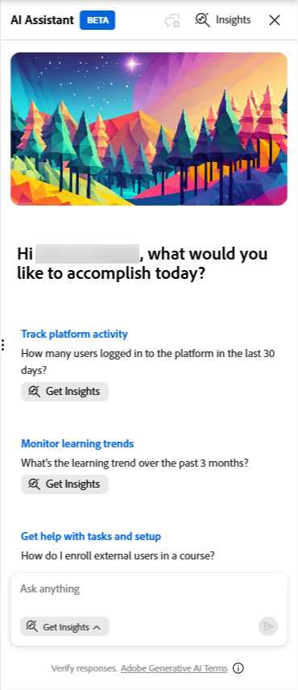
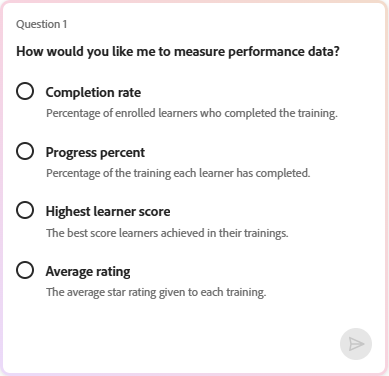
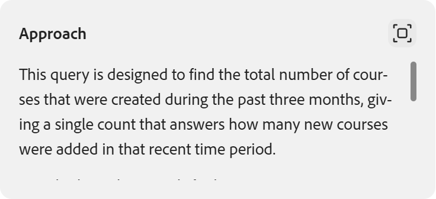
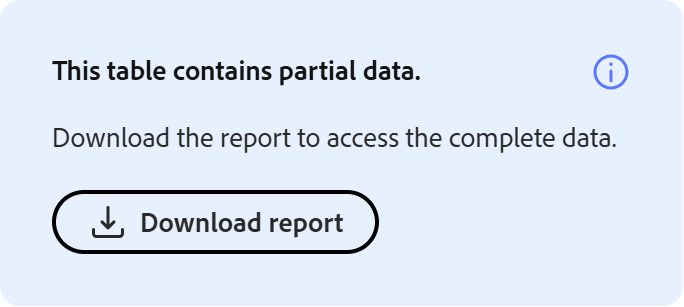
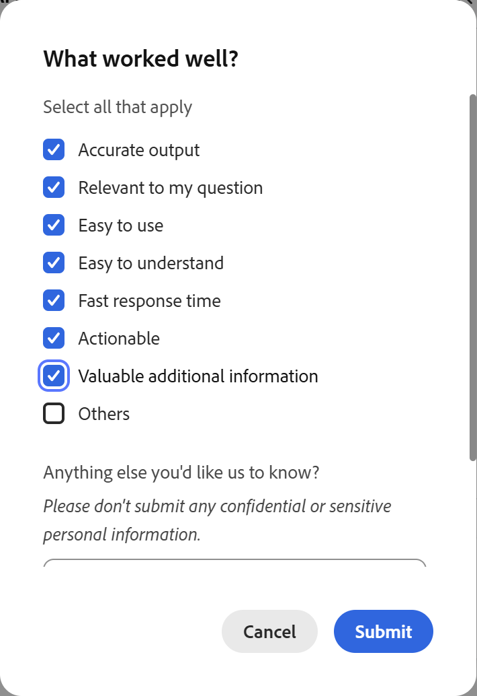
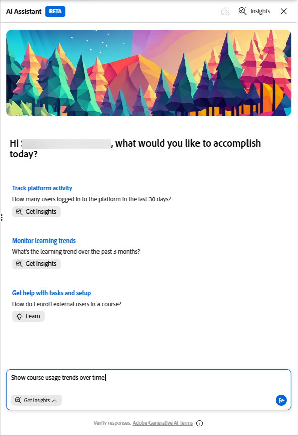
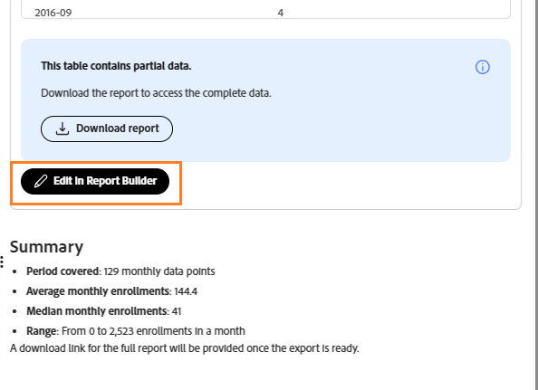
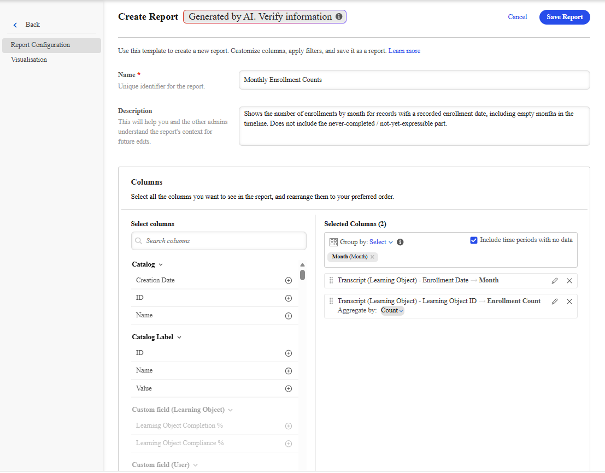

# 什麼是 Insights Agent？

Insights Agent 是 Adobe Learning Manager 中的一項由 AI 驅動的功能，讓管理員能使用自然語言查詢學習資料。 你不用下載報告或操作試算表，而是輸入問題，例如「過去三個月帳戶創建了多少門課程？ 請提供每月的報告。」Insights Agent 會直接擷取並呈現這些資料。 您可以以文字、項目符號或表格的形式檢視結果，或下載為 CSV 檔案。

Insights Agent 的設計目的是縮短從提出資料問題到獲得答案之間的步驟。 目前依賴 Excel 樞紐、商業智慧團隊或多份合併報告的管理員，可以使用 Insights Agent 更快取得答案。

## Insights Agent 能做什麼

您可以使用 Insights Agent 來：

* 依區域、部門或使用者群組檢查完成度與合規性指標
* 分析各課程或學習路徑的報名趨勢
* 檢視特定課程或學習路徑的進度資料

每個查詢都會回傳格式化的表格或可下載的 CSV 檔案，並附上簡單語言說明結果的計算方式。

## Insights Agent 不支援的資料

以下資料類型目前不在 Insights Agent 的範圍內：

* 回饋與調查資料
* 遊戲化積分與徽章
* 稽核歷史與變更記錄

引用這些資料型別的查詢將不會回傳結果。 例如，「上季獲得了多少遊戲化點數？」 或是「哪些學員獲得了合規徽章？」 會回傳錯誤或資料不完整。

## Insights Agent 的運作方式

當您輸入問題時，Insights Agent 會分四個階段處理：

1. **解讀：**&#x200B;代理會解析您的問題，以判斷需要哪些資料。 如果問題有任何部分有含糊之處，客服人員會在繼續前先問你一個澄清性問題

2. **方法：**&#x200B;客服人員描述自己為找到答案所採取的步驟。 本節協助您驗證資料是否以您預期的方式擷取，特別是針對複雜查詢。

3. **結果**：代理程式會依結果性質，以文字、項目符號或表格的形式呈現您的資料。 結果中附有簡明的摘要。 當結果包含 50 列或以下時，摘要會包含對資料的分析洞察。 當結果包含超過 50 列時，摘要會提供欄位層級的統計資料。

4. **下載**：您可以將結果下載為 CSV 檔案。 大型報告可能需要額外時間;代理會在檔案準備好時通知您。

**方法**&#x200B;區段對於複雜查詢特別有用。它顯示代理所使用的邏輯，類似 BI 分析師手動執行查詢時會解釋的邏輯。 檢視這個方法能幫助你在採取行動前確認輸出是否可靠。

## 使用 Insights Agent 提出問題

在 Adobe Learning Manager 中使用 Insights Agent，透過簡單的語言問題查詢學習資料，並取得文字、表格或可下載的 CSV 檔案結果。

Insights Agent 可透過 Learning Manager 的 AI 助理面板供管理員使用。 面板可調整尺寸。 您可以擴充以讓結果更易閱讀。 預設情況下，開啟面板時會選擇「 **取得洞察** 」模式。 另外也提供一個獨立 **的學習** 模式，供使用有關產品的教學問題使用。 **學習** 模式回答有關如何使用 Learning Manager 的教學問題。 例如，「我要如何建立學習路徑？」 它不會查詢學習者資料。 [了解更多](/help/migrated/administrators/feature-summary/insights-agent.md#create-report-insights-agent)

### 提問

預設選擇 **「取得洞察** 」模式時，您可立即開始查詢學習資料，無需每次存取助理時調整模式。 不過，如果你將教學問題切換到 **學習** 模式，請務必在提交查詢前重新勾選 **「取得洞察** 」。

1. 在 Learning Manager 中選取 AI 助理圖示以開啟助理面板。 預設已選取「 **取得洞察」** 選項。

   

2. 請在文字欄位輸入您的問題。 用簡單的語言。 例如： **過去三個月內創建了多少門課程？**

3. 選擇 **「傳送** 」或按 **Enter** 鍵提交您的問題。

### 檢視回應

在您提交問題後，Insights Agent 會處理您的請求，並回傳包含最多四個部分的回應：

1. **釐清（如有需要）：** 如果你的問題包含歧義詞，例如「學習活動」或「表現」，或「給我過去三個月的績效資料」，助理會顯示一串選項，並請你選擇其中一個，然後才繼續。 選擇最符合您需求的選項。 在出完初始問題之後，你就不能再輸入更多指示。 在您使用查詢介面啟動新查詢之前，唯一可用的互動方式是從提供的選項中選擇。 您只能透過從提供的選項中選擇來回應消歧義;本版本不提供自由文字後續功能。

   

2. **方法：****方法**&#x200B;區段描述代理程式取得資料所採取的步驟。它會以可捲動的面板形式出現在問題下方。 選擇展開圖示以查看完整方法。 檢視此部分有助於您確認邏輯是否符合您的意圖，特別是在複雜查詢時。 例如，如果你要求「過去一年內所有已註冊的學習者」，客服人員可能會回傳每位學習者最近的一次註冊紀錄，而非所有登記紀錄。 **「方法」**&#x200B;區段說明代理在擷取您的資料時所做的決策。如果邏輯與你的意圖不符，就用更具體的詞彙重新開啟查詢。

   

3. **結果：** Insights 代理程式會以文字或表格的形式產生結果。 對於最適合以表格格式解讀的資料點，Insights Agent 會回傳一個表格。 Insights 代理程式不會產生圖表或表格。 若要視覺化資料，請下載 CSV 文件並在您偏好的工具中開啟。 結果中附有簡明的摘要。 當結果包含 50 列或以下時，摘要會包含對資料的分析洞察。 當結果包含超過 50 列時，摘要會提供欄位層級的統計資料。 例如，「哪些課程在過去一年內新增的報名人數不少於5人？作者是誰？」

   

而回應內容包含以下摘要：

***摘要***

- *配對課程：102*
- *註冊人數範圍：24 至 2019 年*
- *每門配對課程的平均註冊人數：589.6*
- *每門配對課程的中位數註冊人數：553.5*

*匯出完成後，將提供完整報告的下載連結。*

>[!NOTE]
>
>摘要的格式會依資料性質而有所不同。 以下是摘要回應的一個範例。 你的實際摘要會依查詢內容而有所不同。

>[!NOTE]
>
>Insights Agent 是機率性的。 如果您執行兩次相同的查詢，回應措辭或結果順序可能會略有不同。

### 下載報告

選擇「 **下載報告** 」以匯出結果為 CSV 檔案。 對於大型結果集，下載可能需要額外時間。 當檔案準備好時，代理程式會顯示訊息;您也會收到通知。

## 啟動新查詢

每個 Insights Agent 工作階段一次處理一個問題。 檢視結果後，選擇 **「新增問題** 」以提出另一題。 您也可以在任何時候選擇 **「新聊天」** ，包括在收到回覆之前，如果您想放棄目前的查詢並重新開始。 您不能在同一個工作階段中輸入後續問題，也無法要求代理程式對其回傳的結果進行細化或擴充。

>[!TIP]
>
>如果你想探索相關資料，請開始一個新的查詢，把你從第一次查詢學到的內容納入其中。 例如，在查看各區域的報名總數後，啟動一個新查詢，深入挖掘表現不佳的區域。

## 提供回饋

每次回覆後，點選讚好或倒讚圖示以評分結果。 您也可以指定輸出是否不準確、難以理解，或回傳時間過長。 這些回饋有助於隨著時間提升代理人的品質。

## 最佳實務

- 先從一個具體的問題開始，而不是一個很廣泛的問題。 「北美使用者群組中安全訓練課程的完成率是多少？」 回傳比「顯示完成資料」更有用的結果。
- 在命名內容與學習群組時，請使用精確的 Adobe Learning Manager 術語。 查詢撰寫指南列出了正確的關鍵字。
- 如果客服問了澄清問題，就當作下次要再修正原本查詢的訊號。 你的問題越具體，所需說明就越少。
- 在依結果採取行動前，請先檢視 **「方法** 」區段，以確認代理程式的邏輯與您的意圖相符。
- **指定是否包含候補名單學員。** 預設情況下，報名次數查詢只會回傳具有有效且已確認報名的學習者——候補名單的學習者會被排除，這與課程或學習路徑頁面所提供的已報名學習者清單一致。 如果你希望候補名單的學習者也被納入統計，請在查詢時明確說明。 例如：「有多少學員直接報名參加安全訓練課程，包括等候名單上的學員？」 「方法」部分將顯示候補學習者是否包含在結果中。
<!--
- **Specify whether to include or exclude waitlisted learners**. By default, enrollment count queries include learners who are on a waitlist alongside active, confirmed enrollments. If you need only active participants, explicitly exclude waitlisted learners in your query. For example: "How many learners are directly enrolled in the Safety Training course, excluding waitlisted learners?" The agent will disclose in the Approach section that the exclusion was applied. Without this instruction, enrollment totals may include a significant proportion of waitlisted learners who have not yet started the content.
-->
- **直接與間接註冊計數**：當您查詢某門課程或學習路徑的報名或完成資料時，Insights Agent 會區分直接註冊（特定註冊該課程或學習路徑的學習者）與間接註冊（作為學習路徑或認證一部分存取相同內容的學習者）。 如果你特別詢問直接或間接登記，代理人會回傳每種類型的正確統計。 如果您的查詢未指定直接或間接，代理程式可能會回傳合併計數。 若要取得分開的計數，請在查詢中明確說明差異。 例如：「有多少學員是直接報名或間接報名的安全訓練課程？」

## Insights Agent 與 Report Builder 的差異

這兩個功能使用相同的底層學習資料，但運作方式不同。 Insights Agent 採用對話式。 你描述你想要的東西，代理人就會拿出來。 報表建構器是結構化的。 您可以選擇資料集、欄位和篩選條件來建立可重複使用的報表。

| **使用情境** | **建議** |
|---|---|
| 問一個快速的數據問題 | Insights 代理程式 |
| 在不了解結構的情況下探索資料 | Insights 代理程式 |
| 建立結構化且可重複的報告 | 報告建構器 |
| 以自訂連接組合多個資料集 | 報告建構器 |
| 排程報告訂閱 | 報告建構器 |
| 結合自訂連接或進階資料建模的資料集 | 報告建構器 |

## 為 Insights 代理撰寫有效的查詢

查詢的品質會直接影響 Insights Agent 回傳的結果品質。 一個結構良好的查詢包含三個要素：上下文，例如內容內容與學習者;範圍，例如狀態、時間範圍與使用者狀態;欄位，例如你想要的輸出欄位。 學習如何使用正確的術語、查詢結構及範例查詢作為起點。

### 三部分查詢公式

每個有效的 Insights Agent 查詢都包含以下三個組件：

| **組件** | **可能意味著什麼** | **範例** |
|---|---|---|
| **背景** | 你問的內容和學習者 | &quot;...新進員工入職培訓課程，專為銷售助理學員在地點101開設......」 |
| **適用範圍** | 註冊狀態、時間範圍及使用者狀態 | &quot;...已註冊但尚未完成的課程，且已完成，且已近 90 天內......」 |
| **欄位** | 您想在輸出中包含的所有欄位 | &quot;...顯示姓名、電子郵件、地點及報名日期」 |

缺少任何一項，可能導致結果模糊，或由客服人員提出澄清問題。

### 請使用正確的 ALM 術語

Insights Agent 會將您的查詢與 Adobe Learning Manager 的資料模型進行比對。 使用錯誤的術語可能會返回錯誤或無結果。 請使用下方左側欄位中的術語。

| **請使用此詞** | **不是這個** |
|---|---|
| **學習路徑** | 課程/路線/課程 |
| **河道** | 模組/課程/課程 |
| **認證** | 徽章/證書 |
| **學習者** | 學生/員工 |
| **會話** | 課程/預定日期 |
| **使用者群組** | 團隊/部門/同儕 |
| **主動場域** | 自訂欄位/屬性 |
| **招生** | 註冊/分配 |
| **完工** | 完成/完成/通過 |
| **目錄標籤** | 類別/標籤群組 |

Insights Agent 不區分大小寫，但精確的詞語匹配能提升準確度。

### 使用您組織自訂術語進行查詢

如果您的管理員在「設定>一般&#x200B;**」中使用產品術語**&#x200B;重新命名標準術語，Insights Agent 會識別您組織的自訂術語，取代上述預設詞彙。例如，如果你的組織將「課程」改名為&#x200B;****「章&#x200B;**節**」，你可以詢問「上個月完成了多少章節？」而 Insights Agent 則能理解問題，並透過 **回應與欄位標題中的章節** 來標註結果。

自訂術語適用於 Insights Agent 聊天視窗內的各處，包括查詢如何被解讀、方法說明、結果摘要，以及聊天中顯示的表格或欄位標題。 **下載的 CSV 檔案不反映自訂術語。** 匯出檔案中的欄位標題與內容均使用預設的 Adobe Learning Manager 術語，無論您的組織如何自訂。

- Insights Agent 能辨識自訂詞彙的單數與複數形式，該詞彙在產品術語 CSV 檔案中所設定。
- 即使您的組織已自訂 Adobe Learning Manager 的預設詞彙，您仍可在查詢中使用預設的 Adobe Learning Manager 術語。 Insights Agent 會辨識預設詞彙，並使用您組織自訂的詞彙進行回應。 例如，如果你的組織將「課程」改名為&#x200B;**「章****節**」，你仍然可以詢問「上個月完成了多少章節？」使用原始術語。 Insights Agent 會理解問題，並在回應中使用貴組織自訂的術語「 **章節**」來回應。
- 如果您的查詢包含拼字錯誤或未識別的術語，Insights Agent 會提出澄清問題，並建議您帳戶中最接近的相關詞彙。
- 如果您的管理員重設自訂術語，Insights Agent 將不再辨識先前自訂的術語，並會回復為預設術語。

>[!NOTE]
>
>自訂術語支援不延伸至 Insights Agent 目前未查詢的模組與分頁，如社交學習、工作輔助工具、討論論壇、遊戲化及公告。

<!--
### Query using your organization's custom terminology

If your administrator has renamed standard terms using **Product Terminology** in **Settings** > **General**, Insights Agent recognizes your organization's custom terms in place of the defaults listed above. For example, if your organization renamed **Module** to **Training**, you can ask "How many Trainings were completed last month?" and Insights Agent understands the question and labels the results using **Training** in the response and column headers.

- Insights Agent recognizes both the singular and plural forms of a custom term, as configured in the Product Terminology CSV file.
- You can still use the default Adobe Learning Manager term in your query even after your organization customizes it. Insights Agent recognizes the default term and responds using your organization's custom term.
- If your query includes a misspelled or unrecognized term, Insights Agent asks a clarifying question and suggests the closest matching term available in your account.
- If your administrator resets the custom terminology, Insights Agent no longer recognizes the previously customized terms and reverts to the default terms.

>[!NOTE]
>
>Custom terminology support does not extend to modules and tabs that Insights Agent does not currently query, such as Social Learning, Job Aids, Discussion Forum, Gamification, and Announcements.
-->

### 錨定您的內容

提供內容錨點有助於客服人員知道該關注哪些學習項目。 您可以透過以下任一方式錨定：

| **錨點類型** | **範例** |
|---|---|
| 名稱 | &quot;...新進員工入職學習路徑」 |
| 目錄 | &quot;...入門目錄中的所有學習路徑」 |
| 目錄標籤 | &quot;...所有目錄標籤為 Region = North」的課程 |
| 標籤 | &quot;...所有標註為合規的課程 |
| 技巧 | &quot;...所有課程均對應至客戶服務技能」 |
| 合規標籤 | &quot;...所有符合法規的認證」 |
| 內容類型 | &quot;...所有已出版課程」/「...所有證照」 |

### 穩固你的學習者

如果查詢與學習者相關，請使用以下其中一種方法：

- **活動欄位值** — 「學習者若活躍領域職務 = 銷售助理」或「學習者在活動領域 位置 = 101」
- **使用者群組** — 「Sales Associates 使用者群組中的學習者」
- **課程** — 「報名參加 6 月 15 日職場安全課程的學習者」

### 定義您的適用範圍

省略範圍細節可能導致超出預期的結果。

| **範圍類型** | **選項** |
|---|---|
| 入學狀況 | 已註冊/完成/未註冊/逾期 |
| 時間範圍 | 所有時間 / 過去 30 天 / 過去 90 天 / 特定日期範圍 |
| 使用者狀態 | 僅限啟用使用者（預設）/為非啟用新增「包含已刪除使用者」 |

### 為每個輸出欄位命名

如果您未指定欄位，Insights Agent 會為您選擇欄位。 為輸出中你想要的每個欄位命名。

| **模糊** | **具體** |
|---|---|
| 「顯示地點編號」 | 「每個地區：總學習者數、註冊人數、未註冊人數」 |
| 「顯示完成率」 | 「對每個學習路徑：名稱、總報名人數、總完成度、完成百分比」 |
| 「讓我看看誰失敗了」 | 「顯示未通過學員的學習者姓名、電子郵件、課程名稱及完成狀態」 |

### 範例查詢

把這些當作起點。 透過替換適用於您帳戶的內容名稱、使用者群組及時間範圍來調整它們。

**完成與合規**

- 「北美使用者群組中安全訓練課程的完成率是多少？」
- 「顯示所有合規課程依使用者群組劃分的完成率。 請包含使用者群組名稱、總註冊人數、總完成人數及完成百分比。」
- 「所有在職領域職位名稱 = 副總裁的學習者，其合規率是多少？」

**招生分析**

- 「按地點劃分，有多少學員註冊參加新進員工入職學習路徑？」
- 「顯示過去 90 天按地區劃分的登記人數。」 請註明地區名稱及入學人數。」
- 「列出所有已報名但尚未完成職場安全課程的學習者——包括姓名、電子郵件及報名日期。」

**課程與進度**

- 「領導力發展學習路徑的完成狀態分布為何？ 節目已完成、進行中，以及尚未開始計數。」
- 「上個月有多少學員完成了資料隱私課程？」

**組織觀點**

- 「顯示所有符合類型標籤認證的完成率，並依部門分組。 請註明系所名稱、總報名人數及完成率。」
- 「過去30天各地區的登記分布如何？」

### 應避免的常見錯誤

| **避免** | **改做這個吧** |
|---|---|
| 沒有內容錨點（「把所有東西都給我看」） | 為特定路徑、課程、目錄、標籤或技能命名 |
| 模糊的指標（「為什麼完成率這麼低？」） | 問一個可衡量的問題：「哪些學習路徑的完成率低於 30%，按地點劃分？」 |
| 未指定使用者狀態 | 明確新增「僅限活躍使用者」或「包含已刪除使用者」 |
| 徵求預測 | 問的是現有數據顯示了什麼，而不是未來會發生什麼 |
| 詢問未被支持的資料（回饋、技能、徽章） | 在「報告」區段中使用現有報告 |
| 在同一個查詢中問多個問題（「按地區顯示報名情況，並列出誰尚未完成安全訓練」） | 每問一個問題就聚焦於一個問題。 代理人只能回答複合查詢的一部分，且不保證其餘部分都會被回答。 |

## 發行的限制

**不支援以非拉丁字母提交的查詢**

Insights Agent 支援以英語及法語、西班牙語等拉丁字母語言撰寫的查詢。 使用非拉丁字母（包括日文、中文、阿拉伯文、韓文、印地文及俄文）提交的查詢不予處理。 代理程式會顯示訊息，表示查詢無法完成。 如果您以上述語言之一提交查詢，請重新開一個查詢並用英文重新表述。

## 從 Insights Agent 的回答建立報告 {#create-report-insights-agent}

在 Adobe Learning Manager 中，您可以用簡單的語言向 Insights Agent 提問，並在 Report Builder 中以報告形式開啟答案。 接著你可以編輯報告並重複使用，這樣就不用從頭重建。

## 什麼是 Insights Agent 與 Report Builder 的整合

Insights Agent 與 Report Builder 是 Adobe Learning Manager 中存取相同資料的兩種方式。 兩者運行於相同的資料平台。

* **Insights Agent** 允許您以自然語言提出問題。
* **報表建立器** 允許您透過選取資料集、欄位、彙總和篩選器來建立報表。 您也可以使用它來建立定期報告、訂閱報告，以及編輯現有報告。

整合將兩者連結起來。 你先從一個問題開始，檢視答案，然後在 Report Builder 中開啟它。 在那裡，您可以修改報告，並像處理其他報告一樣繼續使用。 目前，此整合對管理員開放。

並非每個 Insights Agent 的回答都能成為報告。 Insights Agent 僅在報告保留代理人回應意圖及您的問題時，才會在 Report Builder 中開啟答案。

## 整合的運作方式

當您提出問題時，Insights Agent 會產生資料查詢並擷取相應的結果。 如果查詢可轉換為報告建構器結構，Adobe Learning Manager 會根據產生的查詢建立一份報告建構器草稿報告。

Insights Agent：

1. 會根據你的問題產生一個查詢。
1. 將產生的查詢對應到 Report Builder 的資料集與欄位。
1. 建立草稿報告。
1. 將報告與代理的回應及原始問題進行驗證。
1. 在報表建立器中開啟報表以供檢視。

## 從 Insights Agent 的回答建立報告

1. 啟動 **Insights Agent**。

1. 請用淺顯易懂的語言來回答你的問題。 等答案。 Insights Agent 會在背景中準備報告，讓對話持續不中斷。

   

1. 在 Insights Agents 釐清歧義及/或提供產生回應的方法後，檢視所產生的回應。

1. 在報告建立器&#x200B;**中選擇**「編輯」。

   

   報表建構器會開啟產生的報表及欄位，並在必要時自動套用分組或彙總函數。 報告的名稱與描述也會自動產生。

   >[!NOTE]
   >
   >**當 Insights Agent 找不到任何針對您問題的資料時，也會顯示「在報表建構器**&#x200B;中編輯」選項。您可以建立報告並稍後修改。 資料可在您建立報告後顯示，因此報告會保持空白，直到有符合的資料存在。

   

1. 檢視已產生的報告。 報表建立器會將答案中的欄位對應到其自身欄位，例如課程名稱與說明。 如果 Insights Agent 無法轉換您問題中的部分內容，報告會將這些項目列為報表旁的空白。

1. 如有需要，請編輯報告。 例如，新增或變更欄位、聚合或篩選器。

1. 儲存報告。 選擇 **「儲存報告**」。

報告會在 Report Builder 中開啟，並顯示已轉換的欄位及相符的資料。 您現在可以像其他報表一樣編輯和管理它。

## 編輯產生的報告

報告在 Report Builder 中開啟後，您可以：

* 新增或移除欄位。
* 更新篩選條件。
* 修改聚合。
* 改變排序方式。
* 儲存報告。
* 分享報告。
* 新增視覺化。
* 建立儀表板。

## Insights Agent 如何將答案轉換為報告

Insights Agent 與 Report Builder 的設計有所不同。 因此，Insights Agent 中的答案可能會包含 Report Builder 無法完全呈現的資料。 為了處理此事，Insights Agent 會分階段轉換每個答案。

| 舞台 | 發生什麼事 |
|---|---|
| 查詢 | Insights Agent 會幫你計算出能回答你問題的查詢。 報告建構器會在同一時間從同一查詢啟動，因此您的對話永遠不會被阻塞。 |
| 場域映射 | 查詢會對應到報表建立器的資料集和欄位。 根據該映射，會建立一份工作報告。 |
| AI 草稿 | AI 會起草報告並進行核對。 |
| 評論 | 報告會與你原本提出的查詢問題進行比對。 驗證會同時執行。 |
| 更正 | 若驗證發現錯誤，系統會自動修正。 |
| 空檔列表 | 你問題中任何 Report Builder 欄位無法表達的部分，都會列在報告旁。 |

## Insights Agent 如何判斷某個答案是否可以在 Report Builder 中開啟

Insights Agent 遵循兩條規則：保留代理人回應的意圖與你的問題，並坦誠說明無法轉換的內容。

* **保留意圖。** Insights Agent 只允許你在報告建立器中開啟答案，前提是該報告仍反映 Insights Agent 回應的核心內容。 如果轉換失去該意圖，您就無法切換到 Report Builder。
* **揭露缺口。** 如果你的問題的一部分無法在 Report Builder 中表達，Insights Agent 不會悄悄地把它丟掉。 它試圖將最突出的部分列為報告旁的空白。 如果有任何看起來有風險的地方，報告會保留，讓你自己可以檢視。

Insights Agent 會根據其意圖判斷缺失欄位或計算是否為你問題的核心。

>[!NOTE]
>
>Insights Agent 主要會根據自身回應來檢查轉換，其次才會針對你的問題。 如果回應無法完全回答您的問題，您仍可在報告建立器中將其轉換為報告。 在你依賴報告之前，請先先檢視報告。

| 位置 | 結果 |
|---|---|
| 報表建立器包含 Insights 代理回應的每個部分欄位 | 報告已建立並準備好進行審查。 |
| Insights Agent 回應的部分內容無法在 Report Builder 中表達 | 該零件被列為缺口。 該報告仍可供審閱。 |
| 回應中的欄位在 Report Builder 中無法使用，且該欄位對回應而言是次要欄位 | 您可以在 Report Builder 中開啟該報告。 該田被列為空白區。 |
| 回應中的欄位在 Report Builder 中無法使用，且該欄位是回應的核心 | 您無法在 Report Builder 中開啟回應。 例如，技能名稱或技能ID。 |
| 回應使用了一個 Report Builder 不支援的計算欄位。 計算方式可以有兩種：一種是建立新欄位的複雜計算，另一種是建立在現有 Report Builder 欄位上的彙總計算。 第一種無法轉換，但第二種可以。 | 計算結果被標示為缺口。 如果它是回應的核心，您無法在 Report Builder 中開啟該回應。 |
| 回應方式相當複雜，例如多個聯合查詢 | 轉換後的報告可能較不準確。 如果它仍然反映回應的意圖，它就會開啟，讓你可以驗證。 |
| Insights Agent 找不到任何針對您問題的資料 | **「在報表建立器**&#x200B;中編輯」選項仍然會出現。您可以建立報告並稍後修改。 當匹配資料可用時，報告會顯示資料。 |

## 報表轉換疑難排解

| 子嗣 | 解決方案 |
|---|---|
| 你無法在 Report Builder 中開啟答案。 | 與您問題相關的欄位或計算在 Report Builder 中無法使用。 在沒有那個欄位或計算的情況下，重新表述你的問題，然後再問一次。 |
| 報告的欄數比答案還少。 | 檢查報告旁列出的空白處。 那裡列出的商品無法轉換。 |
| 這份報告與你對複雜問題的預期不符。 | 把報告與你原本的問題對照檢視一下。 把問題拆成較小的問題，然後分別轉換每個答案。 |
| Insights Agent 表示未找到資料，但 **「在報告建構器** 中編輯」功能仍然可用。 | 這是預料之中的。 你仍然可以建立報告，在 Report Builder 中修改，並在有新資料時再次檢查。 |
| 報告在 Report Builder 中會以空白狀態開啟。 | 目前還沒有符合你問題的匹配數據。 修改報告，或在有新資料後重新開啟報告。 |

### 更多類似內容

* [使用 Report Builder 建立報告](/help/migrated/administrators/feature-summary/alm-create-report.md)
* [從 Report Builder 報告建立儀表板，並以圖表視覺化報告資料](/help/migrated/administrators/feature-summary/report-builder-visualization.md)
* [使用 Insights Agent 進行報告](/help/migrated/administrators/feature-summary/insights-agent.md#create-report-insight-agent-answer)
* [分享並訂閱報告](/help/migrated/administrators/feature-summary/download-share-subscribe-report.md)
* 以圖表視覺化報告資料