# 學習路徑

## 什麼是學習路徑？

行政人員常有興趣建立一套詳盡的課程，以提供對特定主題或專業領域的深入知識。 也可以是一連串的培訓課程，員工或客戶被期望完成。 這需要將一系列課程與方案打包在一起，打造完整的訓練套件。

這時學習路徑就派上用場了。 學習路徑是學習者必須經歷的旅程，隨著時間推移才能掌握某個主題。 學習者掌控自己的訓練體驗，能以更有效地自我節奏獲取與記憶知識。

例如，在新員工入職時，組織會進行有關政策與程序、文化、歷史等方面的培訓。 學習路徑依員工需求設計課程，讓員工能依照為他們設定的學習路徑報名課程。 你可以選擇，也可以為使用者註冊這條路徑，讓他們能從一門課程繼續前進。

## 建立與設定學習路徑

在本訓練中，您將學習如何建立學習路徑、新增課程、發佈及停用學習路徑，以及在學習路徑內設定實例。

如果您無法啟動訓練，請寫入 <almacademy@adobe.com>。

## 學習路徑的優勢

學習路徑讓培訓課程的提供變得方便且無煩惱。 以下是學習路徑的一些主要好處：

1. 直接為學習路徑指派一項技能與技能等級。 不需要匹配技能點數。 一旦學習者完成學習路徑，便達到上述技能等級。
1. 能夠將現有的學習路徑嵌入到新的學習路徑中。 嵌入功能僅適用於一層嵌入。 因此，已包含嵌入路徑的學習路徑，不能嵌入到新路徑中。
1. 可在學習路徑層級新增先修條件、工作輔助工具及資源。
1. 建立分段的能力。 每個章節都可以有標題。
1. 可將章節設為必修並設定完成條件。

## 在 Learning Manager 中新增學習路徑

在 Learning Manager 的管理應用程式中，點擊 **[!UICONTROL Learning Path]** 左側面板。

在頁面中 **[!UICONTROL Learning Path]** ，點擊 **[!UICONTROL Add]**。 請輸入細節。

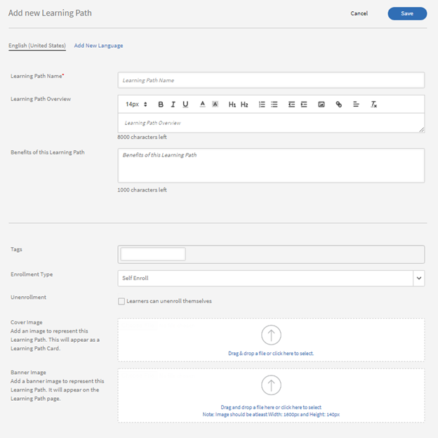

*新增新的學習路徑*

在「註冊類型」**選項中，選擇**「自行註冊&#x200B;**」或**「管理員註冊&#x200B;**&#x200B;**」。

>[!NOTE]
>
>若選擇 **「管理員報名** 」選項，學習者將只會看到經理提名或經理核准的課程。 學習者將無法在建議區看到學習路徑。

建立學習路徑後，選取新建立的學習路徑，並將路徑中的課程加入。

你可以新增技能並為學習路徑分配徽章。 要新增技能，請從 **[!UICONTROL Pick a Skill]** 下拉清單中選擇所需的技能或技能。 同時選擇該技能的等級。

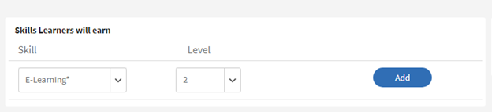

*新增一項技能*

為學習路徑指派徽章。 從可用徽章清單中挑選一個徽章。

從該 **[!UICONTROL Recommend for]** 區段選擇產品、角色及角色層級，以向對這些產品與角色表達興趣的使用者建議此學習路徑。

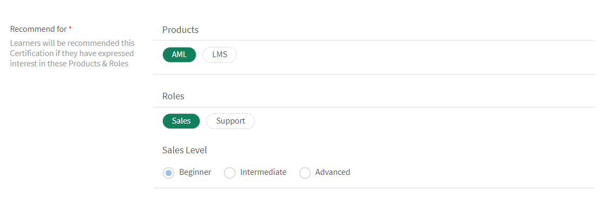

*建議*

根據您的偏好，為章節與訓練選擇排序類型為有序或無序。

如果您選擇「排序」，課程會依您建立時的順序顯示。 若選擇「無序」，則課程不會依序排列。 學習者可以依任何順序完成課程。

若要在學習路徑中新增課程，請點選 **[!UICONTROL Add Courses or Learning Paths]**。

從出現的視窗中，選擇您想新增至學習路徑的訓練項目。 每條目都會顯示名稱、類型（課程或學習路徑）、出版狀態及課程格式，例如自學進度、虛擬、教室或混合式。

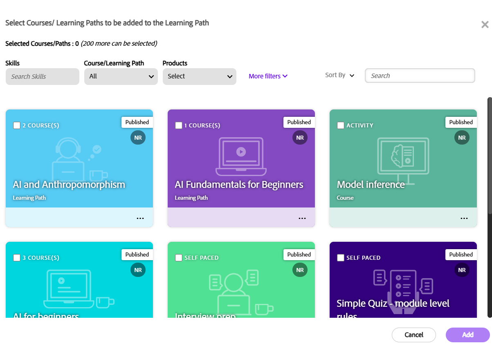

*將訓練加入學習路徑*

您還可以依據所分配的技能、修改日期及課程成效進一步排序課程。

選擇課程或學習路徑後，點擊 **[!UICONTROL Save]**。

在學習路徑中，您可以執行以下操作：

**建立與設定分區** ：分區用來將多個訓練課程分組，完成訓練的某一部分或重要部分。 每個章節都可以有標題。 每個部分也可以標示為「必修」，並附上具體的完成要求。

**將每個章節的課程設為必修：** 如果您希望或不希望在學習路徑內將訓練設為必修，請啟用或停用「必修」核取方塊。 啟用勾選框後，您可以將所有訓練設為強制或部分訓練為強制。

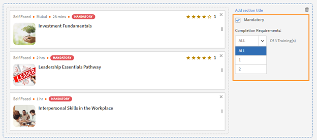

*將各部分的課程設為必修*

**重新排列順序：** 你可以將課程往上或往下移動，並更改它們的順序。

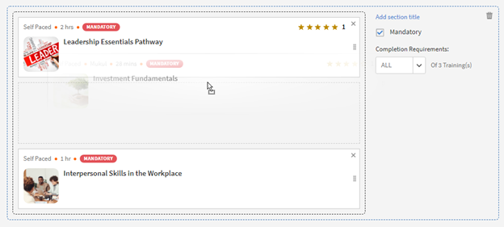

*重新安排訓練的順序*

**移除課程：** 在課程卡片上按一下 X，將該課程從學習路徑中移除。

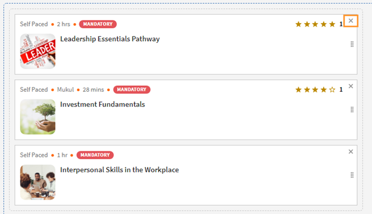

*從學習路徑中移除課程*

完成變更後，若要發佈學習路徑，請點選「發佈」。

## 巢狀或增強學習路徑

巢狀或增強學習路徑是指包含多個學習路徑的學習路徑。 若要插入學習路徑，請依照在學習路徑中新增課程的相同流程。

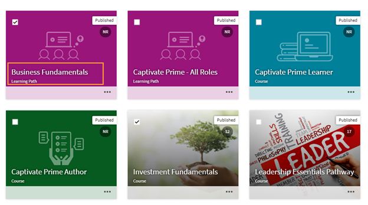

*巢狀或增強學習路徑*

## 學習路徑設定

在「設定」區段中，您可以新增學習者在開始學習路徑前必須修讀的先決條件與工作輔助課程。 你也可以新增對學習者有幫助的資源。

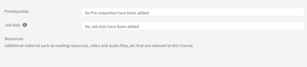

*變更學習路徑的設定*

## 實例

學習路徑實例會顯示一個額外的磁貼。 **[!UICONTROL Learning Paths]**&#x200B;該磁磚顯示該號碼。 加入學習路徑的學習課程。

在 **課程** 圖列中，您可以看到對已註冊此實例的學習者可見的課程實例。

**[!UICONTROL Enable Learners to Choose instances (Flexible Learning Path)]**&#x200B;此勾選框僅適用於課程。此選項允許學習者在學習路徑中切換實例。 所有子學習路徑都會有選項，可以將學習程式實例與學習路徑對應。 預設情況下，對應設定為「預設實例」。

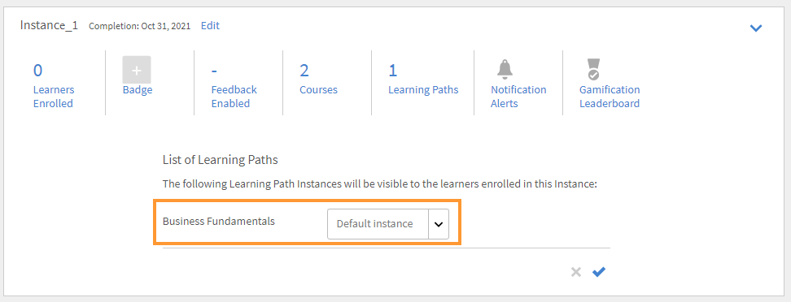

*Learning Path 實例*

學習者可以透過學習計畫或由管理員註冊課程，即使課程具彈性且需學習者自行選擇課程。 在這些情況下，系統允許學員即使名額已滿仍可報名，但必須等到名額空出前才能開始課程。

等候名單功能僅在學習者自行報名時適用。 當課程達到名額上限時，講師可以查看候補學習者的名單。 若名額空出，講師可將候補學員加入，直到課程再次滿員。

## 通知

有三種選擇：

1. **[!UICONTROL All Skill Levels Courses and Learning Paths (selected by default)]：** 學習者會收到任何未完成課程的通知，不論學習路徑中的等級為何。
1. **[!UICONTROL Root Learning Path]：** 學習者會收到屬於父學習路徑的任何未完成課程的通知。
1. **[!UICONTROL Learning Path + first Skill Level children only]：** 學習者會收到任何未完成課程的通知，該課程是父學習路徑的第一個子課程。

通知提醒會根據選項觸發。 預設情況下，該選項 **[!UICONTROL All Levels Courses and Learning Paths]** 會啟用於實例。

## 訂閱

您可以訂閱各個學習路徑，直接將包括測驗分數與學習者狀態在內的完整資料直接送達您的信箱。

請依照以下步驟操作：

1. 前往任一學習路徑>訂閱。
1. 選擇「新增更多」。
1. 選擇詳細資訊並輸入電子郵件 ID 以接收報告。

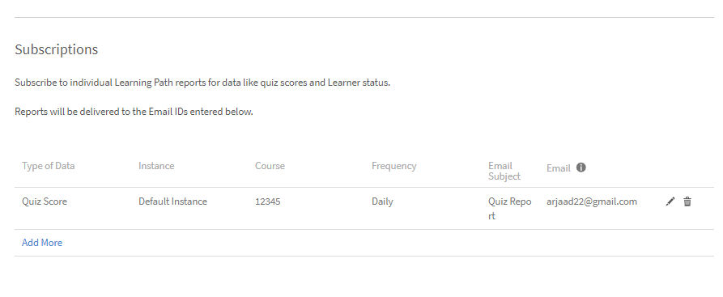

*訂閱個人學習路徑*

## 重要說明

請注意，學習計畫現有功能將在發布後立即更名為學習路徑。 如果您希望繼續稱之為學習計畫，我們建議您使用「術語」功能來套用所需的術語。 這樣你就可以使用「學習計畫」這個詞來學習。

學習路徑為你帶來多種功能。 其中有些在發行後立即開放。 管理員/作者可以開始使用它們。 像「分段」、「在另一路徑中新增學習路徑」等擴充功能會被停用，可透過勾選下方提及的核取方塊來啟用。

學習者可以繼續使用學習程式（現稱為學習路徑），作者/管理員也能繼續建立這些程式。 為了充分利用上述 Learning Path 的擴展功能，管理員應依下列方式啟用該設定。 啟用後，Learning Path 的所有新擴展功能將全面開放。

**[!UICONTROL Settings]** >**[!UICONTROL General]**&#x200B;頁面新增了啟用學習路徑的新選項。若啟用此選項，您可以在學習路徑中新增課程與學習計畫。 一旦啟用了這個選項，你就無法更改它。

<!--
 ## Other Learning Path-related details 

### Learning Path option is disabled/unchecked in Admin Settings

**Accounts using Native Web apps**

**Learners**

* By default, learners will notice a change in terminology from "Learning Program" to Learning Path". This has been done to make the interface more intuitive. If you do not want this change, refer to the below points.  

* This change however will not be reflected in the UI if you have already used the 'Custom Terminology" function to replace the terminology "Learning Programs" with some custom text. 
* In case you had not used the Custom Terminology function yet but now wish to retain "Learning Programs" as the terminology, you can do so via the 'Custom Terminology' feature post the release.

* The overall cosmetic look and feel of erstwhile 'Learning Programs' will get updated to a more visually rich look and feel.

**Authors and Admins**

* The terminology within the Admin/Author apps is the same as that of learners.
* The UI for Authors and Admins to create, update the erstwhile 'Learning Program' objects will now be updated to the new UI. There is no loss of functionality, just that the User Interface to do the operation will be much more intuitive. These UI changes will reflect in your account, even if you have chosen not to enable 'Extended Features of Learning Path', with no loss in functionality. 

* Note that any existing Learning Program objects will not change so there is no impact on learners (other than the terminology point noted above). Authors/Admins might notice a default grouping called "Section" within their existing objects, which would be of no material impact as far as functionality goes. Authors/Admins will also see added functionalities like Skills, Job Aids etc. But as you haven't used it yet, it will not create any impact on the learner side till you actually start using it.

**Reporting**

* If you do not enable the option, Learning Path , there are no changes in the Learner Transcript report structure due to Learning Path. But as communicated in earlier notice (refer to the table shared in earlier communication); one new column will get added to the extreme right of the Learner Transcript immediately after the release.

**Accounts using Headless LMS**

**Learners**

* There are no changes for learners in headless interface. APIs as well that are used to generate the reports does not have immediate changes. 

**Authors and Admins**

* Same changes as that of Authors/Admins stated above.

**Reporting**

* Same changes as that of Reporting stated above.

### Learning Paths option is enabled/checked in Admin Settings

**Accounts using Native Web apps**

**Learners**

* Same changes as that of Learners when the option is disabled.
* As you start using the extended functionality of Learning Paths, Learners will benefit from seeing more elaborate paths with embedded paths and sections, Skills and badges being earned on path completion, resources at path level, and other benefits.

**Authors and Admins**

* Same changes as that of Authors and Admins when the option is disabled.

* Users will get more functionality in crafting elaborate paths. You can define Skill-Levels that would automatically be achieved by a learner on completion of path (not have to focus on the arithmetic of Credits for the levels). Resources can be added at the path level (Not possible as of today). Sections can be created with each section having the ability to have X of Y options. One can embed a Learning Path within another Learning Path (one level of hierarchy supported)

**Reporting**

* A few new columns will get added to the 'Learner Transcript' and 'Content Report' structures to incorporate the new feature of embedding of paths within paths. This may impact integration code that you may have written to export this data to your custom data warehouse/DB outside Learning Manager. This information is communicated in the table provided in earlier communication.

**Accounts using Headless LMS**

**Learners**

* There is no change for your learners, unless you make changes to your headless LMS implementation, as the APIs on which you have built your headless interface will not be changing.
* If you do start using the extended features of Learning Paths by creating new Learning Paths, however you will have to make changes to the headless LMS implementation to reflect those on your learner app. The Learning Manager APIs will allow you to do that.

**Authors and Admins**

* Same changes as that of Authors/Admins stated above.

**Reporting**

* Same changes as that of Reporting stated above. 
-->
