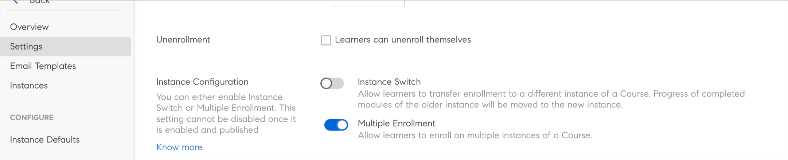
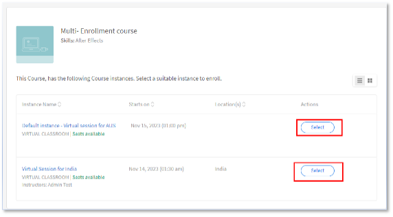
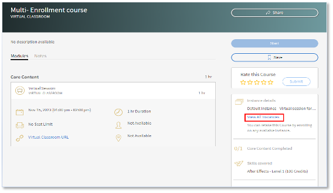
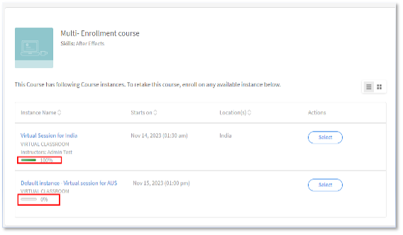
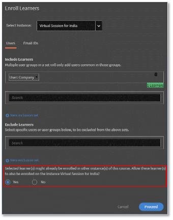

# Adobe Learning Manager 的多重註冊

在 Adobe Learning Manager 中，每門課程都可以有不同的實例。 作為帳戶管理員，您的主要職責之一是跨時區建立不同的 VILT 工作階段，並可能為特定使用者群組建立工作階段。

在 2023 年 7 月版本釋出之前，當管理員為學習者註冊時，他們只能在單一實例中註冊。 若學習者希望在不同實例中修讀課程，管理員會為每個實例建立多門課程。

Adobe Learning Manager 的多重註冊功能幫助管理員避免此類情況。

## 管理實例

>[!INFO]
>
>在本訓練中，您將學習如何編輯實例詳細資訊與實例屬性。    

如果您無法啟動訓練，請寫入 <almacademy@adobe.com>。

## 什麼是多重登記

多重報名是指學習者透過各種可用實例多次報名同一課程。  學習者無論在註冊、完成或尚未開始的狀態，都可以同時報名多個課程實例。 當作者啟用此 [!UICONTROL Multiple Enrollment] 切換後，學習者即可同時報名多個課程實例。

*從設定啟動多重登錄*

每個實例的進度可以單獨追蹤，並且可以匯出報告以追蹤每個實例的進度。

## 重要點

* 多重選課僅適用於同一課程有多個實例的情況。
* 啟用多重報名選項且使用者在多個實例註冊後，學習者成績單報告中會為每門課程建立新列（每個實例及每位學員各一列）
* 如果報告自動化設定為每門課程只預期一列，您必須先對報告自動化進行必要的調整，才能啟用多重報名功能。
* 管理 API 不支援多重註冊情境。 如果你有任何需求，請聯絡你的 CSM。

## 如何啟用多重登錄

1. 以作者身分登入您的 Adobe Learning Manager 帳戶。
1. 選擇您希望學習者多次報名的課程。
1. 在左側面板中，選取 **[!UICONTROL Settings]** > **[!UICONTROL Edit]** > **[!UICONTROL Instance configuration]** > **[!UICONTROL Enable Multiple Enrollment]**。

*啟用多重登錄*

>[!NOTE]
>
>作為作者，您不能同時啟用實例切換與多重註冊。

## 學習者檢視

當學習者想報名教室或虛擬課程，或想在進入下一門課程前再完成課程時，多次報名非常有幫助。

對於未報名的學習者，當他們選擇課程時，會在課程下方的畫面中看到多個實例。 接著，他們可以選擇每個實例並進行註冊。

*檢視實例*

在註冊一個實例後，他們可以在右側窗格選擇「檢視所有實例」選項，來註冊其他實例。

*註冊到執行個體*

每個實例的進度可依下列方式追蹤：

*追蹤每個實例的進度*

## 管理員中的多重登錄變更

**招生：**

在為學習者報名時，您可以啟用以下核取方塊：

*「部分受選學員可能已在本課程的其他實例中報名。 允許這些學習者同時註冊於實例......」*

*管理員註冊選項*

如果學習者已註冊於一個實例，而您作為管理員正嘗試將學習者註冊到另一個課程實例，請選擇「是」。

## 報告

對於同時註冊於同一課程的兩個實例的學習者，會為每個課程實例建立兩列資料。 報告同時也會顯示各實例的進度。

