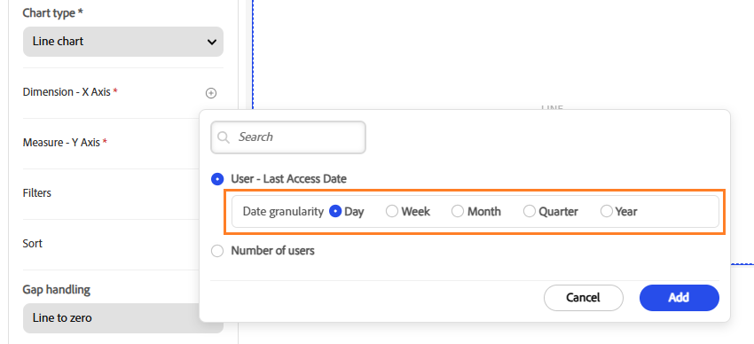
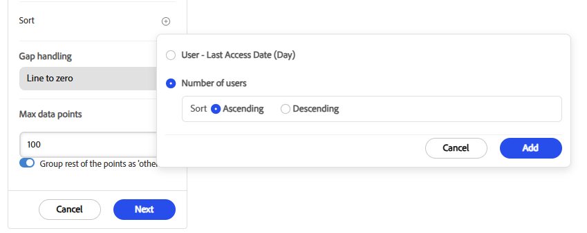
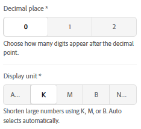
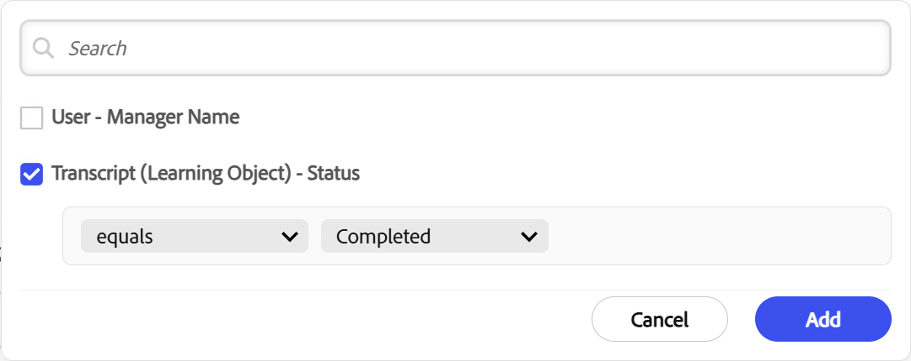

# 報表建立器中的視覺化

Adobe Learning Manager 報告建構器中的視覺化功能，將已儲存的報告轉換成圖表與儀表板。 您可以在試算表工具中比較群組、發現趨勢並分享結果，而無需重新調整資料。

>[!IMPORTANT]
>
>報告建構器中的視覺化（圖表與儀表板）僅提供給 Adobe Learning Manager Ultimate 客戶使用。 Prime 版沒有這些。

## 關於報表建構器中的視覺化 {#about-visualizations}

視覺化是一個圖表，或是從你在 Report Builder 中儲存的報告所建立的圖表或圖表儀表板。 您可以選擇要繪製哪些報表欄位，報表建構器會從報表資料繪製圖表。 您可以直接繪製欄位，或繪製報表中的摘要資料。

* **為報表建立圖表：** 開啟報表，選擇 **「視覺化**」，然後建立圖表。 請參閱 [「從報表](#create-chart-from-report)建立圖表」。
* **儀表板上的圖表群組：** 選擇報表作為資料來源，然後從中新增圖表。 請參閱 [「建立儀表板](#build-dashboard)」。
* **分享與檢視：** 與管理員分享儀表板，管理員以唯讀模式檢視與篩選。

圖表有兩種運作模式：

* **設定模式：** 您可以建立或編輯圖表。
* **檢視模式：** 您可以篩選圖表顯示的內容，但不改變其建置方式。

## 圖表類型及其使用時間 {#chart-types}

依照您想回答的問題選擇圖表類型。

| 圖表類型 | 用它來做 | 範例 |
|---|---|---|
| 折線圖 | 顯示一個數值隨時間如何變化。 | 按創建月份分類的報名人數 |
| 條或欄 | 比較不同類別的價值。 提供分組、堆疊及 100% 堆疊版面。 | 按註冊狀態分類的學習者 |
| 派 | 顯示每個類別在整體中的份額。 低於 1% 的細分會被歸入 **「其他」** 細分。 | 按目錄分類的報名人數 |
| 數量很大 | 強調一項關鍵指標。 | 本季度總完工量 |
| 表格 | 顯示精確數值。 您可以選擇部分欄位，並將某一日期欄位顯示為列而非欄位（欄位對列檢視）。 | 每位使用者每月學習時間 |

>[!NOTE]
>
>由趨勢報告（例如按月的報名人數）建立的折線圖，會顯示您資料的當前快照，並依日期分組。 它們沒有顯示每個過去日期的資料狀況。 如需更多資訊，請參閱「報表建構器的概念與術語」。

## 視覺化術語 {#visualization-terms}

| 術語 | 意義 |
|---|---|
| 報告 | 已儲存的報表建構器欄位、篩選器與分組設定。 圖表是根據報告建立的。 |
| 圖表層級篩選器 | 建立或編輯圖表時所設定的篩選條件。 它限制了圖表所繪製的資料範圍。 |
| 頁面層級篩選器 | 檢視器套用於頁面或儀表板上所有圖表的篩選器。 它可以縮小報告本身的篩選範圍，但不會擴大。 |
| 報表建立器儀表板 | 在 Report Builder 中建立的圖表頁面。 |

## 從報告建立圖表 {#create-chart-from-report}

從已儲存的報表建立圖表，一目了然地查看報名、完成或使用時間資料。 你只需設定一次圖表，每次開啟時它都會從你的報告資料中提取。

### 在建立圖表之前 {#before-you-create-chart}

請確認以下事項：

* **儲存報告。** 儲存報告後，新增圖表的選項會出現在報告建立器頁面。
* **使用你自己的報告。** 複製一份共享報告以建立自己的副本，然後用它來建立圖表。
* **檢查一下尺寸。** 一份超過 1,000 萬列的報告無法繪製圖。 包含超過 10,000 個資料點的摘要報告並不會被繪製。 請參閱圖表與儀表板限制。
* **優化數據以實現視覺化。** 套用適當的報表層級或圖表層級篩選器，以限制繪製的資料量。 載入圖表所需的時間取決於報告資料的數量、所選日期範圍，以及報告中使用的資料集與表格組合等因素。 處理大量資料或複雜資料集組合的報表，載入時間可能較長，或會逾時。 如果發生這種情況，請縮小篩選條件或日期範圍，然後再試一次。
* **熟悉你的專欄。** 圖表的 X 軸（維度）與 Y 軸（衡量）來自報告的欄位。 若要摘要報告本身，請使用 **「群組依據** 」和「彙總」。 如需更多資訊，請參閱「套用群組依據與彙總」。

### 設定圖表 {#configure-chart}

1. 以管理員身份登入 Adobe Learning Manager。
1. 選擇 **「報告」**，然後選擇 **「報告建立器**」。
1. 選取「 **報告** 」標籤，然後開啟已儲存的報告。 在此範例中，選擇使用者登入趨勢報告，該報告顯示每個日期登入學習平台的使用者數量。
1. 在左側導覽中，選取 **「視覺化**」。 會開啟一個面板，內含 **「設定** 」與 **「樣式** 」分頁。

   

   >[!NOTE]
   >
   >在已有圖表後，選取 **「編輯**」，然後按一下 **+** 以新增另一個圖表。

1. 在圖表類型中&#x200B;**，選擇一種類型，例如**&#x200B;折線圖&#x200B;**。**&#x200B;此欄位為必填欄位。
1. 在 **「尺寸 - X 軸**」旁，選取新增圖示，然後選取報告欄位。 對於日期欄位，也選擇 **日期細分度**，例如日期或月份。

   {width="650"}

1. 選擇「 **新增** 」以新增日期維度。
1. 在 **「衡量 - Y 軸**」旁，選取新增圖示，然後選擇報告欄位及其彙總方式，例如 **「計數**」。

   {width="650"}

1. 選擇「 **新增** 」以新增測量。
1. （選用）選擇 **「新增篩選器** 」以將繪圖資料限制在一個範圍內，例如最近 30 天。 選擇 **新增**。

   {width="650"}

1. （選用）新增 **排序** 欄位，然後選擇 **升序** 或 **降序**。 選擇 **新增**。

   {width="650"}

1. （選用）對於折線圖，設定 **缺失資料的差距處理** 。 請參閱 [缺口處理以了解缺失資料](#gap-handling)。
1. 在「最大資料點&#x200B;**」中**，輸入要繪製在圖表上的資料點數量。預設為 100 分，上限為 10,000 分。
1. 將 **「其他人**」開啟群組餘數點。 報表建構器會顯示個別資料點，直到最大值&#x200B;**，**&#x200B;並將超出該限制的所有資料合併為一個稱為&#x200B;**「其他**」的額外類別。

   例如，如果 **最大資料點** 為 150，而您的查詢回傳 200 點：

   * 報告建構器會單獨顯示 150 分。
   * 報告建構器會將剩餘的 50 點合併成 **「其他**」。
   * 圖表顯示151個標示點：150個加上 **其他**。

1. 選擇「 **下一步**」。 您現在可以自訂您的圖表。

   {width="650"}

#### 缺失資料的間隙處理 {#gap-handling}

空隙處理定義了當序列中一個或多個觀測值沒有數值時，圖表會採取什麼動作，例如 NULL、NA、NaN 或空格。

假設資料為：

| X | 價值 |
|---|---|
| Jan | 10 |
| 二月 | 15 |
| 三月 | 無 |
| 4 月 | 無 |
| 五月 | 25 |

下表顯示三種行為。

| 間隙處理 | 概念性結果 | 劇情如何設計 |
|---|---|---|
| 線歸零 | `10 -> 15 -> 0 -> 0 -> 25` | 將遺失值視為 0。 |
| 略過 | `10 -> 15   25` | 它不會標示出缺失的點，並且斷線。 |
| 連結 | `10 -> 15 ----> 25` | 它不會繪製缺失點，而是連結兩側有效的觀察結果。 |

>[!NOTE]
>
>Connect 並不是插值。 如果缺少三月和四月，直接將二月與五月連結只會在兩個已知數值之間畫出一條視覺界線。 它不會產生實際的三月和四月數值。

### 自訂圖表 {#customize-chart}

自訂圖表，使其清晰易讀。 在 **「樣式」** 標籤中，您可以新增標題、顯示或隱藏軸標題與圖例、定位與對齊圖例，並為每個系列設定顏色。 樣式變更只影響圖表的外觀。 它們不會改變它繪製的數據。

1. 若要在圖表上方顯示標題，請選擇 **「顯示圖表**&#x200B;標題」。 若要隱藏它，請關閉此選項。
1. 在「圖表標題&#x200B;**」中**，輸入圖表的標題。
1. 選擇 **「顯示 X 軸** 標題」及 **「顯示 Y 軸** 標題」以標註軸。
1. 若要顯示識別每行的鍵，請選取 **「顯示圖例**」。
1. 在 **圖例位置**，選取左、中或右圖示以對齊圖例。
1. 在「線條顏色&#x200B;**」下**，選取系列旁的色票，例如&#x200B;**「使用者**&#x200B;數量」。
1. 在色彩選擇器中，從調色盤中選擇一種顏色，或使用自訂標籤自行定義顏色。
1. 對每一行想要重新著色的線，重複前述兩個步驟。
1. 選取「 **建立** 」以新增圖表。 如果您正在編輯現有圖表，請選擇 **「儲存**」。

   {width="650"}

圖表會顯示您的標題、圖例和線條顏色。

>[!TIP]
>
>* 選擇彼此及背景明顯對比的顏色。 保留標題和圖例，這樣顏色才不會是區分線條的唯一方式。
>* **圖例位置**、**圖例對齊****及線條顏色**&#x200B;選項僅在開啟「顯示圖例」**時**&#x200B;套用。
>* 圖表中的每條線都有自己的色票，每個在設定&#x200B;**標籤中**&#x200B;新增的量度值都一樣。

若要在單一頁面上排列圖表，請參閱 [「建立儀表板](#build-dashboard)」。

## 建立圓餅圖 {#create-pie-chart}

使用圓餅圖來顯示整體如何分成多個部分，例如完成強制訓練的員工比例，或課程形式的組合。 每個切片顯示某一類別在總量中的份額。

### 關於圓餅圖 {#about-pie-charts}

圓餅圖會為每個類別繪製一個切片。 切片大小顯示該類別在整體指標中的占比。 圖例用來識別每個切片，每個切片會顯示其值。

當觀眾需要比例而非精確數值時，使用圓餅圖顯示整體的部分部分。 若要比較多個類別，請使用長條圖。 若要顯示隨時間的變化，請使用折線圖。

### 建立圓餅圖的步驟 {#pie-chart-steps}

開始之前，先儲存你擁有的一份報告。 包含一欄用於分類，一欄用於衡量。

1. 選擇 **「報告」**，然後選擇 **「報告建立器**」。 在「 **報告** 」索引標籤中，開啟已儲存的報告。
1. 在左側導覽中，選取 **「視覺化**」。
1. 在「圖表類型」中&#x200B;**，選取**「圓餅圖&#x200B;**」。**
1. 在 **「維度 - 區段**」旁，選取新增圖示，然後選擇定義切片的欄位。 例如，選擇 **「成績單（學習物件）-狀態**」。
1. 在「 **測量 - 值**」旁，選取新增圖示，然後選擇能讓切片大小的欄位與彙總，例如 **「計數**」。
1. （選用）在「最大資料點&#x200B;**」中**&#x200B;輸入要繪製的最大切片數。預設值為 100。
1. （可選）若要合併次要類別，請將 **「其他」分數歸為「其他**」選項。
1. 選擇 **「下一步** 」以自訂圓餅圖。

### 自訂圓餅圖 {#customize-pie-chart}

1. 若要顯示標題，請開啟 **「顯示圖表**&#x200B;標題」。 關閉它以隱藏標題。
1. 在「圖表標題」中&#x200B;**輸入標題，例如 `Mandatory Compliance Completion`。**
1. 在圖表樣式中&#x200B;**，選擇圓餅**&#x200B;作為實心圓圈，或&#x200B;**選擇**&#x200B;甜甜圈&#x200B;**作為環**&#x200B;狀。
1. 選取 **「顯示圖例** 」以在圖表上顯示圖例。
1. 在 **圖例位置**，選擇圖例出現的位置。
1. 在圖例對齊&#x200B;**中**，選擇左、中或右。
1. 選取「 **建立** 」以建立新圖表。 編輯現有圖表時，請選擇「儲存&#x200B;**」，然後在**&#x200B;視覺化&#x200B;**頁面選擇**「儲存&#x200B;**」。**

   {width="650"}

報表建構器會建立圓餅圖或甜甜圈圖。

## 建立長條圖 {#create-bar-chart}

使用長條圖比較不同類別的衡量指標，例如按團隊分類的訓練狀態或按客戶分類的學習時間。 條狀排列很容易比較和排序，你也可以將它們分組或堆疊，這樣可以再做一次分解。

### 關於長條圖 {#about-bar-charts}

長條圖會在 X 軸上為每個類別繪製一條長條。 條形長度顯示 Y 軸上的度量，例如學習者人數。 你可以垂直（列）或水平繪製條形。

使用長條圖來：

* 跨類別比較價值，例如團隊、合作夥伴或客戶。
* 依類別從高到低排序。
* 在每條小徑內顯示第二份細分，例如每位伴侶的狀態。

### 在建立長條圖之前 {#before-you-create-bar-chart}

* 儲存報告，並使用您擁有的報告。
* 包含一個欄位用於分類，以及一個要衡量的欄位。
* 請將報告控制在圖表與儀表板限制範圍內。

### 建立長條圖的步驟 {#bar-chart-steps}

1. 選擇 **「報告」**，然後選擇 **「報告建立器**」。 在「 **報告** 」索引標籤中，開啟已儲存的報告。
1. 在左側導覽中，選取 **「視覺化**」。
1. 在圖表類型中&#x200B;**，選擇**&#x200B;長條圖&#x200B;**。**
1. 在 **「尺寸 - X 軸**」旁，選取新增圖示，然後選擇定義類別的欄位。 選擇 **「完成**」。

   {width="650"}

1. 在 **「測量 - Y 軸**」旁，選取新增圖示，然後選擇欄位及其彙總方式，例如 **「計數**」。 選擇 **「完成**」。

   {width="650"}

1. （選用）新增 **篩選** 器以限制資料，並設定 **「排序** 」以欄位排序條狀條。
1. 在「最大資料點&#x200B;**」中**，輸入要繪製的最大資料點數。如果您輸入 150，報告建構器會顯示最多 150 個獨立資料點，並將超過該限制的所有資料合併為一個稱為 **「其他**」的額外類別。
1. 選擇「 **下一步** 」以自訂長條圖。

### 自訂長條圖 {#customize-bar-chart}

使用 **「樣式** 」標籤來設定標題、方向、分組、圖例和顏色。 樣式設定改變的是圖表的外觀，而不是它所繪製的資料。

1. 選取「 **樣式** 」標籤。
1. 若要顯示標題，請開啟 **「顯示圖表**&#x200B;標題」。 在「圖表標題」中&#x200B;**輸入標題，例如 `Most Popular Courses`。**
1. 若要標註軸，請開啟 **X 軸** 的「顯示標題」及 **Y 軸**&#x200B;的「顯示標題」。 關閉選項以隱藏該標題。
1. 在圖表樣式&#x200B;**中**，選擇「垂直&#x200B;**」以表示**&#x200B;欄位，或選擇&#x200B;**「水平**」表示橫向條線。橫向橫線則為較長的類別名稱留出更多空間。
1. 在「條狀分組」**中**，選取三個圖示之一，以設定多個系列共享同一類別的程度：分組、堆疊或 100% 堆疊。
1. 要識別每個系列，請開啟 **「顯示圖例**」。
1. 在 **圖例位置**，選擇圖例出現的位置。 在圖例對齊&#x200B;**中**，選擇左、中或右。
1. 在「條狀顏色&#x200B;**」下**，選取系列旁的色票，然後選擇顏色。
1. 選取「 **建立** 」以建立新圖表。 編輯現有圖表時，請選擇 **「儲存**」。

>[!NOTE]
>
>**小節分組** 只有在一個小節包含多個級數（例如兩個小節）時才重要。 保持圖例並顯示資料標籤，這樣顏色就不是區分系列的唯一方式。

## 創造一個大數字 {#create-big-number}

使用較大的數字來顯示某個關鍵指標為大且易讀的數字，例如總學習者數、逾期報名數或活躍使用者數。 大數字放在儀表板頂端非常有效，觀眾會先查看關鍵數字。

### 關於大數字 {#about-big-numbers}

一個大數字是一個由兩個部分組成的磚塊：一個數值和一個標籤。 該值是從您的報告中計算出的單一數字，例如計數或總和。 標籤告訴觀眾這個數字代表什麼。 一大堆數字沒有軸線、圖例或分類。

使用大數字來：

* 展示一個有人定期查看的標題數字。
* 在下方詳細圖表之前，先為儀表板提供背景說明。

### 建立大數字的步驟 {#big-number-steps}

在開始之前，先儲存你擁有的一份報告。 決定你想要的一個數字，以及哪一欄和哪個彙總會產生它。

例如，訓練管理員每月報告組織完成的訓練量。 領導者想要一個頭條數字，而非登記人數清單，管理者則希望在不重建報告的情況下更新該數字。

1. 選擇 **「報告」**，然後選擇 **「報告建立器**」。 在「 **報告** 」索引標籤中，開啟已儲存的報告。
1. 在左側導覽中，選取 **「視覺化**」。
1. 在圖表類型中&#x200B;**，選取**「大數字&#x200B;**」。**
1. 在「衡量 - 值&#x200B;**」中**，選擇&#x200B;**「成績單（學習物件）-狀態**」，然後套用&#x200B;**計數**&#x200B;彙總。選擇 **「完成**」。

   {width="650"}

1. 選擇小數點後要顯示的數字數。 您最多只能選擇兩位數字。
1. 在顯示單元&#x200B;**中**，選擇數字縮短的大小。選擇 K **表示千，****M 表示百萬****，B 表示十億，或**&#x200B;選擇 **None** 以顯示完整數值。**自動** 會自動選擇適當的單位。 選擇「 **下一步**」。

   {width="650"}

### 自訂大數字 {#customize-big-number}

使用 **「樣式** 」索引標籤來自訂大數字的圖例屬性。

1. 在「圖例標題&#x200B;**」中**，輸入用來命名該數字的文字。例如，輸入 `Total Course Completions`。
1. 在 **圖例位置**，選擇兩個圖示之一以設定標題出現的位置。
1. 在圖例對齊&#x200B;**中**，選擇左、中或右。
1. 選取「 **建立** 」以建立新圖表。 編輯現有圖表時，請選擇 **「儲存**」。

   {width="650"}

## 建立表格或樞紐分析圖 {#create-table-pivot-chart}

使用樞紐分析表將兩個類別的數字彙總，例如每位經理團隊中有多少學習者已完成、開始或未開始所需學習。 您也可以切換至樞紐分析式檢視，日期或分類橫跨表格頂端，讓每位學習者或課程都能排在同一列。

### 關於表格與樞紐分析圖 {#about-table-pivot}

樞紐分析表是一個格線，側邊有一個類別，頂部各有一個類別，每個儲存格都有一個數字。 每個儲存格顯示一個列值和一個欄位值的測度值。 你可以在設定&#x200B;**標籤上**&#x200B;用三個設定來建立它。

| 背景設定 | 它的功能 | 在範例中 |
|---|---|---|
| **尺寸 - 欄位** | 此欄位的值會成為頂部的欄位標題。 | **成績單（學習物件）- 狀態**：完成、進行中、尚未開始 |
| **尺寸 - 列數** | 此欄位的值會變成左側的列標籤，每個值一列。 | **使用者 - 經理名稱** |
| **衡量 - 價值** | 每個儲存格中的數字。 您可以選擇欄位和彙總，例如 **計數**。 它以欄位名稱顯示，後接著 **「Aggregated by：Count**」。 | 學習者人數 |

維度是你用來分組的欄位。 度量是你計算出來的一個數字。

### 建立表格圖表之前 {#before-you-create-table-chart}

* 若要使用欄對列檢視，請依您希望作為標題的欄位（例如日期）將報告分組。
* 如果你依多個日期欄位分組，則選擇其中一個作為標題。

### 建立表格圖表的步驟 {#table-chart-steps}

1. 選擇 **「報告」**，然後選擇 **「報告建立器**」。 在「 **報告** 」索引標籤中，開啟已儲存的報告。
1. 在左側導覽中，選取 **「視覺化**」。
1. 在圖表類型&#x200B;**中**，選擇&#x200B;**「表格/樞紐」。**
1. 在 **「維度 - 列**」旁，選取新增圖示，然後選擇 **「使用者 - 管理員名稱**」。
1. 在 **「維度 - 欄位」**&#x200B;旁，點選「新增」圖示，然後選擇 **「成績單（學習物件）-狀態**」。
1. 在 **「測量 - 數值**」旁，選取新增圖示。 選取衡量 **指標「成績單（學習物件）-狀態**」，然後選擇 **「新增**」。

   {width="650"}

1. 根據您的報告需求，啟用以下其中一個或兩個選項：

   * **顯示欄位總計：** 顯示每欄的總計。 例如，如果表格顯示跨不同區域的銷售資料，總計會顯示每個欄位的總銷售額。
   * **顯示列數的總計：** 顯示每一列的總計。 例如，如果表格顯示不同產品的每月銷售，總計則顯示每列的總銷售額。

1. 在「要顯示的資料列數（最多 20 列）**」中**，輸入一次要在表格中顯示多少列。預設值為 10，最大值為 20。 例如，15 會顯示每頁 15 列。
1. 選擇「 **下一步**」。

### 自訂表格 {#customize-table}

使用 **「樣式** 」索引標籤來新增圖表標題、為表格標題著色，並為表格列著色。

1. 在「圖表標題」中&#x200B;**，輸入您想顯示的標題，例如 `Status of Learning`。**
1. 選取 **「頁首列顏色** 」以套用背景色至頁首列。
1. 開啟 **「高亮交替列** 」，可替列套用交替顏色，方便閱讀。
1. 選擇 **顏色 1**，並選擇交替列的第一個顏色。
1. 選擇 **顏色 2**，並選擇交替列的第二種顏色。
1. 選擇 **「儲存」** 以套用樣式設定至圖表。

## 建立儀表板 {#build-dashboard}

儀表板會將一份或多份報告的圖表放在單一頁面上。 當你反覆回答相同的問題時，建立一個，例如這個月有多少人完成訓練，或是哪些隊伍落後。

### 關於報告建構器儀表板 {#about-dashboards}

儀表板是一頁圖表。 你選擇它要提取的報告、呼叫資料來源，然後從這些報告中加入圖表。 圖表總是來自報表，因此請先在每個報表的 **視覺化** 頁面建立圖表。 您只能使用自己擁有的報告。 範圍設定適用於儀表板上的每張圖表。

### 建立儀表板 {#create-dashboard}

1. 選擇&#x200B;**「報告**」>**「儀表板」。**&#x200B;頁面列出您建立的所有儀表板。
1. 選擇 **「建立儀表板**」。
1. 輸入儀表板的名稱與描述。

   {width="650"}

1. 在資料來源&#x200B;**中**，選擇&#x200B;**「新增報告**」以從可用報告中加入預先建立的圖表。
1. 從清單中選取一份或多份報告，然後選擇 **「新增**」。

   {width="650"}

報告建立器會將報告新增至儀表板。

{width="650"}

### 在儀表板中檢視圖表 {#view-charts}

在儀表板左側導覽窗格中選擇 **「圖表** 」。

{width="650"}

所有可用報告中的圖表都會顯示在儀表板上。

{width="650"}

### 在儀表板中移動圖表 {#move-charts}

1. 在儀表板右上角選擇 **「編輯** 」。 您可以檢視每個報告中用於建立圖表的欄位。 您也可以建立另一張圖表加入儀表板。

   {width="650"}

1. 從左側面板選擇您想新增至儀表板的圖表。
1. 將每個圖表拖曳到你想要的位置，然後放開它以放置圖表。
1. 重複前一步，依照您的報告需求排列圖表。
1. 選擇 **「儲存」** 以儲存儀表板中的所有變更。

### 分享儀表板 {#share-dashboard}

與其他管理員共享報表建構器儀表板，讓他們能檢視相同的圖表與資料。

您從報表建立的圖表會隨該報表一併儲存。 當您分享報告時，其他管理員也會收到圖表。 只分享一次儀表板，而不是請每位管理員重新建立它。

#### 與其他管理員分享儀表板 {#share-with-administrators}

1. 以管理員身份登入 Adobe Learning Manager。
1. 選擇 **「報告」**，然後選擇 **「報告建立器**」。
1. 選取「 **報告** 」索引標籤，然後開啟包含儀表板的報告。
1. 選擇 **「動作** 」> **「分享**」。
1. 在「分享」**下**，選擇&#x200B;**「編輯**」。
1. 選取「 **選擇使用者/使用者群組** 」欄位。
1. 搜尋並選取您想要分享的系統管理員或使用者群組。

   {width="650"}

1. 選擇「 **儲存**」。

所選管理員現在可以在其報表建構器檢視中檢視報告及其圖表。

>[!NOTE]
>
>擁有共享存取權的管理員可以檢視、複製及編輯報告。

#### 移除共用存取 {#remove-shared-access}

1. 開啟報告，然後選擇&#x200B;**「>****共用**&#x200B;動作」。
1. 在「分享」**下**，選擇&#x200B;**「編輯**」。
1. 取消選取管理員或使用者群組。
1. 選擇「 **儲存**」。

#### 分享的最佳實務 {#sharing-best-practices}

* 分享一份配置良好的報告，而非讓每位管理員自行建立變體。 這樣可以保留一個權威版本的資料。
* 建立報告時，使用適用於所有你分享的對象的篩選條件，讓所有檢視者都能看到一致的圖表。

### 刪除儀表板 {#delete-dashboard}

當您不再需要報表建立器儀表板時，請刪除它。 刪除儀表板會永久移除該儀表板及其相關的分享設定。 你無法撤銷這個行動。

1. 以管理員身份登入 Adobe Learning Manager。
1. 選擇 **「報告」**，然後選擇 **「報告建立器**」。
1. 選取「 **報告** 」索引標籤，然後開啟您想刪除的儀表板。
1. 選擇 **「動作** 」> **「刪除**」。 **會出現「確認所需**」對話框。它會顯示儀表板名稱以及與該儀表板共享的使用者。

   {width="650"}

1. 選擇下列選項之一：

   * **編輯分享：** 檢視或變更與儀表板共享的使用者。
   * **取消：** 關閉對話框但不刪除儀表板。
   * **刪除儀表板：** 永久刪除儀表板並移除其分享設定。