# Adobe Learning Manager 的基本設定

## 概觀

基本資訊區段是您 Adobe Learning Manager 設定的基礎，包含定義您的學習平台在不同地區、語言及商業環境中如何運作的關鍵組織參數。

## 主要優點

* 提供區域專屬的內容傳遞與使用者體驗。
* 標準化時間顯示、日期格式及貨幣表示方式。
* 針對特定時區提供自動夏令時間調整。
* 減少跨平台手動調整的需求。

## 設定基本設定

### 存取基本資訊設定

1. 以管理員身分登入 Adobe Learning Manager。
2. 在左側導覽列中選取 **[!UICONTROL Settings]** 。

   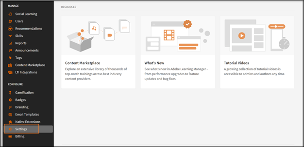

3. 在類別中&#x200B;**[!UICONTROL Basics]**&#x200B;選擇&#x200B;**[!UICONTROL Basic Info]**。

   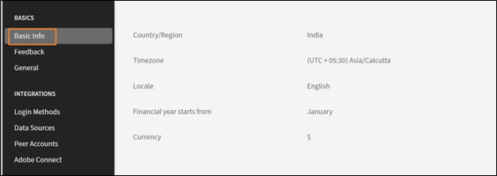

4. 選擇 **[!UICONTROL Change]** 以修改基本設定。

### 變更基本設定

**國家/地區**

Adobe Learning Manager 管理員設定中的「國家/地區」下拉選單允許您指定與該組織相關聯的國家或地區。 此設定用於本地化，確保平台符合區域偏好、合規要求及時區需求。

**時區**

「時區」下拉選單可讓您定義平台的預設時區。 這確保所有時間敏感的活動，如課程時間表、截止日期與報告，都能與組織或學員的當地時間準確對齊。

**地點**

語系指的是帳戶的語言與地區設定。 「語系」下拉選單允許管理員設定平台介面與內容向使用者顯示的語言。 此選項確保學習者與管理員能以偏好的語言與平台互動。

**財政年度起始於**

此選項允許您定義組織財務年度的起始月份。 例如，如果您的組織財務年度從 12 月開始，您可以將此選項設為 12 月。 報告與分析結果將與本財政年度對齊。

**貨幣**

「貨幣」選項允許您定義帳戶的預設貨幣。 此貨幣用於定價學習物件，如課程、學習路徑及認證。 例如，如果您的組織在美國營運，您可以將貨幣設定為 USD（$）。 同樣地，對於歐洲的營運，您也可以選擇歐元（€）。

### 變更回饋設定

Adobe Learning Manager 中的回饋設定為管理員提供工具，以收集和管理來自學習者（L1）與管理者（L3）的回饋。 這些環境確保課程與學習目標獲得有效評估，促進持續改進。

在開始從學習者那裡收集有價值的洞見之前，你需要啟用 L1 回饋功能並設定其參數。 第一步是前往「回饋設定」區域，為所有新課程啟用此功能，同時選擇回饋表單的主要語言。

### 啟用 L1 回饋

在 L1 回饋標籤中，找到標示為「為新建立課程與學習路徑啟用 L1 回饋」的切換開關。 選擇開關以開啟它。 這會自動包含你新建立課程的 L1 回饋表單。

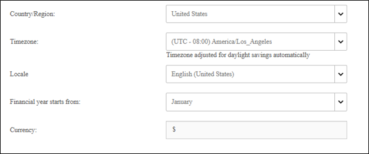

**選擇預設語言**

使用「語言」下拉選單選擇回饋表單的預設語言。 這確保問題以正確的語言呈現給學習者。

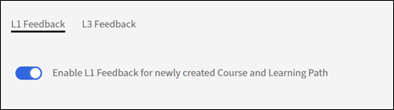

**為不同課程類型設定問卷**

Adobe Learning Manager 允許您根據課程是自學模組還是講師主導的課堂課程，自訂問題內容。 這確保你收到的回饋具體且相關。 在此步驟中，您將選擇並精煉自學課程與課堂課程的問題，以收集最具意義的資料。

**自學課程**：

* **必填問題**：問卷中包含一項必問問題：「你有多大機會會推薦這門課程給同事？」 這是一個標準的淨推薦值（NPS）題目，是整體課程滿意度的關鍵指標。
* **自訂問題**：檢視所提供的問題清單。 若要在回饋表單中加入問題，請確保該問題旁的切換開關設定為「是」。 若要移除問題，請將開關切換為「否」。
* **新增自訂問題**：如果您有與自學內容相關的額外問題，請選擇「新增更多」連結，以建立並新增自訂陳述到問卷中。

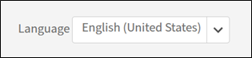

**針對教室課程**：

* **自訂問題**：檢視專為課堂訓練量身打造的問題清單。 將每題旁的開關切換為「是」以包含該題，或切換「否」以排除該問題從回饋表單中剔除。
* **新增自訂問題**：若要新增與您的教室環境或主持風格相關的新問題，請點選「新增更多」連結以建立並加入清單。

**設定回饋提醒**

為了最大化回覆率，設定自動提醒是個好做法。 此步驟示範如何設定與排程這些提醒，定義它們何時發送、重複頻率以及持續多久。 主動提醒學習者，你可以大幅增加收集回饋的數量。

1. **新增**&#x200B;提醒：在此 **[!UICONTROL L1 Feedback Reminders]** 區段中選擇 **[!UICONTROL Add New Reminder]**。

   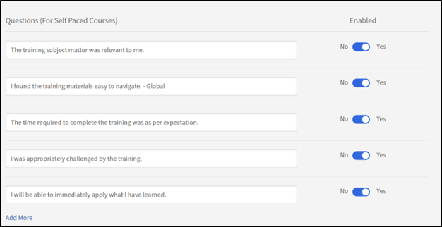

2. **定義提醒排程**：在出現的提醒 **設定** 面板中，使用下拉選單與輸入欄位設定提醒：

   a. **[!UICONTROL When to send]**：選擇提醒是已發送 **[!UICONTROL On Course Completion]** 還是 **[!UICONTROL After Course]** 已完成。
   b. **[!UICONTROL Recurrence]**：選擇提醒的頻率（例如，每週）。
   c. **[!UICONTROL For]**：指定提醒將被傳送的總持續時間（以週為單位）（例如，4 週）。

3. **[!UICONTROL  Save the reminder]**：選取藍色勾選圖示以儲存新的提醒設定。 如果需要，您可以重複此步驟以新增更多提醒。

   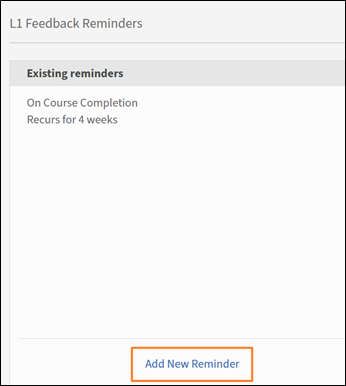

4. 在頁面右上角選取 **[!UICONTROL Save]** 以套用 L1 回饋設定。

### 啟用 L3 反饋

在您能從學習者經理那裡收集回饋之前，您需要先設定 L3 回饋的設定。 第一步是前往「回饋設定」頁面，並選擇 L3 回饋標籤。 從這裡，你可以設定回饋請求的語言，並檢視將送給經理的主要問題。

**選擇 L3 回饋標籤**

在回饋設定頁面中選取 L3 回饋標籤。

**檢視回饋聲明**

學習者的主管會向學習者提出三級回饋，作為一份聲明，讓學習者可以同意或不同意。 預設的說明是：「員工在接受訓練後，表現明顯改善。」 您可以編輯此聲明，以更符合您組織的需求。

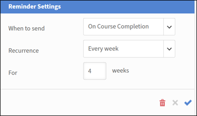

**選擇預設語言**

選擇「語言」下拉選單，以選擇回饋請求的預設語言。

**設定回饋提醒**

為了確保主管能及時提供回饋，你需要設定自動提醒系統。 此步驟涉及設定這些提醒何時發送以及它們的頻率。 截圖顯示 L3 回饋提醒可以設定為在課程結束時一次性發送，但如果需要，也可以新增更多提醒。

1. **[!UICONTROL Add a new reminder]**：若要建立新的提醒，請選取該 **[!UICONTROL Add New Reminder]** 連結。
2. **[!UICONTROL Define reminder schedule]**：在面板 **[!UICONTROL Reminder Settings]** 中，選擇下拉選單和輸入欄位以設定提醒：a. **[!UICONTROL When to send]**：選擇提醒發送時間。 選項為 和 **[!UICONTROL On Course Completion]** **[!UICONTROL After Course completion]**。
b. **[!UICONTROL Recurrence]**：選擇提醒的頻率。 如果重複次數為 **[!UICONTROL Once]**，代表經理將收到一次通知以提供回饋。 可選選項包括：一天一次、每週一次、每月一次。
3. 設定好排程後，勾選藍色勾選圖示以儲存提醒設定。 提醒會顯示在現有提醒清單中。

   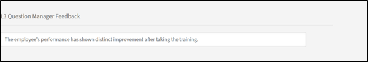

4. 在頁面右上角選取 **[!UICONTROL Save]** 以套用 L3 回饋設定。

## 一般設定

### 概觀

Adobe Learning Manager 中的一般設定為管理員提供一個集中式的地點，以配置整體學習者體驗與管理流程。 這些設定允許您啟用或停用各種功能，以根據組織的特定需求調整平台。

主要可配置的一般設定包括：

* **課程效能與審核：** 選擇向學習者顯示課程效能評分，並啟用需管理員核准的課程審核功能，該功能對所有課程變更皆需管理員核准。
* **學習者參與功能：**&#x200B;您可以啟用或停用討論區&#x200B;**以顯示課程評論、提供外部來源技能，以及**&#x200B;摘要電子郵件&#x200B;**等功能**，讓學習者隨時掌握新內容與進度。
* **內容與課程管理：**&#x200B;設定允許設定&#x200B;**互動式電子學習的多次嘗試**、為內容新增&#x200B;**獨特學習物件 ID**，以及設定模組版本更新&#x200B;**的**&#x200B;預設行為。
* **使用者管理：** 啟用 **自動註冊使用者** ，以自動新增使用者至系統，並 **自動刪除已停用一段時間的內部使用者** 。
* **自訂與顯示**：您可以控制學習者所看到的內容，例如啟用或停用 **篩選面板** 以進行搜尋、顯示 **目錄標籤**，以及自訂最多三個 **頁尾連結**。

### 課程管理

課程管理讓您能監督並管理作者對課程所做的更新。 它確保任何課程內容變更在發布給學習者前，都會經過管理員審核並核准。 選擇課程管理時，作者必須取得管理員同意才能發布課程，前提是他們對課程做了任何變更。

例如，當作者更新課程、新增或移除模組，並嘗試發佈該課程時，

1. 每當作者重新發佈帶有變更的課程時，你都會收到通知。
2. 選取通知以檢視作者所做的變更。
3. 比較舊內容與新內容。
4. 核准或拒絕變更：a. 核准變更以重新發布課程並更新內容。
b. 拒絕變更以保持先前版本的課程有效。
5. 作者會收到你的決定通知，無論是核准還是拒絕。

### 討論區

Adobe Learning Manager 中的討論區選項允許學習者參與與課程、模組或學習計畫相關的討論。 您可以啟用並管理此功能，以促進學習者之間的協作與知識分享。 討論區與特定課程或模組相連結，使其在情境中具有相關性。

作為學習者，你可以透過「討論」標籤與其他學習者及講師互動。 您可以查看您瀏覽或報名的任何課程的貼文。 如果管理員已為某門課程啟用討論，您可以在該課程的「備註」標籤旁查看「討論」標籤。

當您選擇課程的「討論」標籤時，可以看到該課程現有的貼文與留言。 如果你已經報名了課程，也可以開始輸入貼文或留言，讓其他使用者看到。 輸入訊息後，按一下「發佈」。 你的貼文必須至少包含 10 個字元。

該貼文會立即在討論標籤中顯示。 你可以將文章排序為「最新」或「最舊」，然後刪除你寫過的文章。 即使你退選課程後，仍然可以查看所有貼文並刪除你所發表的貼文。

作為管理員，您可以管理討論，以確保相關性與適當性。 學習者會收到回覆或討論更新的通知。

### 多次嘗試

選擇此選項可讓作者在課程或模組層級設定可重複嘗試的次數。 它允許學習者在完成課程或評量後重修該課程或測驗。  此設定適用於包含小考、測驗或需要評估的課程類型。

### 技能、標籤、產品與角色的可見性

此選項決定學習者是否只看到已指派的技能或標籤，或是目錄中對學習者可見的部分，或所有技能與標籤。 這包括與課程或學習路徑相關的技能、標籤、產品與角色。

選擇 **[!UICONTROL Edit]** 以限制學習者可看到的內容：

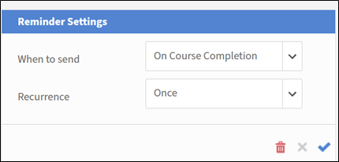

學習者接著探索他們可見的技能與標籤，並訂閱他們選擇的技能。

### 獨特的學習物件識別碼

此選項允許您為每個學習物件（例如課程、學習路徑、認證或工作輔助工具）指派唯一識別碼。 這確保每個學習物件都有獨特的 ID，這對於追蹤、報告以及與外部系統整合都很有用。

啟用後，作者會在建立學習物件時看到一個欄位，以新增學習物件 ID。 他們可以依照情況新增 ID。 獨特 ID 適合與第三方系統整合，包括學習記錄儲存庫（LRS）及學習管理系統（LMS）。 獨特的 ID 也讓您或作者更容易搜尋特定學習物件，並透過學習者成績單追蹤它們。

### 顯示篩選面板

此選項允許您控制學習者應用程式中可用的篩選選項。 這些篩選條件幫助學習者在「我的學習」和「目錄」區塊中精細篩選學習者的搜尋結果。 以下篩選選項可供選擇：

* 團體
* 型錄
* 類型
* 格式
* 持續時間
* 技能
* 技能等級
* 標記
* 價格
* 價格範圍
* 地點
* 產品
* 推薦等級

>[!NOTE]
>
>篩選 **[!UICONTROL Format]** 器 和 **[!UICONTROL Duration]** 預設為關閉，且不會立即顯示給學習者。 您必須明確選取它們。

### 產品術語

Adobe Learning Manager 有特定的產品術語用來定義學習物件，例如課程、學習路徑或工作輔助工具。 您可以依照偏好，以英文和法文自訂術語。 下載產品術語範本，並將例如「學習計畫」替換為「規範性規則」。 同樣地，修改法文類似條目。 接著，上傳修改後的範本，並選擇儲存以更新產品中的術語。

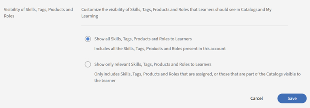

更多資訊請參閱 Adobe Learning Manager 中的產品術語。

### 製作人員

啟用後，作者與講師可記錄每場課程或模組的教學學分數。 學分代表學習者完成該活動後所獲得的教學時間。 學分數值會出現在學習者成績單、學習報告中，並對學習路徑的總學時長度計算有所貢獻。 如果您停用此設定，先前輸入的點數值會被保留，並在重新啟用該設定時還原。

### 團體報名

啟用此設定，可讓作者在一般報名開放前，設定課程實例中的特定使用者群組的報名開放日期及名額。 若此設定未啟用，設定課程實例時將無法使用「依使用者群組分配席位」選項。

### 安全考試瀏覽器整合

啟用此設定，允許作者透過安全考試瀏覽器整合設定測驗。 要啟用此整合，管理員必須上傳其叢集或環境的安全考試瀏覽器設定檔。 若此設定為停用，則在設定測驗時，作者將無法使用「安全考試瀏覽器」選項。

### 模組版本更新

此選項允許管理員更新模組內容，同時不干擾已報名該模組課程的學習者進度。 這確保學習者能順利繼續學習旅程，同時作者也能保持內容最新。 啟用此選項後，作者可以上傳模組的新版本（例如 SCORM、AICC 或 xAPI 套件）以取代現有版本。

* 已開始模組的學習者將繼續使用他們報名時所修讀的版本。
* 新學習者將自動存取更新版本。
* Adobe Learning Manager 會追蹤模組的不同版本，以供報告與稽核之用。

### 自動註冊使用者

此選項允許您在使用者加入系統時，自動註冊特定目錄或學習內容。 這確保使用者能立即取得相關學習資源，無需人工介入。

* 新使用者在加入系統時會自動註冊至預先定義的目錄或課程。
* 管理員可以根據使用者屬性（如角色、群組或其他條件）定義規則，以決定使用者會自動註冊哪些目錄或課程。 更多資訊請參閱 [Adobe Learning Manager](/help/migrated/administrators/feature-summary/learning-plans.md) 中的學習方案或 [在註冊](https://elearning.adobe.com/2024/05/automatically-enroll-external-user-groups-in-courses-upon-registration/) 時自動報名外部使用者群組於課程中。

### 自動刪除內部使用者

若使用者在指定期間內未使用 Adobe Learning Manager，此選項會將其刪除。  指定使用者在不登入 Adobe Learning Manager 的情況下可存取的天數。 使用此選項，您也可以在指定期間後自動從系統中移除非活動的內部使用者。 這有助於透過移除不再活躍的使用者，維持使用者資料庫的乾淨與有序。

* 已在指定期間內處於非活動狀態的內部使用者會自動被刪除。
* 使用者在刪除前會收到通知，讓他們有機會登入並防止被移除。
* 若要恢復存取權，已刪除的使用者必須聯絡帳戶管理員。

### 自動清除已刪除的使用者

自動且永久地將處於刪除狀態超過指定時間的使用者從系統中移除。 一旦清除，所有相關使用者資料將永久移除，無法復原。

若啟用，則清除已在指定天數後已在 ALM 中刪除的使用者資料。

### 顯示目錄標籤

此選項允許作者在建立學習物件時設定目錄標籤。 學習者接著會在學習者應用程式的目錄區段看到目錄標籤。 這些標籤幫助學習者辨識並區分可用的各種目錄。 若未選取此選項，課程或學習物件會移至預設目錄。

### 自訂合規類型

此選項允許作者定義並管理符合其組織特定需求的合規類型，同時建立學習物件。 作者可以在他們正在製作的課程中加上合規標籤和截止日期。
這對於根據獨特的組織政策追蹤並執行員工合規訓練特別有用。

### 學習者可以查看自己的分數

選擇此選項可確保學習者能在學習者成績單中查看測驗成績。 在成績單中，Quiz_score、Quiz_score_max、Highest_Quiz_score 和 Highest_Quiz_score_max 欄位幫助學習者查看自己的評量分數。 這些分數幫助學習者追蹤自己的進展並理解自己的表現。

若取消勾選此選項，測驗分數將不會出現在學習者的成績單中。

### 摘要電子郵件

此選項允許您向學習者發送摘要電子郵件，提供學習活動、進度及即將到來的截止日期更新。 這些電子郵件旨在讓學習者隨時掌握並參與其培訓計畫。 這些電子郵件會記錄學習者的活動，例如已完成的課程。

您可以在電子郵件範本設定中變更電子郵件的頻率。 此外，您還可以自訂摘要電子郵件的內容，加入與學習者相關的具體細節。

>[!NOTE]
>
>* 對於活躍帳戶，摘要郵件預設會被停用，您可以手動啟用。
>* 對於試用帳戶，摘要郵件的選項將保持停用狀態，且您無法啟用該選項。

### 啟用課程/學習路徑/認證/工作援助卡圖示

此選項允許作者在學習者的課程卡片上加入不同學習內容的封面圖片。 這些圖片幫助學習者一眼辨識內容類型（例如課程、學習路徑、認證或工作輔助）。 在建立學習物件時，作者可以為課程添加封面圖片。

如果您未選擇此選項，卡片將不會顯示任何圖示。

### 頁尾連結

此選項允許您自訂學習者應用程式的頁尾區塊，新增指向外部資源、公司網站或其他相關頁面的連結。 這些連結會出現在學習者應用程式介面的底部，可快速取得重要資訊。 這些連結可以引導學習者前往外部網站、說明頁面或公司政策。 它們讓學習者能直接從應用程式輕鬆取得額外資源。

以下是您可以自訂頁尾連結的方法：

1. **[!UICONTROL Add links]**：在指定欄位中選取 **[!UICONTROL Add More]** 並輸入姓名以及 URL 或電子郵件 ID。 確保 URL 前置以 `http://` 或 `https://`。
2. **[!UICONTROL Replicate across locales]**： 選擇 **[!UICONTROL Replicate]** 此項以將變更串接至所有語系，確保所有語言名稱與網址相同。
3. 選取 **[!UICONTROL Save]** 以套用變更。

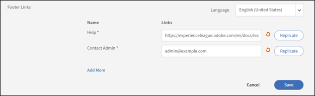

**其他選項：**

* 重設預設值：在說明與聯絡管理員欄位中選取重設圖示，以回復預設值。
* 自訂適用於所有語言：從下拉清單中選擇一種語言，然後新增該語言的名稱與網址。 儲存變更以更新所選語言的頁尾連結。

### 報告時區

此選項允許您設定帳戶層級偏好，以匯出特定時區的學習成績單與課程摘要報告。 可用的選項包括：

* UTC（預設行為）
* 帳戶層級時區偏好

此選項同時確保透過 Jobs API 下載的學習者成績單反映所選時區。

### Badgr 整合

選擇此選項可讓學習者：

* 把他們的徽章上傳到 Badgr 網站。
* 在社群媒體上分享徽章。

運作方式：

* 在 Badgr 整合區段中選擇此選項。
* 學習者可從 Adobe Learning Manager 登入其 Badgr 帳戶。
* 在 Adobe Learning Manager 中獲得的徽章會自動上傳至 Badgr 帳戶。

>[!NOTE]
>
>* Adobe Learning Manager 在整合過程中並未提供 Badgr 帳戶。 學習者必須建立自己的 Badgr 帳號。
>* 學習者可直接從學習者應用程式中的徽章頁面設定 Badgr 帳戶。

更多資訊請參閱 [Badgr](/help/migrated/learners/feature-summary/badges.md#support-for-badgr-badges) 徽章支援。

### 節目收視率

此選項允許您在學習者應用程式中啟用或停用課程評分的顯示。 啟用後，學習者可以查看課程評分，幫助他們在報名課程時做出明智決策。

* 若選擇「課程效能」選項，學習者將只能看到課程成效的價值。 課程成效是根據學習者回饋（L1）、測驗分數（L2）以及主管回饋（L3）來計算的。
* 若選擇「星級評分」選項，學習者將只能查看平均星級評分及評分該課程的學習者人數。 星級評分是學習者完成課程後所給予所有評分的平均值。

對於新帳戶，「顯示評分」區塊預設會啟用「星級評分」選項。

對於現有帳戶，如果先前啟用了「課程效能」選項，則「顯示評分」區塊會啟用，並選擇「課程效能」。 若「課程效能」選項被停用，則「節目評分」區塊也會被停用。 啟用「顯示評分」區段時，「星級評分」選項預設會啟用。

### 預設檢視（學習者角色）

此選項指的是學習者對課程目錄的檢視。 勾選「清單檢視」核取方塊，將學習者的檢視從預設的網格檢視切換為清單檢視。

### 學習路徑

如果您選擇 **[!UICONTROL Enable Extended features of Learning Path]**，您可以在「學習路徑」中包含「學習路徑」，並將這些「學習路徑」與「課程」合併。 這個選項是不可逆的。

### 講師管理

此選項確保作者能從預先設定的清單中選擇虛擬教室或教室課程的講師。

**主要特色：**

* 限制講師選擇：只有具有講師角色的使用者才能被指派到課程中。
* 對移轉工作流程的影響：此限制不適用於移轉工作流程。

### 模組預覽

如果您選擇啟用，作者可以在建立課程後以學習者身份預覽課程。

### 啟用課程/學習路徑/認證的定價

此選項允許您為課程、學習路徑及認證啟用電子商務功能。 此功能主要用於將 Adobe Learning Manager 與 Adobe Commerce 整合，讓組織能夠將其培訓課程變現。
啟用此功能後，貨幣欄位會出現在基本資訊頁面。

當課程需收費時，作者可以指定課程、學習路徑或認證價格。 學習者可直接從 Adobe Learning Manager 或 [客製化 AEM 網站](/help/migrated/integrate-aem-learning-manager.md)購買訓練。

>[!NOTE]
>
>某些類型的訓練，例如定期取得的認證與經理核准的課程，則無法購買。

## 在 Adobe Learning Manager 中啟用自動組隊功能

在管理員設定中啟用自動組隊功能，讓 Adobe Learning Manager 群組在每個課程實例開始前就將學習者註冊為團隊。

此設定為選用。 團隊提交即使沒有它也能運作，講師也可以手動建立團隊。

當您啟用此帳戶設定時，Adobe Learning Manager 會在每個課程實例開始前的固定天數，自動將已報名的學習者分組到團隊中。 此設定預設為關閉。 作者可以調整課程時間表，講師仍可手動建立團隊。

### 開啟自動隊伍陣型

1. 在系統管理員應用程式中，選擇 **「設定** 」> **「一般**」。

1. 在 **「團隊基礎提交的自動組隊」區段**&#x200B;中，選擇 **「編輯**」。 此選項預設為停用狀態。

   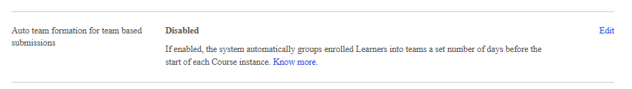

1. 勾選「 **啟用** 」核取方塊。

   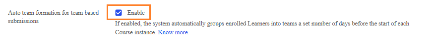

1. 在「團隊組建排程」欄位&#x200B;**中，輸入「建立團隊**」欄位的天數&#x200B;**。**&#x200B;該值必須為 0 或以上。 此欄位為必填欄位。

   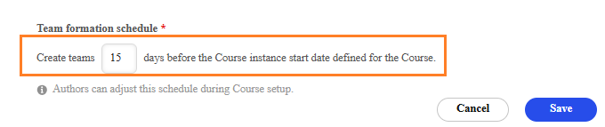

1. 選擇「 **儲存**」。

此設定僅適用於具有團隊式檔案提交模組且有實例開始日期的課程。

## 變更如何影響課程

當您變更此設定時，變更僅適用於儲存後建立的課程。 現有課程會維持發佈時的配置，不論自動組隊是否開啟，且保持賽程。 例如，如果你在三月開啟這個設定，二月建立的課程不會收到，三月或之後建立的課程則會。

Adobe Learning Manager 不會將此變更套用到現有課程，因為這可能會干擾已在使用這些課程的作者、講師與學習者。 作者與講師可繼續使用課程出版時所使用的配置。 如果有人需要不同的配置，他們可以建立新的課程，並讓相關人員知道有哪些變更。

您可以隨時更改設定。 你選擇的任何課程都適用於之後建立的所有課程，直到你再次更改為止。 這讓您能設定適合您組織的政策。

* 如果你把這個設定關掉，已經使用自動組隊的課程仍會照設定正常運作。
* 已組成的隊伍會保留原位，講師仍可編輯。
* 當作者建立新課程時，可以調整該課程的排程。 查看作者如何設定團隊規則。

關閉設定後，已組成的隊伍仍會留在原地。 講師仍然可以編輯它們。

### 啟用多商品 SKU 購物車

此選項允許學習者將多個訓練項目（課程、學習路徑、認證）加入購物車，並共同購買。 此功能是與 Adobe Commerce 整合的電子商務功能的一部分。

此功能對於販售多種訓練產品、希望簡化學習者購買流程的組織特別有用。

**主要特色：**

* 多重購買：學習者可以將多件商品加入購物車，並在一次交易中購買。 更多資訊請參閱多商品購物車。
* 簡化結帳：減少學習者為每項訓練項目分別購買的需求。
* SKU 管理：管理員可以管理課程、學習路徑及認證的 SKU，以確保適當的追蹤與報告。

### 替代課程/路徑

當學習者完成某一課程/路徑時，另一組指定的課程/路徑可以透過替代方式標記為已完成。 當課程內容相同或內容重疊時，這很有用。 例如，當新課程取代舊版本，或同一訓練存在區域性變體時。 學習者不會自動註冊於透過替代方式標示為已完成的課程/路徑，僅會獲得其實際完成的課程/路徑的學分、徽章與積分。 替代完成成績會顯示在學習者成績單中，並計入包含該替代課程的任何學習路徑或認證。

**啟用追溯完成（不可逆）**&#x200B;若學習者先前完成某門課程/路徑，且後來在替代課程/路徑下新增另一門課程/路徑，則該課程也會標示為透過替代完成。 此規定追溯適用於所有過去完成的學生——不僅限於未來的報名人數。 當你希望歷史完成紀錄計入新增的替代課程時，請使用此功能。 一旦啟動，就無法停用。

**啟用追溯性未完成（不可逆）**&#x200B;若某課程/路徑從替代課程/路徑中移除，先前透過替代路徑標記為已完成的學習者將被標記為未完成。 此規定影響所有僅基於替代課程完成課程的學習者，而非直接完成課程的學習者。 他們的成績單將反映更新後的未完成狀態。 一旦啟動，就無法停用。

### 成績簿可見性 {#gradebookvisibility}

啟用後，作者可在課程層級控制成績簿可見性，讓學習者能直接在課程播放器中查看加權模組分數、課程總分及通過/不合格狀態。 如果在帳戶層級停用此設定，學習者將無法在任何課程中看到成績簿，無論個別課程如何設定。 即使關閉學習者可見性，成績簿分數與計算仍會在背景執行，以便管理員報告。

**為學習者啟用成績簿檢視**

啟用帳戶層級權限，允許作者顯示或隱藏每門課程的成績簿。 啟用後，作者會在課程編輯器中看到「向學習者顯示成績簿」選項。 學習者會在課程播放器中看到任何作者啟用的課程的成績簿分頁。 在帳戶層級停用此設定會覆蓋所有課程層級的設定。 在重新啟用設定之前，學習者將不會在任何課程中看到成績簿。 更多資訊請參閱 [「行政](/help/migrated/administrators/feature-summary/alm-admin-gradebook.md)用成績簿」。

### 外部學習

啟用後，學習者可直接從學習者儀表板提交並追蹤在 Adobe Learning Manager 以外完成的學習活動——例如認證、工作坊、會議及外部課程。 提交作業會由學員的直屬主管審核並核准，然後才會被記錄。 一旦核准，外部學習活動會被加入學員成績單，並計入學習者的整體學習紀錄。 管理員可以設定學習者在提交外部學習活動時必須填寫哪些欄位，包括針對您組織的特定自訂欄位。

**啟用**

為帳戶內所有學習者啟用外部學習功能。 啟用後，提交表單會在學習者儀表板上開放。 學習者可以輸入訓練名稱、時長、日期、分數及完成證明等詳細資訊。 提交的稿件會送交主管審核並核准。 已核准的提交會顯示在學習者成績單及管理員報告中。 被拒絕的作品不會記錄在成績單中。

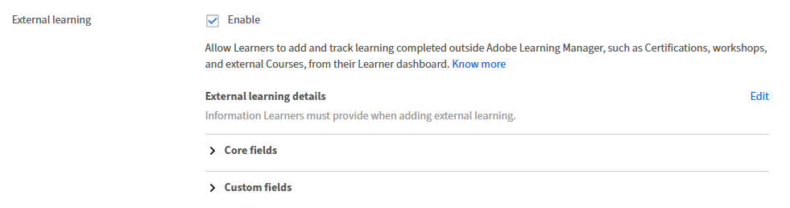

>[!NOTE]
>
>啟用此設定後，外部學習提交會新增學員成績單欄位。 如果您的組織使用自動化工作流程或整合來處理學習者成績單資料，請在啟用前先檢視這些資料，以確保與更新後的成績單結構相容。

外部學習是一種用於平台外訓練的學習活動。 學習者會用它來記錄 Adobe Learning Manager 中不存在的訓練內容，例如產業認證考試、專業會議、導師課程或學術課程。

1. **學員**&#x200B;需填寫一份提交表單，內容包含其外部訓練的詳細資料，並可選擇性地上傳完成證明。

2. 學習者的 **主管** 會收到通知，要求審核提交，並以選填評論核准或拒絕。

3. 經核准後，提交資料會加入 **學習者成績單**，管理員可檢視並回報。

此工作流程允許組織將強制性的平台內合規訓練與員工在現實世界中完成的臨時、自我導向學習結合，並在單一系統中追蹤兩者。

外部學習是可設定的功能。 管理員可控制該欄位是否對學習者開放、提交表單上顯示哪些欄位，以及每個欄位是必填還是選填。 可新增自訂欄位以擷取組織專屬資訊，例如訓練類型或證書參考編號。

### 提交狀態生命週期

每一份外部學習提交都會經過一組定義好的狀態：

| **現況** | **意義** |
|-------------------|--------------------------------------------------------------------------------|
| 等待核准 | 學習者已提交申請;目前正等待經理審查。 |
| 已核准 | 經理已核准提交;該資料會顯示在學員成績單中。 |
| 拒絕 | 經理已拒絕提交;學習者可以重新提交申請。 |

學習者可以在提交處於 **「等待核准** 」狀態時編輯該提交。 一旦經理採取行動，該提交內容就無法再被編輯。 若提交被拒絕，學習者將提交新的外部學習請求，而非編輯被拒絕的申請。

### 功能可用性與可見性

管理員透過單一帳戶層級設定控制外部學習可用性：

**啟用外部學習時：**

* 學習者在導覽中看到 **「外部學習** 」標籤，並可提交新申請
* 經理會在團隊儀表板中看到 **外部學習** 標籤，並可檢視提交內容
* 行政與學員成績單包含外部學習資料，供經核准提交使用。

**當外部學習被停用時：**

* 沒有先前提交資料的學習者將看不到外部學習介面

* 有先前提交的學習者仍可查看其歷史紀錄及提交狀態，但無法建立新提交

* 若團隊有過去提交，經理仍可存取外部學習標籤;否則該標籤將被移除

* 已核准提交的現有成績單資料不受影響

#### 核心場

這些欄位預設對所有帳戶皆可用。 管理員可以選擇在學習者提交表單上顯示哪些欄位，並將每一項標記為必填或選填。

| **場地** | **類型** | **註釋** |
| --- | --- | --- |
| 標題 | 文字 | 外部學習、課程或認證的名稱。 |
| 說明/註釋 | 文字 | 學習者可以新增有關訓練提供者或情境的詳細資訊。 |
| 日期/日期範圍 | 日期/時間 | 開始日期、結束日期，或兩者皆可。 支援小時、分鐘、週、月、天或年。 |
| 持續時間 | 持續時間（小時） | 花在外部訓練上的時間。 |
| 配樂 | 編號 | 學習者所獲得的分數（如適用）。 |
| 附件 | 檔案上傳 | 完成證明。 學員可以提交證書、成績單或其他文件。 |

#### 自訂欄位

管理員最多可新增 10 個自訂欄位，以擷取更多組織專屬資訊。 自訂欄位支援以下類型：

| **類型** | **描述** |
|------------|------------------------------------------------------------------|
| 文字 | 自由格式文字輸入。 |
| 編號 | 數字輸入。 |
| 核取方塊 | 單一的是/否切換。 |
| 下拉選單 | 從管理員定義的選項清單中選取單一選項。 |

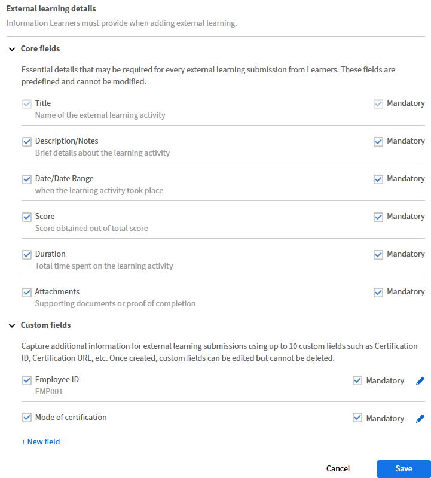

### 完成證明檔案要求

* **支援的檔案類型：** PDF、DOC、DOCX、PNG、JPEG、JPG

* **最大檔案大小：** 每個附件 50 MB

#### 管理員對外部學習所控制的事項

所有帳號預設&#x200B;**為**&#x200B;停用外部學習。您必須明確啟用此功能，學習者才能提交申請或管理者能看到審查標籤。

啟用外部學習時：

* 學習者可進入 **外部學習** 標籤並提交新申請

* 管理者可存取 **外部學習** 檢視標籤

* 管理員與學習者成績單可獲得核准外部學習活動的報告欄位。 一旦啟用外部學習，可能會影響學員成績單報告。 如果您的組織使用 Learner Transcript 資料進行自動化，請檢視並更新任何相關的工作流程，以因應新的外部學習欄位與紀錄。

當你在外部學習已被使用後停用時：

* 新學員提交資料被封鎖

* 已提交、待審核的學習者可被編輯

* 先前提交的經理仍可對待處理的請求採取行動

* 先前核准提交的成績單資料未變更

* 您可以隨時重新啟用此功能。 停用此功能時，資料不會遺失。

#### 啟用或停用外部學習

**注意：** 啟用外部學習會在管理員學習者成績單中新增欄位： **外部學習名稱**、 **完成評論**，以及為您的帳戶設定的任何自訂欄位。 自訂欄位欄位會出現在逐字稿的末尾。

如果您的組織在下游報告管道或自動化工作流程中使用學習者成績單，請先更新這些系統以處理新欄位，然後再啟用此功能。

1. 以管理員身分登入 Adobe Learning Manager。

2. 在左側導覽窗格中，選擇 **「設定**」。

3. 選擇&#x200B;**「一般」。**

4. 捲動至 **「外部學習** 」區塊。

5. 勾選 **「啟用外部學習** 」核取方塊以啟用此功能。

6. 選擇「 **儲存**」。

學習者現在可以提交外部學習申請。 當提交產生時，他們的管理者會收到平台內的通知。

若要停用此功能，請依照相同步驟，並停用該選項。

#### 設定外部學習表單

啟用此功能後，請設定學習者提交表單上顯示的欄位。

1. 在 **「設定」>「一般**」中，開啟 **「外部學習** 」區段。

2. 在表單設定&#x200B;**下**，檢視預設欄位清單。

3. 勾選每個欄位旁的核取方塊，以便在學習者表單上顯示或隱藏該欄位。

4. 對於每個可見欄位，選擇 **「必須** 」以控制學習者是否必須在提交前完成該欄位。

5. 選擇「 **儲存**」。

>[!NOTE]
>
>**標題**&#x200B;欄位始終為必填，且無法隱藏或設為可選。

學習者提交表單會立即反映您的變更。 現有的提交不會受到表單設定變更的影響。

#### 新增並管理自訂欄位

您可以新增最多 10 個自訂欄位，以擷取您組織專屬的資訊。

**新增自訂欄位**

1. 在 **「設定」>「一般**」中，開啟 **「外部學習** 」區段。

2. 展開 **自訂欄位**。

3. 選擇「 **新增欄位**」。

4. 選擇 **欄位類型**： **文字**、 **數字**、 **核取方塊**&#x200B;或 **下拉選單**。

   1. 若選擇 **下拉選單**，請輸入學習者可選擇的數值清單。 您可以新增最多 100 個下拉選單值。

   2. 輸入欄位名稱，並可選擇性地輸入其描述。

5. 為新的自訂欄位選擇或取消選取「 **必須** 」選項。

6. 選擇「 **儲存**」。

新欄位會立即顯示在學習者提交表單上。

**編輯自訂欄位**

1. 在 **「設定」>「一般**」中，開啟 **「外部學習** 」區段。

2. 在您想編輯的自訂欄位旁，選取 **「編輯**」。

3. 更新欄位名稱，或在下拉欄位中新增、編輯或移除數值。

4. 選擇「 **儲存**」。

編輯欄位名稱或下拉選單值不會變更已在現有提交中擷取的資料。 只有新提交的作品才會使用更新後的標籤和選項。

**重要**

一旦新增自訂欄位，就無法刪除它。 你只能編輯它。 如果您希望某欄位不出現在學習者的表單上，請取消勾選該欄位。

### 玩家設定

此選項允許作者針對不同球場層級自訂流體播放器。 作者可以設定訓練內容在播放器中如何顯示給學習者。 這包括與內容語言、介面偏好設定及播放選項相關的設定。

### 經理可以標記完成

此選項允許管理者為員工標記課程、認證或學習路徑完成紀錄。 此功能適用於學習者已完成平台外訓練或需要手動介入以更新進度的情況。
主管可透過以下方式標記課程完成：

* 檢查清單模組：檢查清單模組允許管理者根據特定任務或標準評估學習者的表現。 作者必須在課程建立時啟用此模組，並指派管理員作為審閱者。
* 課程頁面：在課程頁面：a.    在左側窗格中選取該 **[!UICONTROL Learners]** 標籤。
b.    選擇您想要標記出席的學習者。
c.    選擇 **[!UICONTROL Actions]** > **[!UICONTROL Mark Completion]**。

>[!NOTE]
>
> 經理也可以匯出學習者名單以供報告之用。
> 如果課程包含多個實例，管理者可以針對每個實例分別檢視和管理學習者。

### 退休

此選項允許作者退休不再相關或不再需要的訓練內容（課程、學習路徑、認證）。 已退休的內容會從學習者目錄中移除，但仍可在報告與歷史資料中存取，方便追蹤。 你有兩個選擇：

1. 退休後，已註冊的學習者將能檢視並執行操作，但尚未註冊的學習者將失去存取權限：a. 已註冊學習者：i. 已註冊退休課程或學習路徑的學習者仍可存取內容。
ii. 他們可以繼續執行完成課程或檢視教材等操作。
b. 尚未註冊的學習者：i. 在課程退役前未報名該課程或學習路徑的學習者，將不再在目錄中看到該內容。
ii. 他們將完全失去對已退休內容的存取權。
2. 一旦退休，已註冊與尚未註冊的學習者皆將失去以下存取權：a. 已註冊學習者：i. 已註冊該課程或學習路徑的學習者，一旦內容退役後將失去存取權。
ii. 他們將無法再檢視或對已停用內容執行任何操作。
b. 尚未註冊的學習者：i. 尚未註冊課程或學習路徑的學習者也會失去存取權，因為該內容將不再出現在目錄中。

### 對高階學習對象的後繼影響 {#retiral-impact-ho-lo}

**「對高階學習物件**&#x200B;的幕後影響」設定控制學習路徑或認證在其中一門課程或巢狀學習路徑被退休時的處理方式。它僅適用於較高階的學習對象——學習路徑與認證。 選擇下列選項之一：

* **封鎖包含已退休學習物件的高階學習物件的新註冊。**

  當較低階學習物件被退休時，包含該物件的任何學習路徑或認證將無法提供給新註冊。 已註冊的學習者仍可保留對高階學習物件中已退休學習物件的存取權，並可繼續完成該學習。

* **從包含該物件的學習路徑與認證中移除，保留其供新報名使用。**

  當低階學習物件被退休時，它會從包含該物件的學習路徑與認證中移除，就像它被手動移除一樣。 高階學習物件仍可供新註冊使用，新學習者視其為「已退休物件」從未屬於該物件。 已註冊的學習者則可在不使用已退休物件的情況下繼續修讀，其現有進度會保留在學習者成績單中，並相應重新計算完成率。 已完成高階學習對象的學習者會保留其完成及最終成績。

  如果退休某個學習物件會讓高階學習物件沒有剩餘內容（例如，當其所有學習物件或所有必要的學習物件都被退休時），則該物件不會被移除，且該高階學習物件會被封鎖，無法新增註冊。

>[!NOTE]
>
>移除不適用於重複使用之認證，且其於退休時保持不變。

### 自動退役

此選項允許作者設定課程自動退休的特定日期。 當課程終止後，將不再對新報名者開放，但已註冊的學習者仍可存取並完成該課程。

重點說明：

* 一旦設定自動退休日期，課程會在指定日期自動切換至退休狀態。
* 已退休課程對新學習者來說不會在課程目錄中顯示，但現有學習者仍可存取並完成這些課程。

### 在搜尋結果中顯示所有已報名課程

此選項允許學習者即使已註冊學習路徑或認證，也能在搜尋結果中查看課程。

### 技能導入

此選項允許您使用各自的連接器，從外部來源（例如 LinkedIn Learning 和 Go1）匯入技能。 此功能將外部技能雲與人才管理系統整合至 Adobe Learning Manager，提升平台有效管理與運用技能的能力。

來自外部內容提供者的技能會新增至 Adobe Learning Manager 中由管理員定義的技能庫。 這些技能會在課程建立的工作流程中提供給作者使用。

1. 選擇 **[!UICONTROL Enable]**。

   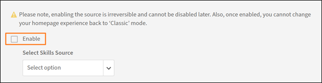

2. 從下拉選單中 **[!UICONTROL Select Skills Source]** 選擇內容提供者。
3. 選擇 **[!UICONTROL Save]**。
請注意，一旦啟用此選項，該動作將不可逆。 您之後無法停用或切換到其他來源。
