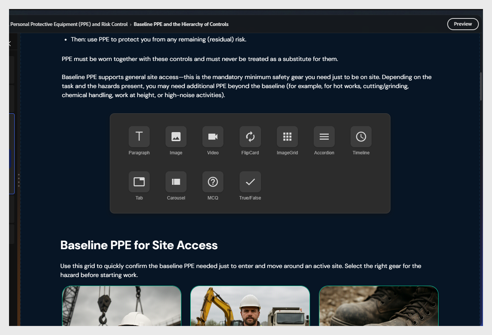
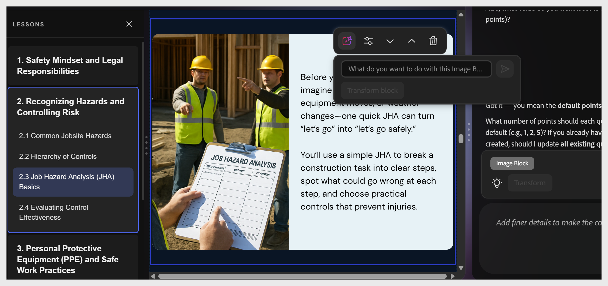

# 新增內容元件

在兩個現有元素中選擇。 出現了+鍵。 選擇它以開啟元件選擇器。

可用元件：

<table>
  <thead>
    <tr>
      <th>組成部分</th>
      <th>用途</th>
    </tr>
  </thead>
  <tbody>
    <tr>
      <td><strong>段落</strong></td>
      <td>正文與說明</td>
    </tr>
    <tr>
      <td><strong>圖片</strong></td>
      <td>插圖、截圖、圖解</td>
    </tr>
    <tr>
      <td><strong>影片</strong></td>
      <td>嵌入的 MP4 或連結影片</td>
    </tr>
    <tr>
      <td><strong>翻轉卡</strong></td>
      <td>項或定義對，揭示交互作用</td>
    </tr>
    <tr>
      <td><strong>影像格網</strong></td>
      <td>格狀佈局中的多張圖片</td>
    </tr>
    <tr>
      <td><strong>手風琴</strong></td>
      <td>可擴充章節，逐步程序</td>
    </tr>
    <tr>
      <td><strong>時間軸</strong></td>
      <td>序列事件或流程步驟</td>
    </tr>
    <tr>
      <td><strong>網頁物件</strong></td>
      <td>直接嵌入外部網頁內容、網頁、互動工具、調查或網頁應用程式，置於主題投影片中</td>
    </tr>
    <tr>
      <td><strong>分頁</strong></td>
      <td>平行內容——比較、區域變體</td>
    </tr>
    <tr>
      <td><strong>輪播</strong></td>
      <td>可滑動的圖片系列或內容卡</td>
    </tr>
    <tr>
      <td><strong>選擇題</strong></td>
      <td>內嵌無分級知識檢查</td>
    </tr>
    <tr>
      <td><strong>正確/錯誤</strong></td>
      <td>內嵌無分級的真或假檢查</td>
    </tr>
  </tbody>
</table>

>[!NOTE]
>
>使用 **手風琴** 進行逐步教學，讓學習者能從掌控步速中受益。 使用 **翻頁卡** 來獲取術語或定義內容。

## 在內容撰寫課程中新增一個網頁物件

網頁物件會在課程內的內嵌框架中顯示外部內容。 學習者在不離開課程的情況下與內容互動。 可用於互動工具、內嵌表單、問卷調查，或任何支援 iframe 嵌入的網路資源。

### 新增網頁物件

1. 在 Content Composer 開啟你的課程，並導覽到你想新增網頁物件的主題。
2. 請在主題投影片中選擇兩個現有元素。 **出現了+**&#x200B;鍵。
3. 選擇 **+** 以開啟元件選擇器。
4. 選擇 **網頁物件**。 方塊出現在畫布上。

### 設定網頁物件

在網頁物件區塊工具列中選擇 **設定** 圖示以開啟設定面板。

### 設定內容來源

在內容中&#x200B;**&#x200B;**，選擇外部內容的載入方式：

- **網址** — 輸入你想嵌入的網頁或工具的網址。 內容會以內嵌框架載入課程。
- **嵌入程式碼** — 貼上第三方服務的嵌入片段。 使用這些工具提供自己的嵌入程式碼，例如互動表單、調查問卷或媒體播放器。
- **系統** — 從連接系統或整合中選擇內容。

### 設定框架高度

在 **Frame height** 欄位中，設定嵌入內容幀的高度（以像素為單位）。 使用 **+** 和 **−** 控制來調整數值。 預設是 498 px。

調整框架高度，使其與嵌入內容的自然高度相符。 設定太低會在畫面內增加滾動條;設定過高則會在內容下方產生空白。

### 設定載入與顯示選項

- **自動載入** — 選擇後，學習者到達投影片時網頁內容會自動載入。 將此選項清除給內容豐富的頁面，以避免拖慢課程進度。 當自動載入關閉時，學習者會選擇觸發載入的幀。
- **區塊標題** — 開啟即可在網頁物件區塊上方顯示標題。 利用這些讓學習者在互動前，先了解內嵌內容的背景。

## 在主題內移動內容區塊

你可以透過工具列的編輯選項或 AI 來重新排序主題內的內容區塊。

