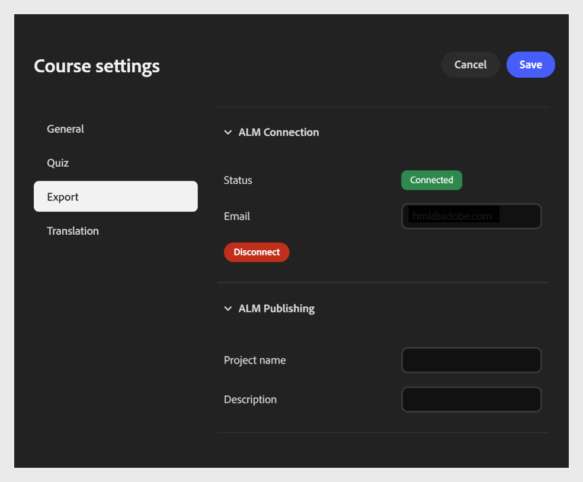
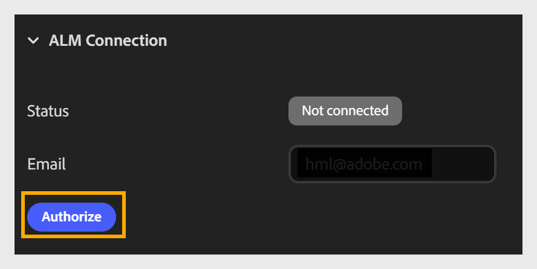
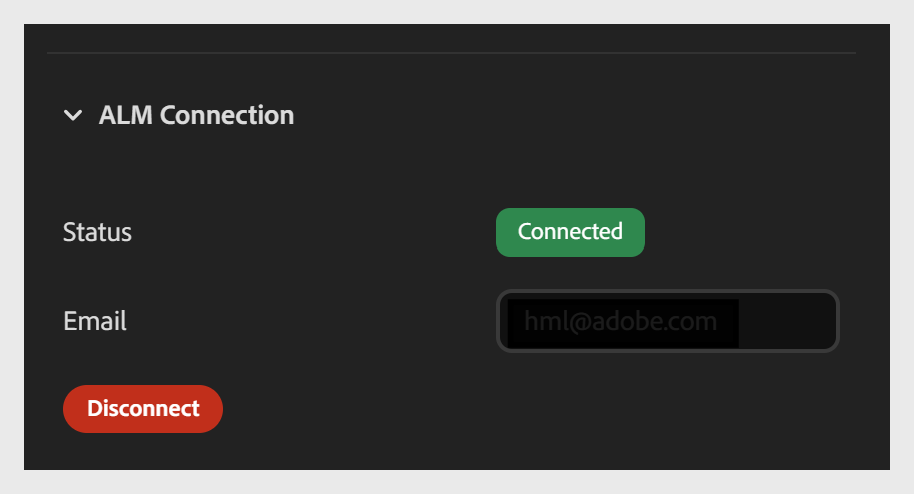

# 從內容撰寫器發佈課程到 Adobe Learning Manager

**匯出**&#x200B;標籤讓你能將課程連接到 Adobe Learning Manager（ALM），並直接發佈到 ALM 內容庫。要設定連線，請在 **電子郵件** 欄位輸入您的電子郵件。 確保你有一個 ALM 帳號，且電子郵件登入 ID 相同。 一旦連接，你可以將課程作為模組發佈到 ALM。

此連線為每門賽道一次性設定。 一旦建立，你不需要每次發佈或匯出都重新連接。

它分為兩個部分：

- ALM 連接部門

- ALM 出版部門

**設定匯出設定**

1. 打開 **課程設定** ，並選擇 **左側的匯出** 標籤。

2. 展開 **ALM 連接** 部分（如果尚未擴充）。

   - 輸入你 **與 Adobe Learning Manager 帳戶相關的電子郵件** 地址。

   - 選擇 **授權** 登入，並將課程連結到你的ALM帳戶。
     

   - 授權後，確認 **狀態** 欄位從 **斷線** 更新為 **已**連線。
     

## Adobe Learning Manager 發佈細節

連結帳號後，請在 ALM 出版區段設定出版細節。

- 輸入 **專案** 名稱以識別課程名稱。 此名稱作為課程名稱出現在ALM內容圖書館中。

- 介紹&#x200B;****&#x200B;說明——課程的簡短摘要，與課程並列於ALM內容庫中，幫助學習者與管理者理解其目的。

- 選擇 **「發佈** 」以將課程作為模組傳送至 ALM 內容庫。

## 已出版內容撰寫者課程中的學習者導航

學習學習者如何瀏覽內容撰寫者課程，無論是發佈到 Adobe Learning Manager 或匯出為 SCORM 套件，包括可摺疊目錄與行動導覽。

## 可摺疊目錄

發佈至 Adobe Learning Manager 或匯出為 SCORM 套件的課程包含可摺疊課程與主題導覽面板。

學習者可以：

- **展開** 導覽面板以瀏覽課程和主題，並跳到任一區塊。
- **將** 導航面板收摺，聚焦於課程內容，且不會佔用螢幕空間。
面板狀態會隨著學習者逐步完成課程而保留。

## 行動導航

在行動裝置上，課程與主題導覽以全螢幕覆蓋方式開啟，而非側邊面板。 學習者選擇導覽圖示開啟覆蓋層，瀏覽他們想要的課程或主題，然後選擇它來導航。

學習者選擇目的地後，覆蓋層會自動關閉，返回課程內容。
