# 建立、修改及發佈課程

若要了解如何在 Learning Manager 中建立課程、認證與學習計畫，請閱讀這篇文章。

作者可以建立學習物件，例如課程、認證和學習計畫。 學習者可以使用這些學習物件，而管理員則可以追蹤學習者的進度。

## Learning Manager 課程 {#coursesincaptivateprime}

Adobe Learning Manager 讓作者能利用一個或多個與虛擬訓練、自學訓練、課堂訓練及活動相關的模組來建立課程。 管理員還能利用這些課程建立課程實例、註冊學習者、指派徽章，並啟用課程回饋。 他們也能利用這些課程設計學習計畫、學習計畫及認證。

作者可以使用使用任何電子學習工具製作的電子學習內容。 其他支援的課程格式包括影片檔案、PDF、doc、docx、PPT 及 PPTX。

## 建立課程 - 基本工作流程 {#createacoursebasicworkflow}

要建立課程，請依照以下步驟操作：

1. 以作者身分登入 Adobe Learning Manager，因為只有作者才有權建立課程。 現在，在「入門」頁面上，點擊 **[!UICONTROL Create Courses]**。
1. 在 **課程概覽** 頁面，輸入課程名稱。 現在，輸入這門課程的簡短說明，該說明會顯示在課程卡片上。 此描述不得超過140個字元。 接著輸入課程的詳細概述，該概述會顯示在課程詳情頁面上。 描述不得超過 1500 個字元。

   作為作者，您可以在將模組加入課程時看到模組的說明。

1. 若要讓您的課程以其他語言提供，請從頁面左上角點選「新增語言」。 選擇您希望提供課程的語言或語言。 點擊 **[!UICONTROL Save]**。 如需更多資訊，請參閱 [「](/help/migrated/authors/feature-summary/content-library.md)為不同語言新增內容」。
1. **修改課程設定**-

   1. 在課程設定頁面，選擇課程的一項技能。 從「技能」下拉選單中選擇所需的技能。 接著，從「等級」下拉清單中選擇所需的等級。
   1. 選擇課程技能、升級，並設定該技能的學分。 如果需要，再增加更多技能。
   1. 從「 **註冊類型** 」下拉清單中選擇註冊類型。

   以下是報名的類型：

   * **經理提名：** 只有經理人才能提名這些課程。 學習者無法報名這類課程。
   * **經理核准：** 經理核准這些課程。 學習者可以報名這些課程，但未經經理批准，不會直接報名這些類型的課程。 當學習者報名這類課程時，系統會向管理者發送通知請求。 經經理核准後，這些課程將列為已註冊學員。
   * **自我報名：** 學習者可以直接報名這類課程。

1. 若要儲存變更，請點選 **[!UICONTROL Save]**。 若要發佈課程，請點擊 **[!UICONTROL Publish]**。

## 建立課程 - 進階工作流程 {#createacourseadvancedworkflow}

1. 以作者身分登入 Adobe Learning Manager，因為只有作者才有權建立課程。 現在，在首頁 **[!UICONTROL Create Courses]**&#x200B;選擇 。 課程目錄頁面隨即開啟，並顯示課程清單。
2. 在右上角選取 **「新增** 」。 會開啟一個頁面以建立新課程。
3. 輸入課程名稱及簡短說明。 此說明會顯示在課程卡片上。 此描述不得超過140個字元。 接著輸入課程的詳細概述，該概述會顯示在課程詳情頁面上。 描述不得超過 1500 個字元。
4. 若要讓您的課程以其他語言提供，請從頁面左上角選擇 **「新增語言** 」。 選擇您希望提供課程的語言或語言。 **選擇** **[!UICONTROL Save]**。 如需更多資訊，請參閱 [「](/help/migrated/authors/feature-summary/content-library.md)為不同語言新增內容」。
5. **修改課程設定**-

   a. 在課程設定頁面，選擇課程的一項技能。 從「技能」下拉選單中選擇所需的技能。 接著，從「等級」下拉清單中選擇所需的等級。
   b. 選擇課程技能、升級，並設定該技能的學分。 如果需要，再增加更多技能。
   c. 如有需要，將自訂合規標籤新增至課程。 請參閱 [「為課程/學習路徑/認證](/help/migrated/authors/feature-summary/courses.md#add-compliance-labels-to-courselearning-pathcertification)新增合規標籤」。
   d. 從「 **註冊類型** 」下拉清單中選擇註冊類型。

   以下是報名的類型：

   * **經理提名：** 只有經理人才能提名這些課程。 學習者無法報名這類課程。
   * **經理核准：** 經理核准這些課程。 學習者可以報名這些課程，但未經經理批准，不會直接報名這些類型的課程。 當學習者報名這類課程時，系統會向管理者發送通知請求。 經經理核准後，這些課程將列為已註冊學員。
   * **自我報名：** 學習者可以直接報名這類課程。

6. 你可以選擇是否為課程設定價格，或是免費。 如果您想讓課程付費，請選擇選項 **[!UICONTROL Paid]**，並指定價格。 價格隨後會顯示在課程卡片及學習者的課程總覽頁面上。

   >[!NOTE]
   >
   >此功能僅在設定 Adobe Commerce 連接器時啟用。

7. 如果您想讓學習者能夠自行取消註冊課程，請啟用「學習者可以自行取消註冊&#x200B;**」的核取方塊**。

8. **實例設定**

   若您啟用此選項，處於「進行中」狀態的學習者可前往其他實例並註冊。 學習者隨後可以保留前一個實例的進度。

   課程發佈後，若您回到設定頁面，該選項將不再可編輯。

   您可以為下列課程類型啟用此選項：

   * 自學進度
   * 虛擬教室
   * 教室
   * 活動

   >[!NOTE]
   >
   >在複製課程時，如果您在來源課程中啟用了「實例設定」選項，該選項在目標課程中仍會保持停用狀態。

   **實例切換器不支援以下**&#x200B;用途：

   * 付費課程
   * 由經理提名的報名型課程。

   若透過目錄分享實例交換器設定，該選項不會傳至同儕帳戶，且該選項在目的地課程中仍為停用狀態。

9. **多次登記**

   透過此功能，您可以在不同期間為學習者報名多個課程實例。

   啟用「多重報名&#x200B;**」切換**&#x200B;選項，以便在學習者的不同課程報名之間切換。如果您已啟用實例切換，則無法使用多重註冊。

10. 選擇在修讀課程前必須完成的先修課程。 點選「課程」欄位，從課程清單中選擇。
11. 如果您希望將先修課程設為必修，請啟用&#x200B;**「啟用****先決條件**」核取方塊。
12. 將關鍵字加入與課程相關的標籤。 這些標籤幫助學習者在搜尋時輕鬆找到你的課程。 所有這些標籤都是根據我們新增的模組自動新增的。 如果你還有其他標籤想加入本課程，可以直接輸入。
13. 將關鍵字加入與課程相關的標籤。 這些標籤幫助學習者在搜尋時輕鬆找到你的課程。 所有這些標籤都是根據我們新增的模組自動新增的。 如果你還有其他標籤想加入本課程，可以直接輸入。
14. 在「自動退休」欄位中，選擇課程退役的日期。 管理員必須先啟用自動退休選項。
15. 若要儲存變更，請選擇 **[!UICONTROL Save]**。 若要發佈課程，請點擊 **[!UICONTROL Publish]**。

## 為課程設定成績簿 {#configuregradebookforacourse}

在 Adobe Learning Manager 中為課程設定加權分數，讓每位學習者根據其模組表現獲得一個總分，並將課程完成與達成最低分數門檻掛鉤。

Gradebook 會在建立新課程時以課程層級設定。 此課程無法新增至現有已出版課程中。

>[!NOTE]
>
>若要讓學習者在課程中看到成績簿，管理員必須先在帳戶層級啟用 **成績簿可見** 性。

### 為課程啟用成績簿

* 以作者身分登入 Adobe Learning Manager。
* 在左側導覽中，選擇 **「課程」** ，然後點選 **「新增** 」以建立新課程。
* 請輸入課程名稱、課程說明及其他必要資料。
* 在「 **模組** 」區段中，找到 **「成績簿** 」切換。

  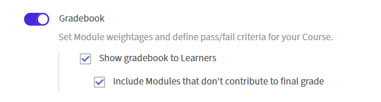

* 選擇 **成績簿** 切換以啟用它。 在它下方顯示兩個選項。 兩者預設皆為開啟：
  * **向學習者顯示成績簿：** 學習者在課程播放器中看到 **一個成績簿** 分頁，顯示其模組分數、權重分布及綜合結果。 關閉這個功能，可以內部計算成績，但不會讓學習者看到。
  * **包含不計入最終成績的模組：** 不可評分的模組（PDF、影片、音訊等）會出現在成績簿中。 非評分模組不會影響學習者的最終成績。

### 新增模組並指派權重

啟用 Gradebook 後，加入你的內容模組，並為每個可評分模組指派一個權重百分比。 權重百分比必須加總到正好 100 後，您才能儲存設定。

1. 選擇 **「新增模組**」。
2. 在模組選擇器中，選取您想新增的模組，然後選擇 **「新增**」。 模組會出現在內容&#x200B;****&#x200B;區段中。可評分模組、SCORM、Captivate 內容、AICC、xAPI、原生測驗、活動模組、教室課程及虛擬教室課程，皆顯示 **權重** 輸入欄位。 非評分模組的權重欄會顯示破折號。
3. 在 **「權重** 」欄位中為每個可評分模組輸入百分比值。 **總權重**&#x200B;指標會隨著您輸入而更新，必須達到正好 **100%** 才能儲存。

   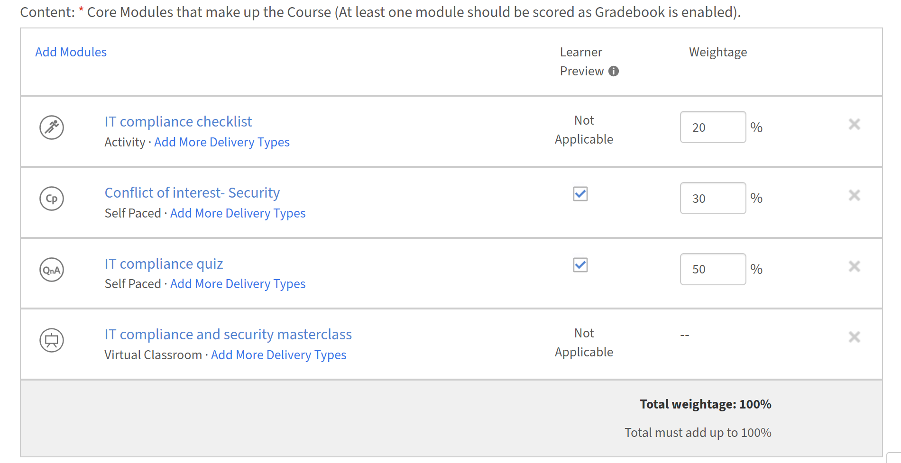

4. 對於具有多種交付類型的模組：只有當 **模組中所有** 交付類型都支援評分時，才能賦予權重。 如果任何一種傳遞類型不支援計分，整個模組無法加權。

>[!NOTE]
>
>評分量表不需要跨配送類型一致。 一個滿分 100 分的課堂課程與一個 10 滿分的 SCORM 模組可以同時存在於同一本成績簿中。 公式會自動將每筆貢獻標準化。

### 在 Adobe Learning Manager 中新增團隊提交模組

新增團隊檔案提交模組，讓一位團隊成員可以上傳全隊檔案，並選擇如何審核與評分。

團隊式檔案提交模組允許一位學習者代表團隊提交檔案。 講師只會評估一次，結果適用於每位團隊成員。 您必須在發佈課程前先新增模組。

### 將模組新增至課程

1. 以作者身分登入 Adobe Learning Manager。

1. 在作者應用程式中，建立課程或開啟未發佈的課程。

1. 新增一個新的活動模組。

1. 選擇檔案提交活動類型。

1. 選擇團隊為基礎的選項。 個人選項是先前針對單身學習者的檔案提交模組。

   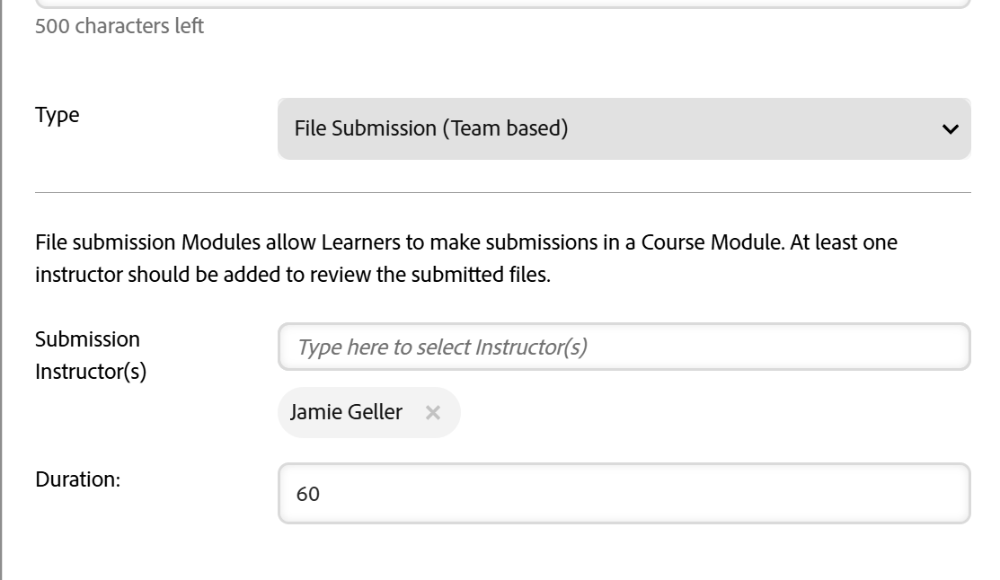

1. 選擇講師或講師。

1. 設定模組長度。

課程可以同時包含團隊與個人提交模組。 同一課程實例中所有團隊模組共用相同的團隊。

### 選擇審閱與評分選項

1. 開啟團隊式檔案提交模組。

1. 選擇是否 **需要**&#x200B;審查者核准。

   * 如果你開啟它，講師必須在模組結束前核准或拒絕每份提交。
   * 如果你關閉它，模組會在團隊提交時立即完成。

1. 選擇一種計分方式：

   * 選擇手動評分，讓講師輸入一個總分。
   * 選擇基於條件的評分，以根據每個評估計畫選項的分數計算分數。 此方法需要一份評估計畫。

     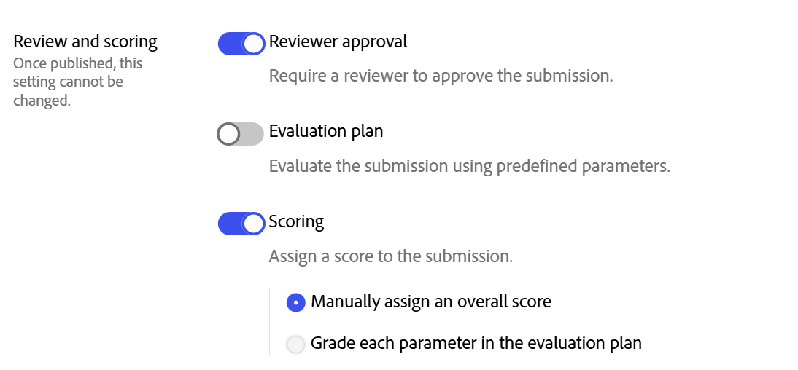

>[!CAUTION]
>
>課程發佈後，您無法移除該模組、更改其設定，也無法為它使用多種傳送方式。

### 將評估計畫新增至檔案提交模組

透過在檔案提交模組中加入客觀與主觀問題，為個人或團隊提交建立評估計畫。

評審計畫是講師用來評估提交作業的一系列問題。 每個模組都有一套評估計畫，且不能在其他模組中重複使用。 您可以將評估計畫新增至單一檔案提交模組或團隊提交模組。 在發佈課程之前先加入它。

#### 開啟評估計畫

1. 開啟評估計畫。

1. 輸入評估的說明。

1. 選擇學習者是否可以在提交前查看評估計畫。 預設是關閉的。 學習者會看到評量說明以及每個準則的說明。 他們看不到答案選項、分數或權重。

   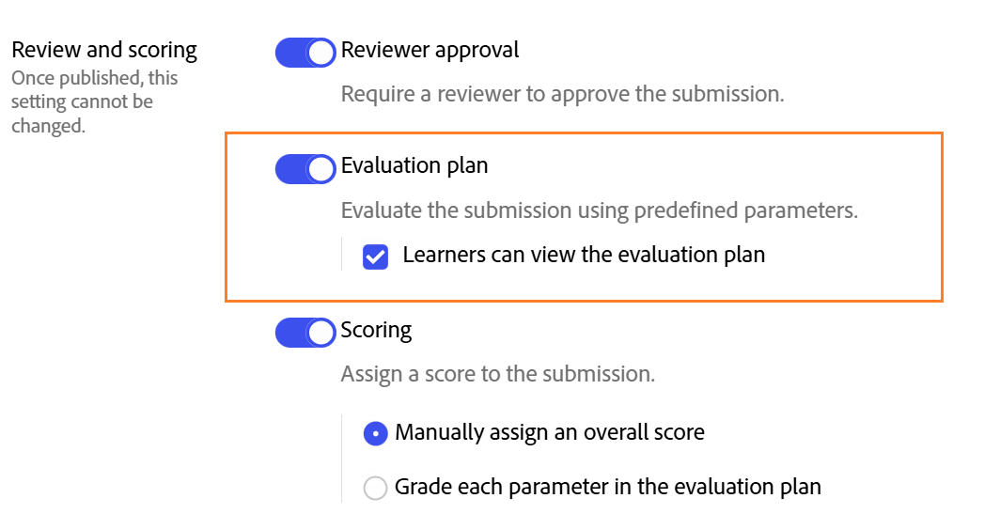

#### 將評估參數新增至評估計畫

您可以新增最多 100 個評估參數。 每個參數都是客觀或主觀的。

1. 選擇 **「定義參數**」。 在「參數/問題」欄位輸入參數文字。

   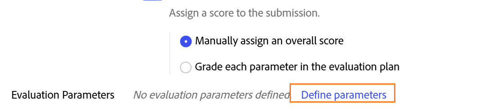

1. 選擇參數類型：

   * **目標：** 講師從答案選項中選擇。 新增選項。

     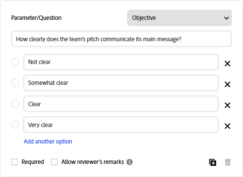

   * **主觀：** 老師會寫一篇描述性的回應。

     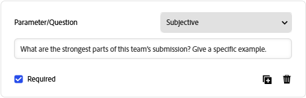

1. 對於具有條件基礎評分的客觀參數，請為每個選項輸入整數分數。 允許使用負數。 每個選項都需要一個點數值。

1. 選擇參數設定：

   * **必填：** 講師必須回應該參數。 非必需的參數會向講師顯示一個可選標籤。
   * **允許審核者評論：** 講師可以將評論加入參數。 此選項僅在目標參數時顯示。

1. 若要讓講師為整個評估計畫新增一則評論，請開啟「整體備註」。

1. 每題重複這個步驟。

1. 選擇「 **儲存**」。

>[!NOTE]
>
>主觀參數沒有分數。

#### 計算整體分數

當您選擇基於條件的評分時，Adobe Learning Manager 會根據講師所選擇選項中的分數計算整體分數。 只有客觀評估參數才算數。 主觀評估參數不會影響分數。

* **無上限：** 總分為所選選項總分數的總和。
* **有上限：** 總分數為分數總和除以最高分數，再乘以最高分，再四捨五入為整數。 上限可以是從 1 到 100 的任何整數。 預設值為 100。

由於選項可能有負點，計算結果可能小於 0。 當發生這種情況時，Adobe Learning Manager 會將總分數設為 0。 整體分數從來不會低於 0。

例如，假設最大可能分數為 12，上限為 10。 如果所選選項加起來為 6，總分為 5。 如果總分加起來是 10，總分就是 8，也就是四捨五入後的 8.33。 如果總和為−3，計算結果會得到小於0的數值，因此總分數為0。

若要在手動評分與條件評分之間選擇，請依照「新增團隊提交模組」中的評分步驟進行。

#### 為每個語系新增評估參數

模組的區域會依照課程的區域設定。 請手動為課程所使用的每個語系新增評估參數。 講師會在其內容語境中看到評量參數。

#### 發佈課程

計畫完成後發布課程。 課程的新實例則採用相同的方案。 發佈後，您只能編輯評估參數與選項的文字。 你無法更改設定、新增設定，也無法開啟或關閉方案。

### 設定最低及格分數

* 在課程編輯器中，找到 **「通過條件** 」區塊。
* 在「 **模組總** 分最低」欄位中，輸入介於 0 到 100 之間的百分比。
* 值為 **0** 表示課程僅依所需模組完成完成，且無累積分數門檻。
* 任何值高於 0 表示學習者必須完成所需模組，並達到或超過該總分。
* 在「必修模組&#x200B;**」**&#x200B;欄位中，輸入所需數量或從下拉選單中選擇。

  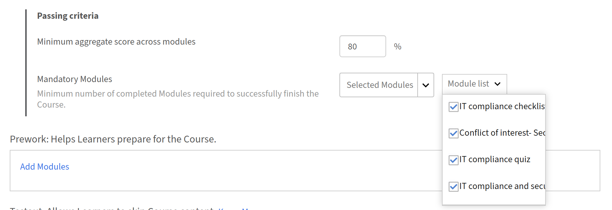

* 選擇「 **儲存**」。

最低及格分數 **會在成績簿** 分頁中顯示給學習者，讓他們在開始前就知道門檻。

### 為多次嘗試的模組設定分數

當某模組允許多次嘗試時，請選擇在成績簿計算中使用的嘗試分數。

* 在課程編輯器中，找到啟用多次嘗試的模組。

  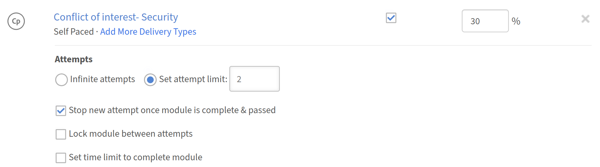

* 找到該模組旁的 **「使用** 分數」設定。
* 選擇 **「最新** 」或 **「**&#x200B;最高」：
  * **最新：** 總是以最近的嘗試分數為準。 後一次嘗試得分較低，將取代先前較高的嘗試。
  * **最高分：** 任何嘗試中取得的最佳分數將被保留。 後續嘗試分數較低不會減少儲存的分數。

  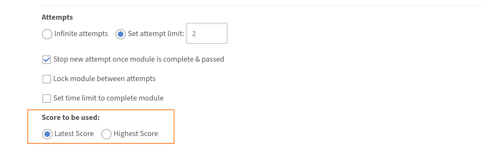

* 選擇「 **儲存**」。

### 發佈課程

設定完所有成績簿設定後，請使用標準工作流程發佈課程。 選擇 **儲存**，然後選擇 **發佈** ，讓課程提供給學習者使用。

### 最佳實務

* 請指定反映每個模組相對重要性的權重。 給予對學習目標最關鍵的模組更高的比例。
* 除非有特定理由隱藏分數，否則請啟用 **「顯示成績簿」給學習者** 。 能看到自己體重與跑步分數的學習者，更能優先安排努力。
* 設定學習者報名前的最低及格分數。 在進行中註冊後更改，可能會影響進行中的完成。
* 當模組為評估，學習者預期需重試時，請使用 **「最高」** 設定。 當您想擷取目前的知識水準而非最佳效能時，請使用&#x200B;**「最新」。**
* 儲存前請確認 **總權重** 指示器顯示正好 100%。

## 在 Adobe Learning Manager 中設定自動團隊建立

為課程設定自動建立團隊規則，讓 Adobe Learning Manager 在實例開始前將已報名的學習者分成團隊。

當講師尚未手動建立隊伍時，自動建立團隊可作為備用方案。 即使帳戶設定關閉，只要課程有團隊檔案提交模組，你都可以啟用自動組隊功能。 如果您的管理員啟用了帳戶設定，新課程會依帳戶的排程開始，您可以在課程設定時調整。

課程必須包含團隊提交模組。 每個實例都需要一個起始日期。

## 為球場設定團隊規則

1. 在作者應用程式中，開啟包含團隊提交模組的課程。

1. 打開課程設定，然後找到 **「自動組隊提交」** 的設定。 只有當課程至少包含一個團隊式檔案提交模組時，才會出現。

1. 選擇 **啟用**。

   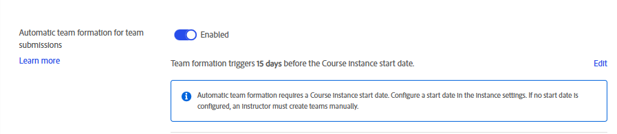

1. 檢視 **球隊組成時間表**。 如果你的管理員開啟了帳戶設定，系統會顯示他們設定的天數。 團隊會在實例開始日期前那麼多天建立。

1. 可選：若要更改本課程的天數，請選擇 **「編輯**」，在警告欄勾選 **「是** 」，然後輸入新的天數。

   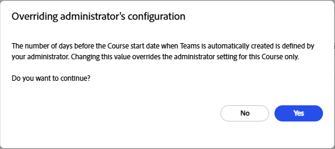

1. 將數值更改為其他。

   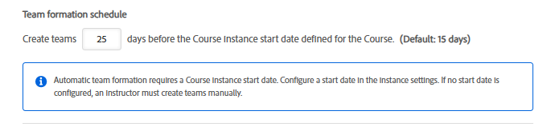

1. 檢視 **球隊組成時間表**。 一切都從帳戶價值開始。 若要使用不同的交期，請輸入新的天數。

1. 選擇如何組成團隊。 輸入 1 或更高。 一個團隊最多可有 100 名成員。

   * 選擇 **「每組** 成員」，並輸入每個團隊的學習者人數。

     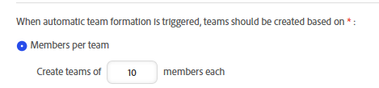

   * 選擇 **「隊伍** 數量」並輸入隊伍總數。

     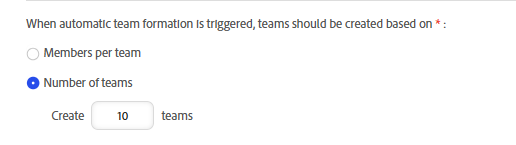

1. 儲存您的變更後，然後發佈課程。

>[!WARNING]
>
>發佈後，你無法為課程開啟或關閉自動組隊功能，也無法更改交期。 你仍然可以更改組隊規則及其價值。

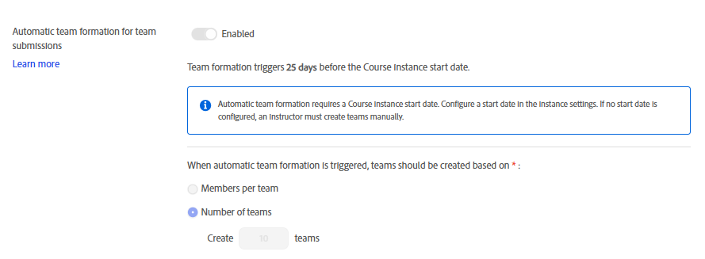

## 設定實例開始日期

1. 開啟課程執行個體。

1. 輸入開始日期並選擇 **「儲存**」。

   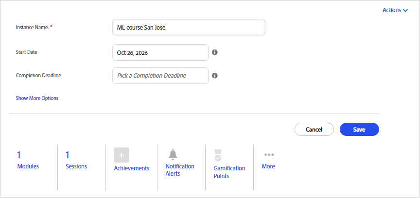

團隊會在交貨日凌晨 12：00 建立，並依實例時區進行。 例如，在三天的前置時間下，團隊會在開始日期前三天的凌晨 12：00 建立。 起始日期只是決定這個時機。 它不會阻擋註冊。

## 發佈後變更團隊規則

您可以隨時更改規則、 **每組**&#x200B;成員數或 **團隊數** 。 此變更適用於所有實例，但僅在尚未建立隊伍時生效。 已存在的隊伍不會重新集合。

## 在學習路徑中使用團隊式課程

團隊屬於課程實例。 如果您在學習路徑中新增團隊課程，請在課程實例上設定交期與開始日期，而非學習路徑上。 關於學習者如何被劃分，請參閱「團隊設定與限制」。

## 疑難排解

**Teams 並不是為了某個實例而建立的。** 請確認實例是否有開始日期。 沒有它，自動建立是無法運作的。 也要確認該課程是否啟用自動隊伍編隊功能。 Teams 並不是為了即將開始的實例而建立的。

**你找不到課程層級的設定。** 此設定僅在課程中至少包含一個團隊模組時才會出現。 在發佈前先新增一個。

**你改了規則，但隊伍沒變。** 規則僅在該實例尚未建立隊伍時適用。 若要更改現有團隊，請請講師編輯它們。

## 設定教室課程的報名時窗與座位分配

您可以定義不同學習群組何時可以報名，為特定使用者群組分配特定席位，並在有席位可用時自動從候補名單中晉升符合資格的學習者。

作者僅在管理員啟用 **群組註冊** 設定後，才能為使用者群組分配席位。 請參閱一般設定文章以取得更多資訊。

設定使用者群組的席位分配：

1. 以作者身分登入 Adobe Learning Manager。
1. 從左側導覽欄選擇 **「課程** 」。
1. 建立一門 **教室課程** 。 請參閱課程模組以獲取更多資訊。
1. 設定以下設定：

   | 背景設定 | 說明 |
   |---|---|
   | **座位限制** | 顯示在教室或虛擬教室模組中設定的最低座位限制。 此欄位為唯讀。 若要為使用者群組分配座位，請先在教室或虛擬教室模組中設定座位限制。 |
   | **開放報名日期** | 選擇所有人（包括所選使用者群組）可註冊的日期。 |
   | **依使用者群組分配席位** | 啟用此選項以為特定使用者群組保留席位。<p>**注意：**<ul><li>將 100% 可用名額保留給特定使用者群組，以確保只有這些群組的學習者能報名課程。</li><li>課程發佈後，您無法啟用或停用此選項。</li></ul> |
   | **未分配席次** | 顯示在所選使用者群組之外仍可供學習者使用的席位數量。 |
   | **群組開放登記日期** | 選擇所選使用者群組成員可開始註冊的日期。 |


1. 選取新增 **群組分配**，並設定下列項目：

   1. **使用者群組**：選擇您想要為其保留席位的使用者群組。
   1. **分配**&#x200B;的座位數：輸入要為所選使用者群組保留的席位數。

   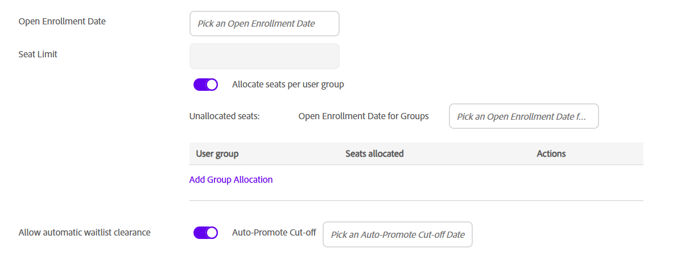

1. 選擇「 **儲存**」。

### 管理使用者群組分配

新增使用者群組後，該群組及其已分配的席位會出現在分配清單中。 使用可用動作修改分配。

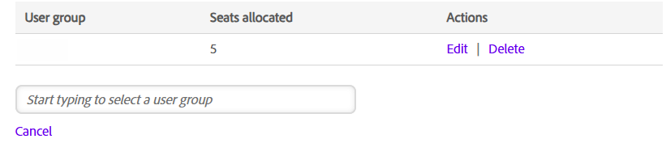

| **行動** | **描述** |
|---|---|
| **編輯** | 修改分配給使用者群組的席位數量。 |
| **刪除** | 移除使用者群組的席位分配。 |

>[!NOTE]
>
>在不同使用者群組間分配的總座位數不得超過座位限制。

### 設定自動候補名單清除

當管理員啟用群組註冊時，當空缺名額時，自動候補名單清除會讓下一位符合資格的候補學習者獲得資格。 此功能預設為啟用。

設定自動清除等候名單的方法如下：

1. 在課程總覽&#x200B;**頁面啟用**「允許自動清除&#x200B;****&#x200B;候補名單」。
1. （選用）從自動晉升截止選擇&#x200B;**器中**&#x200B;選擇日期。
1. 選擇「 **儲存**」。
自動晉升會在截止時間後停止。

>[!NOTE]
>
>* 如果您也為使用者群組分配席位，則只有該群組的成員會被提升至該群組的席位。
>* **自動晉升截止**&#x200B;日期適用於使用者群組及開放的等待名單。自動晉升會停止，適用於這兩個候補名單。

## 為課程/學習路徑/認證新增合規標籤 {#add-custom-compliance-label}

若要將合規標籤新增至課程，請依照以下步驟操作：

1. 在作者應用程式中，前往 **[!UICONTROL Courses]**/**[!UICONTROL Learning Paths]**/**[!UICONTROL Certifications]** 並選擇 **[!UICONTROL Add]**。
1. 輸入姓名及其他細節，如描述、技能。
1. 在 **[!UICONTROL Custom compliance]** 文字方塊中輸入並選擇合規標籤。

   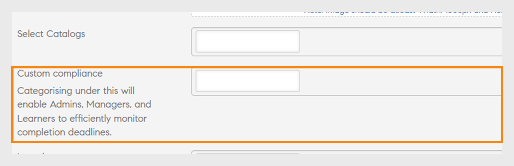
   _新增自訂合規性_

   >[!IMPORTANT]
   >
   >在新增自訂合規時，請務必為課程設定截止日期。

   >[!NOTE]
   >
   >最多可有 50 門課程、學習路徑或認證，對自訂合規類型標籤具有相同價值。

1. 儲存並發佈課程/學習路徑/認證。
現在課程/學習路徑/認證被視為合規類型。 管理員可以將此課程加入合規儀表板，並與主管分享以追蹤進度

>[!NOTE]
>
>作者也可以透過編輯現有課程/學習路徑/認證，將合規標籤新增。

## 建立一個實例 {#createaninstance}

要建立實例，請執行以下步驟：

1. 以作者&#x200B;**身份登入**。
2. 導覽至您想要建立實例的課程並開啟該課程。
3. 在左側導覽面板選擇 **「實例** 」。 **「實例**」頁面隨即開啟。每個課程預設都有一個實例。 您可以修改預設實例或新增實例。 您無法刪除此課程實例。
4. 若要建立實例，請點擊 **[!UICONTROL Add New Instance]** 課程資訊的右上角。 會顯示該課程的新實例。
5. 輸入實例的屬性：

   * 在欄位 **[!UICONTROL Instance Name]** 中輸入您想要與課程關聯的實例名稱。 請確保為該實例使用唯一的名稱。
   * **開始日期：** 這是課程的開始日期。 在此開始日期之前，可於兩個不同選定日期向學習者發送兩封提醒電子郵件。 起始日期必須早於完成日期。 一旦選擇開始日期，該日期會在實例的通知提醒&#x200B;**區段的行事曆**中以藍色標示。
     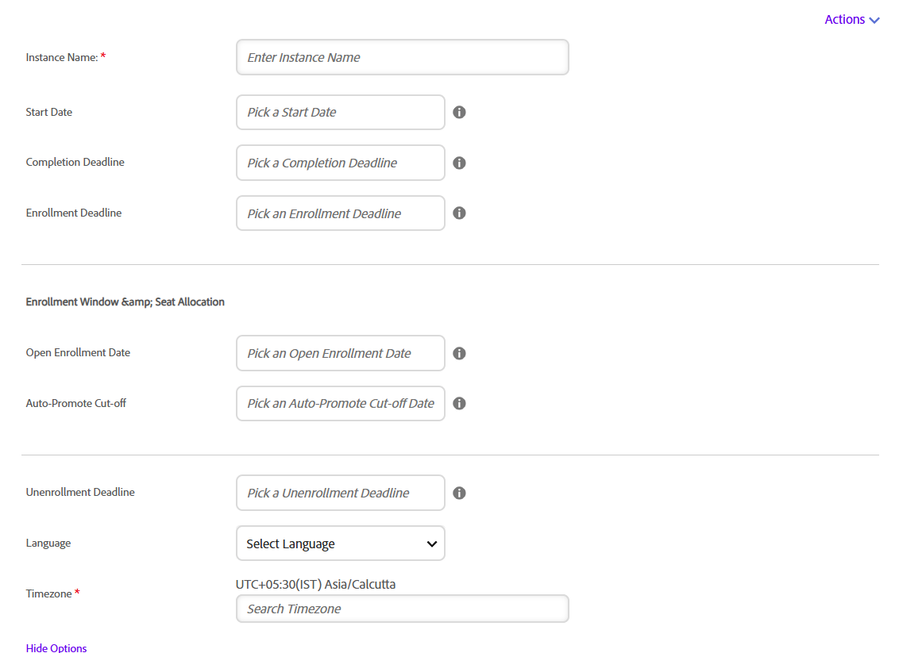
   * 指定該實例的完成截止日期。 學習者必須在此日期前達成課程完成狀態。
     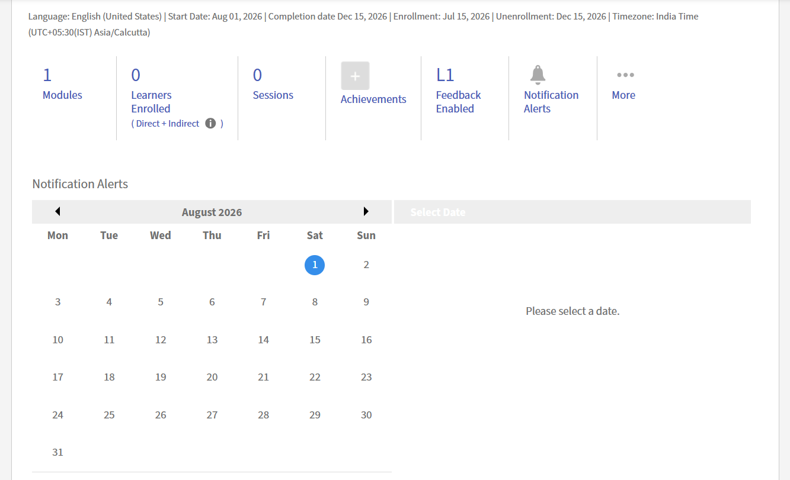
   * **開放報名日期** （選填）：學習者可從此開始報名的日期。 若座位分配給使用者群組，此日期適用於該群組外的學習者。
   * **自動晉升截止** 時間（可選）：在此日期之後，該實例的自動候補名單晉升將停止。 當啟用自動等候名單清除時，此欄位會出現。
   * 選擇 **[!UICONTROL Show More Options]** 以顯示其他截止日期選項。
   * **[!UICONTROL Enrollment Deadline]：** 這是學習者在自我註冊時預期註冊學習對象的日期。
   * **[!UICONTROL Unenrollment Deadline]：** 您可以選擇限制學習者自行取消註冊，並設定退選截止日期。
   * **[!UICONTROL Timezone]：**&#x200B;搜尋後從下拉選單中選擇。**[!UICONTROL Timezone]**

6. 選擇「 **儲存**」。

### 在開始日期前設定電子郵件提醒

您只能在儲存完整實例資訊後設定電子郵件提醒。 一旦選擇 **「儲存**」，實例會自動最小化並進入編輯模式。

1. 勾選 **「通知警示** 」方塊。
2. 在行事曆上，選擇一個在實例開始日期之前的日期作為第一次提醒。
3. 在右側選擇 **「新增提醒** 」。
4. **電子郵件範本：** 從下拉清單中選擇範本
5. **重複** ：從下拉清單中選擇一種重複類型。 勾選右側的藍色勾選標記以儲存提醒日期。 記得每個提醒日期都必須分別保存。
   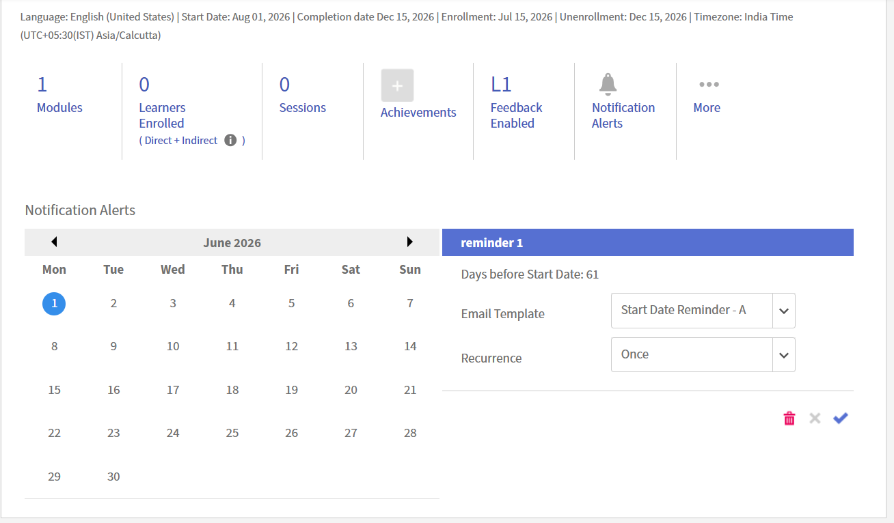
6. 選擇另一個同樣早於課程開始日期的日期作為第二次提醒，重複這個流程，然後點選右側的藍色勾選標記，也儲存這個提醒日期。
   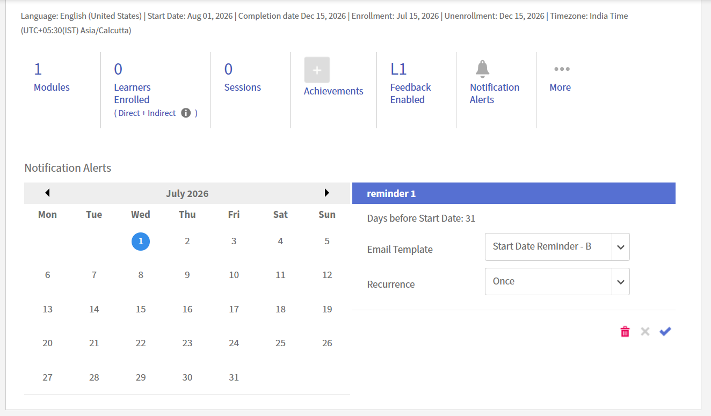

## 檢視實例的屬性 {#viewpropertiesoftheinstance}

1. **模組數：** 課程作者所建立的模組數量
2. **課程次數：** 課程中虛擬教室與教室模組的數量
3. **成就：** 學習者的成就
4. **通知提醒：** 可在課程開始日前發送兩封提醒電子郵件的選項

### 動作 {#actions}

* **儲存至課程設定：** 將此實例的設定儲存到您建立該實例的課程中。
* **套用預設設定：**&#x200B;套用設定 > **實例預設**&#x200B;值頁面中的&#x200B;****&#x200B;預設設定。
* **退休實例：** 已退休一個實例。 該實例將不再可用。
* **刪除實例：** 刪除特定實例。


>[!NOTE]
>
>您無法刪除預設實例或其副本。 在此情況下，「刪除實例」選項將不會出現在「動作」下拉清單中。

* **通知候補名單學員：** 通知候補名單上的學員還有其他可報名的實例
* **寄電子郵件給已註冊學員：** 向學員發送有關重要公告的電子郵件

## 遊戲化積分

你可以在關卡和關卡實例等級分配遊戲化點數。 透過這個，你可以為不同的課程或實例分配積分。 學習者會被激勵選修特定課程，或偏好某一課程實例而非其他課程。

1. 在課程實例層級，選取 **[!UICONTROL Gamification Points]**。

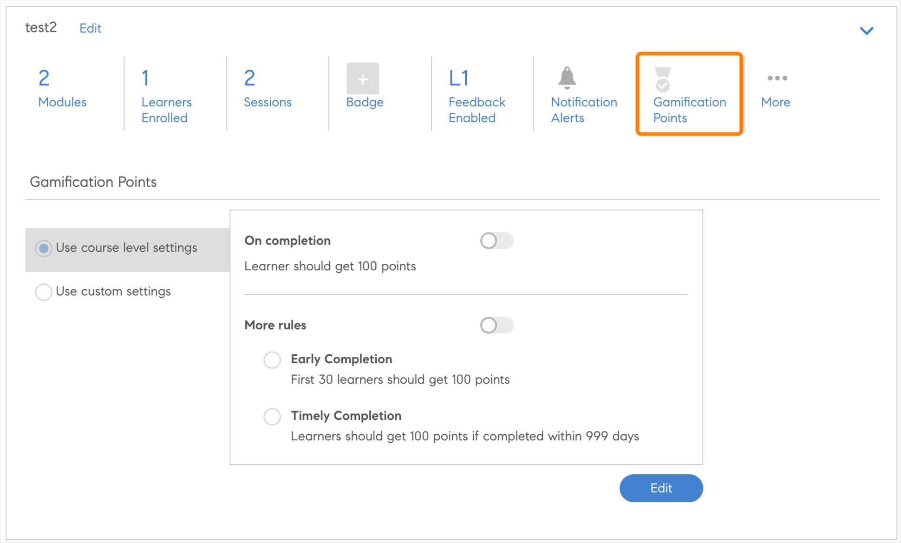

*遊戲化的設定點*

1. 選擇 **[!UICONTROL Edit]**。
1. 如果您選擇使用課程層級設定，將顯示以下選項：

   * **[!UICONTROL On completion]**：如果您希望學習者完成課程時獲得 100 分，請勾選此切換開關。
   * **更多規則**

     * **[!UICONTROL Early completion]**：若選擇此項，前30名學習者完成課程後將獲得100分。
     * **[!UICONTROL Timely completion]**：若選擇此項，學習者若在999天內完成課程，將獲得100分。

1. 若選擇 **[!UICONTROL Use custom settings]**，將顯示以下選項：

   * **[!UICONTROL On completion]**：如果您希望學習者完成課程時獲得 100 分，請勾選此切換開關。
   * **更多規則**

     * **[!UICONTROL Early completion]**：若選擇此項，您可以決定將獲得指定積分的學習者數量。
     * **[!UICONTROL Timely completion]**：若選擇此項，您可以決定學習者在指定時間內完成課程後將獲得的積分數。

   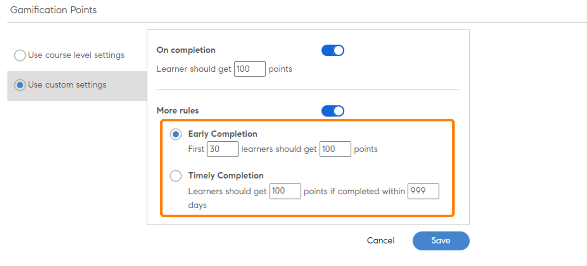

   *提前且準時完成*

1. 選擇 **[!UICONTROL Save]**。

## 彙整學習資源

作者可以決定是否要將學習資源集中在學習計畫層級，或讓其維持在單一課程層級。

作為作者，請選擇 **[!UICONTROL Learning Path]** > **[!UICONTROL Settings]**。 點擊 **[!UICONTROL Edit]**。

在本 **[!UICONTROL Resources]** 區段中，勾選框「在學習路徑層級顯示以學習路徑層級彙總的構成課程資源」，顯示課程層級的資源是否會在學習路徑層級顯示。

>[!NOTE]
>
>在學習路徑的設定頁面，管理員也可以啟用此選項，該選項會顯示課程層級中現有的資源，這些資源本應在學習路徑層級上顯示。

## 排程助理

管理預約講師與教室時的衝突。 如果你想知道在分配授課老師之前，他什麼時候有空，請使用排程助理。

在建立課程時，若是 VC 或 CR 課程，請點選排程助理。

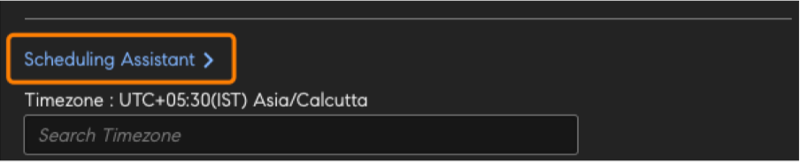

*啟動排程助理*

排程助理視窗會啟動。

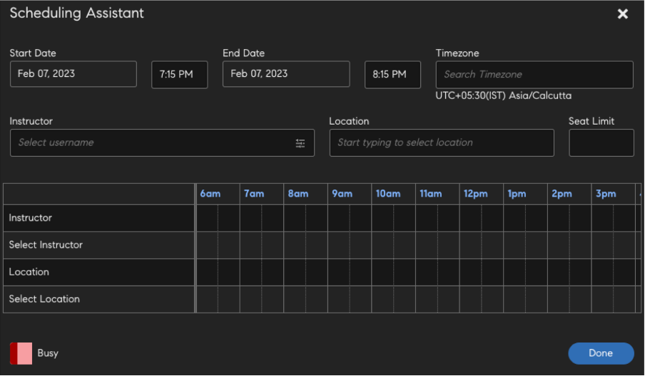

*排程助理對話框*

在排程助理中，您可以：

* 依照老師的名字搜尋。
* 依照教學技能搜尋講師。

### 依講師姓名搜尋

在講師欄位輸入講師名稱，或搜尋部分講師名稱。 會出現一個講師清單，你可以從中選擇講師。

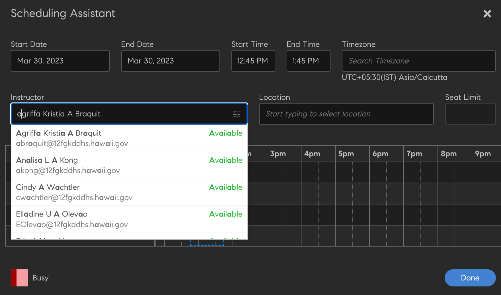

*搜尋講師*

可以選擇多位講師，但一次只能指派一位講師。 所選時間將在時間衝突視窗中被高亮顯示。 在講師附近會出現一個叉號圖示，點擊它即可移除講師。

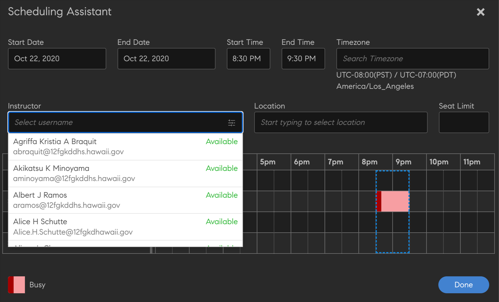

*搜尋多位講師*

### 依技能搜尋講師

尋找具備單一或多項技能的講師。 搜尋時使用 AND 運算子。

技能只能以部分或完整技能名稱搜尋，不能依技能等級搜尋。

在助理欄位輸入講師姓名、地點及座位限制。

此外，你可以搜尋技能，點擊講師搜尋框右側的篩選圖示後會顯示技能。 下方的螢幕截圖顯示了該按鈕。

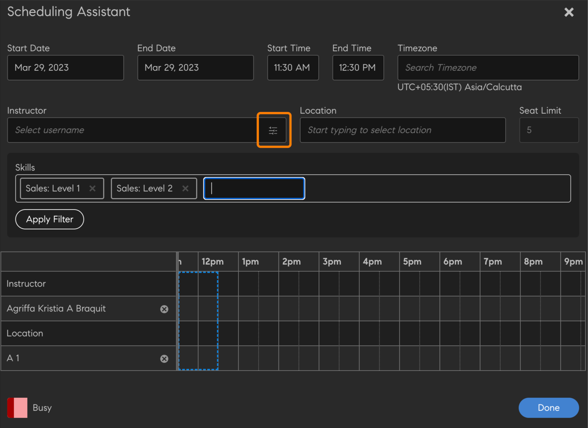

*依技能搜尋講師*

### 使用者群組篩選器

在講師欄位中選擇篩選條件。 作者或自訂作者可以透過 **[!UICONTROL User Group]** 使用者群組中的數值找到合適的講師。

若同時套用兩個篩選條件，則會顯示屬於該使用者群組且具備所選技能的講師名單。

此規定適用於課程或實例頁面上的排程助理。

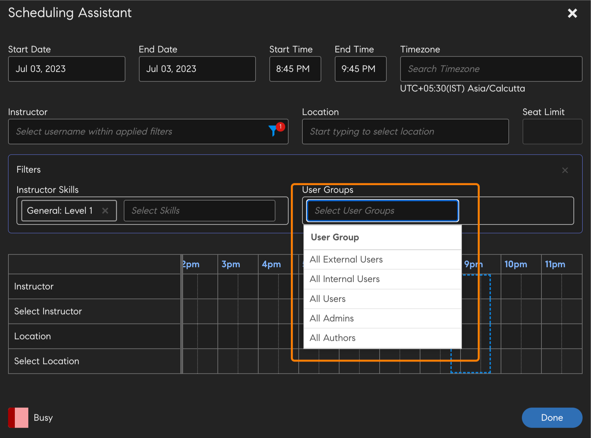

*依使用者群組篩選*

### 實例頁面

您也可以從實例頁面存取排程助理，如下所示。

排程助理也可在實例頁面使用，供管理員及自訂管理員/作者使用。

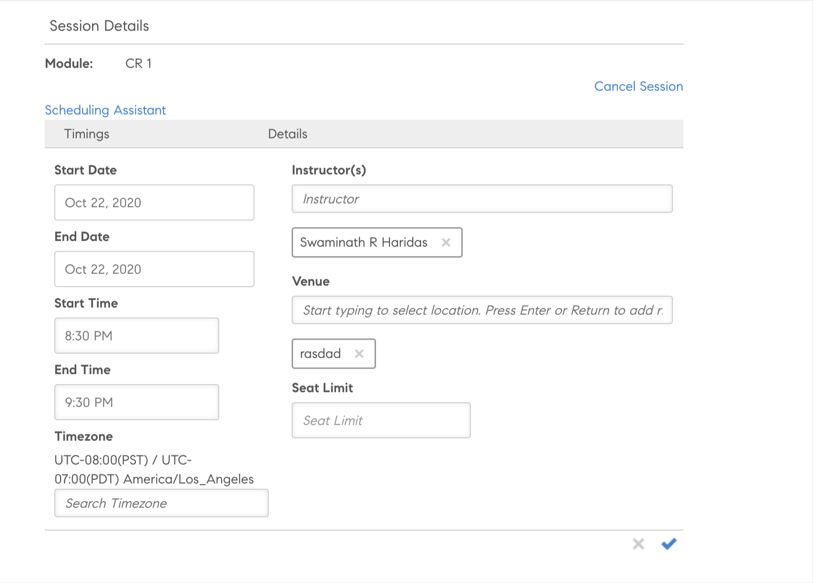

*從實例頁面排程講師*

### 搜尋位置

您可以在模組頁面與排程助理頁面上同時指定教室名稱與地點區域名稱來搜尋地點。

## 富文字格式化

在建立課程、學習計畫、認證或工作輔助工具時，作者可以輸入不同類型的內容，例如文字、圖片，或套用各種文字格式選項。

建立課程時，您可以在課程總覽欄位看到富文本編輯器。 你可以格式化內容、添加圖片、添加超連結等等。

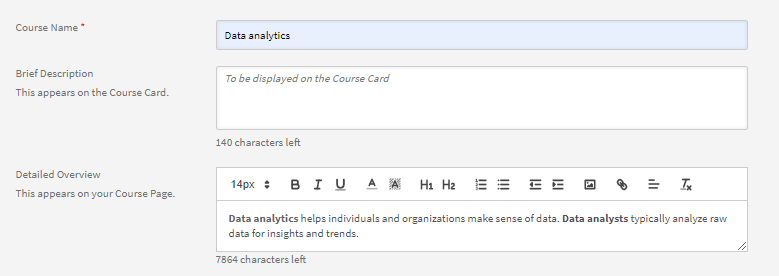

*啟動富文本編輯器*

同樣地，您也可以使用富文本編輯器在建立以下描述時修改：

**學習計畫**

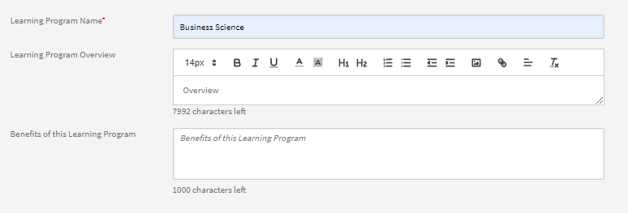

*使用富文字編輯器進行學習計畫*

**認證**

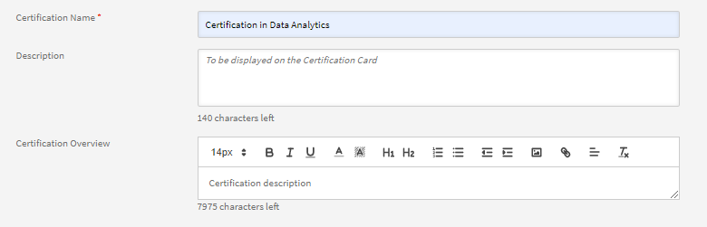

*使用富文本編輯器取得認證*

**就業輔助**

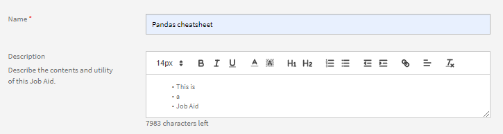

*使用富文本編輯器來撰寫工作輔助工具*

此外，您也可以使用富文本編輯器來支援其他語言。

## 無頭使用者介面的富文字描述支援

### 為什麼需要 CSS？

富文本由 HTML 標記組成。 直接呈現標記會讓瀏覽器套用預設樣式。 這往往與公司的風格規範不符。 CSS 是符合相關指引所必需的。

### 預設樣式

附加的 CSS 樣式表包含由 Learning Manager 套用的樣式。 外觀設計會根據大多數使用情境做調整。 下載附加的 CSS 檔案，並依照你的慣例與建置系統匯入到你的網頁應用程式。 定義的 CSS 類別會被命名在 ql-editor 類別下，且不會干擾你現有的樣式。

### 自訂樣式

預設的造型可能無法滿足每個人的需求。 客製化可以透過覆蓋所提供的 CSS 來完成。 所有樣式都以後代選擇器的形式包裹在 QL-editor 底下。 使用以下類別：

* 縮排： **li.ql-indent-$number**。 $number 從 1 到 9 不等
* 尺寸： **QL-size-small**、 **QL-size-LARGE**、 **QL-size-Huge**

* 對齊方式：**QL-對齊-中心**、**QL-對齊-對齊、** QL-對齊&#x200B;**-右**

* 顏色： **QL-color-$color**。 $color = 白色、紅色、橙色、黃色、綠色、藍色、紫色
* 背景： **QL-BG-$color**。 $color = 黑色、紅色、橙色、黃色、綠色、藍色、紫色
* HTML 標籤：p、ol、ul、pre、blockquote、h1、h2、h3、h4、h5、h6

[用於自訂的 CSS 檔案。](assets/ql-headless.css)

### API 變更以啟用渲染富文字概覽

當客戶打造無頭介面時，他們需要在他們正在開發的自訂使用者介面中顯示學習對象。 為此，通常會使用 [公開的 GET /learningObjects](https://learningmanagereu.adobe.com/docs/primeapi/v2/#!/learning_object/get_learningObjects) API。 現在 Learning Manager 支援為概覽欄位擷取「富文本」，API 回應中的學習物件資料模型也會提供相同的內容。 請參閱下方 API 回應中模型片段中名為「richTextOverview」的欄位。 另外請注意，先前顯示的欄位（「概覽」）為符合向下相容性，保持不變。

```
{ 
 "data": [ 
 { 
 "id": "string", 
 "type": "string", 
 "attributes": { 
 … 
 "localizedMetadata": [ 
 { 
 "description": "string", 
 "locale": "string", 
 "name": "string", 
 "overview": "string", 
 "richTextOverview": "string" 
 } 
 ], 
 … 
 }, 
 "relationships": { 
 … 
 } 
 } 
 } 
 ] 
} 
```

已使用總覽欄位的客戶，在無頭介面中仍將如以往般看到純文字。 若客戶想善用富文本概覽，必須在作者介面中為其學習對象建立豐富格式化的概覽，之後 Learning Manager 會開始回傳富文本概覽，除了像以往一樣在 API 回應模型中回傳純文字之外。

然而，要在使用者介面中呈現這些豐富文字，客戶需要包含 CSS。 這點將在後續章節中詳細說明。

## 允許多次嘗試 {#allowmultipleattempts}

一旦管理員啟用多次嘗試，作為作者，您可以在課程或模組層級為互動式電子學習模組設定多次嘗試。

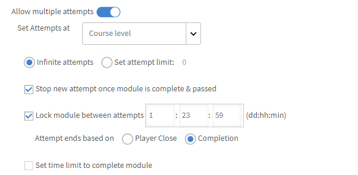

*為互動式電子學習模組設定多重嘗試*

<table>
 <tbody>
  <tr>
   <td>
    <p><b>選項</b></p></td>
   <td>
    <p><b>說明</b></p></td>
  </tr>
  <tr>
   <td>
    <p>集合嘗試次數</p></td>
   <td>
    <p>你可以將模組的嘗試次數設定為無限，或設定明確的限制。<span style="font-size: 0.8125rem;">一旦啟用，嘗試資訊就會顯示給學習者。 學習者可點擊「重試」按鈕選擇重新嘗試模組。</span></p></td>
  </tr>
  <tr>
   <td>
    <p>模組完成或通過後停止新嘗試</p></td>
   <td>
    <p>若要設定何時停止學習者選擇新嘗試選項，請啟用「模組完成或通過後停止新嘗試」核取方塊。 一旦學習者成功完成模組，「重試」選項將從學習者檢視中移除。</p></td>
  </tr>
  <tr>
   <td>
    <p>在兩次嘗試間鎖定模組 0:0:1 格式：天/小時/分鐘</p></td>
   <td>
    <p>您可以透過啟用「<b>在嘗試 0:0:1 之間鎖定模組 格式：天/小時/分鐘</b>」核取方塊，將模組鎖定在特定時間內。 當模組被鎖定時，學習者必須在所提供的鎖定時間結束前進入該模組。 </p>
    <p>你可以透過勾選「<b>玩家結束</b>」或「<b>完成</b>」核取方塊來定義一次嘗試的最終條件。</p></td>
  </tr>
  <tr>
   <td>
    <p>球員關閉</p></td>
   <td>
    <p>每次模組啟動若條件為「<b>玩家關閉</b>」，則視為新嘗試。 學習者在關閉播放器時會提示模組鎖定細節及嘗試細節。</p></td>
  </tr>
  <tr>
   <td>
    <p>完工</p></td>
   <td>
    <p>如果嘗試結束是基於 <b>完成</b>度，則會根據內容成功標準計算。 在內容傳送完成資訊之前，學習者不得重新嘗試該模組。 一旦嘗試結束，模組鎖定與嘗試細節會傳達給學習者。</p></td>
  </tr>
  <tr>
   <td>
    <p>設定完成模組的時間限制</p></td>
   <td>
    <p>作者可透過啟用「<b>設定完成模組</b>的時間限制」核取方塊，設定完成模組的時間限制。</p>
    <p>每次玩家的發射都視為一次新嘗試，學習者會在啟動時提示時間細節。</p>
    <p><b>注意：</b><span style="font-size: 0.8125rem;">時間一到，嘗試將自動結束。 關閉播放器也會結束當前的嘗試。</span></p></td>
  </tr>
  <tr>
   <td>
    <p>模組層級的多次嘗試</p></td>
   <td>
    <p>從「設定嘗試次數」下拉清單中選擇「模組層級」嘗試，可讓您在個別模組層級設定選項。</p></td>
  </tr>
 </tbody>
</table>

## 課程模組 {#coursemodules}

### 新增模組 {#addmodules}

您現在可以新增內容模組、前期作業模組和測試模組。 **內容** 模組是構成課程的主要模組。 **課前** 模組包含一些基本資訊，有助於學習者為課程做好準備。 這些模組並非學習者必須完成的必修課程。 **測驗模組** 幫助學習者跳過內容，直接參加測驗，前提是他們已經熟悉內容並希望透過考試來符合法規要求。

若要新增內容模組，請執行以下步驟：

1. 點擊 **[!UICONTROL Add Modules]**。 您可以看到四種新增模組的選項。 第一個選項是新增自學進度模組。 這些是你在 Adobe Learning Manager 中建立並加入模組庫的模組。 第二個選項是設置虛擬教室。 第三個是設置教室模組，第四個是活動模組。

   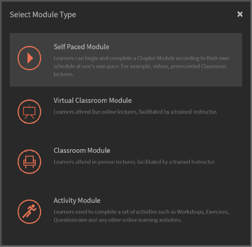

   *為課程新增模組*

   **自學模組：** 在此模式中，你可以依自己的步調開始並完成課程模組。 你可以自己安排時間表。

   點擊該選項後，您可以看到已新增至模組庫的自學進度模組清單。 在這裡，你可以在清單中捲動並選取你想新增的模組，或者在搜尋欄或模組標籤中輸入模組名稱來搜尋模組。

   選取模組後，請點擊 **[!UICONTROL Add]**。 這些模組現在會出現在「內容」區段下。

   你也可以重新排列模組。 拖曳任一模組，向上或向下移動，並依正確順序排列模組。

   **虛擬教室模組：** 在此模式下，學習者可參加由受過訓練的講師主持的線上直播講座。 輸入標題、描述，並設定工作階段的長度。 您也可以指定會議網址及主持課程的講師。 若要儲存變更，請點選 **[!UICONTROL Done]**。

   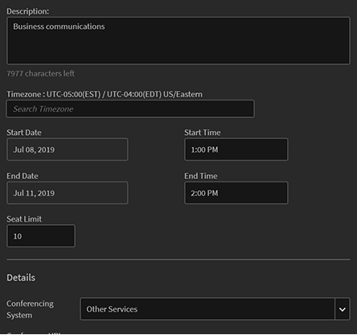

   *新增 VC 模組*

   使用虛擬教室設定對話方塊建立課程時，請將會議系統&#x200B;**設定**&#x200B;為您建立的 Teams 連線。選擇您是否希望為活動設置會議組織者。

   如果您選擇 **「是** 」以指定會議組織者，必須輸入該組織者的名稱。 輸入名稱並選擇組織者。

   **繞過大廳**

   * 如果您選擇 **「是」**，任何學習者都可以加入會議。
   * 若選擇 **「否」**，系統會向主辦方發送請求，以允許或阻止學習者加入會議。

   **注意：** 學習者必須在 Microsoft Teams 上可用。 不過，學習者可以以訪客身分加入 Learning Manager。

   如果管理員已為 ALM 帳戶啟用 Live Hub，您也可以建立 Live Hub 課程。 若要使用 Live Hub 建立 VC 會話，請參閱 [「建立 Live Hub 會話」](../../getting-started-with-live-hub/create-a-live-hub-session.md)

   **課堂模組：** 在此模式下，學習者參加由受過訓練的講師主持的實體講座。 輸入標題、描述，並設定工作階段的長度。 您也可以指定課程地點及授課老師。 若要儲存變更，請點選 **[!UICONTROL Done]**。

   >[!NOTE]
   >
   >您是否能在此建立新位置，取決於您的管理員所設定的「允許作者建立位置」設定。 如果已停用，您只能搜尋並選擇管理員已新增的位置。 請參閱 [「新增教室位置」](../../../migrated/administrators/feature-summary/classroom.md) 以取得更多資訊。

   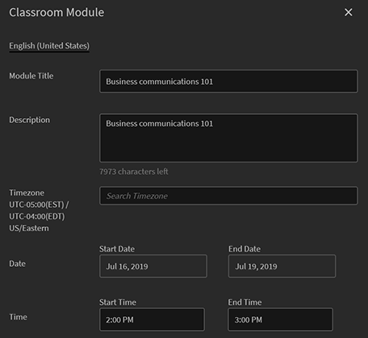

   *新增教室模組*

   建立課程時，在虛擬教室設定對話方塊中，將會議系統設定為您建立的 Microsoft Teams 連線。 選擇您是否希望為活動設置會議組織者。

   如果您選擇「是」以指定會議組織者，必須輸入該組織者的名稱。 輸入組織者的名稱並選擇該組織者。

   **繞過大廳**

   * 如果您選擇「是」，任何學習者都可以加入會議。
   * 若選擇「否」，系統會向主辦方發送請求，以允許或阻止學習者加入會議。

   **注意：** 若學習者想以訪客身分加入 Microsoft Teams，必須輸入電子郵件。 該電子郵件必須存在於 Learning Manager 中。

   **活動模組：** 在此模式下，學習者必須完成一系列活動，如工作坊、練習、問卷及其他學習活動。 輸入標題、描述及外部網址以供參考。 若要儲存變更，請點選 **[!UICONTROL Done]**。

   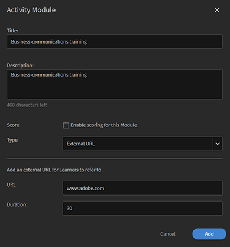

   *新增活動模組*

   您可以在課程中新增活動模組時，針對活動類型檔案提交及基於 xAPI 的模組指定持續時間。

1. 同樣地，加入預備工作與測試模式的模組。
1. 根據您的偏好，將模組的排序類型選擇為有序或無序。

   如果您選擇 **「排序**」，模組會依您建立的順序出現。 若選擇 **「無序」**，模組不會排序。 學習者可依任意順序完成模組。

1. 從「必修模組」下拉清單中，選擇學習者完成課程必須修讀的模組數量。
1. 為課程新增封面圖片和橫幅圖片。 這些目錄由管理員建立。 欲了解更多資訊，請參閱 [目錄](/help/migrated/administrators/feature-summary/catalogs.md)。

   **注意：** 建議的尺寸如下：

   * **封面圖片：** 300 px x 300 px
   * **橫幅圖片：** 1600 px x 140 px

1. 在頁面右上角，按一下 **[!UICONTROL Save]**。

#### 在活動模組中新增 HTML 連結

作者可以在活動模組中新增 HTML 連結並設定完成條件。 若要新增 HTML 連結並設定完成條件，請依照以下步驟操作：

1. 在作者應用程式中，於首頁選擇 **[!UICONTROL Create Courses]** 。
1. 從畫面中&#x200B;**[!UICONTROL Course Catalog]**&#x200B;選擇&#x200B;**[!UICONTROL Add]**
1. 輸入課程名稱與描述。
1. 在選項中 **[!UICONTROL Module]** ，選擇 **[!UICONTROL Add Module]** > **[!UICONTROL Activity Module]**。
1. 在提示字元 **[!UICONTROL Activity Module]** 中輸入名稱與描述。
1. 選取 **[!UICONTROL Type]** **[!UICONTROL External URL]**。
1. 從選項 **[!UICONTROL Completion Criteria]** 中選擇下列任一選項。
   * **[!UICONTROL Learner marks complete]**： 學習者可選擇在 Fluidic Player 中標記該課程為已完成。
   * **[!UICONTROL On Launching content]**：當學習者啟動課程時，課程將自動標記為完成。

   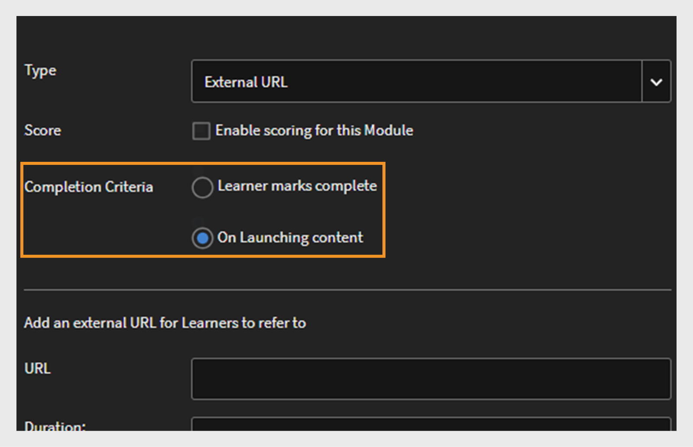
   _完成標準_

1. 選擇 **[!UICONTROL Add]** 並發佈課程。

### 替換已出版課程中的模組

Adobe Learning Manager 為作者提供工具，用以建立、編輯及管理由多個內容模組組成的課程。 當課程內容需要更新或改進時，作者可以在不影響學習進度的情況下替換現有模組。

要替換模組：

1. 以作者身分登入 Adobe Learning Manager。
2. 在左側導覽窗格中選取 **[!UICONTROL Courses]** 。
3. 選擇任一課程，然後選擇 **[!UICONTROL Edit]**。
4. 選擇您想要變更的模組。
5. 更改標題與描述。
6. 使用 **內容** 選項選擇模組。
   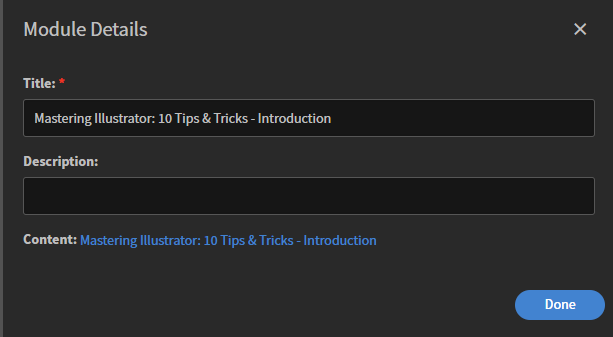
7. 選擇 **[!UICONTROL Done]**。
8. 選擇 **[!UICONTROL Republish]**。

學習者將保留其他模組的進度，但必須完成新模組才能完成課程。

## 核對清單 {#create-checklist}

評估是任何 LMS 的重要環節。 線上評量是評估學習者對某主題理解程度的頂尖方式之一。 但通常，在工作時，透過觀察一個人執行必要任務來評估其理解程度是必要的。

可以想像一下，正在接受評估的店員或倉儲工人，以了解他們每天應該執行的工作。 可能是修理咖啡機時的步驟，或是包裝材料時的步驟。 講師可以根據檢查清單評估員工是否完成這些任務，並在評估活動中以通過或不通過的方式進行評估。

你可以用多種語言建立一份清單。

### 建立多種語言的檢查清單 {#createachecklist}

只有作者才能建立檢查清單。 檢查清單是一種活動模組。 在設定活動模組時，您作為作者可以選擇活動作為 **檢查清單**，如下所示：

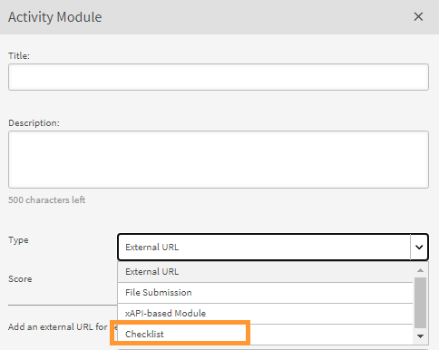

*建立檢查清單*

1. 選擇 **「檢查清單**」選項後，你會看到幾個額外的選項。

2. **檢查清單類型：** 選擇任一選項，是 **/否** 或 **1-5**。 若選擇是/否，清單中將包含只能以是或否回答的問題。 如果你選擇 1 到 5 分，可以看到李克特檢查表，可以用五分制評分問題。

3. 選擇「 **設定**」。 「檢查清單」視窗會出現。
4. 請輸入任意數量的問題。 你也可以以其他語言輸入相同的問題。

   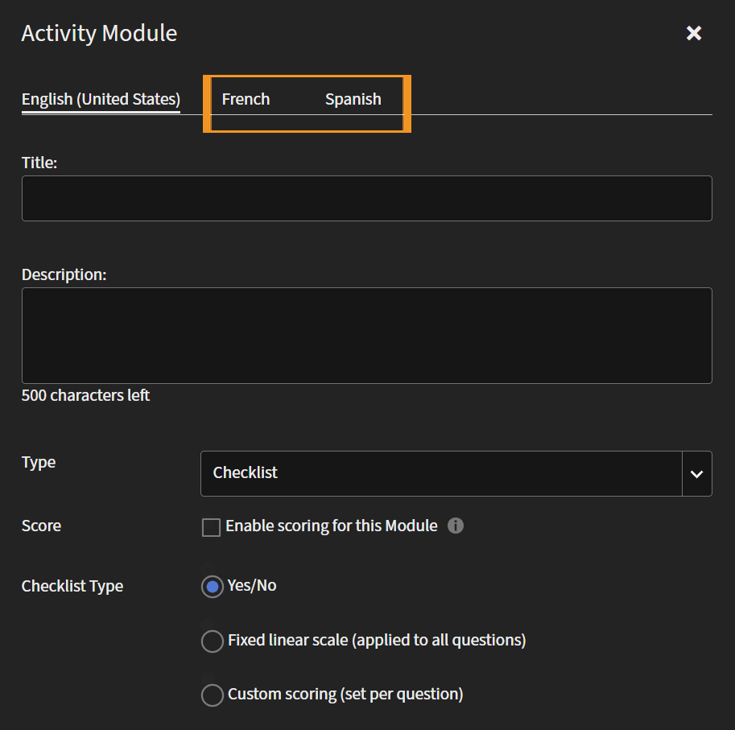
   *提供額外語言*

   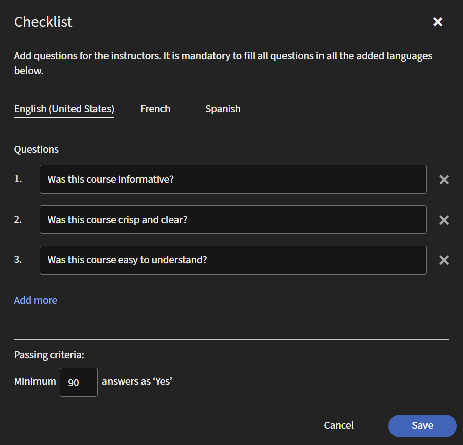
   *例如，問題也會以法文輸入*

   >[!NOTE]
   >
   >ALM 不會自動為您翻譯這些額外語言的問題。 你必須將題目翻譯成各自的語言。

5. 選擇「 **儲存**」。 所有語言的題目都會被儲存。
6. 選取所有其他相關選項，然後選擇 **新增**。 檢查清單以課程提供的所有語言建立。


**通過條件：**

<table>
 <tbody>
  <tr>
   <td>
    <p>如果你選擇 <b>是/否</b>，那麼......</p></td>
   <td>
    <p>如果你選 <b>了1到5</b>，那麼......</p></td>
  </tr>
  <tr>
   <td>
    <p>將通過條件設為回應數為「是」。 例如，若您輸入3，學習者在講師評估時至少獲得三 <b>次「是」 </b>回答，則表示該課程通過。</p></td>
   <td>
    <p>將通過標準設為 1 到 5 之間的任意門檻。 例如，若你輸入 2 和 4，學習者只要至少取得 <b>兩 </b>項評分分數大於 <b>四</b>，則該課程通過。</p></td>
  </tr>
 </tbody>
</table>

選擇一位或多位會評估學習者的講師。

另外，如果你有什麼要留言或要註解的，也可以把它加到「 **給講師** 的備註」文字欄位裡。

現在，加入清單上的題目。 點擊 **[!UICONTROL Add]**。 你最多只能加 150 題。

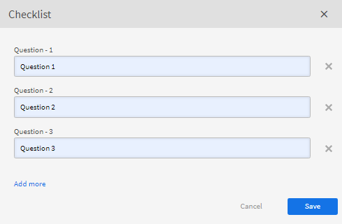

*新增檢查清單問題*

若要新增更多問題，請點擊 **[!UICONTROL Add more]**。


儲存變更、新增模組並發佈課程。

### 新增技能 {#addskills}

在此頁面輸入以下資料：

1. 選擇課程技能、升級，並設定該技能的學分。 如果需要，再增加更多技能。

   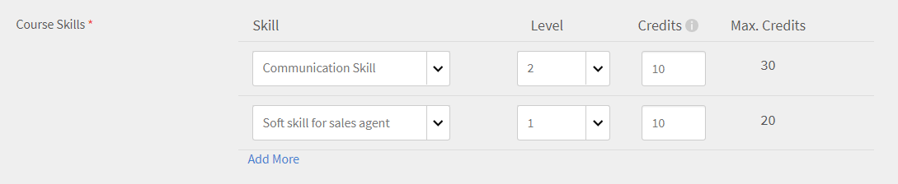

   *為課程新增技能*

1. 選擇報名類型。 以下是選項：

   * **經理提名：** 只有經理人才能提名這些課程。 學習者無法報名這類課程。
   * **經理核准：** 經理核准這些課程。 學習者可以報名這些課程，但未經經理批准，不會直接報名這些類型的課程。 當學習者報名這類課程時，系統會向管理者發送通知請求。 經經理核准後，這些課程將列為已註冊學員。
   * **自我報名：** 學習者可以直接報名這類課程。

1. 如果您想讓學習者能夠自行取消註冊課程，請啟用「學習者可以自行取消註冊&#x200B;**」的核取方塊**。
1. 選擇在修讀課程前必須完成的先修課程。 點選「課程」欄位，從課程清單中選擇。

   

   *新增先修課程*

1. 如果你想將先修課程設為必修，請啟用 **先修課程** 核取方塊。
1. 將關鍵字加入與課程相關的標籤。 這些標籤幫助學習者在搜尋時輕鬆找到你的課程。 所有這些標籤都是根據我們新增的模組自動新增的。 如果你還有其他標籤想加入本課程，可以直接輸入。
1. 點擊文字區，從建議中選擇，新增本課程目標受眾的個人檔案。
1. 為你的課程添加資源檔案作為額外教材。 拖曳您的材質，例如文字、影片或音訊檔案。
1. 現在，這門課程將提供給擁有這些履歷的學習者，作為推薦課程。 您也可以在此章節中附加額外的學習資源。 學習者將能下載這些檔案以供日後參考。 完成所有這些變更後，請點擊 **[!UICONTROL Save]** 右上角。 這會將你的課程保存為草稿。 你的課程預設會以草稿形式儲存。

## 為模組指派講師 {#assigninstructorsformodules}

1. 在為課程建立模組後，你可以指派授課老師。 在作者儀表板中，點擊 **[!UICONTROL Course Catalog]**。
1. 點選您想要指派講師的課程。
1. 在「 **新增模組** 」區段，點選您想要指派講師的模組。
1. 在講 **師** 欄位中，指定您想指派講師角色的使用者名稱。

   

   *為使用者指派講師角色*

1. 若要重新發布包含更新內容的課程，請點擊 **[!UICONTROL Republish]**。

### 附註解的檢查清單


檢查清單註解讓作者在基於檢查清單的評估中啟用 **情境回饋** 。\
啟用後，審查者（講師或主管）可新增說明評鑑結果，不僅限於分數或通過/不合格狀態。

這項功能將檢查清單從純粹的評估工具轉變為 **以回饋為導向的學習機制**，提升學習者的理解、透明度以及後續行動。

藉此，作者可以：

* 啟用審核者對檢查清單的評論
* 控制評論是否對學習者可見
* 控制是否顯示審閱者姓名給學習者
* 確保審查員的意見被記錄在學習者成績單與報告中

#### 使用案例

#### 績效評估

在實務或角色導向評估中，針對觀察到的優勢、缺口及改進領域提供明確回饋。

#### 由講師主導與 VILT 訓練

允許講師解釋為何學習者通過或未通過以檢查表為基礎的評估。

#### 合規與稽核情境

維持可稽核的追蹤，說明評估決策的檢查清單。

#### 多審閱者環境

協助學習者找出評估他們的人，並追蹤以求釐清。

#### 啟用檢查清單註解

1. 開啟現有課程或建立新課程。
2. 新增檢查清單模組或開啟現有檢查清單模組進行編輯。
3. 在檢查清單設定面板中：
   1. 選擇 **「**&#x200B;審閱者備註」。 在檢視清單時，審查者可以補充意見或回饋。 一旦發佈，此設定將無法更改。
   2. （選用）選擇「 **向學習者**&#x200B;顯示審閱者名稱」。 這讓學習者可以查看已審閱清單模組的審查者姓名。
4. 儲存檢查清單設定。
5. 發佈課程以提供檢查清單供評估使用。

檢查表現在支援在學習者評估時的審查意見。

#### 評估過程中會發生什麼事

雖然作者不會進行評估，但了解配置的使用方式很有幫助：

* 審查者在評估學習者時會看到&#x200B;**備註欄位**
* 審核者可以在提交時加入情境性評論
* 若啟用：
  * 學習者可查看審閱者留言
  * 學習者會看到審查者的名字

#### 學習者體驗（啟用時）

* 當學習者打開已完成的檢查清單時：
* 他們看到的是檢查清單上的結果（通過/不通過或分數）
* 他們會看到審閱者的留言（如果已啟用）
* 他們會看到審查者的名字（如果已啟用）

這有助於學習者清楚了解評量結果及後續步驟。

#### 作者重點說明

* 檢查清單註解為 **選用** 功能，必須明確啟用
* 評論的可見性與審閱者身份完全 **由作者控制**
* 適用於：
  * 單一或多位審查者
  * 以分數為基礎的、是/否及縮放檢核表
* 除非作者更新，否則對現有檢查清單不影響

### 建立多語言檢查清單

多語言清單支援允許作者建立 **單一清單模組，提供多種語言**&#x200B;的題目。\
啟用後，審查者會自動以其所 **選內容語言**&#x200B;看到清單問題，確保全球團隊間的評估一致且在地化。

這消除了為每種語言&#x200B;**建立與管理**&#x200B;獨立檢查清單的需求，減少重複並簡化課程維護。

透過多語言檢查清單支援，作者可以：

* 在同一清單內新增多種語言的清單問題
* 在檢查表問題間維持語言一致性
* 確保審查者看到自動符合其內容語言的檢查清單問題
* 下載所選語言的檢查表報告

#### 使用案例

#### 全球勞動力評估

讓跨地區的管理者與講師能利用在地化的檢查清單問題評估學習者。

#### 跨區域標準化評估

維持單一評估架構，同時支援不同地區的多種語言。

#### 合規與營運訓練

確保評估人員能清楚理解其母語的檢查清單標準，減少口譯錯誤。

#### 減少內容重複

避免為不同語言建立並維護多個檢查清單模組。

#### 如何建立多語言檢查清單

1. 開啟現有課程或建立新課程。
2. 新增檢查清單模組。
3. 在課程設定中，新增所需的 **內容語言** （例如英語、法語、德語）。
4. 儲存課程設定。

#### 如何在多語言中設定檢查清單問題

1. 開啟檢查清單模組設定。
2. 前往 **「設定問題** 」區段。
3. 使用 **語言分頁** 切換可用語言。
4. 對每種語言而言：
   * 新增每個檢查清單問題的翻譯版本
   * 在不同語言之間維持相同的意義與評估意圖
5. 依需求定義檢查表條件（是/否、量表或分數）。

每個語言版本代表相同的檢查清單，而非獨立模組。

儲存檢查清單設定並發佈課程。 檢查清單現已支援所有已設定語言。

#### 審稿人的經驗

* 審查者會以 **所選內容語言看到清單問題**
* 評估期間無需手動切換語言
* 如果審查者更改內容語言，檢查表問題會自動調整

### 為檢查清單問題指派權重

清單題目權重讓作者能建立&#x200B;**以分數為基礎的清單，**&#x200B;讓單題的最高分&#x200B;**數可以有所不同**。

作者不必一視同仁地對待所有檢查清單項目，而是可以定義加權問題，並設定 **學習者通過的最低總分** 。

這項能力使評估更精確且靈活，特別是針對 **績效導向、評估導向及合規導向的訓練**。

透過清單題目權重，作者可以：

* 建立 **基於分數的檢查清單類型**
* 為個別檢查表問題分配不同的 **最高分** 數
* 定義&#x200B;**通過檢查表所需的最低總分**
* 使用擴展的評分標準（可設定範圍最高至 10）
* 在報告中檢視已達成的分數與最高分數

#### 使用案例

#### 講師主導的評量

評估學習者時，應使用詳細的評分標準，而非簡單的是/否結果。

#### SOP與作戰訓練

將較高權重分配給關鍵步驟，降低對次要任務的權重。

#### 合規與認證準備

確保學習者在通過前達到定義的最低能力門檻。

#### 技能與效能基準比較

支持結構化評估，部分完成仍會影響整體評分。

#### 如何建立加權檢查清單

1. 開啟現有課程或建立新課程。
2. 新增檢查清單模組或開啟現有檢查清單模組進行編輯。
3. 在檢查清單設定面板中，選擇 **自訂評分** 檢查清單類型。
4. 這讓每題可以進行計分與總分計算。
5. 視需要新增檢查清單問題。
6. 針對每個問題：
   * 定義最高分&#x200B;**數（**&#x200B;例如：5、10、20）
7. 確保題目分數反映其相對重要性。

不同題目在同一份清單內可能有不同的最高分數。

#### 定義通過標準

1. 請指定通過檢查表所需的最低總分&#x200B;**。**&#x200B;系統會根據題目權重自動計算可能的總分。
2. 儲存檢查清單設定並發佈課程。

檢查表現已啟用，並支援教師評量的加權評分。

#### 審稿人的經驗

* 審查者會看到每題清單題目及其 **最高分數**
* 評審在評估時會為每題分配分數
* 系統計算：
  * 總達成分數
  * 根據定義標準進行通過或不通過狀態

#### 學習者的體驗

* 學習者可查看檢查清單完成狀態（通過/不通過）
* 若啟用，學習者還可能看到：
  * 評論者評論
  * 審稿人姓名
* 評分邏輯在各評量中一致應用

#### 作者備註

* 加權檢查表最適合用於 **正式評估**
* 題目分數應謹慎校準，以避免結果偏頗
* 適用於：
  * 單一或多位審查者
  * 審核者留言（若已啟用）
* 除非明確更新，否則現有的檢查清單不會受到影響


### 讓講師能標記成功

Adobe Learning Manager 允許講師在課堂或虛擬教室模組中標記學習者的成功狀態。 作者可以在建立教室或虛擬教室模組時，授權講師標記學習者的成功狀態。 講師可以透過將學習者標記為通過或不通過來標記成功，確保進度能相應更新。

為了讓講師能夠標記學習者的成功：

1. 以作者身分登入 Adobe Learning Manager。
2. 在首頁選擇 **[!UICONTROL Create Courses]** 。
3. 選擇 **[!UICONTROL Add]**。
4. 輸入必要的資料並選擇 **[!UICONTROL Add Modules]**。
5. 選擇或 **[!UICONTROL Virtual Classroom Module]** **[!UICONTROL Classroom Module]**。
6. 輸入必要資料並選擇日期。
7. 選擇選項 **[!UICONTROL Allow Instructor to mark success]** 。

   
   _課程詳細資料畫面，並標示「允許講師標記成功」選項，適用於教室或虛擬教室模組_

8. 選擇 **[!UICONTROL Done]**。


## 觀察檢查清單

檢查清單模組現在除了講師外，經理也能檢視。 人員經理以及非階層式經理，如門市經理或地點經理，都能檢視並完成這份檢查清單。

課程作者可在設定檢查清單模組時，於「審查者」區段選擇這些角色選項，將人員管理者以及非階層式管理者（如適用）新增為審查者。 這可以在課程實例層級完成。


*在活動模組中新增審閱者*

選擇「**[!UICONTROL +Managers]**」選項將自動啟用組織階層中學習者的主管檢視檢查清單。 你不需要逐個搜尋並新增經理姓名。

如果您的帳戶管理員已透過「活動欄位」選項設定非階層式管理角色（例如位置管理員或站點管理員），這些管理員角色將可供您選擇並啟用以檢視清單。

你不需要逐個搜尋並新增經理姓名。 當學習者報名檢查清單課程時，系統會自動向其經理/門市經理發送通知，並連同所選講師一併檢視。 此工作流程讓作者不必提及個別經理姓名變得簡單。

在上方提供的範例截圖中，選擇「**[!UICONTROL +Store Managers]**」選項會自動讓與學習者對齊的非階層式經理能檢視檢查清單。 請注意，此處的「store」將被管理員定義的活動欄位取代。

檢查清單模組的更新也會包含當學習者報名課程且課程中包含檢查清單模組時，會通知講師與主管。 審查者會在 Learning Manager 通知中心以及講師/經理儀表板收到即將執行檢查清單動作的通知。

<!---->

審查者在以講師/經理身分登入時，能從「檢查清單」選單以及通知選單中查看所有待審核清單的相關資訊。


*認證認可*

點擊「審查檢查清單」後，審查者即可完成評估。


*檢視待處理的檢查清單檢視項目*

報告可下載於檢查清單中，包含學習者評估、審查者姓名、角色及電子郵件等詳細資訊。

檢查清單報告 csv 包含新增與更新的欄位：

* 使用審查者姓名取代講師姓名
* 使用審閱者電子郵件取代講師電子郵件
* 審查員角色-可能的值為經理、門市/地點經理、講師

## 預覽課程 {#previewacourse}

課程建立並儲存為草稿後，您可以以學習者身份預覽課程，然後發佈以在課程目錄中提供。

若要預覽課程，請點擊 **[!UICONTROL Preview as learner]**。


*以學習者身份預覽課程*

這會為您開啟課程 **總覽** 頁面，您可以在那裡查看模組、課程順序及其他相關細節。


*檢視模組及其他相關細節*

想了解學習者如何體驗此課程，請點擊每個模組開始遊玩。 這會開始在 Fluidic Player 裡遊玩該球場。

## 發佈課程 {#publishacourse}

以學習者身分預覽課程後，您可以發佈課程，讓學習者能即時使用。 請注意，課程目前仍處於草稿階段。

典型的課程生命週期如下：

* **草稿** ——作者完成課程建立並儲存時。 目前，課程尚未開放給學習者。
* **已出版** - 作者完成課程出版。 目前，課程已開放給學習者報名。 你也可以在這個州編輯課程。
* **已停用** - 課程發佈後，若作者不希望該課程出現在學習者課程目錄中，作者可將其移至退休狀態。
* **已刪除** - 課程處於刪除狀態，是指該課程從 Adobe Learning Manager 應用程式中完全移除。 只有作者可以在課程處於草稿或退休狀態時刪除它們。


*課程生命週期的工作流程*

若要發佈您已建立的課程，請點擊 **[!UICONTROL Publish]** 頁面右上角。


*發佈課程*

在出現的確認彈出訊息中，點擊 **[!UICONTROL OK]**。

該課程現已在課程目錄中提供。

## 查看課程 {#viewacourse}

您可以以作者身分查看所有可用課程的清單。 若要檢視 Learning Manager 帳戶中的所有課程，請點選「課程目錄」。 若要在 Learning Manager 中檢視您所有已編寫的課程，請點選 **[!UICONTROL My Courses]**。

在課程卡片上，將滑鼠移至選項，然後點擊 **[!UICONTROL View Course]**。


*查看課程*

課程資訊視窗會顯示。 課程目前為唯讀模式。 若要修改課程，請點選 **[!UICONTROL Edit]**。

## 退休球場 {#retireacourse}

管理員可以為 Adobe Learning Manager 帳戶啟用退休選項。 此功能讓管理員可以停用課程，使其無法再對新報名使用，同時讓目前已註冊的學習者保留存取權。

退休課程會對學習者隱藏，即使他們已註冊或已完成課程。 如果您終止課程，就無法為新學習者報名該課程。 已報名的學員可參加此課程。

若要為 Adobe Learning Manager 帳戶啟用「退休」選項：

1. 以管理員身分登入 Adobe Learning Manager。
2. 選取 **[!UICONTROL Settings]** ，然後選取 **[!UICONTROL General]**。
3. 從下列選項中選擇任一退休選項：
   * 退休後，已註冊的學習者將能查看並執行操作，但尚未註冊的學習者將失去存取權。
   * 一旦退休，無論是已註冊或尚未註冊的學習者，都將失去使用權。

管理員可以將課程從 **[!UICONTROL Courses]** 頁面中停用。

若要退休課程，請在課程卡片上將滑鼠移至選項，然後點選「退休課程」。


*退休球場*

在出現的確認彈出視窗中，點擊 **[!UICONTROL Yes]**。

## 複製課程 {#duplicateacourse}

您可以先建立課程副本，然後修改課程。 如果你想備份課程，可以複製課程。

## 搜尋課程 {#searchforcourses}

Adobe Learning Manager 讓您更容易快速找到心儀的課程。 您可以透過以下方式搜尋您的課程：

**搜尋欄位：**&#x200B;點擊課程目錄&#x200B;**頁面右上角**&#x200B;的搜尋欄。輸入課程名稱或與課程相關的關鍵字。 您也可以使用課程建立時新增的標籤進行搜尋。 標籤可在搜尋課程欄位內搜尋，這表示當你輸入時，標籤會顯示在搜尋欄位中。


*搜尋課程*

**篩選課程清單：** 您可以依狀態篩選課程，例如全部、已發佈、草稿及退休。 根據您的選擇，您可以查看篩選過的課程清單並選擇必修課程。

作為作者，你也可以排序課程，以便更好地找到你想修的課程。 點擊 **[!UICONTROL Sort by]** 並選擇字母升序、字母降序、課程創建日期、課程更新日期及課程成效。


*課程篩選列表*

## 為學習者報名課程 {#enrolllearnersinacourse}

若要報名學習者參加課程，或允許管理者提名學習者，您必須切換至管理員模式，因為只有管理員擁有註冊學習者參加課程的權利。

若要切換至管理員模式，

1. 點選您的個人頭像，然後選擇「管理員」。
1. 在系統管理模式中，點擊 **[!UICONTROL Courses]** 左側窗格。 在此頁面上，您可以查看由 Learning Manager 帳戶中所有作者所建立的所有課程。
1. 若要報名學習者，將滑鼠移到課程卡片上，即可看到「報名學習者&#x200B;**」選項**。點選此選項。

   

   *為學習者報名課程*

1. 在「註冊學習者」對話方塊中，右上角您會看到 **「預設實例** 」選項已被選取。 一旦作者建立課程，系統會建立該課程的預設實例。

   

   *檢視課程的預設實例*

1. 開始在「包含學習者」欄位輸入學習者的名稱，並選擇一位學習者。 您也可以在此新增使用者群組。 如果您想為您的 Learning Manager 帳戶註冊所有學習者，請開始輸入「all」。 你也可以讓學習者加入團隊。

   

   *將 learhers 加入課程*

1. 如果您想將任何學習者排除在課程之外，請在 **「排除學習者** 」欄位中輸入該學習者的姓名。
1. 完成學員報名後，請點擊 **[!UICONTROL Proceed]**。 在「註冊學習者」對話方塊中，您可以檢視報名摘要。

   

   *檢視課程報名摘要*

1. 若要報名所有課程學習者，請點擊 **[!UICONTROL Enroll]**。 這些學習者現已成功報名本課程。 學習者會收到通知，可以繼續修課。 若要報名更多學習者，請重複報名程序。

## Connect VC 模組課程實例頁面的變更 {#connect-vc}

在取得 Connect 課程時，您可以建立兩種類型的房間：

* 動態
* 持續性

持久的 URL 永遠是固定的。 但對於沒有 Connect 且沒有自己會議室的使用者來說，他們必須在執行時使用動態會議室。 接著，人們就可以加入他們的會議。


*動態會議室選項*

您現在可以在課程實例&#x200B;**頁面更改持久教室**&#x200B;的網址。

<!--
|  |  |
|---|---|
-->

## 取消課程學員報名 {#unenrolllearnersfromacourse}

在建立課程時，作者可以啟用「學習者可自行取消報名&#x200B;**」選項**，讓正在修課的學習者也能從課程中解讀。

管理員也可以取消課程中的學習者報名。


*取消課程學員報名*

如需更多資訊，請參閱 [「取消註冊學習者](/help/migrated/administrators/feature-summary/courses.md)」。

## 新增 Captivate 與 Presenter 的課程模組 {#addcoursemodulesforcaptivateandpresenter}

您也可以透過 Adobe Captivate 和 Adobe Presenter 軟體，透過「發佈」選單將課程模組發佈至 Learning Manager。

1. 在 Captivate 中，點選 **[!UICONTROL Publish]** > **[!UICONTROL Publish to Learning Manager]**。
1. 輸入子網域名稱或電子郵件 ID，然後點擊 **[!UICONTROL Submit]**。 如果您有多個帳戶，系統會提示您選擇該帳戶。
1. 使用 Adobe 憑證登入。 如果您沒有 Adobe ID，請點擊 **[!UICONTROL Create Account]**。 授權後，您將被導向模組發佈頁面。
1. 提供模組的所有基本資訊，然後點擊「發佈」。

您可以在 Learning Manager 模組頁面上看到已發佈的模組。 欲了解更多資訊，請參閱 [「發佈專案至 Adobe Learning Manager](https://helpx.adobe.com/captivate/classic/publish-project-to-captivate-prime.html)」。

## 課程效能 {#courseeffectiveness}

課程效能分數幫助作者評估哪些課程未符合學習者需求，並相應調整。 課程成效評估旨在了解課程對學習者的實用性。 它是學習者對課程內容反饋結果的綜合結果。 課程測驗的結果是學習者的測驗結果，以及經理根據課程學習內容評估學習者的回饋。

在「我的課程」**中**，作者可依下方快照查看課程縮圖上的課程成效評分。你可以看到這門課程的評分為 100。

<!---->

課程效能評分值是根據 L1、L2 與 L3 的回饋值得出的。 若要查看每則回饋的細分，請點擊課程成效值。 會顯示如下所示的彈出選單。


*課程效能的計算*

在這個範例快照中，有 1 位使用者收到了三種回饋，因此分數是 100/100。 從這張表格中，你可以了解缺少哪些回饋，以提升整體效能。 若要查看課程效能的計算方式，請點擊彈出選單右下角的向下箭頭。

<!---->

如上方圓餅圖所示，L3 經理的回饋會被賦予更多比重。

## 認證與學習課程 {#certificationsandlearningprograms}

作者與管理員都能透過 Author 應用程式為學習者建立認證與學習計畫。 在首頁，點選「認證」或「學習計畫」以建立相應的學習物件。

若要了解如何建立和管理認證與學習計畫，請參閱  [「認證](/help/migrated/administrators/feature-summary/certifications.md) 與  [學習計畫](/help/migrated/administrators/feature-summary/learning-programs.md)」。

## 外部認證必修課程 {#mandatorycoursesforexternalcertification}

在早期版本的 Learning Manager 中，外部認證學習者完成課程並非完成證書的必要條件。

您現在可以在課程標籤中啟用 **「為證書完成** 必修課程」選項，將課程設為必修。


*設定必修課程以完成證書*

當課程被設定為必修時：

* 管理員的提交頁面僅在學習者完成課程後列出學員。
* 學習者僅能在完成課程後上傳檔案。

## 常見問題 {#frequentlyaskedquestions}

+++如何移除課程的「尋求經理提名」？

請執行以下步驟：

1. 以作者身分登入 Learning Manager。
1. 開啟課程。
1. 在左側窗格中，點選 **[!UICONTROL Settings]** > **[!UICONTROL Edit]**。
1. 在「 **註冊類型** 」下拉選單中，將登錄類型從 **「經理提名** 」變更為 **「經理核准** 」或 **「自行註冊**」。

1. 一旦您更改了報名類型，請重新發佈課程。

+++

+++如何合併課程？

你可以透過學習計畫合併課程。

1. 以管理員身分登入 Learning Manager。
1. 在左側窗格中，點擊 **[!UICONTROL Learning Programs]**。
1. 若要新增學習計畫，請點選 **[!UICONTROL Add]**。
1. 輸入學習計畫的詳細資訊，若要儲存學習計畫，請點擊 **[!UICONTROL Save]**。
1. 建立學習計畫後，點擊 **[!UICONTROL Catalog]**。
1. 在課程卡片上，點擊 **[!UICONTROL Add]**，如下所示。 對您想加入學習計畫的課程重複此程序。


在您新增學習計畫中所需的所有課程後，請點擊 **[!UICONTROL Publish]**。

在學習計畫中，您只能新增自行報名的課程，不能新增經理提名或經理核准的課程。 這是 Learning Manager 的預設行為。

+++

+++如何確保所有學習者無法看到所有課程？

你可以透過目錄來達成這點。預設目錄預設包含所有新增至 Learning Manager 的課程。

您必須停用預設目錄並建立自訂目錄。

1. 以管理員身分登入 Learning Manager。
1. 在左側窗格中，點擊 **[!UICONTROL Catalogs]**。
1. 點擊 **[!UICONTROL Create]**&#x200B;建立目錄。 輸入詳細資料後點擊 **[!UICONTROL Save]**。

1. 在新建立的目錄選項中，您可以選擇可新增的不同學習類型，例如學習計畫、認證或課程。
1. 在「學習計畫」區段，按一下 **[!UICONTROL Add Content]**。
1. 在左側窗格中，根據您想要鎖定的受眾，點擊 **[!UICONTROL Share Internally]** 或 **[!UICONTROL Share Externally]** 。

1. 若要新增使用者群組，請點選 **[!UICONTROL Add User Groups]**。
1. 在目錄頁面，停用 **D[!UICONTROL efault Catalog]** 並啟用您已建立的目錄。


+++

+++如何重新報名已完成的課程？

課程完成後無法回復。 學習者 **無法重新報名** 已完成的課程。

+++

+++學習者完成課程後，如何查看課程？

學習者可以在課程結束後，點擊課程中的「重訪」按鈕來查看課程。

請執行以下步驟：

1. 以學習者身份登入。
1. 開啟您已完成的課程。
1. 點擊 **[!UICONTROL Revisit]**。

+++

+++如何在課程中新增資源檔案？

在建立課程時，您可以將與課程相關的影片、音訊、PDF 或文字檔案加入課程，讓學習者能存取額外的訓練資料。


+++

+++如何設定模組的多次嘗試？

**先決條件：**&#x200B;管理員必須在管理應用程式的「設定」>「一般&#x200B;**」中啟用「多次嘗試****」選項**。

作為作者，在課程總覽頁面啟用「允許多次嘗試&#x200B;**」選項**。

更多資訊請參閱「多次嘗試](courses.md#Allowmultipleattempts)」章節[。

+++

+++你可以下載已上傳到 Adobe Learning Manager 的內容來修改內容嗎？

不，上傳到 Learning Manager 的內容是已發佈的 zip 檔，並非原始檔案。 因此，即使內容已下載，內容仍無法在創作工具中進行編輯。 你需要一個原始檔案來編輯內容。

+++
