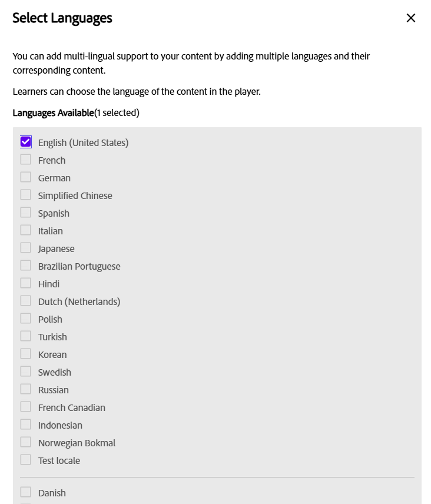

# 建立學習路徑

作者可以為學習者建立一條學習路徑。 在 Author 應用程式中建立學習路徑的方法：

1. 以作者&#x200B;**身份登入**。
1. 選取&#x200B;**「學習**」>**「學習路徑」。**
1. 選擇 **新增**。

   

1. **學習路徑名稱**：輸入學習路徑的名稱。
1. **學習路徑概覽**：輸入學習路徑的簡要概述。
1. **此學習路徑**&#x200B;的好處：描述此學習路徑的幾項好處。
1. **標籤**：從預設清單中選擇適當的標籤。
1. **唯一學習物件 ID**：輸入學習物件的唯一 ID。
1. **報名類型**：從下拉選單中選擇報名類型。
1. **價格方案**：選擇 **付費** 或 **免費**。 如果您選擇 **「免費**」，學習 **路徑價格** 方塊將被停用。
1. **取消註冊**：選擇此選項可讓學習者自行取消註冊。
1. **封面圖片：選擇**&#x200B;一張封面圖片作為學習路徑。
1. **橫幅圖片**：選擇一張橫幅圖片作為學習路徑。
1. **選擇目錄**：從清單中選擇相關目錄。
1. **合規標籤**：從清單中選擇適當的合規標籤。
1. **標籤**：從清單中選擇適當的標籤。
1. **Credly 徽章 ID**：從清單中選擇適當的標籤。
1. **難度等級：從**&#x200B;列表中選擇適當的難度等級。
1. **合規**：從清單中選擇適當的合規等級。

   >[!NOTE]
   >
   > 在儲存前的任何時刻，您可以選擇 **「新增語言** 」索引標籤，從清單中選擇語言，然後選擇 **「儲存**」來新增語言。 英語是預設語言。

   

1. 選擇「 **儲存**」。 會顯示一個新頁面，上面會顯示學習路徑的名稱。 您現在可以新增技能與產品、組織章節，並新增課程或學習路徑。

   

1. 精選 **技能學習者將獲得**。 在開啟的區塊中，選擇你希望學習者獲得的技能及其等級。

   

1. 選擇 **新增**。
1. 選擇您想要如何組織各區段、課程或學習路徑。 選擇 **「有序** 」或 **「無順序**」。
1. 接著，選擇 **新增課程或學習路徑**。 會出現一個視窗，顯示現有課程與學習路徑。 每個磁貼會顯示名稱、類型（課程或學習路徑）、出版狀態及課程格式。 如果是課程，則會顯示自學進度、虛擬課程、課堂課程或混合式等類型。 如果是學習路徑，則會顯示課程數量。

   

1. 選取您想要新增至學習路徑的課程或學習路徑。

   

1. 選擇 **新增**。 課程與學習路徑會顯示在學習路徑頁面上。

   

1. 精選 **技能學習者將獲得**。 選擇技能與等級。 選擇 **新增**。
1. 透過從清單中選擇產品，然後選擇其等級，將學習路徑映射到產品。

   >[!NOTE]
   >
   > 如果您未選擇至少一項產品，將無法發布學習路徑。

   

1. 選擇您想要如何組織各區段、課程或學習路徑。 選擇 **「有序** 」或 **「無順序**」。
1. 選取「 **新增章節標題**」，然後輸入章節標題。

   

1. 選擇「**&#x200B;**&#x200B;提交」。
1. 選擇 **「必要** 」以將學習路徑設為強制。 如果你不選擇它，學習路徑就會變成可選的。
1. 如果你想新增另一個有不同學習路徑的部分，請重複步驟 24 到 30。
1. **完成要求**：從列表中選擇 **全部** 或一個數字以完成訓練。
1. 將課程往上或往下移動以改變順序。
1. 若要從學習路徑中移除課程，請在課程卡片上選取 **X** 。
1. 選擇 **「發佈**」。 若要檢視新發佈的學習路徑，請返回「 **學習路徑」** 頁面。
