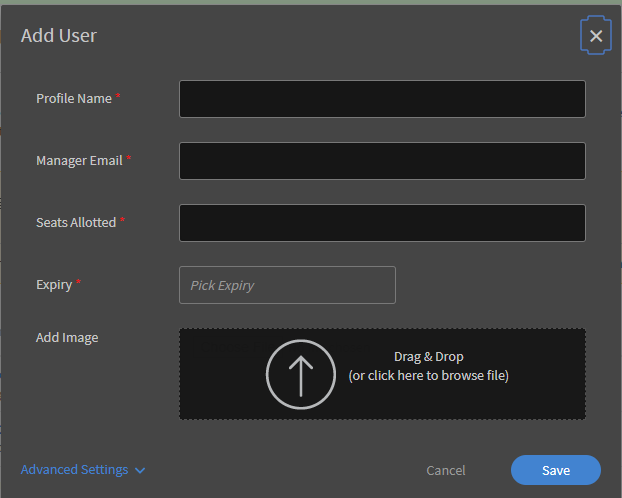
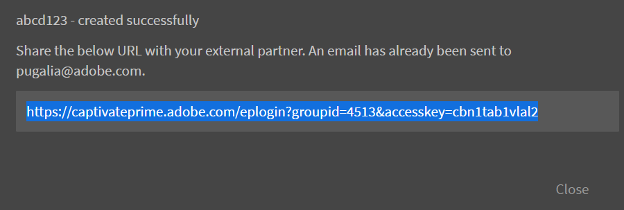
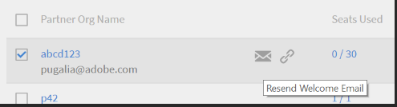
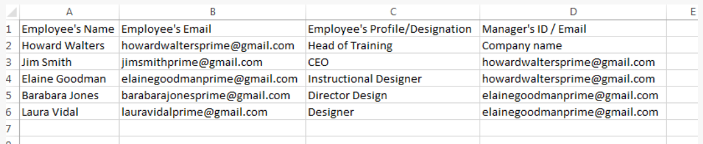
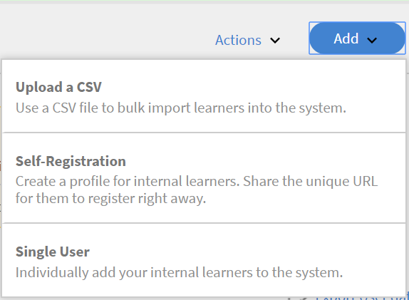
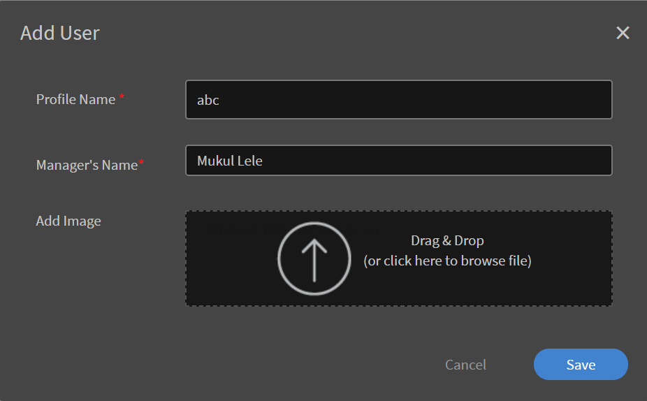
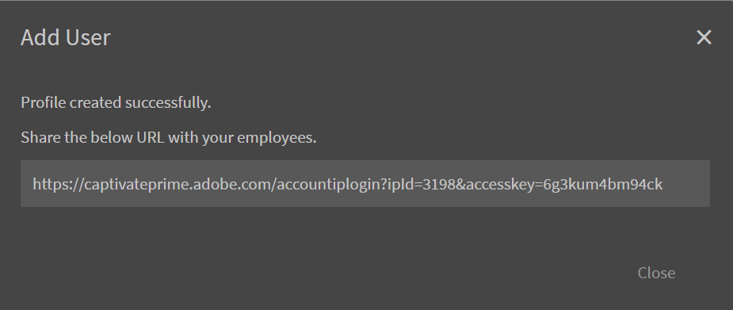
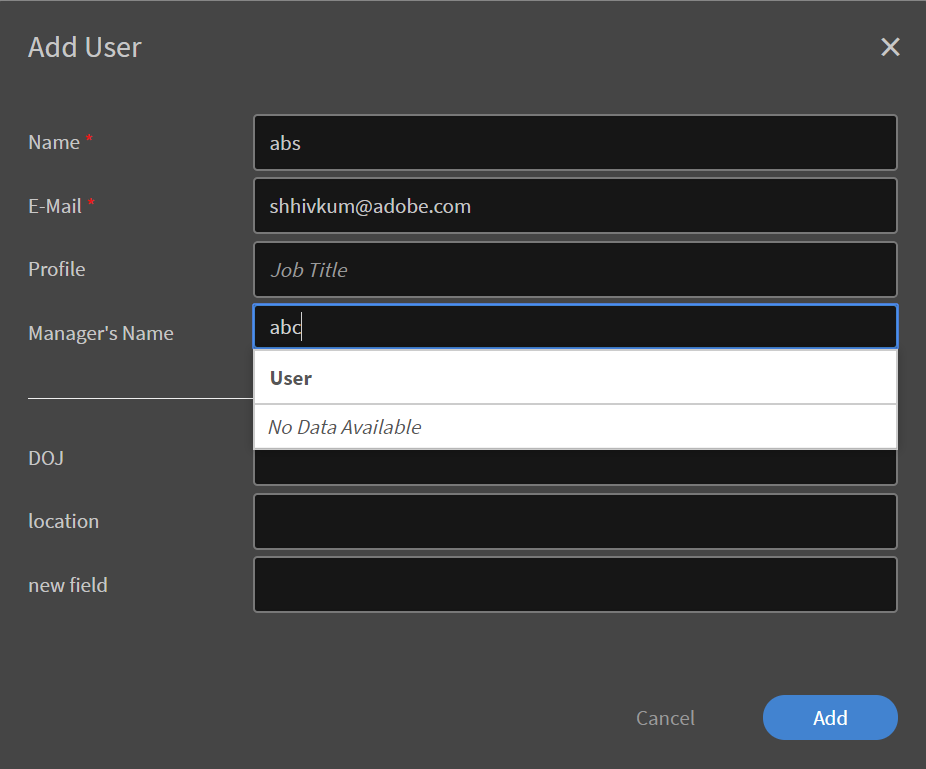
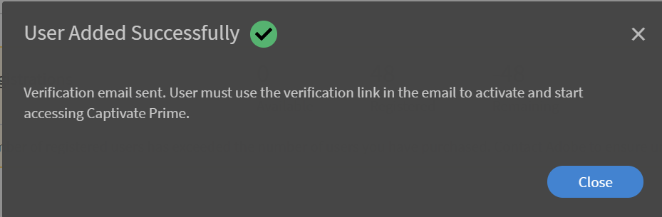
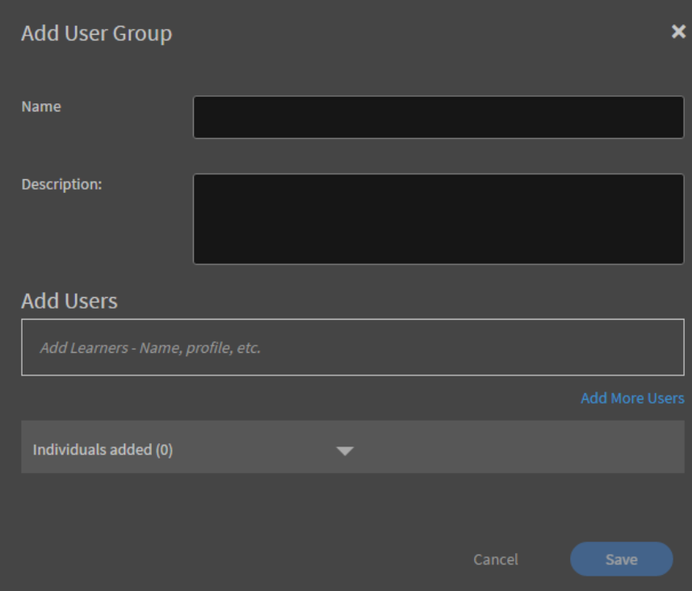

# 在 Learning Manager 中設定使用者

## 內部與外部使用者 {#internalandexternalusers}

在任何 LMS，包括 Learning Manager 中，管理使用者都是很重要的一環。 Learning Manager 允許您將使用者分類為內部與外部。 內部使用者是指屬於特定組織或群組的使用者。 一般而言，企業內部的使用者都是內部使用者。 這些使用者擁有由主管或管理員指派的特定學習物件及特定期限。

相較之下，外部使用者通常是特定 Learning Manager 帳戶的臨時使用者。 這些使用者可能會透過點擊透過電子郵件收到的臨時外部連結來存取特定的學習物件。 外部使用者設定檔通常有有效期限。 例如，負責 Java 認證的組織可能會讓任何使用者暫時登入完成相關課程，然後再嘗試取得認證。 通常，面向外部使用者的課堂訓練與課程也有限。

繼續閱讀，了解如何在 Learning Manager 中新增內部使用者與外部使用者。

## 設定外部使用者 {#setupexternalusers}

作為管理員，您可能希望將外部使用者，例如合作夥伴組織的員工，新增至您的 Learning Manager 帳戶。 新增外部使用者的方法如下：

1. 在 **[!UICONTROL **管理員**]**&#x200B;登入頁面，點選左側導覽窗格中的 **[!UICONTROL **使用者**]**。
1. 在 **[!UICONTROL **使用者**]**&#x200B;頁面，點選左側導覽窗格中的 **[!UICONTROL **External**]**。 系統會顯示外部使用者頁面，並列出外部使用者（如適用）。
1. 點擊頁面右上角的 **[!UICONTROL **新增**]**。

   

1. 在 **[!UICONTROL **新增使用者**]**&#x200B;彈出對話方塊中，以下欄位為必填：

   * **[!UICONTROL **&#x200B;設定檔名稱**：]**&#x200B;指定您要建立的外部設定檔名稱。
   * **[!UICONTROL **&#x200B;管理員電子郵件&#x200B;**：]** 指定外部使用者經理的電子郵件地址。
   * **[!UICONTROL **&#x200B;分配名額&#x200B;**：]** 請指定可報名課程的學習者人數。
   * **[!UICONTROL **&#x200B;到期日&#x200B;**：]** 指定過期日期，超過此日期後外部使用者無法註冊或使用課程。

1. 點選 **[!UICONTROL **「進階設定&#x200B;**」。]**
1. 建立外部設定檔時，可選擇性地設定以下選項：

   * **[!UICONTROL **&#x200B;新增圖片&#x200B;**：]** 拖放您想要的圖片。 此圖片會顯示在使用者的學習者頁面中。
   * **[!UICONTROL **&#x200B;登入要求&#x200B;**：]** 指定使用者需要在多少天內登入。 如果外部使用者超過此登入期間，學習者將無法存取或使用該學習物件。
   * **[!UICONTROL **&#x200B;允許的網域&#x200B;**：]** 請以逗號分隔的網域。 只有擁有指定網域的使用者才能註冊至帳戶。
   * **[!UICONTROL **&#x200B;必須&#x200B;**&#x200B;進行電子郵件驗證：]** 如果您希望將驗證電子郵件寄送給使用者，請勾選此核取方塊

1. 點擊 **[!UICONTROL Save.]**

   

   會顯示一個包含 URL 的彈出對話框。 您可以複製此 URL 並傳送給外部使用者。 預設情況下，會寄送包含此 URL 的電子郵件給使用者。

1. 當您新增外部設定檔時，它們會顯示在&#x200B;**[!UICONTROL **&#x200B;外部使用者頁面&#x200B;**（**&#x200B;管理員&#x200B;**>**&#x200B;使用者&#x200B;**>**&#x200B;外部&#x200B;**]**）。 這些使用者也會顯示座位限制、到期日及登入要求。
1. 若要隨時編輯外部使用者的設定，請點擊使用者名稱。 **[!UICONTROL Edit External Enrollment]**&#x200B;對話方塊隨即出現。修改設定，然後點擊 **[!UICONTROL **「儲存&#x200B;**」。]**
1. 您也可以透過點選外部設定檔旁的電子郵件/複製網址圖示，隨時重新寄出歡迎郵件或複製網址。

   

## 暫停外部使用者設定檔 {#pausetheexternaluserprofile}

在將外部使用者群組新增至 Learning Manager 後，您也可以暫停外部使用者的註冊流程。 當您暫停時，外部使用者的註冊程序會被封鎖。 不過，這個流程只有在用戶尚未接受邀請註冊時才會有效。

若要暫停外部使用者群組，請從頁面右上角點選 **[!UICONTROL **動作**]&#x200B;**，然後選擇 &#x200B;** [!UICONTROL Pause]**。

## 恢復外部使用者設定檔 {#resumeexternaluserprofile}

在任何時間點，你都可以選擇「繼續」選項來解除阻塞（暫停）。 點擊頁面右上角的「[!UICONTROL **動作**]」，然後選擇 **[!UICONTROL Resume]**。

**[!UICONTROL External user states]**

在 Learning Manager 中，適用於外部使用者的下列狀態：

* **非啟用狀態** - 在此狀態下，外部使用者的註冊已過期。 管理員在新增外部使用者時，透過新增使用者工作流程設定外部使用者的到期日。
* **啟用狀態** - 在此狀態下，外部使用者可以註冊 Learning Manager 應用程式，並登入該應用程式。
* **暫停** - 在此狀態下，外部使用者的註冊程序會被封鎖。 然而，現有使用者仍可繼續登入。

## 設定內部使用者 {#setupinternalusers}

作為系統管理員，您可能希望為您的企業或組織設定使用者。 這些使用者也被稱為內部使用者。 內部使用者可透過單一登入或 Adobe ID 登入應用程式。 這些使用者隨後可依需求存取並使用學習對象。 要為組織設定內部使用者，有三種可能的方法：

* 使用 CSV 批量新增使用者
* 透過自我註冊新增使用者
* 新增單一內部使用者

## 使用 CSV 檔案新增使用者 {#addingusersusingacsvfile}

如果使用者數量較多，您可以選擇此方法新增內部使用者。 當您首次使用 CSV 新增使用者時，必須將 csv 資料內容對應到應用程式標籤。 之後，當您新增使用者或更新使用者資料時，相同的對應會被保留。 若要批量新增內部使用者：

1. 在頁面 **[!UICONTROL Administrator Home]** 上，點選左側導覽窗格中的「[!UICONTROL **使用者**]」。
1. 點選 **[!UICONTROL **「新增&#x200B;**」>**「上傳 CSV 檔案&#x200B;**」。]**
1. 在彈出對話方塊中，點選 **[!UICONTROL **&#x200B;匯入&#x200B;**。]**
1. 瀏覽至您儲存 CSV 檔案的位置。 點擊 **[!UICONTROL Open]**。
1. 匯入 CSV 檔案，並將 CSV 檔案內容與應用程式標籤對應。 此步驟僅適用於您首次上傳 CSV 檔案時。
1. 點選 **[!UICONTROL **儲存**]**&#x200B;以儲存映射。
1. 點擊 **[!UICONTROL **新增**]**&#x200B;以上傳已對應至應用程式資料的 CSV 檔案。

### 建立上傳 CSV 檔案時的注意事項： {#considerationswhencreatingthecsvfileforupload}

當您建立用於上傳內部使用者的 CSV 檔案時，以下是必須輸入資料的必填欄位：員工姓名、員工電子郵件、員工個人資料或職稱，以及經理階層。

每位員工的姓名與電子郵件可直接對應至申請資料。 請注意，您必須指定 CSV 檔案中指定的電子郵件，稱為「管理員電子郵件」。 您可以在建立 CSV 檔案時定義 Manager ID，或在上傳 CSV 檔案時指定與 Manager ID 對應的電子郵件 ID。

***在將 ID 新增為員工的經理 ID 之前，請先確認 CSV 檔案中已將經理加入為員工。***

***確保條目之間沒有額外空格，才能成功上傳 CSV 檔案。***

請在此查看 CSV 檔案的範例快照：

若要下載範例 CSV 檔案，請下載 `<give link to zip file>`。

<!--Zip file reference, no source file-->

### 設定根使用者 {#settinguprootuser}

自動化大量匯入使用者。

## 透過自我註冊新增使用者 {#addingusersthroughselfregistration}

除了批量新增內部使用者外，你也可以透過自我註冊方式新增使用者。 您可以使用自我註冊功能，讓員工將自己註冊為學習者，並加入您的 Learning Manager 帳戶。 當您建立自我註冊個人檔案時，系統會建立一個獨特的 URL。 請將此 URL 分享給員工，以便他們能在 Learning Manager 中註冊。

1. 在頁面上 **[!UICONTROL Administrator Home]** ，點擊 **[!UICONTROL Users]** 左側導覽窗格。
1. 點擊 **[!UICONTROL **「新增&#x200B;**>**&#x200B;自我註冊&#x200B;**」。]**

   

1. 在快顯對話方塊中 **[!UICONTROL Add User]** ，於欄位中指定員工 **[!UICONTROL Profile Name]** 的姓名。
1. 在欄位 **[!UICONTROL Manager's Name]** 中輸入該員工主管的姓名。
1. 您也可以選擇使用該 **[!UICONTROL Add Image]** 欄位新增員工的個人頭像。
1. 點擊 **[!UICONTROL Save]**。

   

   系統會顯示另一個彈出對話方塊，並顯示設定檔已成功建立的訊息。 此對話方塊中也會產生唯一的 URL。

1. 請將此 URL 分享給員工，以讓員工能夠自行註冊為學習者。

   

## 在 Learning Manager 中新增單一使用者 {#addsingleusersincaptivateprime}

新增單一使用者是您新增內部使用者到帳戶的第三種方法。 當您想新增幾個使用者時，此程序是理想的。 若要新增單一使用者：

1. 在頁面上 **[!UICONTROL Administrator Home]** ，點擊 **[!UICONTROL Users]** 左側導覽窗格。
1. 點選 **[!UICONTROL **「新增&#x200B;**>**&#x200B;單一使用者&#x200B;**」。]**

1. 在新增使用者快顯對話方塊中，為使用者指定以下詳細資訊：

   * **[!UICONTROL Name]**&#x200B;**[!UICONTROL :]**&#x200B;請指定員工或內部使用者的名稱。這個欄位是必填的。

   * **[!UICONTROL Email]**&#x200B;**[!UICONTROL :]**&#x200B;請指定員工的電子郵件 ID。這個欄位是必填的。

   * **[!UICONTROL Profile]**&#x200B;**[!UICONTROL :]**&#x200B;請指定員工的職稱或職稱。

   * **[!UICONTROL **&#x200B;經理名稱&#x200B;**：]** 指定管理者的名稱。 管理器應該已經加入此處指定的資料庫中。
   * **[!UICONTROL **&#x200B;司法部&#x200B;**：]** 請說明員工入職的日期。
   * **[!UICONTROL **&#x200B;地點**：]**&#x200B;請指定員工所在地。 例如，如果您的組織分布在多個地理位置，請指定員工所在的位置。

   

1. 點擊 **[!UICONTROL Add]**。
1. 系統會顯示訊息，表示使用者已成功新增。 使用者會在指定的電子郵件 ID 中收到驗證連結。 使用者可以點擊此連結以啟用他的帳戶，並開始存取 Learning Manager。

   

## 在 Learning Manager 中管理使用者群組 {#managingusergroupsincaptivateprime}

使用者群組不過是一組屬於特定類別的使用者。 作為管理員，您可以使用使用者群組根據學習者的屬性快速選取學習者。 此外，您可以快速為用戶群組指派標誌或目錄，並產生客製化的進度報告。

Learning Manager 中有兩種使用者群組：自訂群組與自動生成群組。 當您將學習者新增至帳戶時，系統會根據帳戶中使用者的角色與屬性自動建立一些預設群組。 這些群組是自動生成的。 例如，一個包含所有學習者或所有作者的群組。

***您無法編輯自動產生群組的名稱與描述。***

若要在 Learning Manager 中檢視自動產生的使用者群組，請在左側窗格點擊 **[!UICONTROL Auto-generated]**。 應用程式會顯示所有自動產生的使用者群組清單，這些群組適用於您的帳戶。

您也可以在 Learning Manager 中，使用選取的使用者清單建立自訂群組。 自訂群組允許您指定使用者群組的名稱、描述及屬性。 您在 Learning Manager 中建立的自訂群組具有動態性質。 也就是說，如果新增具有相似屬性的新使用者，他們會自動加入這些使用者群組。

## 建立自訂使用者群組 {#createcustomusergroups}

1. 在 Learning Manager 管理員首頁，按一下 **[!UICONTROL Users]**。
1. 在自訂使用者群組頁面，從頁面右上角點選 **[!UICONTROL **新增**]**。

   系統會顯示對話 **[!UICONTROL Add User Group]** 方塊。

   

1. 請指定您的使用者群組名稱與描述。 例如，Dev-Users，包含產品開發團隊的使用者。
1. 在「 **[!UICONTROL **&#x200B;新增使用者&#x200B;**」欄位輸入使用者名稱或使用者設定檔，將使用者新增至自訂使用者群組。]**
1. 若要將更多使用者新增至自訂群組，請點選 **[!UICONTROL **「新增更多使用者&#x200B;**」。]**
1. 新增所有使用者後，點擊 **[!UICONTROL Save]** 以儲存自訂使用者群組。

## 使用者名稱的字元限制 {#character-limit-username}

Adobe Learning Manager 支援較長的使用者名稱，讓您能將名字較長的使用者帶入帳戶，而不必修剪名稱。 當您從外部系統遷移使用者或自動化建立使用者時，這特別有幫助。

自 2026 年 12 月版本起，名字欄位最多可容納 255 個字元。 早期版本最多接受 63 個字元。

>[!NOTE]
>
>此限制適用於您帳戶中的所有使用者，不論其角色為何。 現有使用者及其姓名不會受到此變更的影響。

您可以在新增或編輯使用者時以以下方式輸入長名稱：

* 在管理介面中新增單一使用者
* 編輯現有使用者
* 使用 CSV 檔案匯入使用者
* 透過自我註冊方式註冊使用者
* 新增外部使用者

長名稱可能比介面某些部分的可用空間還要寬。 為了保持版面易讀，Adobe Learning Manager 會在緊湊區域縮短長名稱，例如：

* 表格儲存格
* 下拉清單項目
* 搜尋結果

若要查看完整名稱，請將滑鼠移至縮短後的名稱上。

## 新增名稱過長的使用者

如果使用者名稱超過 63 個字元，您現在可以在不縮短名稱的情況下將該使用者加入您的帳戶。 名字欄位最多可容納 255 個字元。

### 新增單一使用者

1. 以管理員身分登入 Adobe Learning Manager。

1. 在左側導覽窗格中，選取 **「使用者**」。

1. 選擇 **新增** > **單一使用者**。

1. 在「名稱&#x200B;**」**&#x200B;欄位中，輸入完整名稱。欄位最多可接受 255 個字元。

1. 輸入剩餘的必要資料，例如唯一識別碼和電子郵件地址。

1. 選擇「 **儲存**」。

使用者會以全名加入您的帳戶。 在緊湊視圖中，名稱會被縮短。 將滑鼠移到名稱上即可完整查看。

## 匯入名稱過長的使用者

若您批量新增使用者，可以在 CSV 檔案中包含長名稱。 名字欄最多可容納 255 個字元。

1. 準備您的使用者 CSV 檔案。 請確保每個名字長度不超過255個字元。

1. 以管理員身份登入 Adobe Learning Manager。

1. 使用 **「上傳 CSV** 」選項匯入 CSV 檔案。

1. 檢視匯入結果以確認所有使用者均已新增。
