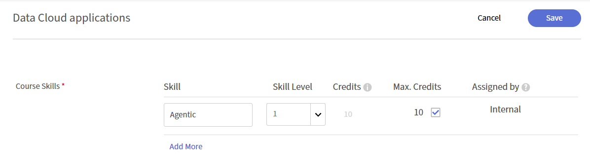
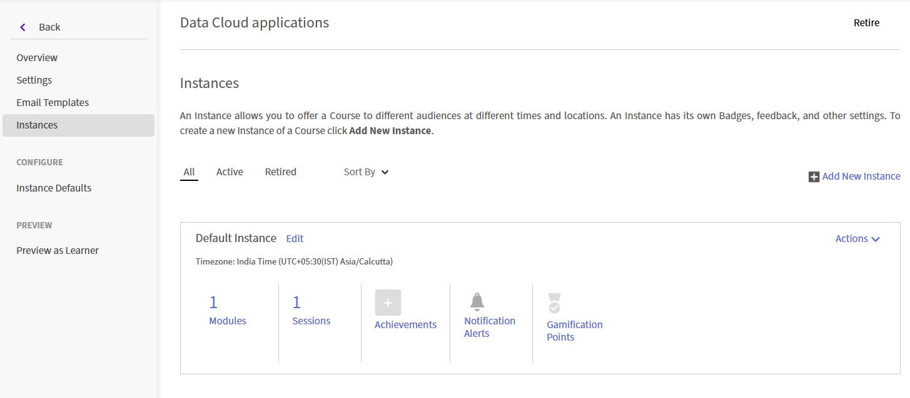
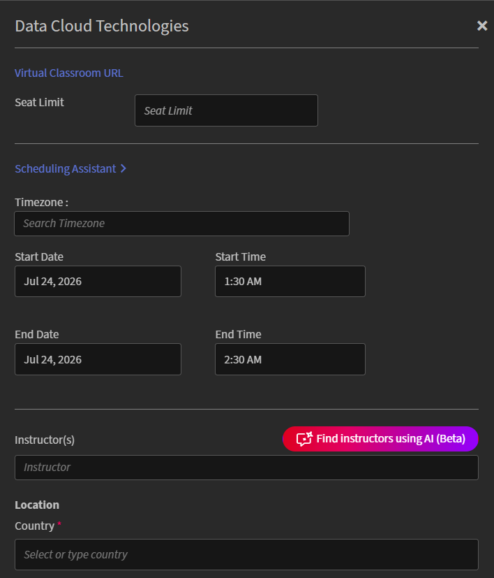

# 建立 Live Hub 工作階段

使用 Live Hub 在 Adobe Learning Manager 課程中提供由講師主導的即時訓練。 你可以將 Live Hub 課程與自學內容結合，打造混合式學習體驗。

當您將虛擬教室模組新增至課程時，請選擇將承辦線上課程的虛擬訓練工具。 您可以選擇 **Live Hub，Adobe** 內建的 AI 虛擬訓練解決方案，或使用外部供應商，例如 **Adobe Connect**。

>[!NOTE]
>
> 只有在您的管理員已在 Live Hub 設定中啟用 Live Hub 時，Live Hub 才會以 Live Virtual Training Tool 選項的形式出現。 如果未啟用，請改用外部提供者，例如 Adobe Connect。 請參閱 [「啟用 Live Hub](../administrators/feature-summary/enable-live-hub.md) 」以取得更多資訊。

建立 Live Hub 課程時，您可以：

* 為課程新增一個或多個 Live Hub 課程。

* 手動選擇講師，或使用AI輔助的講師推薦。

* 以單一預設實例設定課程，或為不同排程或受眾建立多個實例。

本文說明如何建立 Live Hub 課程、指派講師及設定課程實例。

## 建立 Live Hub 課程

當您新增虛擬教室模組時，會自動建立預設實例。 當您想為所有學習者提供單一課程或標準時間表時，這很有用。

建立 Live Hub 課程的方法如下：

1. 以作者身分登入 Adobe Learning Manager。

1. 選擇 **「建立課程**」。

1. 在 **課程目錄** 頁面，選擇 **新增**，然後輸入下列資料：

   1. 課程名稱

   1. 簡要介紹

   
   *在新增模組到課程前，請先輸入課程名稱及簡要說明。*

1. 在模組區段中選擇&#x200B;**「**&#x200B;內容&#x200B;**」>**「新增模組&#x200B;**」。  **&#x200B; **「選擇模組類型**」彈出視窗會出現。

1. 選擇 **虛擬教室** 並輸入課程詳細資訊，包括課程名稱、描述、時區、開始與結束日期，以及開始與結束時間。

1. 在 Live Virtual Training Tools 中選擇 **Live Hub**。**&#x200B;**

   
   *選擇 Live Hub，以啟用本次課程的 AI 驅動講師推薦。*

1. 使用下列其中一個選項新增講師：

   1. 在「 **講師」** 欄位中輸入講師名稱。

   1. 選擇 **「使用 AI** 尋找講師」以檢視 AI 推薦的講師。 請參閱 [「使用講師搜尋](#add-instructors-using-instructor-finder) 器新增講師」以取得更多資訊。

1. 選擇 **「新增** > **儲存**」。

1. 在 **課程技能** 區段選擇所需技能。

1. 選擇技能 **等級**，然後檢視或更新 **最大點數**。

   
   *指定一項技能與技能等級，以定義學習者完成課程後可獲得的學分。*

1. 選擇 **「儲存** > **發佈**」。 課程已在 Adobe Learning Manager 中成功建立。

## 建立課程實例

管理員可以建立一個或多個課程實例，以提供給不同的受眾、時間表或地點。 每個實例都有自己的課程細節，因此你可以為同一課程的每個實例指派不同的講師、Instructor Finder 推薦以及時間安排。

建立課程實例的方法如下：

1. 以作者身分登入 Adobe Learning Manager。

1. 開啟課程，然後從左側面板選擇 **「實例** 」。

   
   *當您新增虛擬教室模組時，預設實例會自動建立。*

1. 選擇 **新增實例**。

1. 輸入 **實例名稱**、 **開始日期**&#x200B;及 **完成截止日期**。 選擇 **「顯示更多選項** 」以設定其他設定。

   
   *輸入實例名稱、開始日期及完成截止日期以建立新課程實例。*

1. 選擇「 **儲存**」。   新實例會被加入 **實例** 清單。

   
   *新實例會與預設實例並列出現在實例清單中。*

1. 在「會話」下&#x200B;**選擇編號以檢視**&#x200B;會話詳細資訊&#x200B;**。**

   
   *課程詳細資料顯示哪些時間、講師及地點欄位仍需設定。*

1. 選取工作階段詳細資料旁的編輯（鉛筆）圖示以開啟工作階段設定面板。

   
   *為特定課程實例設定排程、講師及地點。*

1. 在「 **講師** 」欄位中，手動輸入姓名，或選擇 **「使用 AI** 尋找 AI 推薦講師」。 請參閱 [「使用講師搜尋](#add-instructors-using-instructor-finder) 器新增講師」以取得更多資訊。

1. 輸入 **位置** 詳細資訊，然後選擇 **「儲存**」。 課程內容會更新，包含已設定的時間、講師及地點詳細資訊。

## 使用 Instructor Finder 新增講師

與其手動搜尋並新增講師，不如使用 **Instructor Finder** 獲取由 AI 驅動的講師推薦。 Incorpor Finder 會根據課程細節與所需技能配對教師，同時考量機構的假期行事曆、教師可用時間及教師使用情況，以推薦最適合的教師。 請參閱 [「新增與管理講師」](./instructor-management.md) 以取得更多資訊。

>[!NOTE]
>
> 僅當您的管理員在 Live Hub 設定中啟用了講師搜尋助理時，才會出現 Instructor Finder Finder。 請參閱 [「啟用 Live Hub](../administrators/feature-summary/enable-live-hub.md) 」以取得更多資訊。

使用 Instructor Finder 新增講師的方法如下：

1. 前往&#x200B;**虛擬教室**&#x200B;模組中的&#x200B;**講師**&#x200B;區段。

1. 選擇「 **使用 AI** 尋找講師」。   **AI 助理**&#x200B;面板會在右側開啟。

   
   *利用 AI 助理面板，根據課程細節獲得講師與時段推薦。*

1. 檢視推薦的講師名單。

1. 前往您想要指派的講師，然後選擇 **新增**。   所選講師會以標籤形式加入講 **師** 欄位。

## 為大型課程建立課程 {#create-large-session}

Live Hub 支援最多 5,000 名參加者的大型場次。 當您建立具有此容量的課程時，Live Hub 會自動為大型觀眾設定房間並套用相應的功能限制。

建立大型工作階段的方法如下：

1. 以作者&#x200B;**身分登入 ALM**。
1. 在課程目錄&#x200B;**頁面選擇**「新增&#x200B;**」。**
1. 輸入課程名稱與說明。
1. 在模組區段選擇&#x200B;**「**&#x200B;內容&#x200B;**」>**「新增模組&#x200B;**」。**&#x200B;**「選擇模組類型**」彈出視窗會出現。
1. 選擇 **虛擬教室** 並輸入課程詳細資訊，包括課程名稱、描述、時區、開始與結束日期，以及開始與結束時間。
1. 在 Live Virtual Training Tools 中選擇 **Live Hub**。**&#x200B;**
1. 選擇 **啟用 5000 名與會者容量**。 若未啟用此選項，該場次最多可支援 1100 名與會者。

   

1. 選擇 **「儲存** > **發佈**」。

### 大型工作階段可用的功能

當講師開啟課程時，會議室設定顯示會適用大型課程限制。

| 特色 | 大型會話中的行為 |
|---|---|
| **與會者** | 大型場次最多可容納 5,000 名與會者。 一旦場次達到此上限，其他參與者將無法加入。 |
| **攝影機** | 最多可有 10 位講師同時開啟攝影機。 學習者無法開啟攝影機。 如果攝影機上限被觸及，當另一位講師嘗試開啟攝影機時，會出現訊息。
同時提出的相機請求會以批次形式處理。 因此，啟用攝影機的數量可能會超過設定的限制。 然而，相機按鈕工具提示仍持續顯示設定的限制。 |
| **麥克風** | 最多可同時讓 20 位與會者取消靜音麥克風。 如果達到麥克風上限，當另一位與會者嘗試取消靜音時，會出現訊息。
同時發出的麥克風請求會以批次形式處理。 因此，未靜音的參加者人數可能會暫時超過設定的限制。 |
| **分組討論室** | 分組討論室圖示仍然可見，但講師無法啟動分組討論室。 當他們嘗試啟動時，會出現訊息。 |
| **螢幕共享與白板** | 只有講師才能分享螢幕並使用白板。 講師無法將這些權限授予學習者。 |
| **私人聊天** | 學習者可以向講師發送私人訊息，但不能向其他學習者發送私人訊息。 |
| **輸入指示器** | 在大型工作階段中，輸入指示器不會顯示。 |
| **聊天、反應、提問，以及舉手** | 系統會以批次處理這些互動，因此它們可能會在短暫延遲後出現。 Live Hub 也會將反應分組，並一次顯示有限數量的反應。 |
| **聊天記錄** | 當聊天紀錄過大以維持會話穩定性時，系統會自動移除較舊的聊天訊息。 |
| **投票、測驗、錄音與出席** | 這些功能運作方式與一般會議相同。 |
| **AI 功能** | <ul><li>系統會偵測聊天中的問題，並在問題&#x200B;**面板中顯示，**&#x200B;但問題可能會在短暫延遲後出現。</li><li>與分組討論室相關的 AI 功能無法使用，因為大型分組會議不支援分組討論。</li><li>其他 AI 功能則與一般遊戲模式相同。</li></ul> |

>[!NOTE]
>
>若不啟用 **5000 名與會者容量** 選項，一般場次最多可支援 1,100 名與會者、50 台攝影機及 20 位未靜音參與者。

## 報名學習者參加課程

學習者可透過以下兩種方式報名Live Hub課程：

1. **管理員**&#x200B;會根據組織需求為學習者報名課程。請參閱 [「建立課程實例與學習路徑](https://experienceleague.adobe.com/zh-hant/docs/learning-manager/using/admin/courses) 」以取得更多資訊。

1. 學習者可直接從 **目錄** 頁面報名課程。 若課程設定為自我報名，學習者會立即註冊，並可從 **「我的學習」**&#x200B;存取課程。 查看 [「我的學習」](https://experienceleague.adobe.com/zh-hant/docs/learning-manager/using/learner/courses) 以取得更多資訊。

報名後，學習者會被加入課程，並在其 Adobe Learning Manager 帳戶中收到通知。 根據帳號的電子郵件通知設定，學習者也可能透過電子郵件收到加入課程的邀請。

## 自訂 Live Hub 會議室品牌

管理員可以自訂 Live Hub 會議室的外觀，使其與組織品牌形象相符。 使用 **Adobe Learning Manager 的主題** 設定，在 Live Hub 的各個工作階段套用品牌色彩、標誌及視覺樣式。

客製化品牌塑造有助於創造一致的學習體驗，並確保現場訓練課程能反映貴組織的身份認同。

如需更多關於設定主題的資訊，請參閱 [「色彩主題」](../administrators/feature-summary/themes.md#color-themes) 文章。
