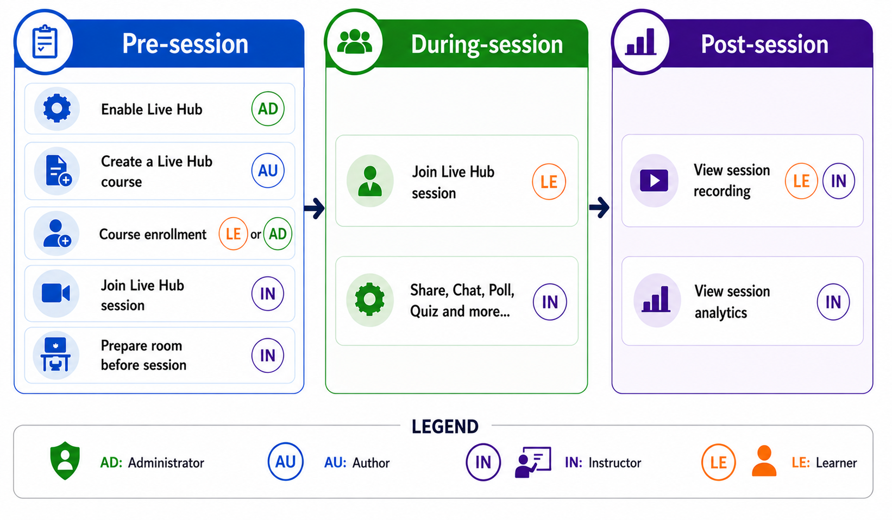

# 開始使用 Live Hub

>[!IMPORTANT]
>
>Live Hub 目前正處於 Prime 客戶的測試階段。 Beta 版本可能存在缺陷，且以「現狀」提供，且不附帶任何保證。 Adobe 完全擁有是否將測試版功能公開提供的決定權。 Adobe 無義務維護、修正、更新、變更、修改或以其他方式支援（透過 Adobe 支援服務或其他方式）測試版功能。 若測試版功能正式上線，可能會受到額外條款與條件的限制，包括適用費用。 測試版功能如有變更，恕不另行通知，包括停產。 建議客戶謹慎行事，切勿依賴測試版功能的不中斷或無錯誤運作或效能。 因此，任何使用測試版功能均需自行承擔風險。 隨著功能演進，產品功能及相關文件可能會有所變化。 本文件反映目前的測試版經驗，不應視為最終或完整的產品文件。

Adobe Learning Manager 中的 Live Hub 讓組織能直接在平台上提供由講師主導的即時訓練，免除核心課程交付所需的外部工具。

它為講師與學習者提供無縫的瀏覽器體驗，將課程進行、協作與參與工具整合於單一環境中。 這種整合式方法幫助組織簡化訓練執行流程、降低行政負擔，並持續掌握學習者在學習過程中的參與情況。

許多組織依賴獨立工具來管理課程、課程進行與協作。 這可能帶來以下挑戰：

- 在多個平台之間切換進行訓練。
- 額外的設定與設定需求。
- 對學習者參與度與參與度的能見度有限。

Live Hub 透過將課程交付、協作、互動與追蹤整合於 Adobe Learning Manager 中的統一體驗，來解決這些挑戰。

在我們深入步驟流程之前，先來一段簡短的導覽影片，讓你對 Live Hub 有個概覽。

>[!VIDEO](https://video.tv.adobe.com/v/3502433)

## 什麼是 Live Hub

Live Hub 是一款內建的虛擬訓練解決方案，讓您能夠：

- 在 Adobe Learning Manager 中建立並進行即時訓練課程。
- 在同一個地方管理講師、學習者與課程。
- 使用整合工具進行溝通、協作與參與。
- 在不切換系統的情況下追蹤參與度與績效。

與第三方整合不同，Live Hub 完全嵌入學習工作流程中，提供更統一的體驗。

## Live Hub 的運作方式

提供 Live Hub 課程涉及四個角色，每個角色負責工作流程中不同的部分：

- **管理員**：為 Learning Manager 帳戶啟用 Live Hub。 請參閱 [「Live hub session](./administrator.md) 中的管理員」以取得更多資訊。
- **作者**：創建 Live Hub 課程。 查看 [Live Hub 會話](./authors-in-live-hub-session.md) 中的作者以取得更多資訊。
- **講師**：準備教室、主持課程、引導學習者，並檢視錄音與分析資料。 請參閱 [Live Hub 中的](./instructors-in-a-live-hub-session.md) 講師課程以取得更多資訊。
- **學習者**：加入課程並參與聊天、投票、測驗、白板及分組討論等活動。 請參閱 [「Live Hub 課程](./learners-in-live-hub-session.md) 中的學習者」以取得更多資訊。

## Live Hub 工作階段工作流程

Live Hub 的課程分為三個主要階段：會前&#x200B;**階段、**&#x200B;會話&#x200B;**中階段以及**&#x200B;後階段&#x200B;**。**&#x200B;每個階段都包含管理員、作者、講師與學習者的特定任務，以確保順利的學習體驗。

| **舞台** | **主要活動** |
|---|---|
| **會前** | 管理員會 [確認系統需求](./system-requirements-for-live-hub.md) 是否符合，並為 [該帳戶啟用 Live Hub](../administrators/feature-summary/enable-live-hub.md) 。 作者 [建立 Live Hub 課程](create-a-live-hub-session.md)，學習者可以自行報名課程，或由管理員為他們報名。 講師會 [為即將到來的課程配置版面](./understand-the-live-hub-layout.md)、內容與互動活動，為教室做準備。 |
| **會話中** | 講師提供現場課程，並透過聊天](about-the-chat-panel.md)、[投票](./about-the-polls.md)、[測驗](./about-the-quiz.md)、[白板](./about-the-whiteboard.md)、[螢幕分享](./about-the-screen-sharing.md)及[分組討論等](./about-the-breakouts.md)功能[吸引學習者。學習者會在整個課程中參與這些活動。 講師可以 [錄製課程內容](./record-a-session.md) ，讓學習者日後能檢視。 |
| **會後** | 講師檢視課程錄影、出席報告及 [參與度分析](./view-the-session-dashboard.md) ，以評估學習者參與度並評估課程成效。 學習者可以透過主題式錄影](./view-recordings-as-a-learner.md)檢視重溫課程，[該檢視將錄影拆分為可導覽的主題，每個主題都有標題、概述與備註，方便他們直接跳到任意主題或閱讀內容，而非觀看。 |

>[!NOTE]
>Live Hub 也可在 Adobe Learning Manager 行動應用程式中使用，但功能有所限制。 支援行動裝置功能。 請參閱 [「以學習者](./live-hub-mobile-experience-for-learners.md) 身分在行動裝置上使用 Live Hub」以取得更多資訊。 若要優化您的 Live Hub 體驗，請參閱 [Live Hub 工作階段](./best-practices-for-a-live-hub-session.md)的最佳實務。