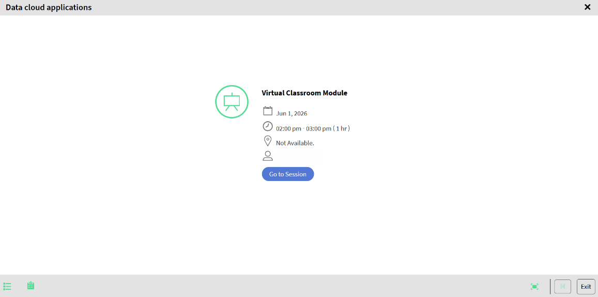

# 以學習者身分加入 Live Hub 課程

學習者可直接從所報名課程加入 Live Hub 課程。 加入後，你將透過聊天、投票、測驗、白板和分組討論室參與線上訓練。

## 加入本次工作階段

1. 登入 Adobe Learning Manager。

1. 前往&#x200B;**我的學習。**

1. 選擇已報名的課程。

   
   *選擇「前往會話」以開啟 Live Hub 加入前的畫面。*

1. 選擇 **「開始** 」> **前往「工作階段**」。 Live Hub 加入介面隨即開啟。

1. （選用）測試麥克風並套用虛擬背景。 請參閱 [「在 Live Hub](./setup-pre-join-screen-in-live-hub.md) 中設定加入前畫面」以取得更多資訊。

1. 選擇 **「**&#x200B;加入」。
