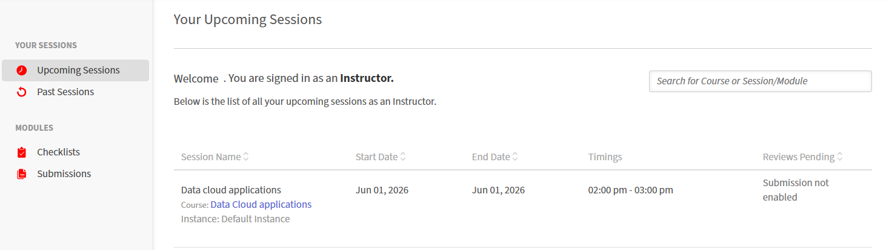
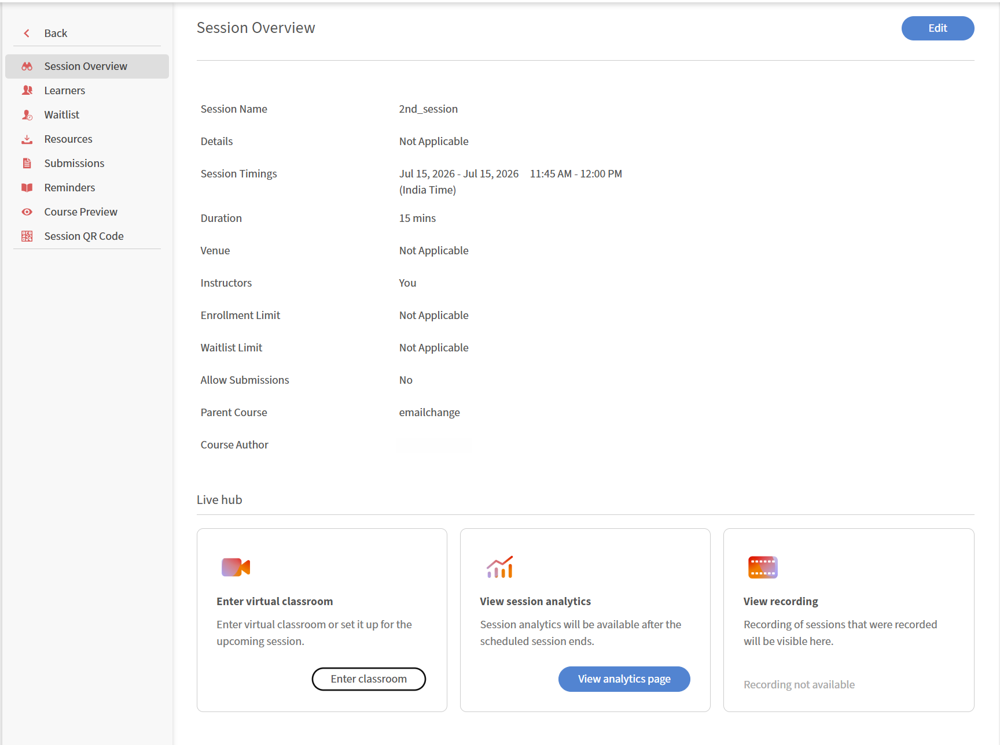
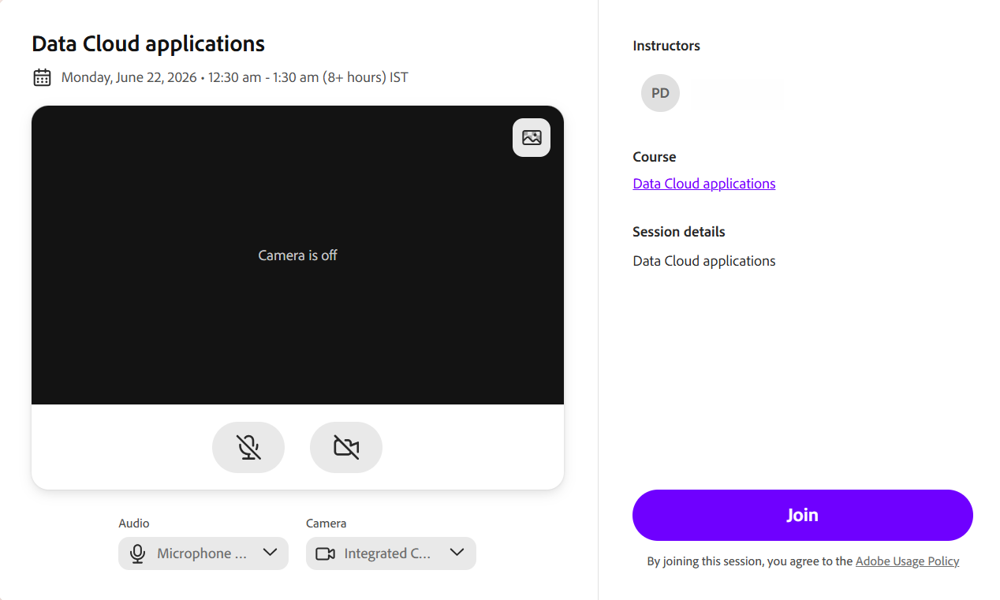

# 以講師身份加入 Live Hub 課程

講師可以在預定開始時間前進入虛擬教室，準備教室、設定學習者權限、字幕、投票、小測驗與分組討論，並在學習者抵達前自行設定音訊與視訊。

## 加入本次工作階段

講師可以在排定課程開始前加入教室，準備課程並在學習者加入前設定所需設定。

1. 登入 Adobe Learning Manager。

1. 從「即將進行的會議&#x200B;**」中**&#x200B;選擇排程的 Live Hub 工作階段。

   
   *選擇「即將進行的課程」以開啟教室加入 URL。*

1. 從列出的會話中選擇該會話。   **會話概覽**&#x200B;頁面隨即開啟。

   
   *會話總覽頁面會顯示進入 Live Hub 會話的選項。*

1. 從 Live 中樞選擇 **「進入教室** 」。   Live Hub 加入介面隨即開啟。

   
   *Live Hub 的預先加入畫面。*

1. （選用）測試麥克風並套用虛擬背景。 查看 [「在 Live Hub](./setup-pre-join-screen-in-live-hub.md) 中設定加入前畫面」以取得更多資訊。

1. 選擇 **「**&#x200B;加入」。
