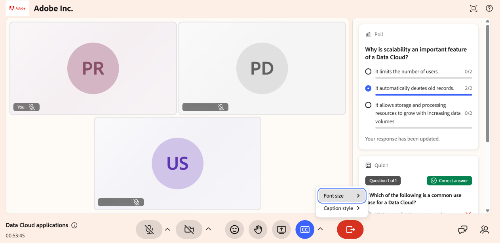

# 以學習者身分管理隱藏字幕

隱藏字幕會將語音內容以螢幕文字形式顯示，讓您在嘈雜環境中或偏好邊聽邊讀時，更容易跟上 Live Hub 的進度。 您可以透過控制列中的隱藏字幕（CC）按鈕自行控制字幕。 本指南說明如何作為學習者顯示、調整及隱藏字幕。

>[!NOTE]
>
>說明文字會以講師為本次課程選擇的語言顯示。

## 顯示隱藏字幕

您可以在工作階段以自己的檢視方式顯示隱藏字幕。 字幕會隨著參與者發言即時更新，讓你能以文字形式跟上對話內容。 每位參與者可依照自己的偏好選擇是否顯示字幕。

若要顯示字幕，請在控制列中選取隱藏字幕（**CC）**&#x200B;按鈕。

*選取 CC 圖示以顯示工作階段中的隱藏字幕。*

## 變更隱藏字幕的外觀

您可以根據觀看需求自訂隱藏字幕的外觀，以提升可讀性。

變更標題外觀的方法：

1. 選取控制列中隱藏字幕（CC）按鈕旁的箭頭。

1. 選擇下列選項之一：

   1. **字體大小**：選擇隱藏字幕文字的大小。 可選的選項包括 **小型**、 **中型**&#x200B;與 **大型**。

   1. **標題樣式**：選擇顏色組合。 可用的組合包括&#x200B;**：黑底黑底**、**黃底黑底**、**黑底白底**、**黃底深**&#x200B;色，以及&#x200B;**藍底黃底。**

   
   *選取 CC 圖示旁的箭頭以變更字型大小與標題樣式。*
