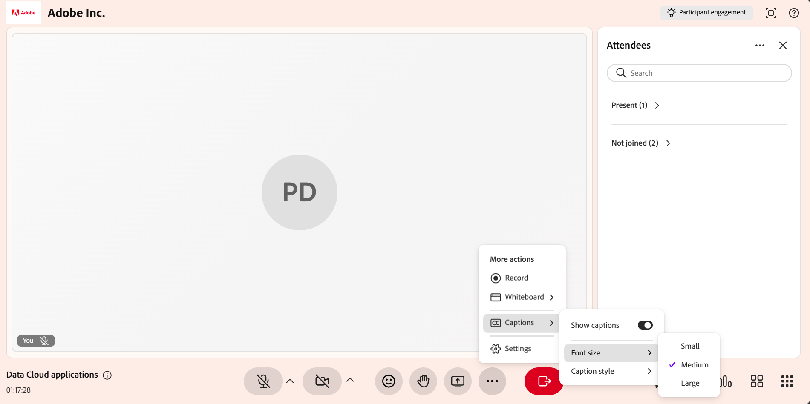

# 以講師身分管理隱藏字幕

隱藏字幕會將語音內容以螢幕文字形式顯示，讓 Live Hub 的課程更容易跟上，例如在簡報、回答參與者提問或在嘈雜環境中工作時。 作為講師，你可以在房間 **的「更多操作** 」選單中自行管理隱藏字幕。

本文說明如何在 Live Hub 工作階段中選擇字幕語言、顯示隱藏字幕，以及變更其外觀。

## 選擇標題語言

選擇在工作階段中顯示字幕所使用的語言。 所有參與者都會看到所選語言的字幕。

>[!NOTE]
>
>AI 驅動的功能僅適用於英語課程。 如果課程語言設定為其他語言，**&#x200B;**&#x200B;字幕標籤會顯示 AI 驅動的功能無法使用。

選擇標題語言的方法如下：

1. 從控制列選擇 **「更多動作** 」。
1. 選擇 **「設定**」。

   「房間設定」對話框隨即開啟。

1. 選擇 **「**&#x200B;字幕」。
1. 從「字幕顯示語言」下拉選單中選擇一種語言。
1. 選擇 **「完成**」。

## 顯示隱藏字幕

在 Live Hub 工作階段中顯示隱藏字幕，以即時檢視語音內容的逐字稿。

啟用隱藏字幕的方法：

1. 從控制列選擇&#x200B;**「更多選項」（⋯）。**

1. 選擇 **「**&#x200B;字幕」。

1. 啟用 **顯示字幕**。 隱藏字幕會顯示在介面底部。

    *啟用顯示字幕以顯示課程中的隱藏字幕。*

## 變更隱藏字幕的外觀

您可以自訂會話中隱藏字幕的外觀，以根據您的觀看需求提升可讀性。

變更標題外觀的方法：

1. 選擇&#x200B;**「更多選項」（⋯）。**

1. 選擇 **「**&#x200B;字幕」。

1. 選擇下列選項之一：

   1. **字體大小**：選擇隱藏字幕文字的大小。 可選的選項包括 **小型**、 **中型**&#x200B;與 **大型**。

   1. **標題樣式**：選擇顏色組合。 可用的組合包括&#x200B;**：黑底黑底**、**黃底黑底**、**黑底白底**、**黃底深**&#x200B;色，以及&#x200B;**藍底黃底。**

   
   *選擇「字型大小」以變更標題中顯示文字的大小。*
