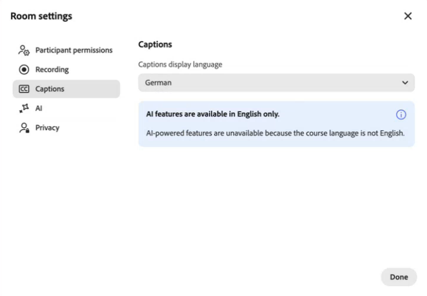

# 管理會議室設定

在 Live Hub 課程中，講師可透過教室內設定控制參與者的權限與教室行為。 這些設定讓您能管理參與者互動、錄影內容、隱私權及 AI 輔助功能，確保課程結構化且引人入勝。

## 存取客房內設定

1. 加入 Live Hub 工作階段。

1. 從控制列選擇 **「更多動作** 」。

1. 選擇 **「設定**」。   彈出視窗會顯示 **房間設定**。

   
   *房間設定彈出視窗顯示會話設定選項。*

1. 從左側面板選擇相關標籤：

   1. **參與者權限：控制**&#x200B;參與者在會話中可做的事，例如使用麥克風、相機、螢幕分享、白板及私人聊天。

   1. **錄製**：選擇錄製內容，包括參與者的視訊串流、投票以及聊天記錄。

   1. **字幕：**&#x200B;選擇在工作階段中產生字幕的語言。

   1. **AI**：開啟或關閉會議中的 AI 助理，包括問答助理、投票助理、分組監控代理及主題記錄。

   1. **隱私：**&#x200B;顯示或隱藏尚未加入會話的已註冊參與者。從左側面板選擇相關標籤：

1. 變更所需的設定。

1. 選擇 **「完成**」。

## 房間內設定選項

以下設定可協助您管理會話，控制參與者可做的事、錄影中擷取的內容、啟用的 AI 助理，以及參與者彼此的形象。

<table style="width:100%;">
<colgroup>
<col style="width: 26%" />
<col style="width: 30%" />
<col style="width: 42%" />
</colgroup>
<thead>
<tr>
<th><strong>類別</strong></th>
<th><strong>選項</strong></th>
<th><strong>說明</strong></th>
</tr>
</thead>
<tbody>
<tr>
<td rowspan="5">
<strong>參與者權限</strong>

<strong>預設</strong>：參與者可以使用麥克風、分享相機，並在聊天中發送私人訊息。
</td>
<td>使用麥克風</td>
<td>允許參與者在課程中發言。</td>
</tr>
<tr>
<td>使用相機</td>
<td>允許參與者開啟他們的影片。</td>
</tr>
<tr>
<td>分享畫面</td>
<td>允許參與者展示他們的螢幕。</td>
</tr>
<tr>
<td>使用白板</td>
<td>允許參與者在白板上繪圖與協作。</td>
</tr>
<tr>
<td>發送私人訊息</td>
<td>允許參與者在聊天中彼此發送私人訊息。</td>
</tr>
<tr>
<td rowspan="3">
<strong>錄音</strong>

<strong>預設：</strong>錄製時會錄下參與者的視訊串流和投票內容，但聊天記錄則不會。
</td>
<td>排除參與者的視訊串流</td>
<td>將參與者的視訊畫面排除在錄影之外。</td>
</tr>
<tr>
<td>排除投票</td>
<td>錄音中省略了民調。</td>
</tr>
<tr>
<td>包含聊天內容</td>
<td>將聊天記錄加入錄音中。</td>
</tr>
<tr>
<tr>
<td>
<strong>字幕</strong>

<strong>預設</strong>：英文
</td>
<td>字幕顯示語言</td>
<td>設定所有參與者產生字幕的語言。 字幕不會被翻譯，因此所選語言應與講師所使用的語言相符。</td>
</tr>
<td rowspan="4">
<strong>AI</strong>

<strong>預設：</strong>所有 AI 助理皆啟用，前提是管理員已啟用。
</td>
<td>啟用問答助理與答案生成</td>
<td>偵測聊天中參與者的問題，並根據上傳內容與課程文字稿草擬答案，供講師審閱、精煉並分享。</td>
</tr>
<tr>
<td>啟用投票助理</td>
<td>從課程內容與即時課程逐字稿、破冰活動或知識檢查建立投票，隨時可一鍵檢視並啟動。</td>
</tr>
<tr>
<td>啟用分組監控代理程式</td>
<td>會根據講師的目標閱讀每間教室的逐字稿，每隔幾分鐘張貼一張狀態卡，並提供每教室的討論摘要，以及跨教室的主題、決策與空白綜合摘要，即時進行回顧。</td>
</tr>
<tr>
<td>啟用錄製主題的產生</td>
<td>錄影會自動被劃分為帶有時間戳記和結構化筆記的命名主題，讓參與者可以直接進入需要的內容，或從筆記中學習，完全不看影片。</td>
</tr>
<tr>
<td>
<strong>隱私</strong>

<strong>預設值</strong>：所有已註冊參與者對所有人可見。
</td>
<td>顯示尚未加入的參與者</td>
<td>顯示尚未加入的已註冊參與者。 關閉它以隱藏它們直到它們加入。</td>
</tr>
</tbody>
</table>
