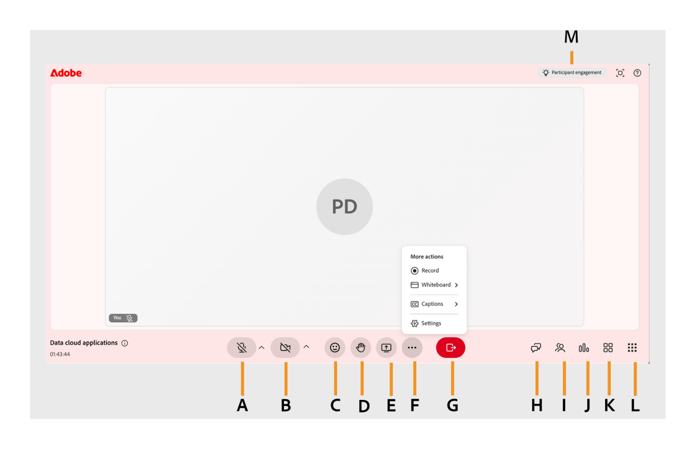

# 了解 Live Hub 的配置配置

在 Adobe Learning Manager Live Hub 中，課程教室的設計旨在協助講師與學習者在線上課程中有效協作。 版面包含多個面板與控制項，讓您能即時管理音訊、視訊、參與者及互動。

本文概述了 Live Hub 介面及其佈局。 它說明了會議室的不同組件，例如控制面板、與會者面板及其他關鍵元素，並附有標註的參考資料，幫助您導航介面。

*A：麥克風控制，B：攝影機選項，C：反應，D：舉手，E：分享畫面，F：更多操作，G：離開會議，H：聊天面板，I：與會者面板，J：投票與測驗面板，K：分組，L：更多應用程式，M：參與者參與度。*

## 教室佈局的關鍵組成部分

Live Hub 的版面配置以面板與工具列組織，協助講師與學習者有效互動、協作並管理課程。

### 控制列（底部工具列）

控制列可快速存取以下工作階段內的控制項與設定。

* **麥克風控制**：在錄音過程中開啟或關閉麥克風。 此服務對講師與學習者皆開放。 請參閱 [「加入前設定」畫面](./setup-pre-join-screen-in-live-hub.md) 以取得更多資訊。

* **影像控制**：啟用或關閉您的相機。此服務對講師與學習者皆開放。 請參閱 [「加入前設定」畫面](./setup-pre-join-screen-in-live-hub.md) 以取得更多資訊。

* **反應**：在會談中使用表情符號和快速回應來互動。 此服務對講師與學習者皆開放。 查看 [「關於舉手」並發送反應](./about-raise-hand-and-reactions.md) 以獲取更多資訊。

* **舉手**：表示你想提問或發言。 此服務對講師與學習者皆開放。 查看 [「關於舉手」並發送反應](./about-raise-hand-and-reactions.md) 以獲取更多資訊。

* **分享畫面**：在工作階段中呈現您的畫面（根據權限）。 此服務對講師與學習者皆開放。 請參閱 [「關於螢幕共享](./about-the-screen-sharing.md) 」以取得更多資訊。

* **更多操作**：存取以下額外工具與設定：

  * **字幕**：開啟或關閉即時字幕，可在工作階段以文字形式觀看語音內容。 查看 [隱藏字幕](./closed-captions-in-live-hub.md) 以獲取更多資訊。

  * **白板**：打開白板，與其他參與者進行視覺合作，例如繪畫、書寫或註解。 查看 [「關於白板](./about-the-whiteboard.md) 」以取得更多資訊。

  * **會議室設定**：設定會話設定，包括&#x200B;**參與者權限**、**錄製**、**AI 與**&#x200B;**隱私**&#x200B;選項，以控制參與者的存取、錄製偏好、AI 功能及參與者可見性。[請參閱以講師](./manage-settings.md)身分管理教室設定以取得更多資訊。

### 投票與測驗小組

「投票與測驗」面板協助講師推動參與度，並在整個課程中衡量學習者的理解度。 你可以：

製作互動投票，收集學習者回饋、收集意見，並鼓勵在課程中積極參與。 即時檢視回應，引導討論並根據需要調整您的表達方式。 請參閱 [「](./about-the-polls.md) 關於投票」以取得更多資訊。

設計測驗以評估學習者的理解程度、衡量知識記憶力並追蹤完成度。 即時監控學習進度與測驗答案，找出可能需要額外指導的領域。 請參閱 [「關於測驗](./about-the-quiz.md) 」以取得更多資訊。

### 與會者座談會

與會者面板列出本次會議的所有參與者。 你可以：

* 查看已報名的與會者，包括出席與缺席的參與者。

* 識別參與者角色，例如講師或學習者。

* 搜尋參與者。

* 即時監控出席情況。

此服務對講師與學習者皆開放。

請參閱 [「關於與會者」面板](./about-the-attendees-panel.md) 以取得更多資訊。

### 聊天面板

聊天面板讓參與者之間能即時溝通。 你可以：

* 在工作階段中傳送與接收訊息。

* 提出問題或回應討論。

* 與參與者互動。

此服務對講師與學習者皆開放。

請參閱 [「關於聊天」面板](./about-the-chat-panel.md) 以取得更多資訊。

### 分組小組

分組討論小組讓講師可以將參與者分成較小的小組，進行專注討論與合作活動。 你可以：

* 在會議期間建立並管理分組討論室。

* 可自動或手動將參與者指派到群組。

* 在不同房間間移動，監控並支援每個團隊。

* 活動結束後，請將所有參與者帶回主場次。

此服務對講師與學習者皆開放。

查看 [「關於分組活動](./about-the-breakouts.md) 」以取得更多資訊。

### 更多應用程式

開啟 **更多應用程式** ，以使用整合工具，延長會話期間的協作。 從這裡，你可以啟動 **Miro** 應用程式，即時協同作業共用的視覺看板。 使用 Miro 板，您可以：

* 在共享的無限畫布上一起腦力激盪想法。

* 隨著課程進行，添加便利貼、圖形與圖表。

* 在不離開會議的情況下，與所有參與者進行視覺化協作。

查看 [「關於白板](./about-the-whiteboard.md) 」以取得更多資訊。

### 參與者參與度

參與者參與度有助於即時追蹤參與者在會話中的活動與參與情況。 你可以：

* 檢視整體學習者參與程度。

* 根據互動如回應、反應與活動來監控參與度。

* 判斷學習者是否積極參與或需要關注。

查看 [「追蹤參與者參與](./track-the-participant-engagement.md) 度」以取得更多資訊。