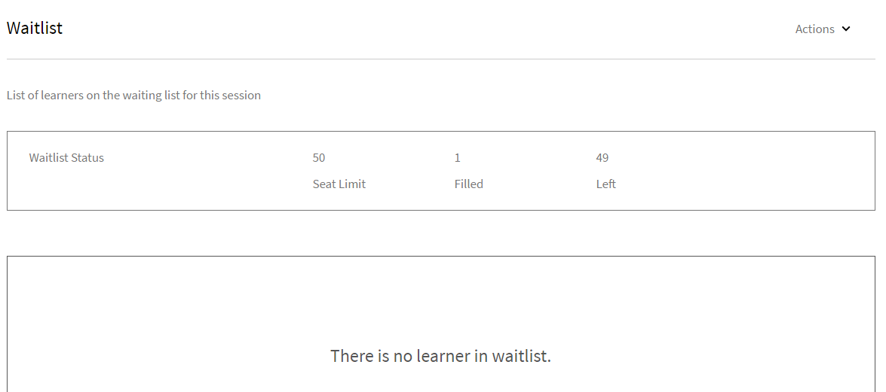
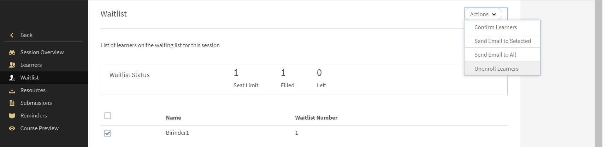
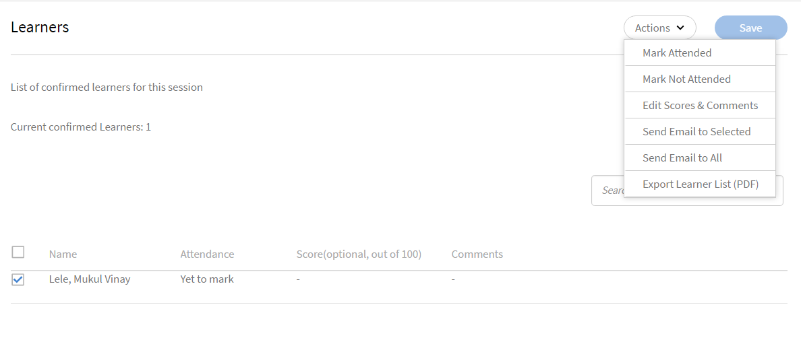
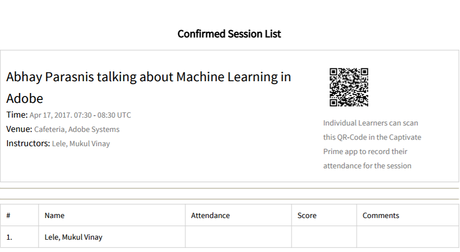
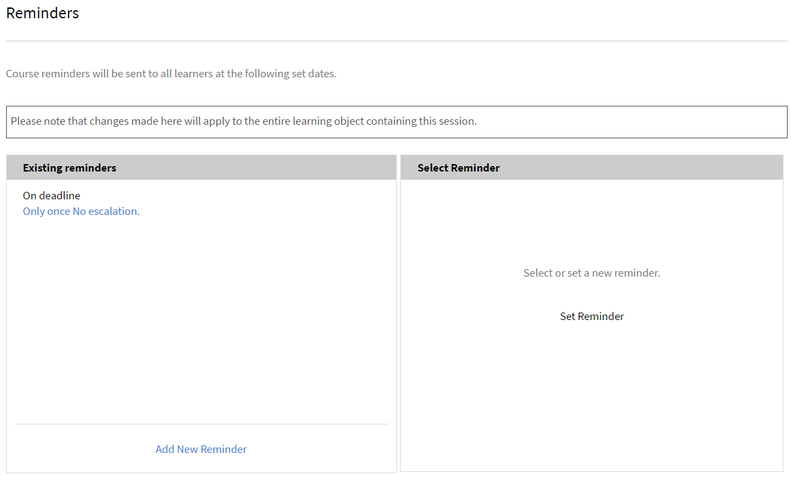
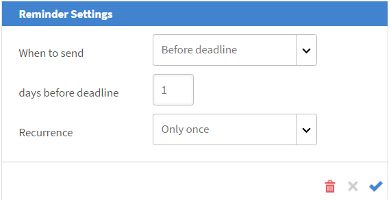
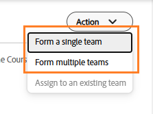

# 為您的課程管理學習者

閱讀本文，了解如何管理與會者、發送課程相關電子郵件及課程提醒。

## 查看有待審核的課程或模組 {#pending}

作為講師，你可以查看正在審核的課程或模組。

在「工作階段/模組」頁面，您可以看到「 **審核待處理** 」欄位，顯示該工作階段/活動的待審核數量。

## 管理您的課程等候名單 {#managewaitlistforyoursession}

當學員註冊你的模組時，你可以從「等候名單」頁面查看最新的報名與等待狀態。

1. 在講師應用程式左側導覽窗格中選擇「即將到來的課程」>「等候名單」。

   您可以查看座位限制、目前已滿的座位數，以及空缺座位數。 表格同時列出已被列入候補名單的學習者。 如果沒有候補名單排隊，這個欄位會是空白的。

   
   *檢視候補名單學習者*

1. 從「等候名單」表格中，選擇您想要確認的學習者或多位學習者。
1. 選擇「動作」>「確認學習者」。

   您已確認的學習者會被加入已確認的學習者清單。

講師有能力將學習者從課程中取消註冊。 這也會讓他們從相應的學習中退學。 選擇標籤 **[!UICONTROL Waitlist]** 。 請使用核取方塊選擇要取消報名的學習者。 若要取消註冊，請選擇 **[!UICONTROL Actions]** > **[!UICONTROL Unenroll learners]**。

*取消學生註冊*

### 候補名單報告

Adobe Learning Manager 的新功能 **[!UICONTROL Waitlist Report]** 允許講師下載所有課程實例的等候名單學習者名單。 講師可從 **[!UICONTROL Waitlist]** 頁面上的 **[!UICONTROL Session Overview]** 該區段存取此報告。

依照候補名單報告中可用的欄位：

* 課程名稱
* 實例名稱
* 實例 ID
* 實例狀態
* 使用者名稱
* 電子郵件
* 使用者唯一識別碼
* 註冊日期（UTC時區）
* 現況
* 候補名單號碼
* 候補名單限制
* 座位限制

從講師區段下載報告的方法如下：

1. 以 .（） 身份登入 **[!UICONTROL Instructor]**。
2. 從首頁選擇任一工作階段。
3. 在頁面中&#x200B;**[!UICONTROL Session Overview]**&#x200B;選擇該&#x200B;**[!UICONTROL Waitlist]**&#x200B;選項。
4. 選擇 **[!UICONTROL Actions]** > **[!UICONTROL Export Report]** 以下載報告。**[!UICONTROL Waitlist]**

## 標記您的場次出席 {#markattendanceforyoursession}

您可以在「學習者」頁面查看已確認參加課程的學習者數量、他們的姓名、學習者的出席狀態及其他詳細資訊。

1. 在左側導覽窗格中，點選「即將進行的學習者>課程」。
1. 從與會者清單中選擇「學習者」，並執行下列其中一項：

   * 若要標記出席，請點選「動作」>「標記出席」。 一旦狀態被標記為已出席，您就無法更改該狀態。
   * 若要標記未出席，請點選「操作」>「未出席」。
   * 若要因取消或其他原因刪除學員，請點選「操作」>「刪除學員」。

   學習者在出席狀態顯示為已出席之前，無法完成模組。

   
   *Mark 學習者出席*

### 下載QR碼以供學員報名及出席

講師可以下載分配課程的 QR 碼，讓學習者能註冊課程實例，並掃描 QR 碼來標記出席或完成。

這讓講師能獨立管理課程參與，無需管理員協助。

以下步驟適用於兩者：

* 實體教室課程
* 線上教室課程

對於實體課堂課程，身為講師，你必須產生正確的 QR 碼，貼在學習者正在上課的教室裡（或傳給大家），讓他們可以掃描 QR 碼並標記報名、出席，或兩者兼有，視 QR 碼而定。

對於線上課堂，身為講師，你可以透過郵寄、訊息系統或其他方式傳送產生的 QR 碼，讓學習者掃描 QR 碼並依 QR 碼標記報名、出席或兩者兼有。

#### 下載 QR 碼以供一次使用。

1. 以 **講師** 角色登入 Adobe Learning Manager。
2. 前往 **講師儀表板**。
3. 開啟相關的 **課程實例**。
4. 選取「 **工作階段** 」標籤。
5. 選擇分配給您的工作階段。
6. 選擇 **「會話 QR Code**」。
   

您可以下載以下 QR 碼：

* **註冊 QR 碼** – 允許學習者在課程實例中註冊
* **出席 QR 碼** – 標記本次會議的出席
* **註冊 + 出席 QR 碼** – 一次掃描即可註冊學習者並標記出席

QR 碼會以 PDF 格式下載，並可在課程中數位分享或顯示。

#### 學習者掃描 QR Code 時會發生什麼事

* 學習者使用行動裝置掃描 QR 碼。
* Adobe Learning Manager 會驗證學習者與課程。
* 根據 QR 碼類型：
  * 學習者已註冊於課程實例中，或
  * 本次課程的出席與完成情況都會被記錄

所有更新都會自動反映在學習者紀錄、成績單及報告中。

#### 筆記

* QR 碼僅提供給被指派參與該課程的講師使用。
* 為課程與課程階段設定的報名、出席及完成規則仍將持續適用。
* 現有的學習進度與報告工作流程保持不變。

#### 使用案例

* 舉辦大量現場課程的組織（例如為專業人士提供的產品訓練）可以讓講師列印針對課程的 QR 碼，一掃描即可報名並標記出席。

* 在零售、製造及醫療保健培訓中，學習者常可直接從現場或無需預先報名即可參加課程，門口可放置「報名+出席」QR碼。 這讓學習者能透過手機自行完成註冊與出席。

* 為合作夥伴或客戶舉辦的培訓活動，讓現場講師能輕鬆因應教室內的變動、額外課程或新增的參加者，而無需向管理員查詢新的 QR 碼。

### 行事曆邀請 {#calendarinvites}

* 當學習者或講師註冊參加教室或虛擬教室課程時，Learning Manager 會發送行事曆邀請（ICS 檔案）。
* 行事曆邀請函包含：

  * 課程日期與時間
  * 課程詳情
  * **行事曆描述中的直接連線** 連線

  

參與者可以直接從行事曆開啟行事曆活動並加入會議。

#### 從 Gmail 加入工作階段

1. 打開 **Google 日曆**。
2. 選擇工作階段事件。
3. 在活動詳情中，點擊「 **會話加入」連結**。
4. 課程可直接在 Adobe Learning Manager 或已設定的虛擬教室工具中開啟。

您不需要打開原始電子郵件即可存取會話連結。

#### 從其他行事曆用戶端加入工作階段

會議連結包含在行事曆活動主體中，並可從以下管道存取：

* Microsoft Outlook
* Apple 日曆
* 其他支援 ICS 檔案的行事曆應用程式

#### 筆記

* 行事曆邀請由 Learning Manager 自動產生。
* 行事曆邀請中的時區資訊會根據學習者所選擇的時區進行調整。
* 此增強適用於新產生的行事曆邀請。
* 管理員或講師不需要額外設定。

## 為學習者標記成功

講師可直接在學習者頁面將每位學習者的成功狀態標記為通過或不通過。 此功能讓教師能根據學習者的表現，準確記錄課堂或虛擬課堂的成果。

為學習者標誌成功：

1. 以講師身份登入 Adobe Learning Manager。
2. 在左側導覽窗格中選取 **[!UICONTROL Upcoming Sessions]** 。
3. 選擇 **[!UICONTROL Learners]**。
4. 選取學習者，然後選擇 **[!UICONTROL Actions]**。
5. 請從下列任一選項中選擇，以標示所選學習者的成功：

   * **[!UICONTROL Mark Attended and Pass]**：被標記為通過的學員已成功完成模組。
   * **[!UICONTROL Mark Attended and Fail]**：被標為不及格的學員已完成模組但未通過。

   
   _學習者頁面顯示「已出席」選單，並標示「已出席」及「通過與標記已出席」與「失敗」選項，以記錄學習者成果_

6. 在確認提示中選擇 **[!UICONTROL Yes]** 。

## 向學習者發送電子郵件 {#sendemailstolearners}

您可以向特定或所有與會者發送電子郵件。 當您想確認學習者的出席，或想發送有關課程的通訊時，「寄送電子郵件」功能非常有用。 您也可以使用「寄送電子郵件給所有人」選項，將作業與課程資料寄送給所有學習者，或發送一般性溝通訊息給所有學習者。

要向學習者發送電子郵件，請從講師應用程式的學習者頁面執行下列其中一項操作：

* 若要向特定與會者發送電子郵件，請選取該與會者，然後點選「動作」>「寄送電子郵件至所選」。
* 若要向所有與會者發送電子郵件，以寄送課程教材或作業，請點選「操作」>「寄送電子郵件給所有人」。

## 擷取邀請回應

講師僅 **[!UICONTROL Invite Reply]** 在 ACAP 管理員啟用此選項時，才能擷取學習者的邀請回應。 要啟用此功能，管理員需聯絡 learningmanagersupport@adobe.com 支援團隊。

完成後，您可以在該 **[!UICONTROL Learners]** 區塊查看邀請回覆。 前往任一會議，選擇 **[!UICONTROL Learners]**，並從下拉選單中選擇邀請回覆。

## 匯出學習者清單 {#exportinglearnerslist}

作為講師，您可以將出席者名單匯出為 PDF 格式，輕鬆標記所有學習者的出席情況。 若要匯出參加者清單，請從左側窗格的學習者中選取。 點選匯出學習者清單>操作（PDF）。

當您的場次參與者名單確認後，您可以將名單匯出為 PDF。 這份易於列印的 PDF 以表格形式顯示學習者資料。 接著，你可以在同一個 PDF 中標記出席或提供分數，並為學習者製作或提供筆記。

請注意這份 PDF 右上角有一個 QR 碼。 此功能允許個別學習者使用 Learning Manager 行動應用程式掃描代碼，以便學生標記出席情況。

*掃描 QR 碼以標示出席*

## 核准或拒絕提交 {#approveorrejectsubmissions}

如果學習者已上傳作業、報告或評量等文件，您可以在提交頁面查看這些文件。 你可以使用這些資料來評分學習者，並決定批准或拒絕該提交。

1. 從左側窗格，依照您的課程排程，點選「即將進行的會話」或「過去的會話」。
1. 點選您想查看提交資料的課程。

   從左側窗格，點選「提交」。

1. 您可以查看您所選擇課程中學習者的提交資料。 選取您想要核准或拒絕的提交，然後點選「核准或拒絕」。

   提交狀態會根據您的操作變更為「核准」或「已拒絕」。

## 為您的工作階段設定提醒 {#configureremindersforyoursession}

1. 從左側窗格點選「即將進行的會話」。
1. 點選您想要設定提醒的課程。 從左側窗格，點選「提醒事項」。
1. 在「選擇提醒」磁貼中，點選「設定提醒」。

   
   *為您的工作階段設定提醒*

1. 請執行以下操作：

   * 在「提醒設定」對話方塊中，設定何時將提醒傳送給學習者：截止日前、截止日時或截止後。
   * 在截止日前的天數欄位中，設定您希望在截止日前寄送提醒給學習者的天數。
   * 設定提醒的重複次數。

   
   *檢視提醒設定*

1. 請執行下列其中一項：

   * 點擊勾選號以儲存提醒。
   * 點擊叉號以取消提醒。

   自動課程提醒會在您提醒設定中指定的日期發送給所有學習者。

   如果您已經為各場次設定了提醒，可以在「現有提醒」圖塊下看到它們。 此外，你也可以在現有提醒中新增額外的提醒。

   若要刪除現有的提醒，請點選該提醒。 從彈出視窗中點擊刪除圖示（垃圾桶圖示）以刪除提醒。

## 在 Adobe Learning Manager 中建立並管理團隊

在課程實例中，從學習者手動建立團隊，然後新增、移動、移除、重新命名或刪除團隊，直到團隊鎖定為止。

作為講師，你為每個包含團隊提交模組的課程實例建立團隊。 任何被指派到實例的講師都可以管理其團隊。 Adobe Learning Manager 也能自動建立團隊。 組建團隊後，學習者可以提交作業，而您可以評估團隊提交的成果。

### 開啟 Teams 管理頁面

1. 在講師應用程式中，於左側導覽窗格選擇 **「Teams** 」。 該頁面列出學習者被指派至的團隊課程實例。

   

1. 要尋找課程，請搜尋該課程，或依最近更新日期排序清單。

1. 選取課程實例。 實例頁面顯示未指派的學習者與團隊。

### 使用規則建立團隊

1. 在實例頁面上，選擇未指派的學習者，以分成團隊。

1. 選擇一條規則。 選擇 **「動作** 」> **「組成單一團隊** 」或 **「組成多個團隊**」。

   

1. 如果您選擇 **「組成多個團隊**」，請輸入每個團隊的學習者人數。 該值必須為 1 或以上。 頁面會顯示將建立多少支隊伍。 例如，每組有 94 名學習者與 2 名學習者，總共創建了 47 個團隊。 如果人數大於已註冊學習者人數，則會出現錯誤訊息。 輸入較小的數字。

   

   如果您輸入的值大於已註冊學習者人數，系統會顯示錯誤訊息。

   

1. 選擇 **「**&#x200B;建立團隊」。 隊伍會顯示在「隊伍&#x200B;**」**&#x200B;標籤中。

   

1. 確認後儲存。 隊伍會顯示在「隊伍&#x200B;**」**&#x200B;標籤中。

此規則僅適用於您所選擇的未指派學習者。 若要重新集合所有人，請先刪除現有的團隊。 他們的學習者會回到未分配的名單。

選擇 **刪除**&#x200B;後，您會看到以下確認對話框：

選擇 **「刪除團隊**」。 所有學習者都會返回未指派清單。

### 建立單一團隊

1. 選擇未指派的學習者，以納入團隊。

1. 選擇&#x200B;**動作>****組成單一團隊**。會以指定人數的學習者組成一個團隊。

   

1. 拯救團隊。 一個團隊至少需要一位學習者，而一名學習者在實例中只能屬於一個團隊。

1. 請逐一重複這些步驟來建立團隊。

### 將學習者加入現有團隊

1. 選取要新增的未指派學習者。

1. 選擇將它們指派給現有團隊，然後選擇該團隊。

   

1. 確認你的選擇。 選擇 **「指派學習者**」。

### 移動或移除學習者

1. 開啟「團隊&#x200B;**」**&#x200B;索引標籤，然後展開團隊以檢視其成員。

1. 選取要移動的學習者。

   

1. 選擇移動它們，然後選擇目的地隊伍。

1. 若要從團隊中移除學習者，請選取該學習者並將其移除。 學習者返回未指派清單。

當團隊中沒有學習者時，該團隊會自動被刪除。

### 重新命名球隊

1. 在「團隊&#x200B;**」**&#x200B;標籤中，選取該團隊，然後選擇重新命名。

1. 選擇「動作&#x200B;**」>**「重新命名&#x200B;**」。**

   

1. 輸入一個獨特的名稱，例如 Team Alpha。

   

1. 選取「 **重新命名團隊**」。

名字不能重複，也不能使用系統生成的格式，例如 Team-1。

### 刪除團隊

1. 在「團隊&#x200B;**」**&#x200B;標籤中，選擇一個或多個團隊。

1. 選擇 **「動作** > **刪除**」。

1. 選擇 **「刪除團隊**」。

   

1. 確認。 刪除團隊中的學習者會返回未指派清單。

### 處理遲報與退選

* 在組建團隊後報名的學習者會出現在未指派名單中。 將學習者加入團隊。
* 如果所有團隊都已鎖定，請為學習者建立一個新的團隊。
* 退選的學習者會自動從其團隊中移除。 隊伍繼續進行，而空隊則被刪除。

### 疑難排解

**你無法選擇團隊或移動其成員。** 隊伍在首次提交後即鎖定，且鎖定適用於實例中的每個團隊模組。 若要解鎖團隊，請取消提交該提交。 檢視 **、評估及取消提交團隊提交的作品**。

**你不能改隊名。** 名稱已在使用，或與系統生成的格式相符。 輸入另一個名稱。

**建立團隊時會出現錯誤訊息。** 一個團隊成員不得超過100人。 減少每組成員數量。

**你無法為某個實例開啟 Teams 管理。** 自動創建隊伍可能正在執行。 存取完成後會恢復。

**你的存檔被拒絕，頁面會重新載入。** 先換另一位講師或自動工作儲存變更。 檢視已更新的團隊，然後重新執行您的變更。

**一支隊伍消失了。** 沒有學習者的團隊會自動被刪除。

## 評估並撤回團隊提交的作品

檢視團隊提交的檔案、完成評估計畫、核准或拒絕該工作，或將該工作撤回，以便團隊再次提交。

當你評估團隊提交時，結果會適用於團隊中的每一位成員，且每位成員都會收到通知。 只有被指派到該實例的講師才能進行評估。 個人提交的步驟相同，只是個人提交沒有隊伍資料。 先確保團隊存在。 檢視 **「**&#x200B;建立與管理團隊」。

自動組建的隊伍可以像手動組隊一樣編輯。

### 尋找提交

1. 在講師應用程式中，開啟提交區域，然後選擇 **「**&#x200B;團隊提交」。 選擇 **「單一提交** 」以支援單一學習者模組。

1. 要尋找模組，請依工作階段或模組名稱搜尋。

1. 選擇模組名稱。

   

1. 要縮小清單範圍，請依狀態篩選： **待提交**、 **待審核**、 **核准**、 **拒絕**&#x200B;或 **完成**。

1. 若要檢視團隊成員，請展開團隊。 會顯示姓名與電子郵件地址，且提交檔案的學習者擁有 **Submitter** 標籤。

1. 若要下載已提交的檔案，請為團隊選擇下載選項。

### 評估提交

1. 尋找處於 **待審核** 狀態的團隊。

1. 打開已提交的檔案並檢視內容。

1. 選擇 **「動作** 」> **「評估**」。

   

1. 完成評估計畫：

   * 回答所有必問的問題。
   * 對於客觀問題，請選擇一個選項。 在基於條件的評分中，分數會隨著你選擇而更新。
   * 主觀問題請輸入你的回答。
   * 在允許評論的情況下，請在問題或整份評析中補充意見。

   

1. 如果模組需要審查者核准，請選擇 **「核准** 」或 **「拒絕**」。 拒絕時記得留言，讓團隊知道該修正什麼。

   

1. 如果模組使用手動計分，請輸入總分。

   

   **可選**：透過選擇 **「在分數** 中新增私人筆記」切換，以輸入私人筆記。 私人筆記僅對被指派至該實例的講師可見。 即使您選擇 **「顯示留言**」，學習者也無法查看。

1. 提交評估報告。 選擇「****&#x200B;提交」。提交狀態會變更為 **「**&#x200B;已核准」。

   

其他講師也可以評估同一提交的作品，前提是該作品尚未獲得批准。 在提交文件獲得批准之前，將由較晚的評估取代先前的評估。

若模組不需審核者核准，則當團隊提交時，所有團隊成員都會完成該模組。 只會出現提交選項，之後無法編輯分數或備註。

在您核准或拒絕團隊提交後，學習者可以查看提交狀態及評估結果。

選擇評估結果時，會顯示評估參數與講師的評論。

## 檢視或變更評估

1. 找一個狀態為 **「拒絕」** 的團隊。

1. 若要開啟已完成的評估，請選擇&#x200B;**「檢視評估」。**

1. 若要再次評估，請選擇「重新評估」選項並提交您的變更。 你只能對被拒絕的投稿這麼做。 **已核准的提交無法更改**。

### 取消提交

當團隊需要重新提交、評估需要重新開始，或你需要更改鎖定的團隊時，請取消提交。 對於個別提交，您也可以利用此方法修正錯誤輸入的評估。

1. 找一個有提交作品的團隊或學習者。

1. 選擇 **「取消提交**」。

   

1. 輸入您的備註，然後選擇&#x200B;**「取消提交」。**

   

提交會被移除，狀態會回到「 **待提交**」。 團隊會解鎖，你可以編輯成員。 團隊成員會收到通知和電子郵件。 任何成員之後都可以再次提交，新檔案會取代先前的檔案。 您的新評估會取代先前的評估，且不會保留任何歷史紀錄。

團隊成員完成課程後無法撤回提交，因為完成後無法撤銷。