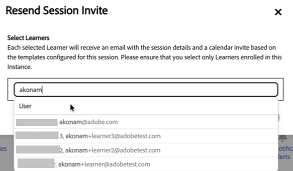
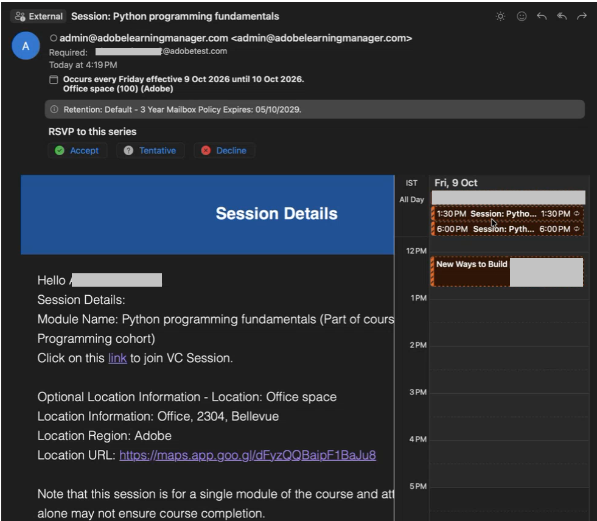

# 重新寄送會話邀請

## 概觀

>[!NOTE]
>
>重新觸發僅適用於虛擬教室（VC）課程。 其他模組類型，如課堂與自學（電子學習）模組則不支援。

學習者可能因多種原因錯過邀請。 透過 **「重新傳送** 」選項，作為擁有編輯課程權限的管理員，您可以在實例頁面開啟虛擬聽眾課程，搜尋學習者，並發送課程邀請電子郵件。 Learning Manager 會在報名事件流程之外，按需發送電子郵件。 學習者會收到課程詳細資訊和行事曆邀請，而報名狀態保持不變。

## 使用案例

以下是您會重新傳送會話邀請的使用情境。

* **找回錯過的邀請。** 重新寄出邀請給信箱已滿、郵件被送入垃圾郵件，或原始郵件未送達的學習者。
* **減少缺席的情況。** 請在會議開始前或當天重新傳送會議詳情及行事曆邀請。
* **避免使用報名變通方法。** 重新發送邀請，但不取消註冊並重新註冊學習者，確保註冊狀態和課程註冊保持完整。
* **減少支援工單數量。** 管理員自行解決「未收到邀請」的請求，無需介入支援團隊。

## 先決條件

* 這場會話是一場 VC 會議。
* 學習者已報名目標課程。 Learning Manager 只會將邀請寄送給已註冊於該課程的學習者。
* 該工作階段已經存在。 此功能不會建立或修改工作階段。
* 使用現有的會話邀請電子郵件範本。 此功能不會引入新的電子郵件範本。

## 支援的配置

| 商品 | 支援 |
|--------------------|-----------------------------------------------------------------------------------------------------------|
| 角色 | 擁有編輯課程權限的管理員。 負責他們所分配課程的講師。 |
| 目錄項目類型 | 課程與學習路徑 |
| 模組類型 | 虛擬教室（VC）課程 |
| 課程 | 目前及未來的場次。 過去的場次不被支援。 |
| VC 提供者 | 所有為本次會話設定的提供者，例如 Zoom、Teams 和 Adobe Connect |
| 電子郵件範本 | 為學習物件設定的範本包括：會話詳細資料、電子郵件及行事曆邀請 |
| 得獎者 | 已註冊於本次課程的個別學習者。 不支援使用者群組。 |
| 觸發點 | 手動，來自「重新傳送邀請」動作 |

經理角色在此版本中無法使用此功能。 這個選項對學習者和管理者隱藏。

## 存取「重新傳送工作階段邀請」動作

行動的地點取決於你的角色。

| 角色 | 在哪裡尋找動作 |
|---------------|-----------------------------------------------------------------------------------------------------------------------------------------------------------------------------------------------------------------|
| 管理員 | 在目錄中開啟課程或學習路徑，前往「實例」，然後開啟該實例。 在「工作階段」區段中，找到該虛擬工作階段並選擇「重新傳送工作階段邀請」。 您需要取得授權才能編輯課程。 |

## 重新傳送對話框

「重新傳送工作階段邀請」對話框包含以下元素。

| 元素 | 說明 |
|-----------------|---------------------------------------------------------------------------------------------------------------------------------------------------------------------------------------------------------------------------------------------------------------------------------------------------------------------------|
| 選擇學習者 | 一個搜尋欄位。 輸入學員的姓名或電子郵件地址以尋找學員，然後選擇該學員。 您可以選擇多位學習者。 備註說明每位選定學習者會收到兩封電子郵件：一封課程詳情電子郵件與一封行事曆邀請，依據為學習物件設定的範本而定。 |
| 取消 | 關閉對話框，但不發送任何電子郵件。 |
| 重新發送 | 將電子郵件寄送給所選學習者。 在你選擇至少一位學習者之前，這個按鈕會被停用。 |

>[!NOTE]
>
>搜尋僅匹配個別學習者。 您無法搜尋或選取使用者群組。

## 重新寄送會話邀請

以系統管理員身份完成以下步驟。

1. 以擁有編輯課程權限的管理員身分登入。
2. 前往 **「學習** > **課程**」。

   

3. 開啟您想存取的實例課程。

   

4. 導覽至您想存取的會話實例。
5. 在下方的 **「工作階段詳細資料** 」區段中，選擇 **「重新傳送工作階段邀請**」。

   

6. **「重新傳送會話邀請**」彈出視窗會開啟。

   

7. 搜尋您希望重新寄送邀請的學習者或學習者。

   

   

8. 選擇 **「重新傳送**」。 你會看到一則訊息，上面寫著：「課程邀請已發送給「x」學習者。」

   

9. 如果所選學習者中有來自其他課程，您將看到訊息：「X 所選學習者未報名此課程，已被跳過。」

   

10. 幾分鐘後，學員會收到一封包含課程詳情的電子郵件，其中包含加入課程的連結。

Learning Manager 會驗證每位所選學習者是否已註冊於目標課程，然後將現有課程邀請寄送給符合資格的學習者。

當 Learning Manager 接受請求時，對話框會關閉並顯示確認訊息：「邀請電子郵件正在寄送給學習者，以參加本次課程。 這可能需要一些時間才能完成。」 電子郵件通常會在幾分鐘內送達。

## 電子郵件內容

每位被選中的學習者都會收到課程詳細資訊、電子郵件以及該課程的行事曆邀請。 內容包括 VC 會話加入連結、日期與時間，以及會話詳細資訊。 電子郵件與原始課程邀請相同，因為 Learning Manager 使用相同的範本。

## 多重登錄行為

重寄是針對特定實例的。 如果學習者同時註冊於多個實例，從其中一個實例重新發送邀請只會針對該實例發送邀請。 它不會重新觸發學習者其他實例的邀請。

| 學員報名 | 動作 | 結果 |
|------------------------------------------------|------------------------------------------------|----------------------------------------------------------------------------------|
| 實例 A 與實例 B | 從實例 A 重新傳送 | 只有實例 A 邀請會被重寄。 |
| 僅限實例 A | 從實例 A 重新傳送 | 實例 A 邀請會被重寄。 |
| 與所選工作階段不同的實例 | 學習者會出現在課程層級搜尋中 | Learning Manager 會跳過所選課程的學習者，並顯示警告。 |

## 特定情境下的行為

| 劇情 | 行為 |
|--------------------------------------------------------|------------------------------------------------------------------------------------------------------------------------------------------------------------------------------------------------------------------------------|
| 該實例沒有 VC 工作階段 | 「重新傳送工作階段邀請」動作不可用。 |
| 該工作階段已經發生 | 動作場面無法使用。 Learning Manager 僅支援目前及未來的課程。 |
| 您選擇一位未註冊於本次課程的學習者 | 學習者搜尋涵蓋整個課程，因此您可以找到來自其他實例的學習者。 Learning Manager 會跳過未報名於所選課程的學習者，將邀請發送給其他人，並顯示警告。 |
| 一位學習者在多個實例中註冊 | Learning Manager 只會針對您所寄出的實例發送邀請。 它不會為其他實例發送邀請。 |
| 已選取學習路徑實例 | 動作的運作方式與關卡實例相同。 |

## 錯誤處理

如果錯誤導致 Learning Manager 無法發送電子郵件，對話框會顯示以下其中一則訊息。

| 狀況 | 訊息 |
|---------------------------------------|------------------------------------------------------------------------|
| 邀請電子郵件範本已停用 | 無法發送電子郵件：邀請電子郵件範本目前已停用。 |
| 任何其他錯誤 | 發送電子郵件時發生錯誤。 請稍後再試。 |

如果您選擇未註冊的學習者，Learning Manager 會顯示警告，表示這些學習者已跳過邀請。 它仍然會把邀請寄給已註冊的學習者。

>[!NOTE]
>
>電子郵件服務會在對話框關閉後，以非同步方式向 Learning Manager 回報交付狀態。

## 限制

* 您只能為當前及未來的場次重新寄送邀請。
* 僅使用已為學習物件設定的範本。 你不能選擇其他範本。
* 您可以一次只為一個會話重寄邀請。 不支援一次跨多個實例重傳。
* 您無法選擇使用者群組。 您只能選擇個別學習者。
* Learning Manager 僅向已註冊於所選課程的學習者發送邀請。
* 對話框不會顯示郵件的投遞狀態，也不會提供個別學習者的重試。
* 您無法從對話框中排定新工作階段或編輯現有工作階段詳細資訊。

## 疑難排解

| 症狀 | 可能的原因 | 動作 |
|---------------------------------------------------------------------|-------------------------------------------------------------------------------------------------------------------|---------------------------------------------------------------------------------------------------------------------|
| 「重新傳送邀請」動作無法顯示 | 這個模組不是 VC 課程，課程已經結束，或者你沒有權限編輯課程。 | 確認該工作階段是目前或未來的虛擬客戶工作階段。 請管理員驗證您的課程權限。 |
| 發送電子郵件後會出現警告 | 一位或多位被選中的學習者未參加所選課程。 | 檢查哪些學習者已註冊於該工作階段，並從正確的工作階段或實例重新發送邀請。 |
| 邀請寄送給錯誤的實例 | 學習者在多個實例中註冊，而您從另一個實例重新寄出邀請。 | 開啟學習者所需的實例，然後從那裡重新發送邀請。 |
| 會出現錯誤訊息「邀請電子郵件範本目前已停用」 | 該學習物件的邀請電子郵件範本已停用。 | 請管理員啟用範本，然後重新寄出邀請。 |
| 重寄的電子郵件看起來和原本的邀請一樣 | 這是預料之中的。 Learning Manager 會重複使用現有的 Session Invite 範本。 | 不需要採取行動。 |
| 您需要一次在多個實例間重新寄送邀請 | 這不被支援。 | 請分別從每個實例重新發送邀請。 |
| 您需要重新寄送教室或線上學習模組的邀請函 | 這不被支援。 重新觸發僅適用於 VC 會話。 | 這些模組類型沒有可用的動作。 |
| 一位學習者表示電子郵件未收到 | 該郵件仍在處理中、學員信箱已滿，或郵件被過濾為垃圾郵件。 | 等幾分鐘，請學習者檢查垃圾郵件匣並釋放信箱空間，然後重新寄出邀請。 |
