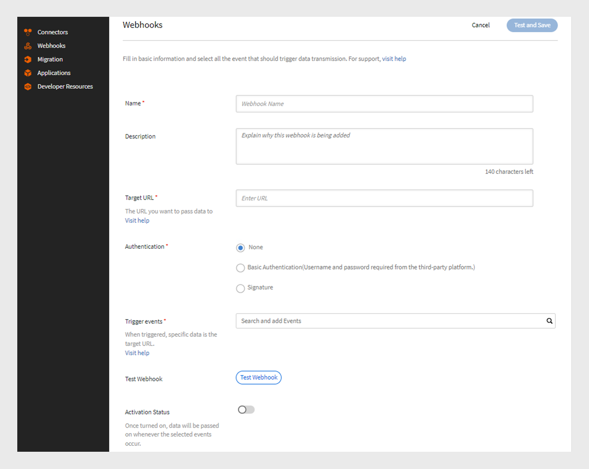
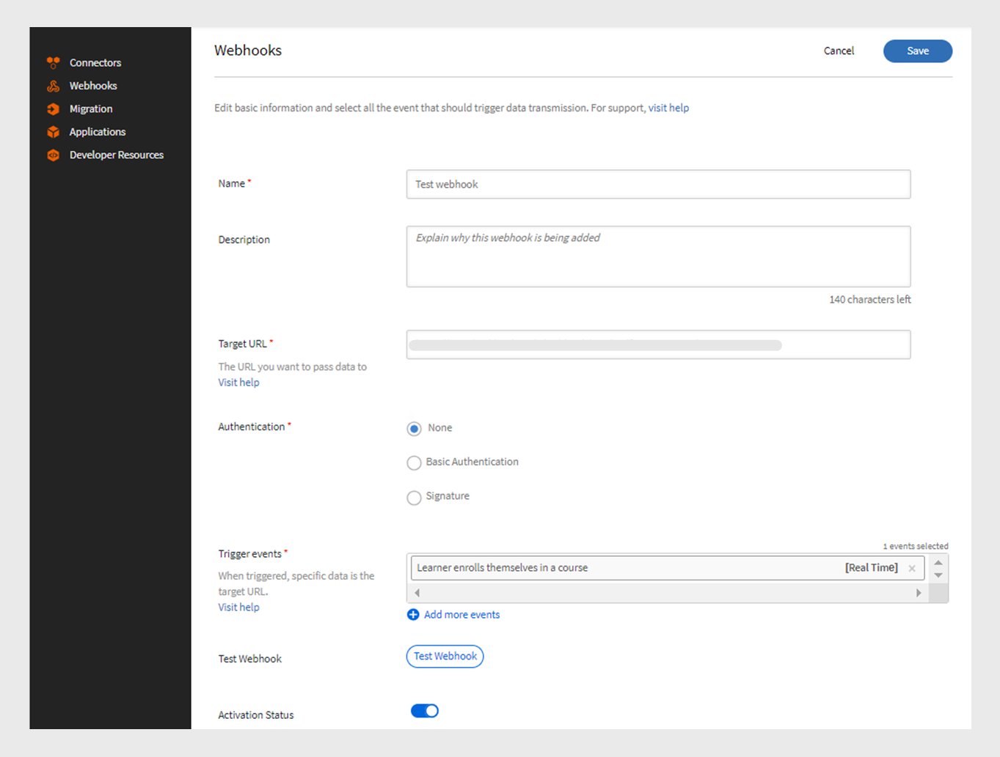
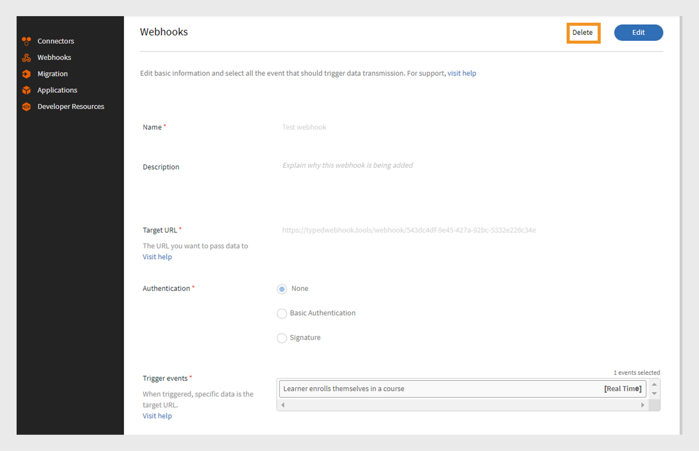
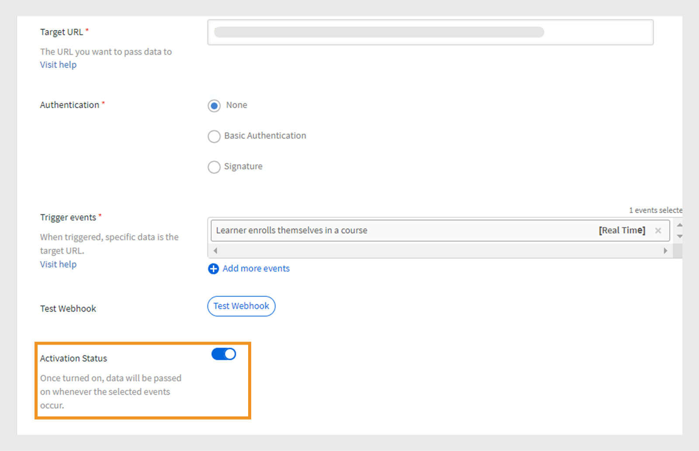

# Webhooks

## 簡介

Webhook 允許一個實體在特定事件發生時自動向另一個實體傳送即時資料或通知。 它能讓應用程式在不不斷請求的情況下，向其他應用程式提供資訊。 例如，如果使用者完成了學習管理系統（LMS）課程，webhook 就能自動將該資訊傳送到其他平台，例如 CRM 或報告工具。 Webhook 常用於整合，以自動化流程並減少系統間手動更新的需求。 透過提供回調 URL 來設定 webhook，並將資料傳送到那裡。

>[!NOTE]
>
>此功能在 FedRAMP 授權的環境中無法使用。 詳情請參閱 [FedRAMP 環境中](/help/migrated/feature-availability-in-fedramp-authorized-environment.md) 的功能可用性。

## Webhook 與 API 的比較

Webhook 和 API 都幫助系統彼此溝通，但它們的運作方式不同。 使用 API 時，資訊只會在使用者提出請求時才被分享。 例如，如果學習者需要課程進度資料，他們會向 API 發送請求，API 再提供相關資訊。 另一方面，Webhook 會在事件發生時自動立即傳送資料。 例如，若學習者完成課程，資料會立即傳送至監聽者網址，無需手動請求。

## 什麼是即時 API？

即時 API 讓應用程式能在事件發生時即時交換資料。 與等待使用者請求資訊的傳統 API 不同，即時 API 會在資料發生的瞬間分享。 Webhooks 作為即時 API，並在指定事件發生時立即協助分享資料。 即時 API 確保資料傳輸即時完成，無需任何手動請求，讓系統能即時保持最新狀態。

## Webhook 事件

Webhook 事件是指系統中發生的特定動作，會自動將資料傳送到監聽者 URL。 例如，當學習者報名課程時，會觸發 webhook 事件，並將報名詳情傳送至監聽者的 URL。

Webhook 事件分為兩大類：

* **即時事件**：事件會被即時處理並傳送到目標 URL
* **非即時事件**：事件會以批次方式處理，並在指定時間傳送，而非即時傳送

## 監聽者 URL

監聽器 URL 是一個端點或目的地，會在事件發生時接收資料資訊。 每當發生特定事件，例如使用者報名課程時，系統會自動將詳細資訊傳送至此網址，無需人工請求。 監聽者 URL 是所有這些更新傳送的地址。
Webhook 會以 JSON 格式傳送相關資訊。 以下是在 Adobe Learning Manager 中觸發的事件範例載荷：

```
{
  "accountId": 1010,
  "events": [
    {
      "eventId": "d5fb7071-10a9-46b2-9f9e-79dde346c052",
      "eventName": "COURSE_ENROLLMENT_BATCH",
      "timestamp": 1727414643000,
      "eventInfo": "1727414643000-047210-84242-0",
      "data": {
        "userId": 4279332,
        "loId": "course:7374992",
        "loInstanceId": "course:7376092_10250977",
        "loType": "course",
        "enrollmentSource": "ADMIN_ENROLL",
        "dateEnrolled": 1727414643
      }
    }
  ]
}
```

## 建立與管理 Webhooks – 整合管理員 {#create-manage-webhooks}

請依照以下步驟在 Adobe Learning Manager 中建立 Webhooks 整合：

1. 以 .s **[!UICONTROL Integration Admin]**&#x200B;登入
2. 在首頁，選取 **[!UICONTROL Webhooks]** > **[!UICONTROL Add Webhook]**。

   
   _新增 webhook_

3. 輸入 **[!UICONTROL Name]** Webhook 的 and **[!UICONTROL Description]** 。
4. 輸入監聽器 URL，作為 **[!UICONTROL Target URL]** 您想要傳遞事件資料的位置。
5. 選擇任一種驗證方法：Webhooks 中的驗證是一種安全方法，用來確保傳送到監聽者 URL 的資料來自受信任的來源。
   * **[!UICONTROL None]**：無需驗證。
   * **[!UICONTROL Basic]**：這是基於憑證的驗證。 輸入使用者名稱和密碼。
   * **[!UICONTROL Signature]**：系統會建立一個特殊簽章並將其加入 webhook 資料中。 接收端伺服器會檢查這些程式碼，以確保資料真實且未被更改。 產生簽名並用於驗證。 下載簽名為 JSON。
6. 從下拉選單中 **[!UICONTROL Trigger events]** 選取 Webhook 事件。

   >[!NOTE]
   >
   >您也可以從新增 Webhook 頁面選擇「測試 Webhooks」選項來測試 webhooks。

7. 勾選 **[!UICONTROL Activation Status]** 切換鍵以啟用 webhook。 啟用後，當所選事件發生時，資料就會傳遞。

>[!NOTE]
>
>您可以建立並管理最多 5 個 Webhook。

### 編輯 Webhooks – 整合管理

請依照以下步驟從 Adobe Learning Manager 編輯 Webhooks：

1. 以 **[!UICONTROL Integration Admin.]**
2. 在首頁選擇 **[!UICONTROL Webhooks]** 。
3. 選取您想編輯的 webhook。

   
   _編輯 webhook_
4. 選擇 **[!UICONTROL Edit]** 以修改 webhook 的詳細資訊，然後選擇 **[!UICONTROL Save]**。

### 移除 Webhooks – 整合管理員

請依照以下步驟從 Adobe Learning Manager 編輯 Webhooks：

1. 以 .s **[!UICONTROL Integration Admin]**&#x200B;登入
2. 在首頁選擇 **[!UICONTROL Webhooks]** 。
3. 選取您想要刪除的 webhook。
4. 選取 **[!UICONTROL Delete]** 以移除 webhook。


_移除 webhook_

### 停用 Webhooks – 整合管理員

請依照以下步驟停用 webhook：

1. 以 .s **[!UICONTROL Integration Admin]**&#x200B;登入
2. 在首頁選擇 **[!UICONTROL Webhooks]** 。
3. 選取您想編輯的 webhook。
4. 選取 **[!UICONTROL Edit]** 並停用 以 **[!UICONTROL Activation Status]** 終止 webhook。


_退休 webhook_

## 替代裝置的 Webhook {#webhooks-for-alternates}

ALM 提供專用的 webhook 事件，以支援自動化、整合以及與外部系統的同步。

這些事件讓外部消費者能可靠區分直接完成與透過替代關係獲得的完成。

### 概觀

當學習者透過替代或關聯完成課程時，ALM 會觸發一個與標準課程完成 webhook 不同的 webhook 事件。 這確保整合能在需要時對替代完成方式做出不同回應。

當發生回溯完成或追溯未完成時，Webhook 事件也會被觸發，涵蓋歷史更新以及關係變更。

### Webhook 事件行為

* 當學習者對目標課程獲得「透過替代完成」狀態時，會觸發一個獨特的 webhook 事件。
* 當學習者完成已設定的來源課程，並透過替代關係滿足目標時，會產生該事件。
* 此 webhook 不會因直接完成課程而觸發。
* 當啟用回溯完成或追溯未完成時，會為每位受影響的學習者及目標課程發出 webhook 事件。

### Webhook 有效載荷詳細資訊

替代完成 webhook 有效載荷包含以下關鍵屬性：

* **學習者識別碼**&#x200B;識別獲得替代完成的學習者。
* **原始課程**&#x200B;學習者直接完成的課程或學習路徑。
* **目標航線**&#x200B;透過替代關係標記為已完成的課程。
* **補全法**&#x200B;表示補完方法為替代方式。
* **完工日期**&#x200B;根據原始課程的完成日期推算。
* **關係類型**&#x200B;指定關係是否為交替關係。

對於追溯性未完成情境，webhook 事件表示已有的替代完成已被撤銷。

### 整合考量

外部系統可利用這些 webhook 事件來：

* 更新學習者紀錄
* 同步完成狀態
* 觸發通知或後續工作流程
* 維護審計追蹤以符合法規要求

Webhook 使用者應明確區分直接完成與替代完成。

替代完成不會獲得技能、徽章或遊戲化獎勵。 在下游系統中，回饋應被妥善處理。

## 自適應學習路徑的 Webhook

### 簡介

Adobe Learning Manager 提供 **webhook 事件**，當學習路徑（學習計畫）**的完成狀態**&#x200B;更新時，會通知外部系統。這讓您能在學習者的完成紀錄被回滾或重新計算時，同步下游系統（如人力資源、報告或分析平台）。

新增兩種 webhook 事件類型：

**LEARNING_PATH_COMPLETION_ROLLBACK** – 當 **學習者** 為自己刷新學習路徑的完成狀態時觸發。

**LEARNING_PATH_COMPLETION_ROLLBACK_BATCH** – 當&#x200B;**管理員**&#x200B;重新整理一位或多位學習者的&#x200B;**學習路徑**&#x200B;完成狀態時（例如透過批次作業），觸發此系統。

這些事件使用 **共通的有效載荷結構** ，並可由你的 webhook 端點在你這邊更新或重新處理完成資料。

### 共通有效載荷結構

每個 webhook 請求都包含以下頂層結構：

```
{
  "accountId": 69735,
  "events": [
    {
      "eventId": "757b9d58-048c-4ae2-9fff-35f9def7ef29",
      "eventName": "LEARNING_PATH_COMPLETION_ROLLBACK",
      "timestamp": "2026-01-20T05:48:10.000Z",
      "eventInfo": "1768888090000-197513-137581-0",
      "data": {
        "userId": 13446697,
        "loId": "learningProgram:157165",
        "loInstanceId": "learningProgram:157165_148769",
        "loType": "learningProgram",
        "enrollmentSource": "SELF_ENROLL",
        "dateEnrolled": "2026-01-20T05:44:05.000Z"
      }
    }
  ]
}
```

兩種事件類型使用 **相同的結構** ;只有 eventName 與資料內的值（例如 userId、loId、enrollmentSource）有所不同。

#### 範例：學習者主動刷新

當學習者刷新自己學習路徑的完成狀態時，webhook 會傳送一個LEARNING_PATH_COMPLETION_ROLLBACK事件：

```
{
  "accountId": 69735,
  "events": [
    {
      "eventId": "757b9d58-048c-4ae2-9fff-35f9def7ef29",
      "eventName": "LEARNING_PATH_COMPLETION_ROLLBACK",
      "timestamp": "2026-01-20T05:48:10.000Z",
      "eventInfo": "1768888090000-197513-137581-0",
      "data": {
        "userId": 13446697,
        "loId": "learningProgram:157165",
        "loInstanceId": "learningProgram:157165_148769",
        "loType": "learningProgram",
        "enrollmentSource": "SELF_ENROLL",
        "dateEnrolled": "2026-01-20T05:44:05.000Z"
      }
    }
  ]
}
```

當學習者明確要求重新整理時，使用此事件重新 **計算或重設外部系統中的學習者完成資料** 。

#### 範例：由管理員發起的批次重新整理

當管理員對一位或多位學習者執行完成刷新（例如，修正某一群組的歷史完成紀錄）時，webhook 會發出一個LEARNING_PATH_COMPLETION_ROLLBACK_BATCH事件：

```
{
  "accountId": 69735,
  "events": [
    {
      "eventId": "757b9d58-048c-4ae2-9fff-35f9def7ef29",
      "eventName": "LEARNING_PATH_COMPLETION_ROLLBACK_BATCH",
      "timestamp": "2026-01-20T05:48:10.000Z",
      "eventInfo": "1768888090000-197513-137581-0",
      "data": {
        "userId": 13446698,
        "loId": "learningProgram:157166",
        "loInstanceId": "learningProgram:157166_148770",
        "loType": "learningProgram",
        "enrollmentSource": "ADMIN_ENROLL",
        "dateEnrolled": "2026-01-21T05:44:05.000Z"
      }
    }
  ]
}
```

在批次操作中，您的 webhook 端點可能會在單一請求&#x200B;**中接收多個事件物件，每個已更新完成的學習者都會有一個**。您的整合應對事件陣列進行迭代，並獨立處理每個事件。

### 如何在整合中使用這些事件

您可以利用這些 webhook 事件來：

**當完成度被回滾或重新計算時，將完成記錄** 與外部 LMS/LRS、HR 或報告系統同步。

**觸發後續工作流程** ，如重新指派、通知或重新計算認證與徽章。

**透過記錄 eventId、時間戳記與 eventInfo，以及學習者與學習路徑識別碼，來維護稽核軌跡** 。

至少，你的 webhook 處理器應該：

驗證有效載荷並解析事件[]。
使用 eventName 判斷變更 **是學習啟動** 還是 **管理員/批次啟動**。

使用 userId、loId 和 loInstanceId，找出並更新系統中對應的記錄。
利用 eventId 防止同一事件多次傳送時產生重複處理。

## 用於新增與移除使用者群組成員資格的 Webhook

兩種新的 webhook 事件類型承載最終狀態：

* 回應:ASYNCAPI_USERGROUP_USER_ADDED
* 回應:ASYNCAPI_USERGROUP_USER_REMOVED

### 範例載荷

```
{
  "accountId": 69735,
  "events": [
    {
      "eventId": "cd2972c8-cb15-47a0-a23f-e4a16cb720f5",
      "eventName": "RESPONSE:ASYNCAPI_USERGROUP_USER_REMOVED",
      "timestamp": "2026-03-18T13:38:12.000Z",
      "eventInfo": "cd2972c8-cb15-47a0-a23f-e4a16cb720f5",
      "data": {
        "status": "SUCCESS",
        "request": {
          "metadata": { "event_id": "cd2972c8-cb15-47a0-a23f-e4a16cb720f5" },
          "data": [ { "type": "user", "id": "13446641" } ]
        }
      }
    }
  ]
}
```

### 關鍵要素

* `accountId` 識別 ALM 帳戶。
* `events` 是一個事件物件陣列。
* `eventId` 與原始非同步請求識別碼相符。
* `eventName` 表示新增或移除操作。
* `timestamp` 顯示完成時間。
* `data.status` 目前對成功批次回報「SUCCESS」。
* `data.request` 包含您所傳送的完全相同的請求。

你的積分應該主要以 `eventId` （或 `metadata.event_id`） `status`和為關鍵。

### 範例

#### 非同步新增使用者

**步驟 1。 進行非同步呼叫**

POST /primeapi/v2/async/userGroups/12345/users

```
{
  "metadata": {
    "event_id": "sync-2026-03-30T10:15:00Z-ug-12345",
    "sourceSystem": "HRIS",
    "batchId": "hr_2026_03_30_0001"
  },
  "data": [
    { "type": "user", "id": "11101219" },
    { "type": "user", "id": "11101220" }
  ]
}
```

**步驟二。 閱讀即時回應**

```
{ "event_id": "sync-2026-03-30T10:15:00Z-ug-12345" }
```

您現在可以在系統中將此工作標記為已提交。

**步驟三。 處理 Webhook**

Webhook 回調範例：

```
{
  "accountId": 69735,
  "events": [
    {
      "eventId": "sync-2026-03-30T10:15:00Z-ug-12345",
      "eventName": "RESPONSE:ASYNCAPI_USERGROUP_USER_ADDED",
      "timestamp": "2026-03-30T10:15:43.000Z",
      "data": {
        "status": "SUCCESS",
        "request": {
          "metadata": {
            "event_id": "sync-2026-03-30T10:15:00Z-ug-12345",
            "sourceSystem": "HRIS",
            "batchId": "hr_2026_03_30_0001"
          },
          "data": [
            { "type": "user", "id": "11101219" },
            { "type": "user", "id": "11101220" }
          ]
        }
      }
    }
  ]
}
```

典型消費者會：

* 定位內部作業。
* 可選擇性地使用 GET /userGroups/{id}/users 驗證成員資格。
* 將工作標記為已完成。

#### 非同步移除使用者

移除是對稱的，使用 DELETE 與相同實體結構。

```
{
  "metadata": {
    "event_id": "sync-2026-03-30T11:00:00Z-ug-12345",
    "sourceSystem": "HRIS",
    "batchId": "hr_2026_03_30_0002"
  },
  "data": [ { "type": "user", "id": "11101219" } ]
}
```

立即回應：

```
{ "event_id": "sync-2026-03-30T11:00:00Z-ug-12345" }
```

之後，一個帶有相同 eventId、的 RESPONSE:ASYNCAPI_USERGROUP_USER_REMOVED Webhook 會到達。

請參閱 [使用者群組成員資格](/help/migrated/api-changes-alm.md#asynchronous-public-apis-for-user-group-membership) 的非同步公開 API，以取得更多資訊。
