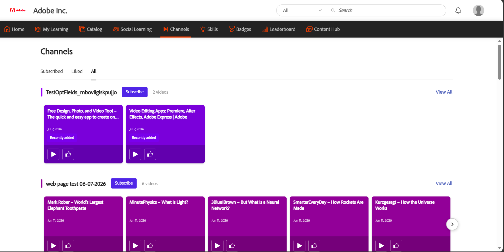
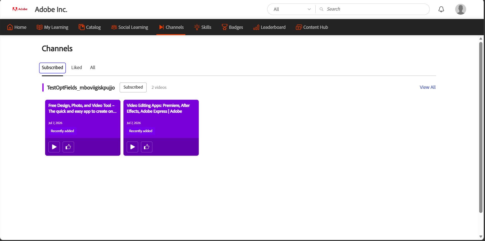
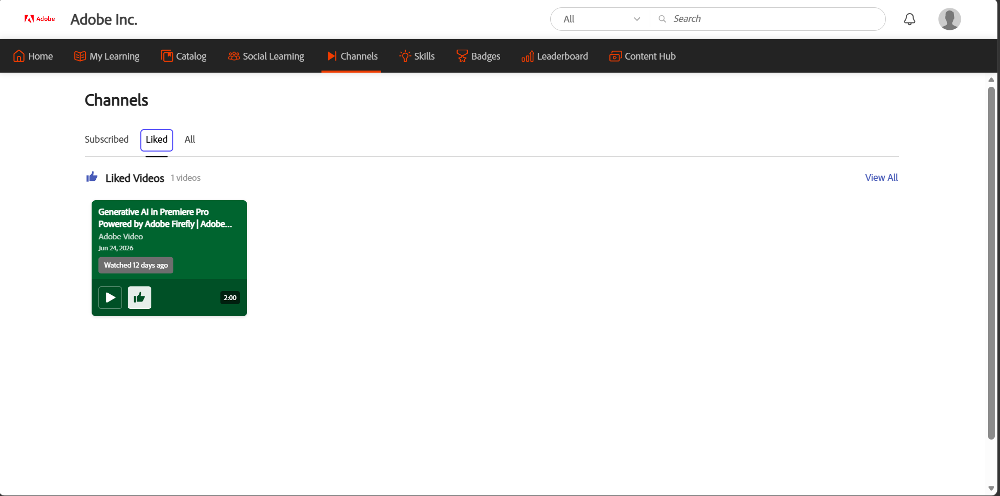
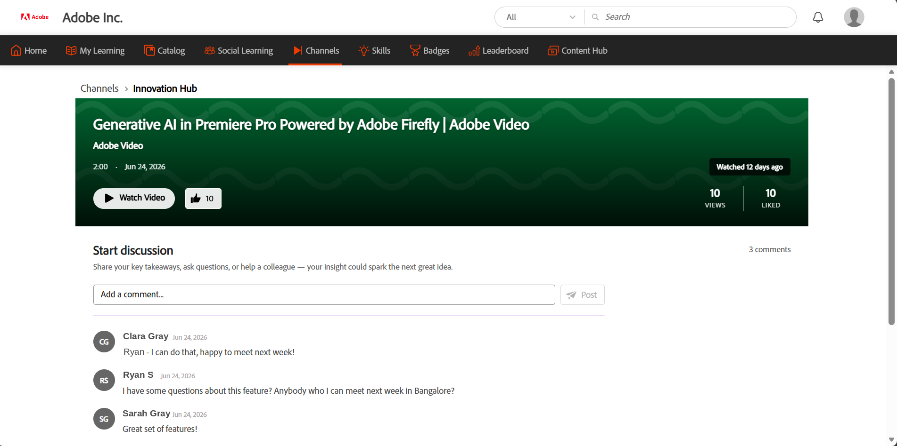

# 探索並參與頻道

管道協助學習者發現並存取在 Adobe Learning Manager 網頁及 Cloud Confluence 頁面中精選的影片非正式學習內容。 管理員透過將頻道連結至企業網頁或 Cloud Confluence 頁面來建立，這些頁面會進行錄製的知識分享與知識轉移會話。

您不必跨多個內部網站搜尋，而是可以直接在 Learning Manager 中瀏覽通路內容。 頻道提供一個集中式的平台，讓您發現相關影片、掌握新內容資訊，並參與組織自學學習資源。

**主要優點**

- 在同一處存取企業網頁與 Cloud Confluence 頁面的影片內容。
- 無需瀏覽多個內部網站，即可發現學習資源。
- 訂閱頻道，隨時掌握新內容的更新。
- 直接在 Adobe Learning Manager 中觀看並按讚影片。
- 參與討論，並與其他學習者圍繞共享內容進行合作。
- 探索與你職務及興趣相關的精選影片合集。

## 尋找頻道

使用 **頻道** 頁面來發掘新內容、存取您訂閱的頻道，並查看您按讚過的影片。

1. 登入 Adobe Learning Manager。

1. 從頂端導覽列選擇 **「頻道** 」。

   >[!NOTE]
   >
   >如果您無法在導覽列中檢視 **「頻道」** 標籤，請聯絡您的管理員。

    **「通道**」頁面預設顯示「**全部**」標籤。

   

   *頻道頁面的「全部」標籤，您可以在這裡發現並訂閱可用的頻道。*

1. 請使用以下標籤瀏覽頻道內容：

   | **分頁** | **描述** |
   |----|----|
   | **全部** | 顯示您可用的所有頻道。 使用此標籤來發現並訂閱新頻道。 |
   | **已訂閱** | 只顯示您已訂閱的頻道。 |
   | **喜歡** | 顯示您在不同頻道按讚過的所有影片。 |

1. 選擇 **「全部檢視** 」以檢視該頻道中所有可用的影片。

## 訂閱頻道

訂閱頻道，快速存取與您最相關的內容，並在新增影片時隨時掌握最新資訊。

1. 在「 **全部」** 標籤中，導覽至您想要訂閱的頻道。

1. 選擇 **「訂閱** 」按鈕。

     頻道會被加入「 **已** 訂閱」標籤。

1. 選取「 **已** 訂閱」標籤。

     這會顯示您訂閱的所有頻道。

   

   *您已訂閱的頻道可於「已訂閱」標籤下收集，方便快速存取。*

### 取消訂閱頻道

如果您不想再追蹤某個頻道，請再次點選「 **已** 訂閱」按鈕。 該頻道會從您的 **「已** 訂閱」標籤中移除，並保留在「 **全部** 」標籤下，您可以隨時存取。

## 觀看影片

觀看組織頻道的影片，以取得精選的知識分享與學習內容。

要觀看影片，請前往頻道並選擇影片縮圖或播放圖示。 在影片詳細資料頁面，選擇「 **觀看影片** 」按鈕以開啟並播放影片。

## 像是一段影片

按讚影片，將影片儲存到 **「喜歡」** 分頁，之後快速找到。

若要按讚影片，請在顯示卡或影片詳細資訊頁面上點選「 **讚** 」按鈕。 按讚數會更新，影片也會加入你的 **「讚」** 標籤，方便你輕鬆存取。

「喜歡」分頁，你喜歡的影片會被儲存，方便你之後找到。

## 加入討論

利用每支影片的討論分享見解、給予回饋並提出問題。 每支影片都有自己的討論串。

要發表評論：

1. 打開你想討論的影片。

1. 導覽至 **「開始討論** 」區段。

1. 在「新增留言&#x200B;**」欄位中輸入您的留言**。

1. 選擇「 **Post**」。

     該留言會被加入討論串，並對其他觀看影片的學習者可見。

   

   *觀看影片、查看按讚與觀看次數，並從影片詳情頁面加入討論。*
