# 學習者的 AI 助手

## 簡介

使用 AI 助理快速且準確地從指定學習內容獲得答案、生成課程摘要、比較學習物件、尋找操作答案，並建立個人化學習路徑，而這一切都無需瀏覽整門課程。

>[!IMPORTANT]
>
>學習者專用的 AI 助理目前僅作為測試版功能提供。 隨著功能演進，功能、支援情境及限制可能會有所變化。

>[!NOTE]
>
>此功能在 FedRAMP 授權的環境中無法使用。 詳情請參閱 [FedRAMP 環境中](/help/migrated/feature-availability-in-fedramp-authorized-environment.md) 的功能可用性。

## 學習者助理中的學習路徑引用與代理程式 {#learning-path-citations}

學習助理現在會在課程旁標註相關的學習路徑，讓學習者能找到更廣泛且結構化的主題學習。 管理員也可以啟用或關閉個別學習助理代理程式，以控制學習者在 Adobe Learning Manager 中可以使用哪些 AI 功能。

### 學習者助理回答中的學習路徑引用

學習助理現在會在課程旁標註相關的學習路徑，讓學習者能找到更廣泛且結構化的主題學習。

### Learning Path 引用在 Learner Assistant 中是如何運作的

當學習助理回答問題時，會列出該學習內容作為引用。 早期版本僅引用課程。 學習助理現在也會引用與問題相關的學習路徑與認證。 學習者可以開啟學習路徑引用，以查看與其主題相關的結構化學習內容。

### 決定哪些引用出現的因素

* Learner Assistant 僅在學習內容與問題相關且在目錄中對學習者可見時，才會顯示引用。
* 如果課程或學習路徑對學習者看不到，學習者助理不會顯示該課程。
* 如果課程與相關的學習路徑都可見，學習助理可以以階層結構格式顯示兩者。
* 選取學習路徑引用會開啟該學習路徑。

### 透過學習助理尋找學習路徑

1. 開啟 **學習助理** 並就主題提出問題。

1. 請檢視答案及其附註的引用。

1. 選擇課程或學習路徑引用以開啟它。

### 排解學習路徑引用問題

**學習路徑不會以引用形式出現**

確認學習路徑與問題相關，且在目錄中對學習者可見。 學習者助理不會顯示對學習者隱藏的內容。

## 設定學習助理代理程式

開啟或關閉個別學習助理代理程式，以控制學習者在 Adobe Learning Manager 中可以使用哪些 AI 功能。

### 什麼是學習助理代理？

管理員可以為整個帳戶啟用或停用學習助理。 從本版本開始，管理員也可以控制組成學習助理的各個代理程式。 您可以啟用任意組合的代理程式。

| 代理人 | 它提供什麼 | AI 學分 |
|---|---|---|
| **知識代理** | 預設代理。 只要啟用學習者 AI 助理即可使用。 | 未消耗任何點數 |
| **接聽專員** | 從目錄中可用的內容回答問題 | 每次查詢消耗已購買的 AI 點數 |
| **Learning Path Agent** | 為學習者打造個人化的學習路徑。 | 每次查詢消耗已購買的 AI 點數 |

>[!NOTE]
>
>管理員 AI 助理擁有相同的代理層級控制功能，包含 **知識代理** 程式與 **洞察代理**&#x200B;程式。

### 啟用或停用 Learner Assistant 代理程式

1. 以管理員身分登入 Adobe Learning Manager。

1. 在左側導覽窗格中選擇 **「學習** 」中的 AI。

   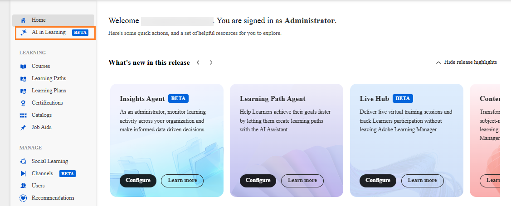

1. 在學習者 AI 助理區段，選擇 **「編輯**」，並視需要開啟或關閉每個代理程式。

   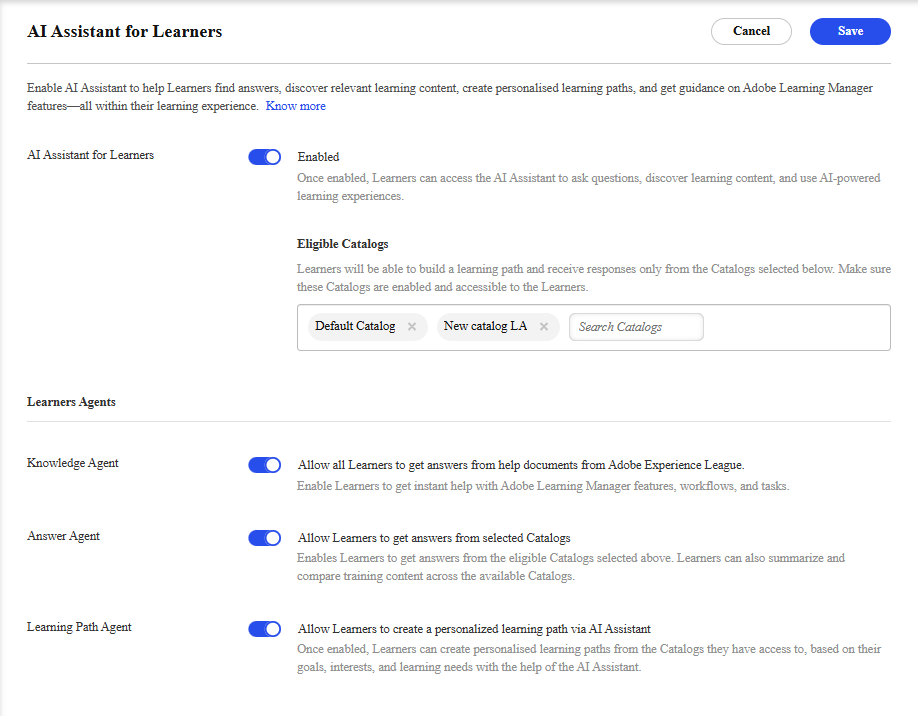

1. 儲存您的變更。

學習者助理現在包含所有已啟用的代理程式，學習者可開始使用這些代理程式。

## 支援的內容類型

AI 助理會從分配給你的學習內容中擷取資訊，包括：

- **文件：** PDF、Word、PowerPoint、Excel、HTML
- **媒體：** 音訊（MP3、WAV、M4A）、影片（MP4、MOV、WMV）
- **互動內容：** SCORM 1.2、SCORM 2004
- **學習對象類型：** 課程、學習路徑、認證、工作輔助工具

Adobe 透過受信任的服務安全地處理您的學習內容。

### 目錄與內容來源限制

AI 助理僅使用內部目錄及第三方內容庫的內容。 學習者查詢的答案僅來自他們可存取的目錄。

以下內容來源在目前版本中不被支援：

- 共用外部目錄
- 預設目錄

支援取得的目錄，並支援來自第三方內容庫（例如 LinkedIn Learning 或 Go1）的元資料回應。

如果你無法取得課程或工作輔助工具，AI 助理不會從該內容中顯示資訊，且引用連結也無法存取。

## 使用案例

### 技術學習者

Sarah 是一名正在學習顯示卡的銷售工程師。 她需要快速理解技術規格與優勢，才能自信回答客戶問題。

AI 助理協助 Sarah 完成：

- 複雜 GPU 架構的清晰技術說明
- 加深對各種顯示卡及其差異的理解
- 範例說明，讓 Sarah 能將功能與真實應用情境連結起來

### 客戶支援

Marcus 是合作公司的支援專員。 他需要快速回答產品功能，以幫助客戶，而不必升級到工程團隊。

AI 助理協助 Marcus 完成：

- 為經常詢問的客戶問題尋找相關的支援內容
- 當最初的答案不夠具體時，會提出澄清性的問題
- 尋找相關故障排除課程的建議，以提升他的技能

### 新員工入職

Jennifer 剛加入公司，對大量訓練教材感到不知所措。 她需要一種方法，在不複習整門課程的情況下找到具體資訊。

AI 助理協助 Jennifer 完成以下事項：

- 取得提交費用報表的逐步指引
- 在不瀏覽整個目錄的情況下，探索公司政策相關課程
- 引導她到課程的適當部分，卻不讓她看好幾個小時的影片

## AI 助理如何使用內容

AI 助理會從你的學習內容中找到準確的答案。 運作方式如下。

### AI 助理使用哪些內容

AI 助理僅使用帳號管理員啟用的學習內容回答問題。 所選目錄的內容會被索引。

AI 助理會分析你分配的學習內容，生成聚焦且具情境性的回應：

- 每則回應都會附上引用原始內容的引用。
- 您可以選擇引用，直接導覽至相關課程、模組或文件。
- 引用有助於您核實資訊並在需要時探索更多背景。

### 串流回應

AI 助理會在生成的答案中逐步遞送，讓你能立即開始閱讀，不必等待完整回覆載入。

### 引用與來源透明度

每個 AI 助理回應都會附上直接連結至原始課程、模組或學習物件的引用。 引用資料可讓您：

- 選擇內嵌引用編號以跳至精確引用的章節。
- 在回應底部選擇 **「顯示來源** 」以開啟完整來源清單。
- 從權威來源核實資訊並探索更多背景。

> **重要**
> AI 助理會根據管理員啟用的內容提供答案。 如果您無法存取被引用的項目，當您嘗試開啟該項目時，會看到「不支援」的訊息。

## 內建提示

AI 助理內建提示，幫助你快速開始處理常見問題與情境。 這些提示會指導你如何與助理互動，並示範你可以提出哪些類型的問題。

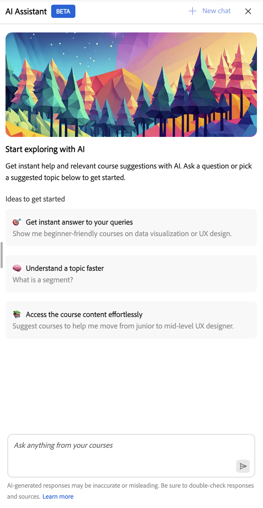

組織可以自訂內建提示，以反映其學習目標、角色、術語或特定使用情境。 管理員可以與客戶成功經理合作，設定或更新內建提示。 在目前版本中，您無法直接在 Adobe Learning Manager 介面中自訂提示。

## 設定 AI 助理（管理員）

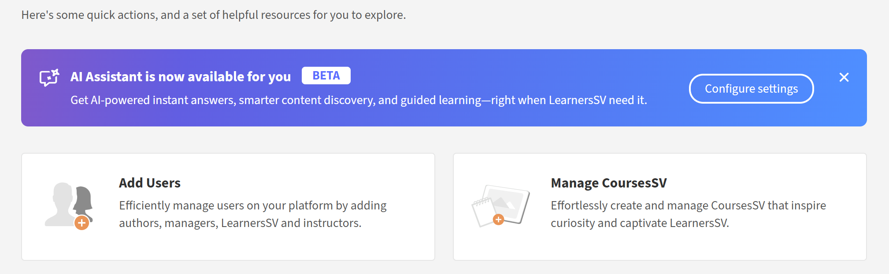

管理員可選擇哪些 **內部** 目錄可以存取 AI 助理功能。 確保你指派的目錄只包含適合 AI 回答與引用的學習內容，且這些目錄是&#x200B;**內部目錄**（非&#x200B;**共享**、**獲取**&#x200B;或&#x200B;**外部）。**

在設定 AI 助理之前，請確認您擁有管理員憑證，且已確認已識別的目錄應有存取權限。

### 設定 AI 助理存取權限

啟用學習者 AI 助理的方法：

1. 以管理員身分登入 Adobe Learning Manager。

1. 從首頁選擇 **「設定** 」。

   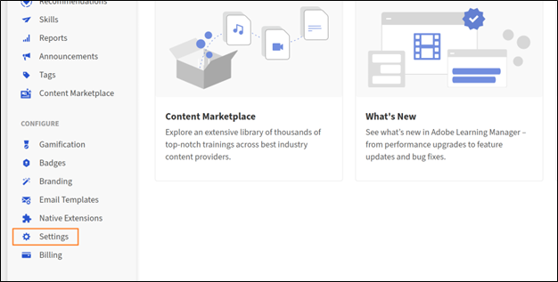

1. 從設定&#x200B;**選單中**&#x200B;選擇 **Learner AI 助理（Beta版）。**

   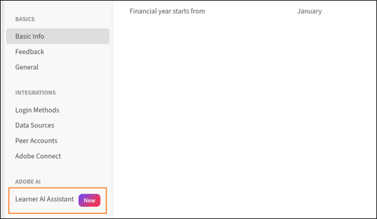

1. 選擇切換開關以啟用 **Learner AI 助理（Beta版）。**

   <!--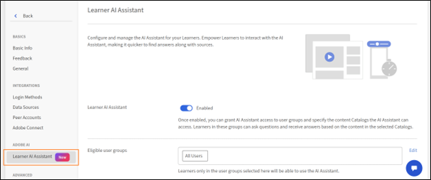-->
   <!--5. Select one or more user groups from the **Eligible user groups** option.-->
   <!--5. Select **Save** to apply the user group settings.-->

1. 從「 **合格目錄」** 選項中選擇一個或多個目錄。

1. 選擇 **「儲存** 」以套用目錄設定。

>[!IMPORTANT]
>
>僅 **支援內部** 目錄。 如果&#x200B;**選取了「共享**」、「**取得**&#x200B;**」、「外部」**&#x200B;或其他非內部目錄，即使其內容出現在&#x200B;**「合格目錄**」清單中，AI 助理也不會顯示該目錄。

## 啟動 AI 助理（學習者）

啟動 AI 助理的方法如下：

1. 以學習者身分登入 Adobe Learning Manager。

1. 在首頁選擇 **「詢問 AI 助理** 」。

   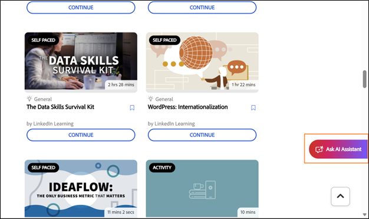

1. 當「學習者 AI 助理&#x200B;**」畫面出現時**，選擇&#x200B;**「開始使用**」。

   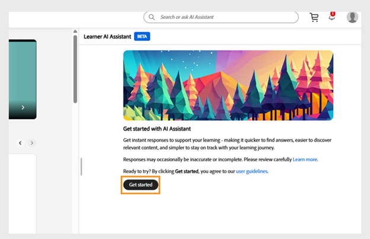

   >[!NOTE]
   >
   >首次啟動 AI 助理時，您必須在使用前提供同意。 同意對話框只會在此初始啟動時顯示。 在所有後續的啟動中，你都會直接進入 AI 助理輸入提示。

1. 在文字欄位輸入您的提示。

   <!-- 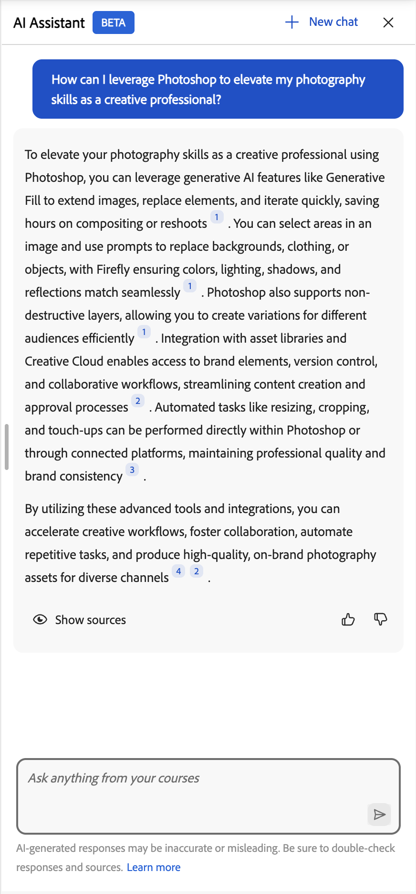 -->

1. 按下 **Enter** 以接收回覆。 檢視你的答案、資料來源和建議。

你可以：

- 選擇內嵌引用編號以跳至精確引用的章節
- 在回應底部選擇 **「顯示來源** 」以開啟完整來源清單

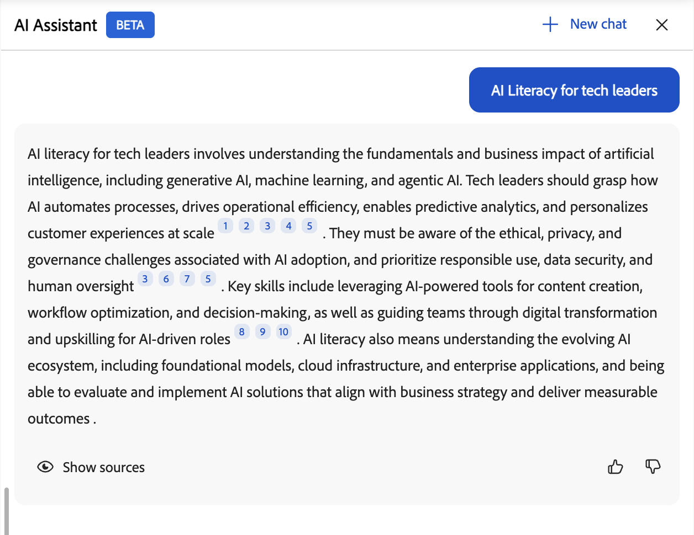

AI 助理會在每則回應中附上引用，以顯示資訊來源。 每個引用直接連結到用來產生答案的原始課程、模組或學習物件。

您可以選擇任何引用，在 Adobe Learning Manager 中開啟課程頁面，並依照上下文檢視完整內容。 引用有助於你核實資訊、探索更多細節，並持續從權威來源學習。

## 透過搜尋進入 AI 助理

你也可以直接從搜尋欄啟動 AI 助理。 在搜尋欄輸入您的問題，然後從出現的選項中選擇 **「詢問 AI 助理** 」。

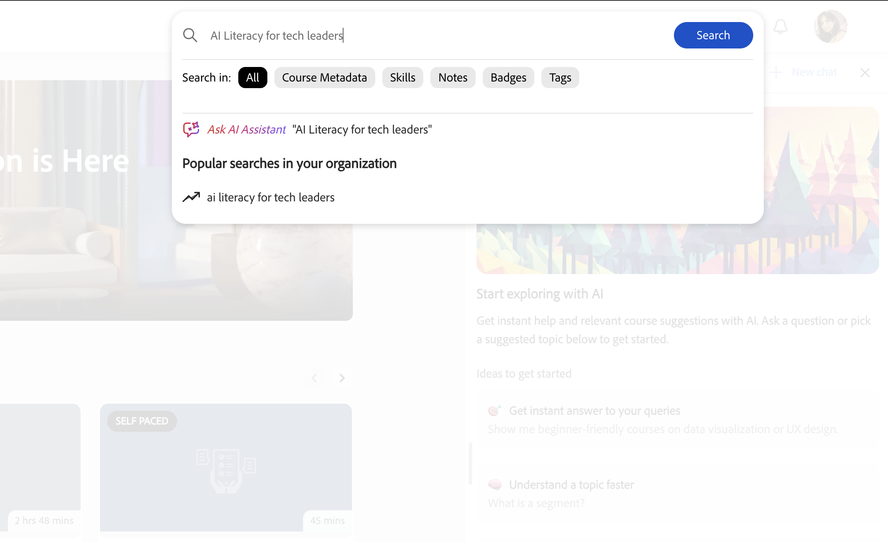

## 對 AI 助理回應提供回饋

您對 AI 助理（測試版）所產生回應的回饋，有助於提升其準確性、相關性及整體效能。

### 喜歡或不喜歡某個回應

- 選擇 **「**&#x200B;讚」，選擇你覺得回覆中有用的內容，並可選擇新增留言，然後選擇 **「提交**」。
- 選擇 **「大拇指向下**」，選擇回應不具幫助的原因，新增任何留言，然後選擇 **「提交**」。

## 開始新聊天

開啟新聊天可以讓你重新開始一段新對話，清除先前的上下文，讓助理能專注於新主題，而不必重複先前的互動。

若要清除目前對話並重新開始，請在 AI 助理畫面選擇 **「新增聊天」** ，然後選擇 **「是**」。

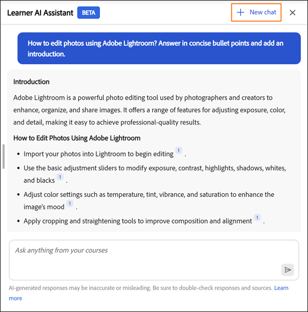

AI 助理為學習者提供快速且具情境性的答案，支援多種內容類型，並提供內嵌引用以提升透明度。 管理員可以控制存取權限，確保 AI 助理符合組織需求，並提升學習體驗。

## 在 Learning Assistant 中取得特定學習物件的摘要與答案

Adobe Learning Manager 的學習助理可以生成目錄中任何課程、工作輔助、學習路徑或認證的摘要。 摘要取自課程內容及課程目錄中儲存的模組成績單。

### 搜尋課程

1. 從您的學習者首頁開啟 _學習助理_ 。
2. 在聊天面板中輸入 / 以啟動內容搜尋。

>[!NOTE]
>
>未新增至目錄的學習物件無法搜尋。 您可以存取任何您有權限的內容，但學習助理只會從模組內容擷取摘要。

1. 輸入您想要摘要的課程名稱、工作輔助工具、學習路徑或認證。 會出現一個符合的目錄項目的預先輸入清單。
2. 從清單中選取學習物件。

### 快速生成課程概覽

當您需要快速且可靠的課程快照，但又不想完整開啟課程時，請使用此功能。 常見情境包括：

- 重溫或複習學習
  *情境：* 一位業務代表六個月前完成了一門「談判基礎」課程，明天即將迎來一場重要的續約電話會議。 他們沒有重看全部四個模組，而是請學習助理總結課程內容，並快速複習所涵蓋的關鍵談判策略。
- 決定是否enroll_
  *情境：* 一位新經理看到目錄中推薦「帶領變革」，但不確定是否適合目前的團隊狀況。 他們會先要求摘要，發現內容非常著重於遠端團隊的變更管理，於是決定報名，因為這符合他們的需求。
- 準備或參考topic_
  *情境：* 一位支援工程師即將加入一通關於他們很久沒碰過的產品功能而進行的客戶通話。 他們不會在 45 分鐘的訓練課程中翻找，而是請學習助理摘要相關課程，以便在通話前快速複習關鍵步驟與術語。

1. 在聊天輸入中輸入查詢，例如「總結此課程」或「提供本課程摘要」。
2. 選擇 **「傳送** 」以提交您的查詢。
3. Learning Assistant 會根據課程模組與目錄中儲存的內容產生並顯示摘要。

### 最佳實務

- 搜尋時使用特定課程名稱，以獲得準確的預先輸入結果。
- 您可以索取課程摘要、工作輔助工具、學習計畫及證照。
- 在報名前，請先檢視摘要，快速判斷課程是否符合您的學習目標。

## 在 Learning Assistant 中比較學習物件

Adobe Learning Manager 的學習助理讓您能將多達兩個目錄中的學習物件並排比較。 在報名前，請利用此功能了解兩門課程在內容、範圍或重點上的差異。

### 選擇要比較的學習物件

1. 從您的學習者首頁開啟 _學習助理_ 。
2. 在聊天面板中輸入 / 以啟動內容搜尋。
3. 輸入第一個學習物件的名稱。 會出現一個符合的目錄項目的預先輸入清單。
4. 從清單中選取第一個學習物件。
5. 再次輸入 / 並搜尋第二個學習物件。
6. 從清單中選取第二個學習物件。

>[!NOTE]
>
>在單一查詢中，最多可比較兩個學習物件。

### 請求比較

1. 在聊天輸入中輸入查詢，例如「這兩門課程有什麼差別」或「比較這些學習物件」。
2. 選擇 _「傳送_ 」以提交您的查詢。
3. Learning Assistant 會產生並顯示一個比較，以突顯兩個學習物件內容上的差異。

### 最佳實務

- 在比較前先閱讀個別課程摘要，以簡要理解每門課程。
- 利用比較結果找出哪門課程涵蓋的主題最符合你的職務或技能差距。
- 如果目錄項目未出現在類型中，請向您的管理員確認兩個學習物件皆屬於您指派的目錄。

## Learning Assistant 中的 Experience League 答案

了解 Adobe Learning Manager 的學習助理如何利用 Adobe Experience League 的內容回答學習者的問題，包括相關說明文章的連結。

### Learning Assistant 如何使用 Experience League

Adobe Learning Manager 的學習助理可以從 [Adobe Experience League](/help/migrated/user-guide.md) 取得答案，該網站是 Adobe 官方的說明與文件網站。 當學習者提出程序性或操作相關問題時，學習助理可以擷取相關答案，並附上完整 Experience League 文章的連結。

### Learning Assistant 能回答哪些類型的問題

學習助理可以回答有關如何以學習者身分使用 Adobe Learning Manager 的問題。 例子包括：

- 如何報名經理提名課程
- 如何取得學習計畫或認證
- 如何查找並檢視您已完成的課程

當 Learning Assistant 在 Experience League 中找到相關答案時，回應會附上原始文章的連結，方便您瀏覽完整文件。

### 這與行政助理有何不同

[Adobe Learning Manager 中的管理助理](/help/migrated/administrators/feature-summary/alm-ai-assistant.md)自早期版本起，便為管理員提供來自 Experience League 的解答。2026 年 8 月的強化將這項功能擴展至面向學習者的學習助理，讓學習者在不離開平台的情況下也能獲得協助。

管理助理與面向學習者的學習助理皆使用相同的底層 Experience League 內容來產生答案。

## Learning Assistant 對第三方內容的支援

Adobe Learning Manager 的學習助理可以回答學習者關於平台上任何第三方內容以及原生 Adobe Learning Manager 內容中學習物件的問題。 在學習者查詢這些課程之前，管理員必須先將 Go1 或 LinkedIn Learning 目錄新增至 Adobe Learning Manager。

### 第三方目錄支援的運作方式

>[!IMPORTANT]
>
>作為先決條件，管理員必須將所需的目錄新增至學習者助理。 更多詳情請參閱[「設定 AI 助理存取](https://experienceleague.adobe.com/en/docs/learning-manager/using/learner/learner-ai-assistant#configure-ai-assistant-access) 權」。

當管理員將 Go1 或 LinkedIn Learning 目錄新增至 Adobe Learning Manager 時，目錄內容會經過排程的擷取流程。 匯入完成後，該目錄中的學習物件將可供學習助理查詢。

擷取通常會在管理員新增目錄後一到兩小時內完成。

導入完成後，學習者可以像查詢原生 Adobe Learning Manager 內容一樣，對 Go1 或 LinkedIn Learning 課程提出問題。 例如，學習者可以請求 Go1 課程的摘要，或使用 / 指令將 LinkedIn Learning 課程與 Adobe Learning Manager 課程進行比較。

- Adobe Learning Manager 沒有第三方內容的文字記錄，因此不會用文字記錄來檢索答案。 答案僅從可用的元資料中擷取，例如標題、描述與概覽。
- 目前僅 _支援英語_ 。

### 需求

若要讓 Learning Assistant 查詢 Go1 或 LinkedIn Learning 內容：

- 管理員必須將相關的 Go1 或 LinkedIn Learning 目錄新增至 Adobe Learning Manager。
- 排程目錄擷取必須完成，課程才可供查詢。
- 學習物件必須是學習者指派目錄的一部分。

## 排除 AI 助理問題

>[!NOTE]
>
>設定新目錄後，請預留 4–5 小時，讓內容被索引並可供 AI 助理回應。

### 無法存取內容

**問題：** 學習者可以使用 AI 助理，但收到的回覆是「我沒有這個問題的答案」。

**可能的原因：**

- 學習者的目錄不包含在 AI 助理設定中。
- 與問題相關的內容不在所選目錄中，或目錄是空白的。
- 學習者無法看到相關內容。

**解決方案：**

- 確認學習者的目錄存取權。
- 檢查 AI 助理設定中啟用了哪些目錄。
- 確保這些目錄中存在相關內容。
- 新增內容後等待幾個小時，才能被索引。

### 無關或品質不佳的回答

**問題：** AI 助理提供的答案與問題不符或品質低劣。

**可能的原因：**

- 這個問題太廣泛或模糊。
- 相關內容的元資料（描述、標籤）很差。
- 內容結構使得擷取資訊變得困難。

**解決方案：**

- 鼓勵學習者提出更具體的問題。
- 檢視並改進課程說明與元資料。
- 確保內容有明確的標題與結構。
- 檢視詳細使用報告以識別模式。
- 考慮為常見問題製作工作輔助工具。

### 超出範圍的問題

**問題：** 學習者提出與訓練內容無關的問題。

**範例：**

- 常識問題（「誰是總統？」）
- 個人意見（「你覺得X怎麼樣？」）
- 不當內容

AI 助理設計僅根據指定的學習內容回答問題，不會回應超出範圍的問題。

**Go1 或 LinkedIn Learning 課程未出現在學習助理搜尋中**&#x200B;請與您的管理員確認 Go1 或 LinkedIn Learning 目錄已新增至 Adobe Learning Manager，且目錄擷取已完成。 目錄加入後，擷取可能需要一到兩小時。

**最近新增的課程尚未開放**&#x200B;請等待排程目錄同步完成。 如果兩小時後課程仍未顯示，請聯絡您的管理員確認目錄連線是否有效。

**學習路徑不會以引用形式出現**&#x200B;確認學習路徑與問題相關，且在目錄中對學習者可見。 學習者助理不會顯示對學習者隱藏的內容。

**當代理被停用時，學習者會看到什麼？**
學習助理不會執行已停用的代理程式。 例如，如果您停用 **答答代理** ，而學習者提出需要該提示的問題，學習助理不會回傳基於課程的摘要。 它提供仍然啟用的代理選項。