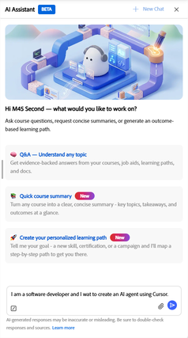
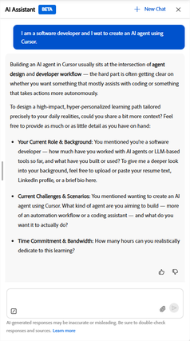
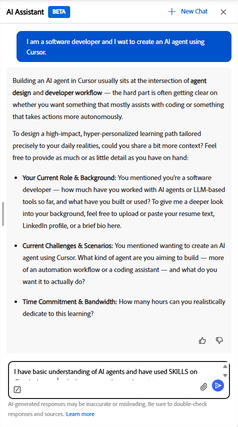
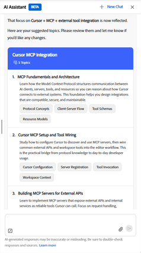
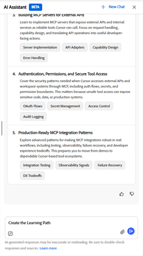

# 什麼是 Learning Path Agent

學習路徑代理會利用 AI 助理建立結構化的學習路徑。 與管理員指定的標準學習路徑不同，這些學習路徑是透過引導式對話產生的。 你描述你的目標，代理人會幫你建立一條符合你學習需求的路徑。

代理會先從您組織內部的課程目錄中擷取內容，優先選擇經核准且與團隊相關的課程。 如果您的管理員啟用了第三方內容，代理程式也可能包含來自已連接外部供應商的課程，以填補覆蓋上的缺口。 您系統會自動註冊您儲存路徑內的課程，因此可以立即開始學習。

個人化學習路徑設計為兩種主要應用場景：

- **精準技能發展**：當你需要快速達成特定業務成果或達成績效目標時，例如準備新責任或彌補評估中發現的技能差距。
- **建立深厚的專業知識**：當你想在某個特定領域、技術或學科中，從初學者晉升為專家時，持續較長時間。

## 以對話為基礎的方法如何運作

代理程式接著產生一個命名的學習路徑，顯示每門課程、其描述、時長及模組數量。 在儲存之前，你可以請代理程式使用自然語言新增、移除或替換路徑中的個別路徑。」

根據你的回答，代理人會找出 3–5 個學習主題，並建議熟練程度。 您可以在客服人員搜尋匹配課程前，先檢視這些主題、申請變更或確認。 代理程式接著會產生一條命名的學習路徑，顯示每門課程、其描述、時長及模組數量。 你可以在儲存之前進一步調整路徑。

當你儲存路徑時，你會自動註冊所有課程。 路徑會顯示在您的首頁 _「個人化學習路徑」_ 區塊中，隨時準備開始。

### 內容來源與課程選擇

代理人會根據與您所設定目標的相關性、您目前的熟練程度、您可用的總時間，以及內容更新的時間來挑選課程。 當代理無法在可用目錄中找到特定主題的匹配課程時，會通知您並建議聯絡管理員，請求該領域的額外內容。

### 首頁上的個人化學習路徑

所有儲存的個人化學習路徑都會顯示在您的首頁的 _「個人化學習路徑」_ 條列中。 每張卡片都會顯示路徑名稱、課程數量，以及 _一個「繼續_ 」按鈕，可以從中斷處繼續。

### 分享學習路徑

儲存個人化學習路徑後，您可以與同事分享。 分享會寄送連結或電子郵件邀請給他們。 當同事開啟共享路徑時，他們只需一個動作即可註冊。 當團隊中有好幾個人有相似的學習目標，且你希望他們遵循相同的結構化計畫時，分享非常有用。

### 最佳實務

- 在開始對話時，請盡可能具體地描述你的學習目標。 代理人掌握的背景越多，你的路徑就越相關。
- 事先提供你的時間承諾，這樣生成的路徑才符合你的實際行程。 代理人能理解自然語言：「一週兩個晚上」或「每天30分鐘」都有效。
- 在請客服人員生成課程前，請先檢視建議的主題。 在這個階段確認或調整主題，比事後修改課程清單節省時間。
- 如果某主題沒有匹配內容，請註明並聯絡您的管理員，要求將相關課程新增至目錄。
- 在儲存前，請使用自然語言微調您的路徑。 例如，請移除你已完成的課程，或替換一門感覺過於複雜的課程。

## 設定個人化學習路徑代理程式

當您在設定中啟用 AI 助理選項時，Adobe Learning Manager 預設會啟用個人化學習路徑代理程式。

>[!NOTE]
>
> 內容可見性遵循您現有的目錄存取規則。 學習者只會從他們已擁有存取權限的目錄中看到並接收課程。 個人化學習路徑代理程式不會繞過目錄限制。

在每個來源中，代理人會依照與學習者目標的相關性，以及課程層級與學習者自稱熟練程度的契合度，對課程進行排名。

如果目錄中某主題沒有匹配的課程，客服人員會通知學習者，並建議他們聯絡管理員申請該領域的內容。

<!-- 
### Monitor credit usage

The Personalized Learning Path agent consumes AI credits each time a learner generates a path. To monitor and manage usage:

1. In the left navigation of the administrator's home page, select **Billing**.
2. Select the **AI Credits** tab. The **Learning Path** agent appears as a line item in the features list.
3. Review current usage and adjust the credit allocation or usage limit as needed.

>[!CAUTION]
>
>If the credit limit for the Learning Path agent is reached, learners receive an in-app message that the agent is unavailable and are directed to contact an administrator. Increase the allocation to restore access. 
-->

## 使用 Learner AI 助理打造個人化學習路徑

使用 Adobe Learning Manager 中的 Learner AI 助理，生成符合您的目標、背景及可用時間的個人化學習路徑。 然後把它存到你的個人檔案，立刻開始學習。

### 開啟 Learner AI 助理並開始對話

1. 從首頁選擇 **AI 助理** 。
2. 在文字欄位輸入您的學習目標。 請盡可能具體說明。 例如：
   - *我是一名軟體開發者，想用 Cursor 來創建一個 AI 代理。*
   - *我剛升職為經理，想學習如何處理困難的對話。*
   - *我想以分析師的身份精通財務建模。*
     

3. 若您已開啟先前的會話，可 _選擇「+ 新增聊天_ 」以開始新對話。

備註：

- 也可以選擇使用迴紋針&#x200B;_圖示附加文件_，例如履歷、主管回饋電子郵件或專案簡報。經紀人會利用這份文件來了解你正在尋找目標和背景的更多背景。
- 選擇 _「傳送_」。

### 請描述你的目標與背景

客服會回覆一則訊息，確認你的目標，並要求提供更多背景資料以調整你的路徑。 它通常會問：

- _你目前的職務和背景_ ，你已經知道什麼、你在這個職位上工作了多久，或任何相關的經驗。
- _你具體的挑戰或情境_ ，以及你需要立即學習的真實情境。
- _你的時間投入_ ，以及你每週實際能投入學習的時間。

你不需要回答每一個問題。 唯一需要的輸入就是你的學習目標或挑戰。 代理人會根據你提供的背景資料繼續進行。

>[!TIP]
>
>代理人理解自然時間表達式。 你可以說「一週兩個晚上」、「每天大約 30 分鐘」或「週末幾個小時」，客服會把這個數字換算成每週工時來估算並跟你確認。

輸入您的回應並選擇 _「傳送_」。

持續對話，直到客服人員提出您建議的主題。

### 檢視建議的主題

從你的回答中，代理會找出 3–5 個學習主題。 您可以在客服人員搜尋匹配課程前，先檢視這些主題、申請變更或確認。 代理程式接著會產生一條命名的學習路徑，顯示每門課程、其描述、時長及模組數量。 你可以在儲存之前進一步調整路徑。

1. 檢視建議的主題，確保它們符合你的學習目標。
2. 要調整主題，請在聊天中輸入你的回饋。 您可以要求代理新增、移除或取代主題。
3. 如果您對建議主題感到滿意，請在聊天中回覆，或在出現建議確認提示時選擇確認。

### 檢視學習路徑

代理程式會搜尋可用的目錄並建立命名的學習路徑。 這條路徑顯示：

- 路徑名稱及總預估持續時間
- 每門課程名稱、描述、時長及模組數
- 若某些主題沒有匹配內容，則可提示

如果某些主題沒有匹配內容：

客服人員會告知你，他們找不到針對這些特定主題的課程，建議你聯絡你的管理員，要求取得相關內容。 路徑仍會針對找到課程的主題自動生成。

<!-- - Review the path. If you want to change something, for example, remove a course, adjust the scope, or explore different topics. Type your request in the chat\. For example, Can you remove the first course and replace it with something shorter? -->
當您對路徑感到滿意後，請代理程式輸入「save the learning path」來儲存。

<!--

-->

### 在儲存前調整學習路徑 {#adjust-lp-before-saving}

在儲存學習路徑前，使用刪除圖示或聊天功能移除、新增或取代已產生的學習路徑中的主題與課程。

當您在 Adobe Learning Manager 中請學習路徑代理建立個人化路徑時，它會先建議主題，然後將課程與主題匹配。 在你存檔前，可以同時調整兩者，讓最終路線符合你的目標。

你可以透過點選卡片上的刪除圖示，或在聊天中輸入請求來調整路徑。

>[!NOTE]
>
>Learning Path Agent 可隨 Ultimate 等級提供，或作為 Prime 等級的附加套件。 每個請求都使用人工智慧點數。 如果您看不到該代理，請聯絡您的管理員。

1. 在 Learner Assistant 中，請 Learning Path Agent 產生學習路徑。 回答客服人員提出的任何澄清性問題。 例如，輸入「幫助我建立一條學習路徑，讓你從行銷協調員轉到資料分析師」。
2. 回答客服人員提出的澄清性問題。 代理程式接著會產生一個主題清單。
3. 檢視主題，然後視需要調整：

   * 若要移除主題，請在卡片上勾選刪除圖示，或輸入請求，例如「移除此主題」。
   * 若要新增主題，請輸入描述您想要主題的請求。

4. 確認主題。 客服會將你帳戶中的課程與每個主題進行匹配。
5. 檢視建議課程，然後視需要調整：

   * 若要移除課程，請勾選該課程卡片上的刪除圖示，或請代理人將其移除。
   * 若要新增課程，請輸入一個描述您想學習內容的請求。
   * 若要更換課程，請客服人員替換該課程。 代理人會根據你原本的要求建議替代方案。

6. 重複步驟3和5，直到路徑符合你的目標。
7. 保存學習路徑。

### 儲存並存取您的學習路徑

當您儲存路徑時，代理程式會確認儲存，並自動為您報名路徑內的所有課程。

要進入您的路徑：

- 從確認訊息中選擇 _「前往學習路徑_ 」以立即開啟，或
- 隨時可在首頁的「個人化學習路徑&#x200B;_」條中找到它_。

### 分享您的學習路徑

在路徑概覽頁面，您可以與同事分享已儲存的路徑。

1. 從首頁的「個人化學習路徑&#x200B;_」條頁開啟您儲存的路徑_。
2. 選擇 _「分享_」。
3. 分享產生的連結，或輸入電子郵件地址以發送直接邀請。

收到共享連結的同事可以透過一個動作註冊到該路徑。

## 最佳實務

- 請說明你的角色背景以及目前面臨的挑戰。 你越具體，選課就越相關。
- 用自然語言提及你每週的時間投入。 代理會在產生路徑前確認其詮釋。
- 在要求路徑生成前，請先檢視建議的主題。 在這個階段調整主題，比事後修改課程清單要快得多。
- 如果產生的路徑包含你已經完成過的課程，請告知客服人員。 它能提出替代方案。

## 常見問題

_我在哪裡可以找到我儲存的個人化學習路徑？_

您所有儲存的路徑都會顯示在您的 _首頁的「個人化學習路徑」_ 條帶中。 每張卡片都會顯示路徑名稱及「 _繼續」_ 按鈕。 你也可以從那裡開啟任何一條路徑，查看完整的課程清單和你的進度。

_我可以節省多少條個人化學習路徑？_

_您首頁上的個人化學習路徑_&#x200B;條最多顯示 20 條路徑。

_我應該提供哪些資訊才能獲得相關的學習路徑？_

至少，描述你的學習目標或你想解決的具體挑戰。 你提供的背景越多，這條路就越好。 有用的資訊包括你目前的職務、做了多久、相關經驗，以及你每週實際能投入多少小時來學習。

_如果經紀人找不到適合我主題的課程怎麼辦？_

客服人員會在對話中直接告訴你，他們找不到適合你某一或多個主題的匹配課程。 它只利用當時有課程的主題來生成路徑。

如果代理無法找到針對您任何主題的課程，它會通知您無法為該目標建立路徑。 無論哪種情況，請聯絡你的學習管理員，告訴他們哪些主題沒有內容可用。 他們可以把相關課程加入目錄，這樣未來的路徑需求就能被涵蓋。

<!-- 
_How does the agent decide which courses to include?_

The agent prioritizes your organization's internal course catalog above external sources. It selects courses based on relevance to your stated goal, whether the course level matches your proficiency, how recently the content was published or updated, and quality signals such as ratings and completion rates\. Your administrator controls which content sources are available. 
-->

_我可以調整學習路徑上的主題嗎？_

是的。 在對話過程中，您可以要求代理程式在路徑生成前新增、移除或變更主題。 代理程式會更新主題清單並重新生成路徑以匹配。

_我可以更改生成路徑中的個別課程嗎？_

是的。 在儲存路徑之前，您可以請代理程式使用自然語言新增、移除或替換課程。 例如，「移除第二道菜」或「用更根本的東西取代第四道菜」。 代理只更新你提到的路線，其餘路徑不變......

如果你想在多個主題上做更廣泛的調整，最好在客服生成路徑前調整主題，因為課程選擇是根據你確認的主題來決定的。

_如果我嘗試新增課程，但路線已經滿了怎麼辦？_

學習路徑最多可包含五門課程。 如果你在路徑已滿時要求新增課程，客服會詢問你想用新課程取代哪一門現有課程。

_為什麼客服一直問後續問題？_

代理人需要對你的學習目標有足夠清晰的了解，才能找出相關的主題。 如果你最初的訊息很廣泛，比如「我想學行銷」，它會問一些問題來縮小範圍。 提供更具體的職責細節、面臨的挑戰，以及學習後希望能做什麼，將有助於客服人員更快進入主題生成階段。