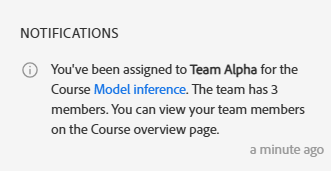
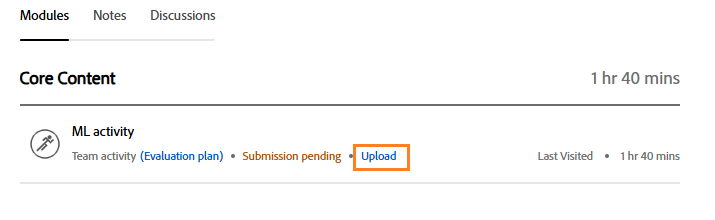

# 在 Adobe Learning Manager 中以團隊形式提交作業

查看您的團隊、共同完成作業、上傳整個團隊的檔案，並查看團隊的評估結果。

當你被指派到某個團隊時，你會收到通知。

在團隊式檔案提交模組中，任何團隊成員都可以上傳檔案給同一團隊的所有人。 你的指導老師只會評估一次作業，結果會適用於整個團隊。

## 檢視您的團隊與評估計畫

1. 在學習者應用程式中開啟課程，然後前往課程總覽頁面。 團隊活動會在課程大綱中標示為團隊活動。

   

1. 選擇 **「檢視團隊成員** 」以查看與您同一團隊的其他學習者清單。

   

1. 如果您尚未加入團隊，系統會顯示活動會在您被分配到團隊後開始。 請聯絡您的講師或管理員。

1. 如果作者允許，請查看你將被評定的內容。 您可以閱讀評估計畫的說明以及每個評估參數的說明。 你無法查看答案選項、分數或權重。

當您被加入團隊、被移除團隊，或團隊成員被新增或移除時，您會收到通知和電子郵件。

## 提交團隊檔案

1. 在課程總覽頁面，開啟團隊活動。

1. 請與你的團隊就提交的檔案達成共識。 選擇 **「上傳**」。

   

1. 上傳檔案。 狀態變更為 **「評估待定**」。 不過，您可以檢視您的提交並提交另一份檔案。

   

你的教官已被通知。 每位團隊成員都能查看狀態與已提交的檔案，並下載該檔案。 當任何成員提交或重新提交時，所有團隊成員都會收到通知及電子郵件。

若要在檔案核准前替換，請選擇 **「檢視**/**變更提交」**，然後上傳新檔案。

>[!NOTE]
>
>如果作者不需要審查者核准，則在檔案提交後，所有團隊成員的活動都會立即完成。

## 查看結果

1. 在老師評估完團隊活動後，再開啟團隊活動。 所有團隊成員都會收到通知。

1. 檢視狀態，例如已核准或拒絕。

1. 如果講師選擇展示，請閱讀他的留言。

1. 若活動有評估計畫，請查看審查者姓名、每個評估參數所選選項、書面回應及任何備註。 個別選項的點數不會顯示。

1. 如果有計分，請查看你球隊的總分。

如果該活動不需要核准，你會看到它已被評估，並附帶結果。

## 被拒絕後重新提交

如果你團隊的投稿被拒絕，請閱讀留言，然後上傳新檔案。 您的新檔案會取代先前的檔案。

## 疑難排解

**活動顯示您必須被分配到團隊。** 你還沒加入任何隊伍。 聯絡你的教練。

**你無法切換到其他實例。** 你的團隊提交後，你不能切換實例。 只有在你的隊伍解鎖時才允許切換。

**提交消失了，狀態顯示「待提交」。** 你的老師取消提交了，你收到通知和電子郵件。 再次上傳檔案。 你看不到之前的投稿或留言。
