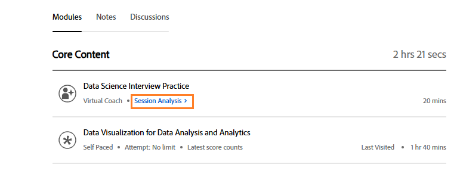
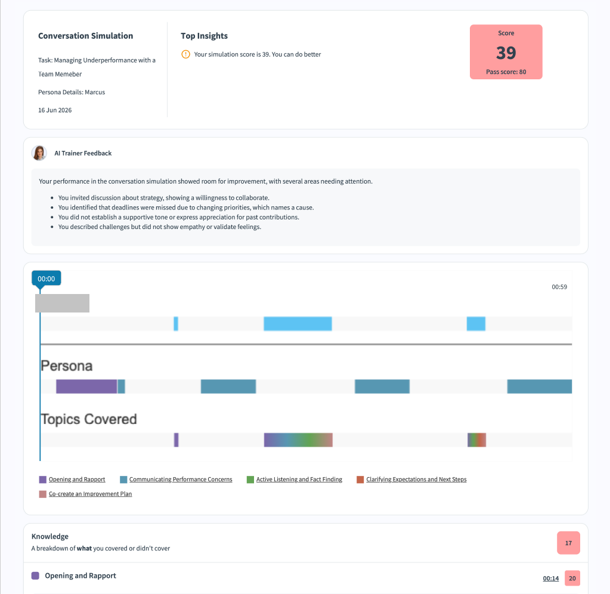

# 了解您的虛擬教練績效報告

你的虛擬教練成績單會顯示你在角色扮演中的表現，包括你涵蓋了哪些主題、你如何溝通，以及在下一次嘗試前需要改進的具體領域。

每完成一次會話都會自動產生一份報告。 在課程結束後立即選擇&#x200B;**「檢視分析**」存取，或在「我的學習&#x200B;**」的課程歷史**&#x200B;中隨時返回。您也可以下載報告的 PDF 格式，方便自己保存或與主管分享。

## 下載您的虛擬教練課程分析

在 Adobe Learning Manager 中下載您的虛擬教練課程分析，以簽名 PDF 形式呈現，並與您的主管或講師分享。

在你結束一場虛擬教練課程後，Adobe Learning Manager 會產生一份你的表現分析。 關閉播放器、重做該場次並下載已簽署的 PDF 分析後，你可以再次查看。

1. 打開包含你虛擬教練課程的課程或工作輔助。

1. 選擇 **「工作階段分析**」。

   

1. 檢視你的分析。 產生分析可能需要一點時間。

1. 選擇「 **下載** 」以儲存已簽署的分析 PDF。

將 PDF 分享給你的主管或講師，作為你表現的證明。 檔案內含 C2PA 簽名。 詳細資訊請參閱 [PDF](#c2pa-signatures) 中的 C2PA 簽章。

### 關於工作階段分析 PDF 中的 C2PA 簽章 {#c2pa-signatures}

AI 會生成虛擬教練課程分析。 為了讓其他人信任已下載的副本，Learning Manager 會以 C2PA[&#128279;](https://c2pa.org/) 簽名在 PDF 上簽名。

C2PA 是開放的產業標準，用於內容真實性。 Adobe Learning Manager 使用與其他 Adobe 產品相同的 Adobe 簽署服務。

#### 簽名包含的內容

該簽名是嵌入於 PDF 中的密碼學簽署清單。 報告記錄如下：

* Adobe Learning Manager 產生了分析結果
* 分析是在特定日期產生的

#### 為什麼簽名很重要

當您與主管或講師分享 PDF 時，簽名會提供檔案真實且下載後未被編輯的證據。

## 您的總分數如何計算

你的總分數是兩個要素的加權組合：知識 **分數** 和 **風格分數**。 建立情境的作者會設定每個元件的權重;常見的配置是 70% 知識、30% 樣式，但這會因情境而異。

| 組件 | 它衡量的是什麼 | 典型重量 |
|---|---|---|
| 知識 | 您是否涵蓋了所需主題並提供準確資訊 | 70% |
| 風格 | 你的溝通方式——表達方式、節奏、清晰度與自信 | 30% |

*你的成績單會顯示為你情境設定的精確權重，可能與這裡顯示的典型分攤有所不同。*

您的總分會以 0 到 100 的等級顯示。 及格門檻由作者設定，並會與你的分數一同顯示。 若分數達到或超過門檻，即通過;若未達標，則可重試該課程。 如果必修主題被設定為 **成敗** 攸關，而你在對話中完全沒有提及，無論你其他部分表現如何，最終分數都是 0。

## 知識分數

知識分數反映您在對話中所說的內容——也就是您是否針對作者為情境設定的主題進行討論。

### 主題分類

每個情境都有一組必修主題。 你的成績單會為每個主題寫出獨立的分數，並附上書面回饋說明你涵蓋了哪些內容、錯過了哪些內容。 報告底部的會議時間軸中會以顏色標示主題，讓您能精確看到每個主題討論的時間。

**發現呼叫情境中的主題分數範例：**

| 主題 | 配樂 | 摘要 |
|---|---|---|
| 開幕與關係 | 40 | 確認了可上班時間，但沒有自我介紹或說明外展原因 |
| 臨床可信度發現 | 60 | 指出作者身份與審查流程，但未明確承認該角色的準確性疑慮 |
| 實施與資源評估 | 40 | 描述了人力配置和時間表，但沒有說明典型的設置步驟，也沒有確認利害關係人的參與 |
| 處理異議與風險 | 0 | 沒有邀請該角色分享風險或猶豫，也沒有提供文件或緩解措施 |
| 同意下一步步驟 | 20 | 提供了專案時間表，但沒有提出具體且低承諾的下一步，也沒有取得口頭同意 |

*每個主題分數都清楚顯示在你下一次嘗試前，該專注於對話中的哪一部分。*

### 如何提升您的知識分數

報告中的每個主題章節都包含具體且可執行的指引。 例如：

- **如果你在開場與互動測驗得分偏低：** 先以名字向對方打招呼，說出你自己的名字，簡要提及外展原因，並以簡短的開場白說明時間有限。
- **如果你在處理異議與風險方面得分偏低：** 明確邀請該角色分享猶豫，提出在提出疑慮時提供文件，並確認該疑慮已處理後再繼續。
- **如果你在「同意下一步步驟」得分偏低：** 提出一個明確且低承諾的下一步，要求透過電子郵件分享資料，確認偏好的時間與參加者，並尋求口頭同意或明確不進行的理由。

## 風格配樂

風格分數反映您在對話過程中的溝通方式，並根據音訊自動測量的五項傳遞指標。

**配速** 以每分鐘字數（WPM）衡量你的說話速度。 目標音速範圍為 140–180 WPM——速度足夠讓聽起來自信，但又足夠緩慢以讓人清楚理解。 低於140 WPM，你的速度稍慢;超過180 WPM，速度太快。 您的報告會顯示最慢與最快時刻的時間戳記，方便您在工作階段錄製時重播。

**清晰** 度衡量的是你的演講有多容易被理解。 分數達 90% 或以上表示大家能很好地理解你;報告將此標記為通過或進步領域。

**填充詞** 是像「嗯」、「呃」、「喜歡」、「你知道」和「基本上」這類的聲音和短語。 頻繁使用它們會降低你的可信度，並分散你對訊息的注意力。 您的報告會顯示每個實例的總計數與時間戳記。 一般來說，三分鐘的練習中四個或更少的填充詞是可以接受的;五個或以上則代表你應該檢視標記的時間戳，並練習靜默暫停，而不是用聲音填補空白。

**句子長度** 衡量的是你的句子是否簡潔且易於理解。 目標範圍為每句7至30個字。 7個字以下的句子可能聽起來簡短或不完整;超過43個字時，可能過長，容易分散聽者的注意力。 報告上的條狀指標顯示你的平均值在這個光譜上的位置。

**能量** 衡量的是你在對話過程中的熱情與自信。 報告顯示整個療程的能量時間軸，並以低至高的顏色標示。 持續的高能量訊號互動;特定時刻的低沉值得在錄音中檢視，以了解其成因。

## 會話錄製與時間軸

**「錄音**」區塊會以同步時間軸的影片回放方式顯示完整對話，由三條軌組成：你的發言回合、角色的發言回合，以及每個節點所討論的指定主題，並以顏色編碼以配合主題分解表。使用時間軸直接跳到特定時刻，例如錯過主題或填充詞被標記的時間戳。

## 最佳實務

- **先複習你得分最低的主題。** 在那裡的進步對整體分數影響最大。
- **使用主題時間軸檢查時間軸。** 在對話的早期提出必修主題，往往能同時提升知識與風格分數。
- **重播你最慢的每分鐘數時刻。** 節奏緩慢通常是因為在尋找合適的詞彙;事先準備關鍵詞會有幫助。
- **把低能量分數當作檢視開局的提示。** 能量通常在開始時最高，中間則會下降;練習在不同主題之間的轉換有助於維持節奏。
- **重試角色扮演。** 請參閱 [「與虛擬教練](/help/migrated/learners/feature-summary/virtual-coach/practice-role-play-with-virtual-coach.md)一起練習角色扮演」。 每一次嘗試都會產生一份全新且獨立的報告。 所以，把你在一次課堂學到的東西運用到下一次課堂。
