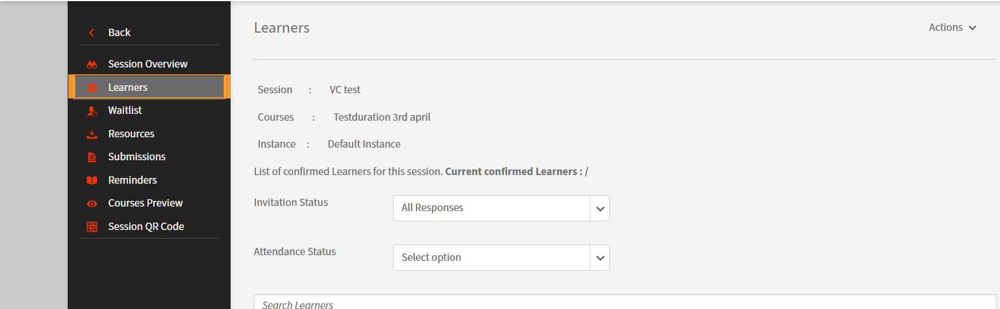
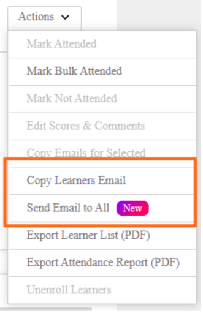
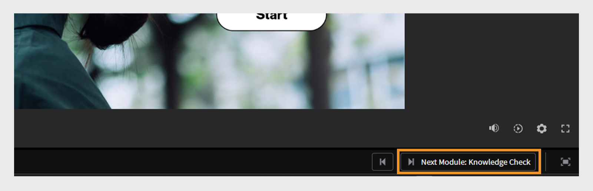
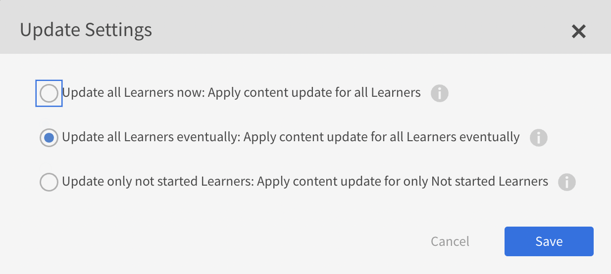
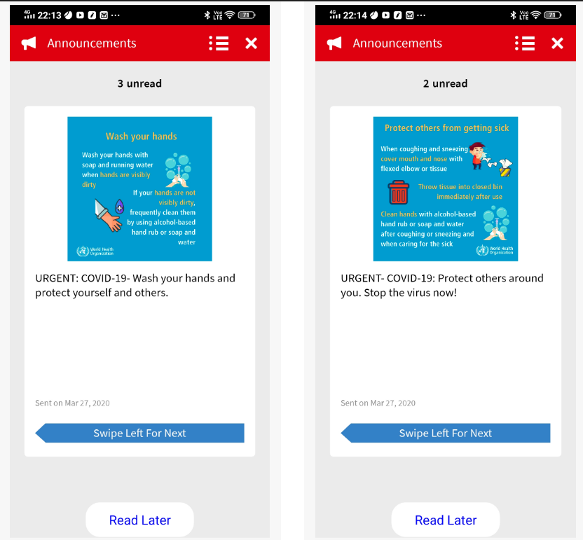
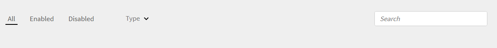
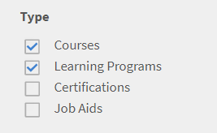
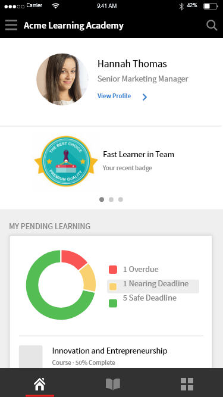

# Adobe Learning Manager 發行說明

<!--
<table>
 <tbody>
  <tr>
   <td></td>
   <td>
    
<a href="https://business.adobe.com/tw/products/learning-manager/adobe-learning-manager.html">Adobe Learning Manager</a> was launched in August 2015. As part of our continuous improvement efforts to enhance the product, we have been rolling out regular updates. Read on to know the features enhanced/issues fixed in update releases. 
</td>
  </tr>
 </tbody>
</table>

-->

+++ 更新 114：Adobe Learning Manager 2026 年 12 月 5 日版本

## 發行重點

2026 年 12 月版本的 Adobe Learning Manager 新增了報告建構器中的圖表與儀表板，與 Adobe Experience Manager 資產整合，並擴充了檔案提交功能，包括團隊提交與評估計畫。 本次版本還新增了課程層級與實例層級電子郵件的電子郵件建構器支援、小考的安全考試瀏覽器整合、學習者助理的模型情境協定（MCP）伺服器，以及無需使用者登入即可控制學習內容的存取。

Live Hub 現支援最多 5,000 名與會者的場次、多語言隱藏字幕及本地化介面。 Live Hub 現已普遍提供給 Ultimate 客戶，而 Channels 則一般對所有客戶開放。

## 本版本的功能

**報告建立器圖表與儀表板：** 管理員現在可以在報告建立器中視覺化報告資料。 從報表欄位建立大型數字圖、折線圖、圓餅圖及樞紐分析表，並在每個圖表中提供彙總與篩選功能。 報告儀表板會儲存由單一報告建立的圖表。 自訂儀表板可整合多個報表的圖表，並支援最多 20 個小工具。 屬於報告的圖表會在您分享報告時共享。 儀表板無法匯出。

[了解更多](/help/migrated/administrators/feature-summary/report-builder-visualization.md)

**報告建立器中的 Insights Agent 報告：** 管理員可以開啟、檢視、編輯並將 Insights Agent 回答儲存為報告建構器報告，然後使用報表建構器功能，例如訂閱。 如果問題的一部分無法用 Report Builder 欄位表達，報告會將該部分列為空白。

[了解更多](/help/migrated/administrators/feature-summary/insights-agent.md#create-report-insights-agent)

**Adobe Experience Manager 資產整合：** 作者可在不離開 Adobe Learning Manager 的情況下，瀏覽並選擇 Experience Manager 資產中核准的學習內容與影像資產。 當數位資產管理器中的資產變更時，更新內容可以流向使用該資產的課程。 作者只會看到他們在 Experience Manager 資產中已擁有存取權的資產。

[了解更多](/help/migrated/integration-admin/feature-summary/aem-assets-integration.md)

**檔案提交功能增強：** 檔案提交模組現支援以下功能：

* **團隊提交：** 講師組成最多 100 人組成的團隊。 每隊提交一份檔案，講師的評估適用於每位成員。 講師在新的 **Teams 管理** 頁面上管理團隊。

  [了解更多](/help/migrated/learners/feature-summary/submit-assignment-as-team.md)

* **評估計畫評量：** 作者定義評估計畫，包含已評分選項的客觀問題與經過書面審查的主觀問題。 評估計畫最多可包含100題。

* **講師核准或自動完成：** 作者可選擇提交是否需講師核准或自動完成。 此設定與評估計畫無關。

[了解更多](/help/migrated/administrators/feature-summary/team-submissions-and-rubrics.md)

**學習者助理模型情境協議伺服器：** 學習者可透過模型情境協議（MCP）伺服器，從他們已使用的工具（如 ChatGPT、Claude 及自訂代理程式）存取 Learning Manager。 管理員會在整合管理員應用程式中設定伺服器。 它提供搜尋、列出報名、取得學習物件、取得使用者資料、回答學習內容問題，以及個人化學習路徑功能。

[了解更多](/help/migrated/integration-admin/feature-summary/configure-alm-mcp-server.md)

**適用於課程與實例的電子郵件建構器：** 完整的電子郵件建構器體驗現已適用於課程層級及實例層級的電子郵件。 管理員定義帳戶版型與範本，作者則自訂課程與實例電子郵件，同時繼承版面配置與格式。 範本會連結到最近的可用版面配置，您可以解除連結以獨立編輯。 **橫幅與簽名設定已從**&#x200B;已移除的「設定&#x200B;**」標籤移至**「全域版面配置&#x200B;**」。** **&#x200B;**&#x200B;如果您的帳戶已啟用電子郵件建構器，您將自動收到這些變更。

[了解更多](/help/migrated/authors/feature-summary/customize-course-instance-emails.md)

**小考的安全考試瀏覽器整合：** 管理員可在帳戶層級啟用整合，並上傳安全考試瀏覽器設定檔（.seb）以定義評量限制。 作者可選擇哪些測驗需要使用安全考試瀏覽器。 嘗試此類測驗的學習者會被提示啟動或下載安全考試瀏覽器。

[了解更多](/help/migrated/administrators/feature-summary/safe-exam-browser.md)

**非登入功能增強功能：** Learning Manager 現在可在不要求使用者登入的情況下，受控地存取學習內容。

* **無需登入即可使用內容：** 管理員可為帳戶開啟或關閉未登入存取權限。 作者可以讓整門課程或特定模組無需登入即可使用。 學習路徑與認證遵循其中課程的設定。 僅支援自學進度的內容。
* **公開目錄：** 管理員可選擇哪些目錄會出現在公共學院中。
* **搜尋引擎與 AI 助理的發現（測試版）：** 公共學院可由搜尋引擎與 AI 助理發現。 每個學院都有自己的網站地圖和robots.txt，Learning Manager 會自動產生 meta 標題、meta 描述和結構化資料。 此功能需要在原生 Adobe Learning Manager 上建立自訂網域。

>[!NOTE]
>
>本專題的文件將很快公開。

**虛擬教練：** Virtual Coach 是一款由 AI 驅動的角色扮演與教練解決方案，讓學習者能練習逼真的職場對話。 它支援九種語言，可以作為獨立的作業輔助工具使用，也可以嵌入課程中。

[了解更多](../authors/feature-summary/virtual-coach/what-virtual-coach-is.md)

**Live Hub：** Live Hub 現已對 Ultimate 客戶開放，Prime 客戶仍處於測試階段。

[了解更多](../administrators/feature-summary/billing-management.md)

**Live Hub** 支援最多 5,000 名與會者：作者新增虛擬教室模組時，現在可選擇最多 5,000 名與會者的容量。 在大型課程中，攝影機存取、螢幕共享及白板功能僅限講師使用。 這些場次不設分組討論室。

[了解更多](../getting-started-with-live-hub/create-a-live-hub-session.md#create-a-course-for-large-session-create-large-session)

**Live Hub** 中的多語言隱藏字幕：講師現在可以在教室設定&#x200B;**中**&#x200B;選擇隱藏字幕語言。所有參與者皆以講師所選語言觀看字幕。

[了解更多](../getting-started-with-live-hub/closed-captions-in-live-hub.md)

**群組報名預約與候補名單管理：** 作者可以將教室與虛擬教室課程中的名額分配給特定使用者群組，為這些群組及所有其他學習者設定獨立的報名開放日期，並啟用自動候補名單升級及截止日期。

[了解更多](../authors/feature-summary/courses.md#configure-enrollment-window-and-seat-allocation-for-a-classroom-course)

**支援多個 Zoom 連線：** 整合管理員可以在單一帳戶中設定多個 Zoom 連線，並將其指派給特定角色或使用者群組。 作者在建立或編輯工作階段時，可從可用的連線中選擇。

[了解更多](../integration-admin/feature-summary/zoom-connector.md)

**通路：** 通路通常對所有客戶開放。

[了解更多](../administrators/feature-summary/create-channels.md)

## 本版本的增強功能

**個人化學習路徑編輯與品牌標籤：** 學習者可一次移除建議主題或課程。 管理員可以透過品牌頁面&#x200B;**重新定位學習者首頁**&#x200B;上的個人化學習路徑條。

[了解更多](/help/migrated/administrators/feature-summary/customize-learner-homepage.md#add-reorder-homepage-strips)

**學習者助理中的學習路徑引用：** 答案現在會引用包含來源課程的學習路徑，並附上課程本身。 從工作輔助工具中擷取的答案包含下載連結。

[了解更多](/help/migrated/learners/feature-summary/learner-ai-assistant.md#learning-path-citations)

**AI 助理配置：** 管理員助理提供兩個代理程式，分別是 Insights 代理與知識代理。 學習助理提供三種代理：知識代理、回應代理與學習路徑代理。 您可以分別設定每個代理程式。

[了解更多](/help/migrated/learners/feature-summary/learner-ai-assistant.md#configure-la-agents)

**重新寄送虛擬教室課程邀請：** 具有課程編輯權限的管理員可從實例頁面重新寄送課程邀請。 此選項適用於當前及未來的場次。

[了解更多](/help/migrated/instructors/feature-summary/resend-session-invite.md)

**從 Adobe Connect 錄影檢視自動出席：** 當學習者播放錯過的虛擬教室錄音時，Learning Manager 會標記出席。 排程整合會將實際檢視時間與帳戶設定的完成條件進行比較。

[了解更多](/help/migrated/integration-admin/feature-summary/track-attendance-through-adobe-connect.md)

**下載的報告建構器報告中的欄位標題變更：** 已下載的報告建立器報告中的預設欄位標題現在會包含資料集名稱。 例如，Learning Object 資料集中的 **Name** 會顯示為 **Learning Object - Name**。 對於彙總欄位，標題也會包含功能，例如 **學習物件數量 - ID**。 在別名&#x200B;**欄位中使用自訂名稱**&#x200B;的標題不會變更。

**合規元件中的多重報名課程：** 合規小工具列出學習者必須完成的所有多選課課程實例。 如果某個實例有截止日期，沒有截止日期的實例會被隱藏。

[了解更多](/help/migrated/learners/feature-summary/multi-enrolled-learner-compliance-widget.md)

**管理員目錄搜尋中的相關性排名：** 管理員檢視中的目錄搜尋會依相關性排序結果。 最先顯示完全匹配的部分匹配，接著是部分匹配。

[了解更多](/help/migrated/administrators/feature-summary/catalogs.md#search-catalogs)

**退休課程而不使學習路徑無法存取：** 已退休課程或巢狀學習路徑會從較高階的學習物件中移除，該物件仍會持續開放以接受新報名。

[了解更多](/help/migrated/administrators/feature-summary/settings/basic-settings.md#retiral-impact-ho-lo)

**Adobe Workfront 的課程取消同步：** 在 Adobe Workfront 取消的課程可透過遷移轉移至 Learning Manager。 移轉會新增一個可選的狀態&#x200B;**欄位，可接受**「啟用&#x200B;**」或**「已取消&#x200B;**」。**

[了解更多](/help/migrated/integration-admin/feature-summary/alm-workfront-cancellation.md)

**名字字元限制：** 名字欄位現在最多可容納 255 個字元，原為 63 個。 此限制適用於介面新增的使用者、透過 CSV 匯入、自我註冊以及外部使用者身分新增的使用者。 現有使用者不會受到影響。 在表格儲存格、下拉清單項目及搜尋結果中，長名稱會被縮短。 將滑鼠移到縮短名稱上即可完整查看。

[了解更多](/help/migrated/deployment-guide/user-setup.md#character-limit-username)

**本地化的 Live Hub 介面與錄製播放器**：Live Hub 現在以 Adobe Learning Manager 所選語言顯示介面，支援相同的 18 種語言。 錄影播放器會根據球場語言進行本地化。

**課程與學習路徑的徽章資訊：** 當作者新增課程或學習路徑時，視窗會列出現有課程與學習路徑，並附有徽章資訊、出版狀態及課程格式。

[了解更多](/help/migrated/authors/feature-summary/create-learning-path.md)

**自我註冊個人檔案的未登入頁面 URL：** 每個自我註冊個人檔案都可以擁有其可分享的未登入選單 URL，內建於 Experience Builder 中。 從該網址選擇 **「註冊」** 的使用者會被加入該網址所屬的個人檔案。

[了解更多](/help/migrated/administrators/feature-summary/experience-builder/non-logged-in-menu-url-self-registration.md)

**Learning Tools 互通性中的自訂學習者屬性：** Learning Manager 透過選用的名稱與角色配置服務端點以及啟動請求讀取自訂學習者屬性。 有些學習系統，例如 Moodle，並不支援這個端點。

[了解更多](/help/migrated/integration-admin/feature-summary/lti-support-for-nrps.md)

**討論區講師通知：** 無頭用戶可透過 API 將討論區活動摘要寄送給講師及班長。

[了解更多](/help/migrated/discussion-board-instructor-notifications.md)

**教師對學習物件實例的 Webhook 編輯：** 學習物件實例修改 webhook 現在也會在講師編輯虛擬教室課程時觸發。

[了解更多](/help/migrated/integration-admin/feature-summary/webhook-instructor-edits.md)

**Learning Path 註冊的最後存取日期：** 您可以透過 API 為 Learning Path 註冊附加自訂的中繼資料，例如最後存取日期。

[了解更多](/help/migrated/api-changes-dec-2026.md#last-access-date-lp-enrollment)

## API 變更

* **書籤 API 排序與已退役內容處理：** 書籤現在會優先回傳最新的，而已退役學習物件的書籤則不再回傳。 不會新增端點、參數或回應屬性。

  [了解更多](/help/migrated/api-changes-dec-2026.md#bookmark-api-ordering-retired-content)

* **討論區講師通知的 API：** 新 API 讓講師與班級經理訂閱討論區，並控制哪些活動出現在摘要郵件中。

  [了解更多](/help/migrated/api-changes-dec-2026.md#api-discussion-board-instructors)

* **在 Learner 應用程式中支援多重註冊實例的 API：** 新增可選 `includeMultiInstanceEnrollments=true` 參數以 `GET /enrollments` 包含多重註冊實例。 預設值為 `false`。

  [了解更多](/help/migrated/api-changes-dec-2026.md#api-multienrolled-instances-lc-widget)

* **Learning Paths 註冊的最後存取日期：** 使用管理權杖在 Learning Path 註冊上設定自訂的中繼資料。 用管理員或學習者憑證閱讀。

  [了解更多](/help/migrated/api-changes-dec-2026.md#api-last-access-date-lp-enrollment)

* **報告建立器匯出的作業 API 工作類型：** 新的 `generateCustomReport` 工作類型會依報告 ID 匯出已儲存的報告建構器報告。 現有的工作類型（包括 `generateQuizReport`）保持不變。

  [了解更多](/help/migrated/api-changes-dec-2026.md#api-job-report-builder-exports)

* **Zoom 連接器的 API：** 新增 API 可擷取並管理 Zoom 連線、儲存 Zoom 認證，並設定可使用連線的使用者群組與自訂角色。 API 採用基於會話的驗證，並需要整合管理員登入。

  [了解更多](../api-changes-dec-2026.md#apis-to-create-and-manage-the-zoom-connector)

## 本版本的重大變更

### 學習者成績單的 Salesforce 連接器匯出工作流程

Salesforce 連接器中學習者成績單（LT）資料表的主鍵已更新，以支援多種註冊情境。 這是一個重大變更，要求 Salesforce 客戶物件中現有的 LT 資料必須在 2026 年 12 月版本中被刷新。 未能清除資料可能導致重複記錄。

### Email Builder 推廣至所有客戶

電子郵件建構器功能於 2026 年 8 月版本中推出，現正逐步推廣至所有客戶。 鼓勵客戶在其沙盒或正式服務帳戶中探索此功能。

>[!NOTE]
>
> 帳戶一旦遷移到新的電子郵件建立編輯器，就無法回復到先前的電子郵件編輯器。 如果您的正式或沙盒帳戶尚未啟用電子郵件建構器，請聯絡您的客戶成功經理（CSM）或 Adobe 支援尋求協助。

### 未登入目錄選擇變更會導致中斷

自 2026 年 12 月 5 日版本起，Adobe Learning Manager 將不再透過 TDA 連接器匯出已停用的目錄。 過去，客戶可以使用停用的目錄來建立未登入的體驗。

此變更影響使用停用目錄進行非登入體驗的客戶。 這些目錄的內容將不再透過 TDA 連接器提供。

**解決**&#x200B;方法：在 2026 年 12 月 5 日版本之前，啟用任何用於未登入體驗的停用目錄，以確保其內容能持續存取。

## 本次版本修正的錯誤

**活動模組影片大小調整：** 當學習者更改網頁瀏覽器視窗大小時，嵌入活動模組中的 Vimeo 或 YouTube 影片並未調整大小。 影片周圍顯示黑色條紋，或是影片控制被隱藏在播放器工具列後方，直到模組重新開啟為止。 學習者現在可以在任何視窗大小下，以完整畫面與控制項檢視活動模組影片。

**SCORM 2004 模組完成狀態：** 通過 SCORM 2004 模組（例如以 Articulate Storyline 撰寫的內容）的學習者，有時會被記錄為通過但未完成。 因此，該課程及相關學習路徑持續處於進行中狀態。 這發生在內容幾乎同時回報已通過與完成狀態時。 課程與學習路徑現在會在學習者完成所有必修模組後轉為「已完成」。

**AEM 元件：** 課程與路徑元件未顯示學習者透過學習路徑註冊的課程，即使啟用顯示所有已報名課程的帳戶設定。 透過學習路徑報名的學習者幾乎沒有或完全沒有看到預期的課程。 學習者現在可以看到他們所報名的所有課程，包括透過學習路徑分配的課程。

**作者：** 在課程、學習路徑、認證及工作輔助工具的總覽頁面中，預設目錄以原始儲存名稱顯示，而非本地化名稱。 這影響了以非英語語言建立的帳號。 例如，「選擇目錄」欄位顯示為「Standaardcatalogus」而非「預設目錄」。 預設目錄名稱會以已登入使用者的語言顯示，與管理員中的目錄頁面一致。

**報告：** 若以包含非英文字元（如日文）的使用者群組名稱進行過濾，結果無法下載並顯示錯誤「無法載入預覽，請重試」。 報表產生現已使用 UTF-8 字元編碼。 對於名稱中含有非英文字元的使用者群組，並設有篩選器的報告現在都能成功下載。

**報告：** 在學員成績單報告中，當報告產生時，課程、學習路徑及認證等級的學分欄位為空白。 無論報告中是否包含模組層級的詳細資料，學分計算均為所有等級正確。

**一般：** 當使用者存取 Adobe Learning Manager 專屬的工作流程與功能（例如社交看板）時，會出現主控台錯誤。 這些工作流程現在可以載入時不會出現主控台錯誤。

**學習路徑：** 在學習路徑的「學習者」頁面上，當選擇子課程或學習路徑時，會顯示「取消報名」選項。 選擇此選項會將學習者的報名從整個學習路徑中移除，而非個別課程。 現在，當選擇子課程或學習路徑時，取消註冊功能會被停用，這與認證的行為一致。

**技能：** 被刪除的技能仍以變更名稱（如「一般刪除）」顯示在學習者訓練卡、目錄及搜尋結果中。 在所有技能顯示給學習者的地方，刪除的技能都會被排除在外。 學習者現在只看到主動技能。

**學習路徑：** 學習者在完成屬於學習路徑的課程後，無法提交第一級回饋表單。 選擇 **「提交」** 似乎沒有任何反應，也沒有顯示任何錯誤訊息。 當課程中啟用回饋，但未啟用學習路徑時，就發生了這種情況。 學習者可依課程層級提交回饋，任何提交失敗都會回報給學習者。

**電子郵件範本：** 在電子郵件範本頁面的「提醒與更新」下，外部學習通知管道有時會以原始本地化金鑰的形式出現，例如「notification.externalLearning：：submissionApproved.name」。 這些管道僅在應用程式內使用，且不會發送電子郵件。僅限應用程式內的管道不再出現在電子郵件範本頁面上。

**出席與評分：** 在批量貼上電子郵件 ID 標記出席時，包含大寫字母的電子郵件會被拒絕，錯誤顯示「在第 line number null 不是有效的使用者電子郵件，無法用來標記出席」，且沒有學習者被標記為已出席。 電子郵件 ID 無論大小寫、多餘空格或重複，都會被匹配。 錯誤訊息現在顯示正確的行號。 使用貼上電子郵件 ID 進行批次標記出席，現在的行為與 CSV 上傳選項相同。

**電子郵件建構器：** 在儲存、預覽或傳送範本時，文字區塊中段落間新增的空白行會被移除。 有意保留空白行。 電子郵件現在會完全按照 Email Builder 中撰寫的段落間距顯示。

**學習者：** 課程的詳細概覽區段中，粗體格式在作者與管理員預覽中可見，但在發佈後在學習者檢視中消失。 粗體文字會以作者身份顯示給學習者，斜體與底線格式則不受影響。

**課程：** 當作者編輯現有模組以支援另一種傳遞類型，例如將模組從虛擬教室改為虛擬教室及教室時，學習者檢視仍會顯示先前的交付類型。 管理員與作者視圖正確顯示為混合模式。 當模組被編輯時，向學習者顯示的傳遞類型會更新。 學習者現在看到的傳遞類型與管理員及作者相同。

**搜尋：** 當套用目錄篩選時，搜尋結果不會包含學習者間接報名的課程，例如透過學習路徑、群組或管理者指派。 儘管課程對學習者開放，搜尋結果卻未回來。 目錄篩選式搜尋現在同時包含直接與間接登記。

**自訂證書：** 當課程、學習路徑或認證被刪除時，其與自訂證書設計範本的關聯並未被移除。 因此，刪除範本失敗時出現錯誤：「無法刪除此憑證，因為它已附加到學習物件或實例」，即使該學習物件已不存在。 當學習物件被刪除時，關聯也會被移除。 管理員現在可以無錯誤地刪除未使用的自訂憑證範本。

**自訂角色：** 已設定自訂角色的使用者在開啟自動產生字幕（VTT）檔案的「檢視字幕」對話框時，收到「載入字幕檔失敗」的錯誤訊息。 下載檔案如預期般運作，且未設定自訂角色的使用者未受影響。 具有自訂角色的使用者可以開啟並檢視自動產生的字幕。

**QR 碼：** 在更新帳戶的自訂學習者 URL 後，為現有課程產生的 QR 碼仍會重新導向先前設定的 URL。 報名、完成及匯出學習者名單的 QR 碼使用目前自訂的學習者 URL。

**行動應用程式：** 即使未達成完成條件，模組在嘗試間仍被鎖定。 當學習者在完成測驗前關閉沉浸式測驗時，就發生了這種情況。 當未達成完成條件時，模組不再被鎖定。 學習者現在可以重新嘗試測驗。

**Live Hub 無障礙功能：** 無障礙改進針對螢幕閱讀器、鍵盤導覽、隱藏字幕、色彩對比以及縮放與重排等問題，提升參與者的可用性。

## 本版本已知問題

**課程概覽頁面顯示多實例課程的錯誤實例詳細資訊**&#x200B;課程概覽頁面可能會顯示較早實例的截止日期、課程數或報名次數，而非目前進行中的實例。

這種情況可能發生在有兩個或以上啟用實例的課程中，且檢視者尚未註冊課程，例如作者以學習者身分預覽課程，或學習者在註冊前瀏覽課程。 因此，學習者可能會看到已過的截止日期，或已結束或取消的課程。 已註冊的學習者會看到自己實例的詳細資訊，且不會受到影響。 未來版本已規劃進行修正。

**課程層級電子郵件範本的變更也可能同時影響帳戶層級範本**&#x200B;在課程層級編輯課程-自我報名電子郵件範本，也可能變更帳戶層級的範本。

這可能發生在課程的電子郵件設定首次由管理員儲存，而其介面語言與帳戶層級範本自訂時的語言不同時發生。 課程層級範本的後續編輯也會套用到帳戶層級範本。 未來版本已規劃進行修正。

**直接報名次數包括學習計畫報名次數**&#x200B;在課程的學習者區段，透過學習計畫註冊的學習者會被計入直接報名人數。 然而，實例卡片上的工具提示將學習計畫註冊列為間接報名。

數量與提示說明不一致。 工具提示將於未來版本更新以符合數量。

**嵌入在 SCORM 內容中的 YouTube 影片在 Chrome 中無法播放**&#x200B;嵌入在 SCORM 內容中的 YouTube 影片，在 Google Chrome 中開啟時，學習者體驗中可能無法播放。

本次版本未包含任何修正，目前正在評估未來版本的相關問題。

**學習者應用程式中的作者頁面不會在高解析度螢幕上載入更多課程**&#x200B;在學習者應用程式的作者頁面上，只有前六門課程會以網格視圖顯示在高解析度螢幕上，且學習者無法載入其他課程。

當學習者捲動至頁面底部時，額外課程會自動載入。 在高解析度螢幕上，第一組賽道完全顯示在螢幕上，因此沒有要捲動的內容，下一組也不會被要求。 未來版本已規劃進行修正。

**從 UI 匯出的第 2 級測驗報告所包含的資料列數少於從 Job API 匯出的報告**&#x200B;當從 UI 匯出第二級測驗報告時，匯出的檔案只包含有限的列數，例如 3,000 位使用者。 透過 Job API 產生的同一報告包含所有資料列。

UI 匯出的列數限制低於 Job API 的列數。 這點將在未來版本中處理。 在此期間，請使用作業 API 匯出完整報告。

**已刪除課程的儀表板與下載的 Excel 報告不同**&#x200B;當課程被退休並刪除時，選擇「顯示當前值資料」的儀表板報告仍會將學習者列為已報名並完成。 從同一儀表板下載的 Excel 報告並未包含學習者的詳細資料。

已刪除課程的儀表板與下載報告不一致。 未來版本已規劃進行修正。

**匯出的教室位置 CSV 中欄位名稱未本地化**&#x200B;當 UI 語系設定為非英文語言時，從教室位置頁面匯出的 CSV 檔案會以英文顯示其欄位名稱（頁首列），而非所選語言。

此行為發生在從管理員設定檔匯出教室位置時>設定>教室位置。 雖然檔案中的位置資料會正確回傳，但欄位標頭並未轉換成符合管理員所選擇的 UI 語系。 因此，在非英語地區工作的管理員，會在本地化環境中看到英文欄位名稱。

只有標頭列受到影響;匯出檔案中的底層位置資料則不受影響。 本次版本未包含任何修正，目前正在評估未來版本的相關問題。

**Live Hub 中的字幕品質限制**

Live Hub 的字幕在不同支援語言間的準確度可能有所不同。 字幕品質取決於語言，並可能影響直播時產生文字的準確性。

Adobe Learning Manager 支援多種語言的即時字幕，但 Word 錯誤率（WER）有所不同。 字幕準確度在以下語言間有所不同：

| 錯誤率 | 字幕品質 | 語言 |
|---|---|---|
| 最高可達 5% | 準確度良好 | 英語、西班牙語、日語、德語、義大利語、韓語、葡萄牙語 |
| 高於 5% 或低於 10% | 小錯誤 | 法語、荷蘭語、俄語、土耳其語、中文、瑞典語、芬蘭語 |
| 10% 及以上 | 精度降低 | 挪威語、丹麥語 |

這是目前版本中已知的限制。 未來版本計畫進行改進，以提升支援語言的字幕準確度與品質。

+++

+++更新 113：Adobe Learning Manager 2026 年 10 月 27 日版本

## 本次版本的強化

Go1 整合：Adobe Learning Manager 中的 Go1 整合已增強，使課程完成追蹤更可靠。 即使學員在Go1完成後立即離開球場，Go1完成次數也能被準確記錄。 此修正有助於確保學習者成績單與管理員報告保持完整且最新。 無需設定，現有的 Go1 課程仍能照舊運作。 [了解更多](/help/migrated/integration-admin/feature-summary/go1-webhooks.md)。

## 修正的錯誤

**行動裝置：** 在使用 iOS Safari 的 iPhone 上，從目錄或搜尋 CTA 以直向方式啟動課程時，會顯示「請旋轉您的裝置」提示。 即使轉到橫向畫面，提示仍持續出現，導致賽道無法開始。 這個問題已經修正，玩家現在能在輪換時恢復，並如預期般啟動賽道。

**學習者：** 學習者無法在檔案提交模組中提交 Excel、PowerPoint、影片、ZIP 及其他檔案類型，並收到通用錯誤。 此問題已修正，學習者現在可依預期上傳並提交這些檔案類型。

**電子郵件範本：** 當會議範本從全域版面移除連結時，行事曆邀請郵件顯示空白內容及空.ics事件描述。 此問題已修正，未連結的範本現在會在電子郵件與行事曆事件描述中，如預期顯示已設定的會話詳細資料與版面配置內容。

+++

+++更新 112：Adobe Learning Manager 2026 年 9 月 30 日版本

## 本版本的功能

**虛擬教練：** Virtual Coach 是 Adobe Learning Manager 中的一套 AI 驅動的教練解決方案，幫助學習者透過真實角色扮演情境、個人化回饋及隨需練習來發展技能，然後再將這些技能應用於真實世界情境中。 [了解更多](/help/migrated/authors/feature-summary/virtual-coach/what-virtual-coach-is.md)。

**座位共享：** 座位共享允許帳戶與另一個帳戶共享部分授權座位，讓接收帳戶的學習者能透過共享座位存取 Adobe Learning Manager。 座位共享僅限 Ultimate 帳戶使用;Prime 帳戶既不能共享座位，也無法接收座位，且以信用卡計費的帳戶預設為 Prime 方案。 試用帳號是例外，可以從 Ultimate 帳號獲得共享座位。 在啟用座位共享關係期間，試用帳戶將獲得終極層級的功能存取權。 [了解更多](/help/migrated/administrators/feature-summary/tiering-seat-sharing.md)。

**Learning Path Agent 強化功能：** Learning Path Agent 現在提供更多彈性，可在儲存前建立與優化個人化學習路徑。

* **建立更多學習路徑：** 學習者現在最多可建立 20 條學習路徑，較先前的 10 條限制增加。
* **在儲存前細化路徑：** 學習者可以以自然語言要求代理程式新增、移除或替換課程，然後再儲存學習路徑。 代理程式只會更新所請求的課程，其餘路徑不變，讓學習者能持續優化路徑，直到符合需求。
* **改善完整學習路徑的處理：** 一條學習路徑最多可包含五門課程。 如果學習者要求將另一門課程加入完整路徑，代理會提示他們選擇一門現有課程以替換。
* **更智慧的課程變更指引：** 若學習者的需求不明確，客服人員會在修改路徑前先求明確說明。 若無法找到合適的替代方案，代理人會說明限制並建議最接近的替代方案。

[了解更多](/help/migrated/learners/feature-summary/learning-path-agent.md)。

**管理員稽核追蹤報告：** 管理員稽核追蹤報告提供您設定變更的歷史紀錄，讓您能判斷：

* 是誰做出了改變
* 變更發生的時間
* 改動前的設定是什麼
* 變更後的設定是什麼

本報告涵蓋了以下事項的變更：

* 基礎
* 進階
* 整合

此報告也可以由工作 API 產生。 請參閱 [管理員稽核追蹤報告](/help/migrated/administrators/feature-summary/reports.md#adminaudittrailreport) 與 [工作 API 以取得管理員稽核追蹤報告](/help/migrated/api-changes-sep-2026.md#apiaudittrailreport)

## 本版本的增強功能

### Insights 代理程式

Insights Agent 進行了兩項強化。 它們是：

* **產品術語支援：** 如果您的管理員在「設定>一般」中使用產品術語自訂標準術語，Insights Agent 會識別並使用這些術語取代預設術語。 例如，如果你的組織將「課程」改名為「章節」，你可以問：「上個月完成了多少章節？」 Insights Agent 會解讀自訂詞彙，並在回應與欄位標頭中使用「chapter」。

* **課程報名（預設不包括等候名單）：** 對於沒有篩選器的直接與間接報名查詢，直接報名的人數會包含處於等待狀態的學習者，即使他們在候補名單上且未積極參與。 預設情況下，「方法」面板不會顯示候補學習者是否包含在統計中。 僅在管理員明確要求排除時，候補名單學習者才會被排除，此時會揭露所套用的規則。

[了解更多](/help/migrated/administrators/feature-summary/insights-agent.md)。

### 自訂憑證 - 憑證設計器

當徽章加入證書設計時，證書產生系統僅支援以文字為基礎的徽章欄位。 結果，學習者的徽章圖片在產生的 PDF 中遺失或顯示錯誤。 透過這項修正，系統現在能辨識徽章圖像的佔位符，並以學習者獲得的徽章圖像取代，同時保留證書設計器中設定的位置與大小。

## API

* **學習物件目錄存取 API：** 學習物件目錄存取 API 讓您判斷是否能透過指定的目錄直接存取一個或多個學習物件。 使用回應來控制與註冊相關的 UI 元素。 例如，僅在確認直接目錄存取時顯示「報名」選項，同時允許學習者無論是否存取目錄，都能檢視課程頁面。
了解更多。

* **管理員審計追蹤報告工作 API：** 此 API 用於處理審計追蹤報告工作——建立一個工作，產生針對指定日期範圍及設定類型組合的設定變更審計追蹤報告。

[了解更多](/help/migrated/api-changes-sep-2026.md)。

## 修正

**Learning Path 實例：** 當 LP 實例時區與管理員的系統或瀏覽器時區不同時，Learning Path （LP） 的開始與結束日期顯示錯誤。 編輯日期導致開始日期顯示錯誤的日曆日，而相同的時區轉換問題也影響了行事曆中的通知通知。

**行動應用程式：** 在 Safari 和 Edge 中，學習者切換橫向與直向時，播放器大小調整不正確，導致顯示問題，例如總覽區段出現白線，無法存取目錄與筆記。

**遊戲化：** 學習者在從書籤區重溫已完成的課程時，不會獲得遊戲化點數。

+++

+++更新 111：Adobe Learning Manager 2026 年 8 月 31 日版本

## 本版本的增強功能

**由我儲存的小工具**

* **管理員：** 管理員可以在頁面上放置「由我儲存」小工具，讓學習者能輕鬆找到他們已加入書籤的內容。 這讓學習者可以回到先前儲存的課程，而不必再次搜尋或瀏覽。 了解更多關於「由我儲存」小工具[&#128279;](/help/migrated/administrators/feature-summary/experience-builder/add-a-widget.md#bookmark-widget)的資訊。

* **學習者：**&#x200B;**「由我**&#x200B;儲存」小工具會顯示您已加入書籤以供日後使用的課程、學習路徑、認證及工作輔助工具。使用此小工具快速在同一處存取已儲存的內容，無需再次搜尋目錄。 了解更多關於「由我儲存」小工具[&#128279;](/help/migrated/learners/feature-summary/saved-by-me-widget.md)的資訊。

**頻道主題色彩：** 建立頻道時，您可以從更多頻道主題顏色中選擇。 主題色會在你選取後依情境套用，以凸顯對比。 當您為頻道選擇主題顏色時，所選顏色會套用到頻道介面，並設計用來與頻道縮圖及文字保持對比。 建立頻道時會自動指定預設顏色，但您可以隨時從可用選項中選擇其他顏色。

**影片縮圖：** 學習者現在能快速透過影片的磁貼辨識影片，而磁貼會顯示縮圖，幫助一眼辨識內容。 如果來源影片沒有提供自己的縮圖，Adobe Learning Manager 會自動根據頻道主題顏色、抽象圖案和影片標題生成縮圖。

**頻道：** 只有當至少建立一個頻道、包含至少一支來源影片，且標示為「對學習者可見」時，「頻道導覽」選項才會對學習者顯示。 了解更多關於頻道的[&#128279;](/help/migrated/administrators/feature-summary/create-channels.md)資訊。

## 修正的錯誤

**Adobe Experience Manager 元件：** 升級至 Adobe Learning Manager 參考網站套件 v2.0.1 後，使用者點擊通知鈴時通知面板未能載入。 載入器持續無限旋轉，導致通知無法顯示。 此問題也導致多次呼叫 /userNotifications 端點，最終導致 HTTP 429 回應。 通知載入工作流程已修正，以防止過多的 API 請求並解決載入問題。 通知現在能正確載入，面板也能如預期開啟，無需不必要的 API 限速。

**Adobe Learning Manager 行動應用程式>學習路徑：** 在 Adobe Learning Manager 行動應用程式中，已完成的課程在 Adobe Learning Manager 行動應用程式中，卻錯誤地以黃色指示器和紅點顯示，儘管其狀態顯示為已完成。 這種視覺不一致僅發生在學習路徑內的課程，而已完成的模組則正確顯示。 行動應用程式中學習路徑課程的狀態指示邏輯已修正。 已完成的課程現在會顯示正確的綠色完成指示。 這確保了行動應用程式與桌面瀏覽器間的完成體驗一致。

+++

+++更新 110：Adobe Learning Manager 2026 年 8 月 16 日版本

## 發行重點

Adobe Learning Manager 於 2026 年 8 月發布，在個人化學習、AI、報告與整合方面帶來重大進展。

功能完整的成績簿為課程新增加權評分與綜合通過/不通過計算，讓組織能精確且可配置地衡量學習者表現，而非僅僅是完成度追蹤。

在 AI 方面，學習者 AI 助理可取得課程摘要、學習對象比較、Adobe Experience League 答案，以及來自 Go1 與 LinkedIn Learning 目錄的第三方內容查詢;全新的學習路徑代理程式會引導學習者進行對話，自動生成自訂的序列學習路徑;而 Insights 代理則將自然語言查詢帶入管理員報告。 所有 AI 功能皆由帳單頁面中的全新 Gen AI 積分系統管理，管理員可依功能設定使用限制及使用提醒。

內容管理透過基於所見即所得元件的電子郵件範本建構器、具角色存取權的階層式內容資料夾結構、外部學習功能用於提交與核准平台外培訓，以及新的「管道」功能（彙整企業網頁與 Confluence 頁面的影片內容）而獲得強化。

了解更多關於 [Adobe Learning Manager](/help/migrated/whats-new.md) 2026 年 8 月版本中新增內容與變更內容。

## 版本中的破壞性變更

### 外部學習功能：學習者成績單新增欄位

這些欄位會在 LT 報告中新增帳戶專屬的外部學習自訂欄位。 在 Admin LT 中，新的自訂欄位欄位會附加在最後;在 Learner LT 中，外部學習名稱與完成評論會插入在相關模組與審查欄位附近，其餘自訂欄位則在最後新增。

了解更多關於 Adobe Learning Manager[&#128279;](/help/migrated/reporting-changes-august-2026.md) 2026 年 8 月版本中報告變更的資訊。

### 學員成績單中認證的根訓練識別碼

這會在 Admin LT 與 Learner LT 中新增一個新的根訓練 ID 欄位。 此欄位會出現在報告的末尾，有助於識別學習者紀錄的父級認證上下文。

了解更多關於 Adobe Learning Manager[&#128279;](/help/migrated/reporting-changes-august-2026.md) 2026 年 8 月版本中報告變更的資訊。

### Webhook 日期-時間格式與學習者成績單的對齊

這會將 webhook 資料物件的日期-時間值標準化為分鐘精確度。 秒數總是以 00 發出，使 webhook 的時間戳與 LT 報告格式對齊。

了解更多關於 Adobe Learning Manager[&#128279;](/help/migrated/reporting-changes-august-2026.md) 2026 年 8 月版本中報告變更的資訊。

### 學習者成績單中的權重欄位

對於啟用成績簿的課程模組，LT 報告中會新增權重欄位。 這會直接在報表輸出中顯示模組權重。

了解更多關於 Adobe Learning Manager[&#128279;](/help/migrated/reporting-changes-august-2026.md) 2026 年 8 月版本中報告變更的資訊。

### learningObjects API 中的共用課程作者詳細資訊

詳細資訊會更新共享課程的 learningObjects API LO 回應，因此接收帳號不再顯示接受管理員為作者。 在同儕帳戶中，只有原始外部作者的詳細資料會被揭露;父帳戶的行為則保持不變。

### AI Orchestrator 代理程式中的意圖偵測

AI Orchestrator 代理程式將單一查詢請求的意圖偵測移入 orchestrator，並移除手動使用者介面切換。 查詢路由可能會根據偵測到的意圖在 Q&amp;A 與 PLP 流程間改變。

## 本次版本修正的錯誤

**學習者成績單：** 學習者成績單報告中的日期過去會記錄 00 以秒數表示，而在 webhook 中，秒數則如預期般顯示——以兩位數表示。 這問題已經修正了。 學習者成績單現在也能正確顯示兩位數秒。

**實例：** 當 Microsoft Teams 或 Adobe Connect VC 工作階段從實例頁面被取消時，頁面重新整理後，部分相關工作階段細節仍會保留。 此問題已修正，取消的課程現在會正確移除所有相關細節，包括 Teams 組織者與大廳繞過設定，以及 Connect 主要講師。

**API：** 自動化 AWS 工作流程中的某個問題，導致重複對 CMS HTTP API 的下載請求使用了不正確編碼的 URL，導致間歇性出現 HTTP 500 錯誤以及大量無效流量。 工作流程已更新，以正確編碼下載請求 URL 中的空格及其他特殊字元。 因此，帳戶資產下載請求能成功處理，減少錯誤並提升自動資產檢索的可靠性。

**學習者：** 某個問題導致課程詳細概覽區段套用的斜體格式在撰寫過程中正確顯示，但在發佈後面向學習者的課程總覽頁面上則無法顯示。 呈現邏輯已更新，以在課程內容發布時保留斜體文字格式。 因此，在已發佈的課程總覽頁面上，詳細概覽區段套用斜體字會正確且一致地顯示給學習者使用。

**自訂認證：** 當上傳 SVG 影像作為成就證書的證書背景時，證書預覽顯示空白白色背景。 憑證預覽渲染流程已更新，以正確支援並顯示已上傳的 SVG 背景影像。 因此，憑證預覽現在會依預期呈現已配置的 SVG 背景，提供最終憑證的準確呈現。

**作者：** 長篇互動影片的 VTT 檔案生成可能會有明顯延遲，有些上傳的處理時間甚至超過兩小時。 此問題已經過調查與優化，以提升大型影片檔案的 VTT 產生效能與可靠性。 因此，VTT 檔案的產生效率提升，為互動式影片上傳提供更快速且一致的字幕工作流程。

**API：** 儘管完成資料在後端存在，符合指定的日期範圍與使用者群組篩選條件，且符合所有報告條件，部分學習者完成紀錄仍未被報告匯出 API 回傳。 針對多個工作學習者完成的報告匯出流程及資料擷取邏輯已改進，以確保符合資格的完成紀錄能一致納入 API 匯出。 報告匯出 API 回應現在會回傳完成時間戳記落在所要求日期範圍與篩選範圍內的使用者的完整學習者完成資料，提供更準確且可靠的報告結果。

**Webhook：** 當學習者報名了後來被取消的課程，除非學習者先從該課程取消註冊，否則報名同一課程的其他課程不會觸發新的註冊 Webhook 事件。 這導致下游系統錯過已取消或先前完成的有效註冊更新。 Webhook 流程已更新，當學習者在先前課程取消或結束後，再次報名同一課程的另一個課程時，會觸發新的報名事件，確保報名活動能一致回報。

**API：** 管理員 API 對於包含大量相關資料（如實例、註冊、資源與成績）的學習路徑請求，效能大幅下降，回應時間從典型的五至八秒延長至多達 45 至 60 秒，影響整合工作流程及後續系統。 已實施效能優化，納入大量學習物件請求，以提升資料擷取效率。 包含複雜巢狀關係的學習路徑 API 呼叫，現在能更穩定地回傳結果，並提升回應時間，有助於確保整合效能可靠。

**電子郵件與通知：** 即使原課程已停用完成電子郵件範本，完成定期認證課程的學員仍會收到課程完成郵件。 這是因為定期認證建立新課程與實例時，未複製原始課程層級通知設定，導致重複課程使用預設電子郵件設定。 重複流程已更新，以在複製課程時保留課程通知設定。 因此，現在只有在原始課程設定中明確啟用時，才會寄出結業郵件。

**學習者：** 設定為影片的主頁公告僅在學習者首頁顯示初始影片畫面，且播放未如預期自動開始。 影片播放行為已更新，以確保在載入公告時，支援的主播影片能正確自動播放。 學習者現在可以在不需手動播放的情況下觀看以影片為主的報頭公告，提供更具吸引力的體驗。

**學習者：**&#x200B;**您的網路**&#x200B;趨勢小工具錯誤地在兩側橫列顯示&#x200B;**空白的開始學習**&#x200B;卡片。此問題已透過為每一列繪製適當的空狀態卡片而獲得修正。 第一列現在會顯示 **「前往目錄** 」連結，而第二列則依預期繼續顯示 **「開始學習** 」卡片。

**API：** 當學習者依名稱（A–Z）排序目錄時，公開 API 以區分大小寫排序回傳結果，導致課程名稱（AA、BB、CC）出現在小寫名稱（aa、bb）之前，而非遵循標準字母順序。 排序邏輯已更新，可使用不區分大小寫的比較。 課程成績現依預期字母順序顯示，無論字母大小寫為何，確保課程名稱順序一致。

**CR-VC：** 當新講師加入 VC 課程時，若「您已被新增為講師/主辦人/共同主辦者」的電子郵件範本被停用，則不會發送邀請函，導致講師無法收到課程詳情。 通知邏輯已修正，以確保講師課程邀請是獨立於範本產生的。

**用戶端共通：** 當活動模組在課程加入自動註冊觸發（AET）學習計畫後更新時，學習者預覽仍顯示 AET 實例的時長，而非預設課程實例更新後的時長。 此問題已透過確保學習者預覽從正確的課程實例擷取模組時長而獲得修正。 學習者預覽現能準確顯示最新發布的模組時長，反映課程內容的更新。

**學習者：** 在有序認證中，學習者可跳過未通過的第一門課程，透過完成其先修條件進入鎖定的第二門課程，當該要求設定為任一課程時，該認證即可被標記為完成。 驗證系統已更新，以一致執行課程順序與鎖定規則。 學習者現在只能依照既定順序完成認證要求，避免鎖定課程對認證完成有影響。

**API：** 當資源被加入課程但未附說明時，若資源後來更新，GET /learningObject/{id} API 不會回傳新新增的描述。 這導致 API 暴露了過時的資源元資料。 同步問題已修正，API 現在無論新增時間，都會回傳最新的資源描述。

**API：** 當模組隨描述遷移後，描述後來被更新時，更新後的值會正確儲存在模組資料表中，但未反映在使用者介面中。 介面持續顯示舊有描述，因為該描述來源為content_group紀錄，且修改期間未更新該紀錄。 此同步問題已解決，且遷移後更新的模組描述會一致反映於整個介面。

**電子郵件範本與設定：** 當管理員在電子郵件範本設定中更新電子郵件橫幅時，新的橫幅在 Outlook 桌面版中正確顯示，但在 Outlook Web 中卻未顯示，導致不同客戶端的電子郵件體驗不一致。 電子郵件範本的呈現方式已更新，以確保橫幅在 Outlook 各平台間的相容性。 更新後的電子郵件橫幅現在能在 Outlook 桌面版和 Outlook Web 版本中正確顯示。

## 本版本已知問題

### 講師無法在模組間加入虛擬教室

講師若嘗試在其分配課程模組預定時間外進入教室，則無法加入虛擬教室。

Adobe Learning Manager 使用單一的虛擬教室教室來管理課程中的所有模組。 當講師啟動教室時，該課程會與該講師連接的模組相關聯網址。 任何後續的加入請求都必須與該房間關聯的活動模組相符。 如果另一位講師在其他模組啟用時嘗試使用不同模組的加入連結加入，存取權限房間被拒絕。 共用房間中一次只能啟用一個模組。

這種行為在目前版本中是預期的。 未來版本計畫推出強化功能，讓課程講師無論使用哪個模組都能加入教室。

### 當麥克風和喇叭在 macOS 上不同時，音訊會斷斷續續

在 macOS 虛擬教室作業中，當選取的麥克風與喇叭是不同裝置時，音訊可能會間歇性斷斷續續或聽起來雜亂。

當音訊輸入與輸出使用不同裝置時，例如麥克風使用AirPods，播放則使用內建喇叭，可能會出現這種行為。 因為每個裝置都會引入自己的音訊延遲，所以回聲消除效果較差，背景噪音抑制有時會將語音部分誤判為噪音。 這可能導致短暫的音訊中斷。 當說話者的聲音會以較低音量錄製，例如當麥克風擺得較遠時。

這是已知的平台限制，並非 Adobe Learning Manager 特有。 類似的行為也在其他會議應用中被觀察到。 本次版本未包含任何修正，目前正在評估未來版本的相關問題。

請同時使用同一個裝置安裝麥克風與喇叭，以避免此現象。

### 在 Chrome 中，共享影片在失去焦點後凍結

當講師分享播放影片的 Chrome 視窗後，然後將焦點從該視窗移開時，與會者可能會看到共享內容凍結或顯示黑屏。

影片會持續在本地為講師播放，但遠端參加者可能無法看到內容更新，因為共用視窗失焦。 行為會因作業系統而異：

- 在 Windows 上，與會者會看到一片黑屏。
- 在 macOS 上，與會者會看到最後顯示的影片影格。

當焦點回到共用瀏覽器視窗時，與會者的影片播放通常會恢復。

這是瀏覽器與作業系統的限制，並非 Adobe Learning Manager 專屬。 此版本沒有針對特定產品的修正。

在呈現影片內容時，保持共用瀏覽器視窗的焦點。 播放時避免切回虛擬教室視窗。

### 講師無法加入已在使用的模組

當講師嘗試同時啟動使用相同虛擬教室的兩個課程模組時，只有第一位講師能成功進入教室。

Adobe Learning Manager 使用單一共享虛擬教室作為課程實例。 當第一位講師加入教室時，該教室會與該講師的模組相關聯。 額外的加入請求包括已針對啟用模組進行驗證。 若其他講師嘗試使用其他模組連結加入，存取將被拒絕。 因此，無法在同一堂內同時進行由講師主導的課程使用共用教室的獨立模組的課程實例。

這種行為在目前版本中是預期的，也與現有的房間架構一致。 此功能正根據客戶回饋進行評估，以進行未來強化。

### 共享內容在返回 Live Hub 視窗後會顯示隧道效果

當講師分享整個螢幕後再返回 Live Hub 視窗時，參與者可能會在共享內容中感受到隧道效應。 當您分享整個螢幕時，共享資訊流會包含桌面上顯示的所有內容。 切換回 Live Hub 視窗可能導致共享內容反覆擷取並顯示 Live Hub 介面，導致意料之外的視覺現象。 這是全螢幕共享的已知限制，目前正評估未來版本的使用。

分享特定的應用程式或視窗，而不是分享整個螢幕。 例如，分享您希望參與者檢視的簡報或文件視窗。 共用單一應用程式可以讓共享內容保持隔離，並防止隧道效應。

### 重新加入已結束的工作階段後，會話儀表板報告不會立即顯示

重新加入結束的工作階段後，會話儀表板報告不會立即顯示如果講師在課程結束後查看課程儀表板，然後使用其 URL 重新加入同一課程，現有的課程儀表板報告可能不再可用。 報告在處理上一次工作階段實例期間，大約需要五到七分鐘才能重新刷新並重新可用。 這是已知的限制，目前正在評估未來版本的使用。

關閉工作階段後請等待五到七分鐘後再重新開啟儀表板 URL。 這會讓上一個工作階段執行個體完成處理，之後工作階段儀表板報告才會再次可用。

### 匯出的教室位置 CSV 中欄位名稱未本地化

當 UI 語系設定為非英文語言時，從教室位置頁面匯出的 CSV 檔案會以英文顯示其欄位名稱（頁首列），而非所選語言。

此行為發生在從管理員設定檔匯出教室位置時>設定>教室位置。 雖然檔案中的位置資料會正確回傳，但欄位標頭並未轉換成符合管理員所選擇的 UI 語系。 因此，在非英語地區工作的管理員，會在本地化環境中看到英文欄位名稱。

只有標頭列受到影響;匯出檔案中的底層位置資料則不受影響。 本次版本未包含任何修正，目前正在評估未來版本的相關問題。

### 信用期間欄位輸入上限為 9999.99

當使用者在工作階段編輯表單輸入大於 9999.99 的信用期間值（例如 999999），儲存時該值會靜默地被限制在 9999.99，且不會顯示驗證錯誤或警告給使用者。 該欄位的 HTML max 屬性設定為 9999.99，可在瀏覽器層級強制執行此上限，且不會通知使用者其輸入被拒絕或修改。 此版本尚未進行任何修正，因為此行為已確認為設計正常運作。

### 錯誤訊息未指出 CSV 上傳中缺少預設語言列

當結構化位置 CSV 上傳僅包含非預設語系的列，例如 fr、de，且帳戶預設語言中沒有列時，回傳的錯誤訊息會顯示 CSV 第 1 列為 Locale，第 2 欄無效或不支援。 這並不表示實際問題是缺少預設語言列。 這可防止使用者上傳多語系 CSV 並僅憑錯誤訊息診斷問題。 這個問題在本版本中已取消，且未進行任何修正。

### 座位限制欄位允許不切實際的數值最高可達 4,294,967,295

教室位置模式中的座位限制欄位接受最高 4,294,967,295（~43 億）的值，此上限技術上由底層資料類型驅動，而非實際的業務限制。 使用者可以輸入並儲存不切實際的座位數，例如 1,000,000,000 個，且不會經過任何業務層級的驗證。
此版本尚未進行任何修正;現實中的業務上限尚未達成共識或執行。

+++

+++更新 109：Adobe Learning Manager 2026 年 7 月版本

發行日期：2026 年 7 月 16 日

## 修正的錯誤

**電子郵件範本：** 針對已報名課程的學習者，即將到來的課程提醒電子郵件未提供課程日期與時間資訊。 此問題已修正，以正確填入電子郵件範本中的會話排程細節。 學習者現在會收到即將到來的課程提醒電子郵件，內含相關課程日期與時間，提供完整的排課資訊。

**連接器：** 作者在複製或編輯基於連接器的教室/虛擬教室課程時，間歇性遇到 HTTP 400 錯誤。 一旦觸發，問題就會持續存在，並阻止後續課程的建立或編輯操作，直到課程重新刷新。 此問題已修正，以確保基於連接程式的課程能可靠地重複與編輯。 作者現在可以複製、建立及修改教室/虛擬教室課程，而不會遇到重複出現的 400 錯誤。

**CMS API 請求編碼：** 一個自動化平台工作流程會以錯誤編碼的 URL 重複向 CMS HTTP API 產生下載請求，導致間歇性出現 HTTP 500 錯誤，有時每秒出現數千次無效請求。 URL 編碼邏輯已修正，以確保包含特殊字元（如空格）的資產路徑在發送請求前能正確編碼。 下載至 NetStorage 的請求現在能成功執行，消除反覆出現的 API 錯誤與請求激增。

**翻譯工作流程韌性：** 從英語發送至挪威語 Bokmal 的翻譯請求失敗，原因是底層翻譯服務不支援該語言配對，導致整個翻譯工作流程中斷。 翻譯處理邏輯已強化，以優雅管理不支援的語言配對並隔離個別翻譯失敗。 對於不支援語言的翻譯請求現在會被跳過並適當回報，而所有剩餘支援的目標語言的翻譯則持續成功處理。

+++

+++更新 108：Adobe Learning Manager 2026 年 6 月版本

發行日期：2026 年 6 月 17 日

## 本次版本有哪些新內容

**一鍵報名：** 一鍵報名讓學習者能開啟管理員分享的模組深度連結，立即開始存取內容——無需先報名後再另行啟動課程。 這簡化了存取流程、節省時間，並提升整體學習體驗。 欲了解更多資訊，請參閱 [「一鍵註冊](/help/migrated/administrators/feature-summary/admin-one-click-enrollment.md)」。

**已取得課程可循環** 認證：過去，已取得課程只能加到永久認證中。 重複認證不會在課程選擇面板中顯示已取得課程，這也阻止了受領者帳號使用共享內容來支援需要定期續約的課程。 已修讀的課程現已提供永久及定期認證兩種形式。 更多資訊請參閱 [接收器應用程式](/help/migrated/administrators/feature-summary/catalogs.md#sharedcatalogfeaturesinreceiverapplication)中的共享目錄功能。

**VILT 課程遷移至 Adobe Learning Manager：** Adobe Learning Manager 現支援透過 CSV 檔案批量遷移與更新虛擬講師主導訓練（VILT）課程資料。 使用此工作流程設定實例開始日期、將學習路徑實例與課程實例關聯，並為 Microsoft Teams、Adobe Connect 和 Zoom 設定虛擬教室課程。 欲了解更多資訊，請參閱 [《遷移手冊》](/help/migrated/integration-admin/feature-summary/migration-manual.md#migrationofviltsessiontoalm)

## 本版本的增強功能

**李克特量表順序的反轉：** 在 Adobe Learning Manager 中，李克特量表用來評分學習者使用學習物件的體驗。 學習者體驗回饋表上的李克特量表已反轉，以符合標準的從左至右排列順序。 過去李克特量表的順序是從右到左——與標準的從左至右排列相反。 樂譜現在以左側的「強烈不同意」開始，右側以「強烈同意」結束。

**教師寄給學習者的臨時電子郵件：** 過去，「寄送電子郵件給所有人」選項僅允許講師複製收件人的電子郵件地址。 現在，講師可以直接用同一選項向學習者發送臨時電子郵件。 「複製電子郵件」選項只能用於複製收件人的電子郵件地址。

### 步驟

1. 以講師身份登入。
2. 在左側導覽面板中導覽至「過去會話」。 頁面中會出現過去工作階段的清單。
3. 從過去的工作階段清單中選擇一個工作階段名稱。
4. 在左側導覽面板中導覽至「學習者」。
   
5. 從學習者清單中選擇一位學習者。
6. 在右上角， **開啟「動作** 」下拉選單，顯示更多選項（包括灰色顯示的選項）。 **「向所有人**&#x200B;發送電子郵件」是其中一個選項。
   

**自動清除已刪除使用者：** 自動清除刪除使用者設定為刪除所需的最短一年期間。 這功能也被強化，能以「天」為單位容納多個數字。 管理員現在可以透過聯絡客戶成功經理，從後端申請變更。

## 修正的錯誤

**著作**

1. 在自動產生 VTT 字幕檔時，翻譯品質分數較低的語系不再會顯示在字幕生成模式中。 這可避免提供品質不佳的翻譯，例如不準確的中文文字呈現給學習者。

2. 歡迎電子郵件（內部）範本現在對 Adobe ID 與 SSO 登入方式有獨立設定。 過去兩種登入方式共用單一範本通道，當模板被停用後設定 SSO，該範本會自動重新啟用，導致學生收到非預期的歡迎郵件。

**認證**

定期認證現在會從最新（母）版本的認證中取得課程，而非原始（根）版本。 這確保更新後的課程內容能正確納入每個認證週期。

**內容庫與自訂角色**

1. 自訂作者若僅能存取特定內容資料夾，現在可以使用「以學習者身份預覽」選項預覽 AICC 和 Tincan 課程模組，而不會收到「內容不可用」錯誤。

2. 擁有特定內容資料夾與目錄存取權的自訂作者，現在可以在「以學習者身份預覽」檢視中開啟課程資源，而不會遇到 403 存取錯誤。

**資料與報告**

註冊資料同步已透過解決資料庫連接器故障及資料管線中過大記錄負載而獲得穩定。 登記紀錄現已可靠地匯入下游報告系統。

**發佈與 API**

公開 **的搜尋** 與 **分類** API 現在會以正確的數字格式回傳目錄 ID。 過去，目錄 ID 會以錯誤格式的字串格式「catalog123」回傳，而非預期的數字 ID。

**UI 與管理**

1. 管理員指定課程的課程實例頁面不再顯示管理員及自訂管理員使用者的錯誤版面配置。 CSS 迴歸導致元素溢位且未進行包裹的情況已被修正。

2. 外部使用者點擊電子郵件中的 VILT 會話邀請連結時，現在會正確導向其設定的登入方式（例如 Adobe ID），而非錯誤導向內部 SSO 登入頁面。

**AI 助理**

當被問及是否可以在認證中新增學習路徑時，AI 助理現在會給出正確的答案。 該助理先前回傳的肯定答案不準確;現在正確指出，在 Adobe Learning Manager 中，只有課程才能被加入認證。

## 已知問題

**基於 QR 碼的課堂出席學習者成績單所花時間：** 對於以 QR 碼自標記出席的學習者，若顯示為 0 分鐘，則已確認其運作正常。 學習者成績單中記錄的課程時長是根據完成時所輸出的 xAPI 資料推算而來。 若在處理完成時尚未提交會話排程資料至資料庫，則會記錄為零的持續時間。 此版本尚未進行任何修正。

+++

+++更新 107：Adobe Learning Manager 2026 年 5 月版本

發行日期：2026年5月26日

## 本版本的增強功能

**實例的起始日期：** 作為管理員或作者，您現在可以在建立或編輯實例時加入實例的起始日期。 開始日期只能透過 API 在學習者介面中顯示。

**開始日期前的電子郵件提醒：** 這與實例中新引入 **的「開始日期** 」欄位有關。 作為管理員或作者，您現在可以在不同類型的重複實例開始日期前設定兩封電子郵件提醒。

更多資訊請參閱 [「為 Admin 建立實例](/help/migrated/administrators/feature-summary/courses.md#createinstanceofacourse) 」及 [「為 Author 建立實例](/help/migrated/authors/feature-summary/courses.md#createaninstance) 」。

**課程邀請電子郵件：** 當使用者被加入為 CR/VCR 類型的課程講師時，講師會收到自動通知郵件。 這封郵件的外觀與感覺在美學上都經過了提升。 欲了解更多資訊，請參閱 [行事曆邀請](/help/migrated/instructors/feature-summary/learners.md#calendarinvites)

## API 變更

### 在 getLO API 中啟動可用性

**GET /learningObjects API 增強功能**

當實例關聯包含時，GET /learningObjects API 現在會在 learningObjectInstance 資源中新增一個 startDate 屬性。

**端點**

GET /learningObjects/{id}？include=instances

**變化**

新增一個欄位 startDate，位於以下欄位：include.attributes.startDate[]

**描述**

startDate 代表學習物件實例的排定開始日期與時間。

更多資訊請參閱 [五月版本](/help/migrated/api-changes-alm-may.md)中的 API 變更。

+++

+++更新 106：Adobe Learning Manager 2026 年 4 月版本

發行日期：2026 年 4 月 30 日

## 錯誤修正

**VTT 覆寫因字元限制而被阻擋：** 修正了使用者在審閱/編輯模式下因字數限制而無法覆寫由 ALM 自動產生的 VTT 檔案的問題。 VTT 編輯模式下字數上限現已提升至一百萬。

+++

+++更新 105：Adobe Learning Manager 2026 年 4 月版本

發行日期：2026 年 4 月 11 日

## 有哪些新內容與變更

2026 年 4 月版本的 Adobe Learning Manager 在學習者體驗、管理、內容撰寫與報告等方面帶來強化，其中多項功能目前仍處於測試階段，可能會有所變更。

**學習者體驗增強**

* 優化流體玩家導航，明確標示「下一個模組」，並設有專用退出動作，以促進賽道流暢度。
* 多語言支援擴展至工作輔助工具、檢查清單及影片字幕。
* AI 助理整合進學習體驗，提供情境化的協助。
* 透過統一目錄、完成指標及改良的筆記匯出，強化 Captivate 內容體驗。
* 支援透過 LTI 設定玩家語言，確保跨平台體驗一致。

**管理員與作者更新**

* Zoom Connector 現在支援多個同時進行的虛擬會話，提升排程效率。
* 能限制模組啟動時間，並透過 API 改善學習物件到期的可視性。
* 檢查清單模組強化了加權評分、多語言支援及審閱者回饋選項。
* 自訂憑證可透過拖放編輯器、動態欄位及 AI 生成背景升級。
* 引入未登入的體驗建構器，用於建立公開學習頁面。
* 共用課程現在能正確顯示原始作者。

**講師能力**

* 產生 QR 碼，用於課程報名與出席追蹤。
* 具備在檢查清單評估時提供意見與回饋的能力。

**報告與分析改進**

* SCORM 報告強化，可捕捉多次測驗嘗試。
* 學習者成績單中學習時間的更精確計算。
* 管理員成績單報告更新。
* 改進的進階搜尋功能。

**對應與替代**

* 對等效與替代課程的強化，透過更精確的替代與課程繪製，提升學習路徑的彈性。

**關鍵影響**&#x200B;這些更新提升了易用性、擴展性與自動化，重點放在 AI 輔助學習、多語言支援、簡化的虛擬訓練管理，以及更精確的報告。

請參閱 [Adobe Learning Manager](/help/migrated/whats-new.md) 2026 年 4 月版本的新增與變更內容以取得更多資訊。

## 本次版本修正的錯誤

**進階搜尋：** 當目錄存取權缺失時，進階搜尋不會根據使用者註冊來承認 LO 存取。 進階搜尋現已套用與詞彙搜尋相同的基於註冊的存取檢查，允許已註冊使用者在不存取目錄的情況下存取 LO。

**Adobe Experience Manager：** 目錄小工具標題未保留所選目錄，且開啟目錄頁面時顯示所有學習物件，而非篩選後的目錄。 現在點擊目錄小工具標題會開啟目錄頁面，並預先選取對應目錄，且學習對象已正確篩選至該目錄。

**裝置應用程式行動版：** 在行動裝置上，學習者可以完成排序學習路徑第一部分的所有項目，但即使成功完成，第二部分仍未解鎖。 在手機上完成某個章節的所有項目後，有序學習路徑中的下一個章節現在會正確解鎖給學習者。

**LMS 遷移：** 當透過遷移建立的課程實例具有字母數字實例 ID，重新執行遷移以更新 VC 會話時，會建立一個新的會話，而非更新現有會話。 遷移現在會正確更新現有的 VC 會話，適用於以字母數字 ID 為系統的課程實例，而非建立重複的會話。

**課程時長：** 對於 VILT 課程而言，課程等級的時長始終是從預設實例的靜態LO_DURATION中取得，當課程結束且未從實際實例模組重新計算時，課程長度即為 0。 VILT 課程的時長現在反映實際實例模組，而不再僅依賴預設實例的過時或零LO_DURATION值。

**連接器：** 由於 Ember 模組細節控制器在不同模組間重複使用，vcHostingSystem 未能持續更新，導致 VC/F2F 行為混合，且僅基於 vcHostingSystem 錯誤清除 instructorId。 模組處理現在能保持 vcHostingSystem 的一致性，並僅在真正的 VC 課程中清除 instructorId，因此在轉換後的 F2F 課程中，講師也能正確更新。

**LMS 遷移：** 後端未尊重 LearningProgramCourse CSV 欄位的課程順序，因此即使 orderEnforced 為 true，LP 章節的課程順序也被忽略。 為了符合後端行為，並避免透過 CSV 顯示不支援的課程排序，已移除未使用的 CSV 排序欄位。

**效能：** AWS 自動化工作流程反覆向 Akamai CMS HTTP API 發送錯誤編碼的下載請求（包含未編碼的空間），導致 500 次錯誤突發及過多無效流量。 自動化工作流程現在能正確地以 URL 編碼下載網址中的空格，避免無效請求並消除相關的 500 錯誤尖峰。

**報名與退選：** 在某些管理流程中，針對學習計畫、認證及課程的報名流程，報名來源錯誤地被記錄為 SELF_ENROLL 而非 ADMIN_ENROLL。 由管理員驅動的註冊現在會一致地以來源ADMIN_ENROLL儲存在受影響的流程中。

**報名與退選：** 對於重複認證鏈中的門檻註冊，學員即使未完成前一次重複，仍會被登記為較晚的重複。 門檻式報名現遵循重複認證鏈，學習者除非已完成必要的先前重複認證，否則不會被列入後續認證。

**管理員設定：** 管理員無法新增子網域以數字開頭的同儕帳戶，因為驗證規則要求子網域必須以字母開頭。 只要符合允許的字元規則，子網域名稱以數字開頭的同儕帳號現在也被接受。

**課程 – 測驗分數：** 在無頭遊戲啟動時，管理員重置測驗模組後，玩家顯示錯誤的總數為 12 題，而非實際的 3 題。 在無頭啟動時，測驗播放器現在會在模組重置後顯示正確的總題數。

**作者：** 當內容群組從 SCORM 更新到 CAPI 時，報告資訊與完成條件未更新，導致該內容群組沒有完成條件。 將內容群組從 SCORM 更新到 CAPI 現在會正確更新報告資訊，並為該內容群組設定適當的完成條件。

**裝置應用程式行動版：** 在 Captivate Prime 行動應用程式中，透過 target=“_blank” 在新分頁開啟的可下載資源，點擊時無法下載。 在行動應用程式中，現在只要點選可下載資源，即使內容使用 target=“_blank” 連結，也能正確啟動下載。

**富文本編輯器：** 在作者檢視中，豐富文字 LO 描述中的換行在發佈後被移除，儘管學習者仍能看到換行符號。 富文本 LO 描述現在能在作者與學習者視圖中正確保留並顯示換行符號。

## 已知問題/設計上

### Second Nature 資源的版本控制行為

Adobe Learning Manager（ALM）不會在編輯情境中遞增 Second Nature（SN）資源的版本。 此行為反映 ALM 處理 SN 內容更新的方式，而非創作選擇。

Second Nature 在其原始碼系統中不支援版本管理。 當作者在 SN 入口網站更新情境資料時，ALM 資源及其相關學習物件（LO）會自動參照更新後的內容，而不會建立新版本。

相比之下，ALM 支援基於檔案與 LTI 的資源版本控制，作者可替換檔案或更新啟動連結。 由於這些控制項不適用於 SN 整合，因此 ALM 不支援 Second Nature 內容的版本提升。

+++

+++更新 104：Adobe Learning Manager 中專為學習者設計的 AI 助理

發行日期：2026 年 3 月 2 日

## 學習者的 AI 助手

一款由生成式AI驅動的對話工具，旨在幫助學習者透過自然語言查詢即時找到回應、資源及相關課程。

**主要亮點**

* 採用檢索增強生成技術（RAG），智能搜尋課程內容、工作輔助工具與學習材料，提供準確且具情境性的回應。
* 理解上下文，保留先前的互動，並提供基於引用的答案作為真實的基礎，這些資料可視需要後續而消化。
* 讓學習者能夠請求符合其個別學習需求的個人化講稿、講稿重點與摘要。
* 涵蓋所有支援的內容格式搜尋，包括 PDF、DOCX、PPTX、音訊、影片以及 SCORM 1.2 與 2004。

[了解更多](/help/migrated/learners/feature-summary/learner-ai-assistant.md)

+++

+++更新 103：Adobe Learning Manager 2025 年 11 月版本

發行日期：2025 年 11 月 25 日

## 本次版本有哪些新內容

### 體驗建構器

Experience Builder 現已適用於所有 Adobe Learning Manager 帳戶，讓客戶能利用低程式碼元件與彈性版面打造完整品牌化的學習體驗。 Experience Builder 允許管理員建立完全支援行動裝置的客製化學習入口網站與頁面。

對於現有帳戶，Experience Builder 更新將自動推出。 Experience Builder 功能不適用於持續使用舊版 UI 或經典 UI 的帳戶。

請參閱 [體驗建構器](/help/migrated/administrators/feature-summary/experience-builder/overview.md) 以取得更多資訊。

### Adobe Learning Manager 行動網頁介面

行動網頁介面已基於現代化程式碼庫重新建構，以提供更快的載入時間、更佳的回應速度，以及跨裝置更直覺的學習體驗。

更新後的行動網頁體驗預設為所有新帳戶啟用。 現有帳號也會自動獲得升級，除非啟用了社交學習。 在這些情況下，先前的行動體驗將持續生效，直到社交學習遷移到新的相容框架。

>[!NOTE]
>
>在全新的 Adobe Learning Manager 行動網頁介面中，不支援社交學習。

### 流體播放器強化

過去，Fluidic Player 的「下一步」按鈕不會顯示即將到來模組的標題，這讓學習者難以預測學習旅程的下一步。

透過這項強化，「下一步」按鈕現在包含下一個模組的標題，讓學習者可以：

* 在內容繼續之前，先搞清楚接下來會有哪些內容。
* 以更清晰且自信的方式引導模組。
* 在整個課程流程中保持更好的脈絡。

_流體播放器現在會顯示「下一步」按鈕，並顯示即將推出模組的標題_

### L1 回饋表單

L1 回饋只能在個別學習物件中設定，這限制了彈性，也防止管理員在目錄中使用不同的表單。 管理員現在可以建立並使用多個 L1 回饋表單，且每份回饋表單可分配給特定課程、學習路徑及認證。 該表單現支援多種題型，包括課程效能、NPS、李克特量表及自由文本題目。

回饋表單可以翻譯成其他語言，同時在所有地區保持相同的問題結構。 報告現在包含回饋表單名稱與回饋表單版本，以協助辨識是哪一種表單捕捉了每一項回應。

**應用案例**

* 為不同的培訓計畫指派量身訂做的回饋表單。 例如，銷售課程可以使用以 NPS 為主題的問題，而合規課程則可以使用課程效能與李克特量表問題來衡量清晰度與政策理解度。
* 根據學習模組使用不同的回饋表單。 例如，混合式模組、自學進度模組和教室模組有三種不同形式。

請參閱 [L1 回饋表單](/help/migrated/administrators/feature-summary/l1-feedback-form.md) 以取得更多資訊。

+++

+++更新 102：Adobe Learning Manager 2025 年 10 月版本

**發行日期**：2025 年 10 月 12 日

## 本次版本有哪些新內容

查看 [Adobe Learning Manager 2025 年 10 月版本](/help/migrated/whats-new.md) 的新功能以取得更多資訊。
+++

+++更新 101：Adobe Learning Manager 2025 年 7 月版本

## 基於角色的電子郵件範本

### 客群

管理電子郵件範本的管理員與作者

### 概觀

您（管理員或作者）可以根據收件人的角色、學習者、經理或講師的身份啟用或停用電子郵件範本。 它讓你能更好地掌控與學習者溝通的類型與頻率。

### 使用情境

* 管理員與作者需透過電子郵件通知學習者，且不通知管理者（例如，學習者報名）。
* 針對特定角色批量啟用或停用電子郵件的選項（例如，停用所有寄給管理者的郵件）。

### 現有工作流程

如果目標是寄電子郵件給學習者但不寄給主管（例如課程註冊），目前的範本會寄送電子郵件給所有角色。

### 有什麼新意

* 電子郵件範本介面上的基於角色的切換功能。
* 針對特定角色進行批量啟用/停用。
* 可視化每個範本的角色。

請參閱本文[&#128279;](/help/migrated/administrators/feature-summary/email-templates.md#enable-or-disable-email-at-a-role-level)以獲取更多資訊。

## 為已完成課程的學習者提供更佳的內容版本控制

### 概觀

當已完成課程的內容模組更新至新版本時，已完成課程的學習者仍在背景接收更新後的模組版本。 這導致他們在嘗試重溫課程時出現意料之外的異常，因為更新的內容並非為他們設計。

### 現有行為

當作者更新課程內容至新版本，並選擇僅套用於尚未開始課程的學習者時，Adobe Learning Manager 仍會為已完成課程的學習者更新模組版本。 因此，這些學習者無法如預期般存取原始內容。

這項強化確保當課程模組更新並設定僅適用於尚未開始課程的學習者時，已完成課程的學習者仍能不中斷地存取原始版本。

### 改變了什麼

Adobe Learning Manager 現在為作者提供更清晰的選項來管理內容更新。 作者可以更新課程中已可用的內容。 新增版本時，版本號會顯示在內容旁。

當管理員造訪內容已更新的課程時，會在新版本旁看到「更新」按鈕。 管理員也會看到清晰的更新選項，以選擇新內容版本如何套用給學習者。

| 學習者狀態 | 立即更新 | 更新將陸續完成 | 更新尚未開始 |
|---|---|---|---|
| 未註冊 | V2 | V2 | V2 |
| 尚未開始 | V2 | V2 | V2 |
| 進行中 | V2 * | V1 → V2 * | V1 |
| 已完成 | V2 * | V2 * | V1（保存） |

(*)表示當版本更新時，模組將被重置。

在「更新未開始」中，已完成課程的學習者仍可繼續看到原始內容版本（V1）。 這可避免意外的播放問題，並確保學習者重溫已完成課程時能享有一致的體驗。

### 內容更新選項

當管理員點擊 **[!UICONTROL Update]**&#x200B;時，他們可以從以下選項中選擇：

* **[!UICONTROL Update all Learners now]**：立即套用內容更新，適用於所有學習者。 未開始、進行中及已完成的學習者會立即切換至新版本。
* **[!UICONTROL Update all Learners eventually]**：將更新分階段套用於所有學習者。 未開始與已完成的學習者現在會收到新版本。 進度中學習者在完成當前版本後即可獲得更新。
* **[!UICONTROL Update only not started Learners]**：僅將更新套用於尚未開始課程的學習者。 進行中與已完成的學習者仍維持原始版本。

### 使用者介面變更

| 舊標籤 | 新選項 |
|---|---|
| 將內容更新套用於所有學習者 | 立即:Apply 更新所有學習者的內容更新 |
| 套用更新給尚未開始的學習者 | 僅更新尚未開始的學習者：僅套用內容更新給尚未開始的學習者 |
| 在學中學習者完成後會收到更新 | 最終更新所有學習者：最終為所有學習者套用內容更新 |

<!--

_Content update options_
-->

有關內容庫的更多資訊，請參閱本文[&#128279;](/help/migrated/authors/feature-summary/content-library.md#content-version-control-for-learners-who-have-completed-a-course)。

## 流體播放器的改良

此版本為 Adobe Learning Manager 帶來全新升級的流體播放器，外觀現代且學習體驗更直覺。 更新後的播放器介面更乾淨、操作更精良，以及在桌面與行動裝置間保持一致的設計。 學習者可輕鬆存取並互動任何螢幕模式，包括直向、橫向、全螢幕或標準視圖。

* **煥然一新的流體玩家外觀**：現代化外觀，並更新了使用者介面元素。
* **改良的導覽控制**：更流暢且直覺的導航，帶來更佳的學習體驗。
* **優化設計**：在桌面與行動裝置上提升外觀與易用性，支援直向、橫向、全螢幕及標準螢幕模式。

所有透過 Adobe Learning Manager 存取內容的學習者，不論使用 Native 還是 Headless 體驗，都會自動看到這些全新的 UI 與導覽改進。 由於更新的版面配置與操作，學習者可能會注意到與玩家互動的方式略有不同。

>[!NOTE]
>
>此增強功能僅適用於靜態內容。

有關流體播放器的更多資訊，請參閱這篇文章[&#128279;](/help/migrated/learners/feature-summary/fluidic-player.md)。

## 本次版本修正的錯誤

* 修正已完成課程的學習者在內容模組更新至新版本後，重溫時出現白畫面的問題。

此外，有關 Adobe Learning Manager 即將進行的變更詳情，請參閱本文[&#128279;](https://experienceleague.adobe.com/zh-hant/docs/learning-manager/using/introduction/upcoming-changes-in-adobe-learning-manager)。

+++

+++更新 100：Adobe Learning Manager 2025 年 5 月版本

**發行日期**：2025年5月10日

## 本次版本有哪些新內容

查看 [Adobe Learning Manager](/help/migrated/whats-new-may-2025.md) 的新功能以取得更多資訊。
+++

+++更新 99：Adobe Learning Manager 2025 年 2 月版本

## 透過 SAML 設定介面語言

Adobe Learning Manager （ALM） 現在接受語言的 SAML 屬性。 此屬性隨後會映射到使用者介面與內容語言設定，確保以偏好語言與 LMS 順暢互動。 這些語言設定的設定透過身份與存取管理（IAM）平台管理，並利用 SAML 進行單一登入（SSO）。 這支援由服務提供者（SP）發起的登入，以及由身份提供者（IdP）發起的登入，讓使用者能以所選語言查看介面與內容。

請參閱本文[&#128279;](/help/migrated/administrators/feature-summary/set-up-interface-language-through-saml.md)以取得更多資訊。

## 遷移 API 強化

過去，透過 API`GET /bulkimport/cansync` `POST /bulkimport/startrun`遷移的帶有外部連結的活動模組（及 ）在存取連結後，學習者不會顯示此 **[!UICONTROL Mark as Complete]** 選項。 這個問題已經解決了。 現在，透過 API 遷移的外部連結活動模組將正確顯示 **[!UICONTROL Mark as Complete]** 該選項給學習者。

## Learner 應用程式中的排序功能

學習者應用程式中的排序功能會根據內容與介面語言提供個人化課程推薦。 這項改進簡化了學習者尋找偏好語言課程並使用更智慧排序選項的過程。

請參閱本文[&#128279;](/help/migrated/learners/feature-summary/catalogs.md#sorting-functionality-in-the-learner-app)以取得更多資訊。

+++

+++更新 98：Adobe Learning Manager 2024 年 11 月版本

**發行日期**：2024 年 11 月 16 日

## 本次版本有哪些新內容

查看 [Adobe Learning Manager](/help/migrated/whats-new-nov-24.md) 的新功能以取得更多資訊。
+++

+++更新 97：Adobe Learning Manager 2024 年 7 月版本

**發行日期：** 2024年7月13日

## 本次版本有哪些新內容

查看 [Adobe Learning Manager](/help/migrated/whats-new-july-2024.md) 的新功能以取得更多資訊。
+++

+++更新 96：Adobe Learning Manager 2024 年 3 月版本

**發行日期：** 2024 年 3 月 16 日

## 本次版本有哪些新內容

查看 [Adobe Learning Manager](/help/migrated/whats-new-march-2024.md) 的新功能以取得更多資訊。
+++

+++更新 95：Adobe Learning Manager 2023 年 11 月版本

**發行日期：** 2023年11月18日

## 本次版本有哪些新內容

查看 [Adobe Learning Manager](/help/migrated/whats-new-november-2023.md) 的新功能以取得更多資訊。
+++

+++更新 94

**發行日期：** 2023年8月23日

## 本次更新有什麼新內容

* 選取播放器的齒輪圖示以更改影片畫質。
* 在社群媒體上更改影片的畫質與速度。
+++

+++更新 93：Adobe Learning Manager 2023 年 7 月版本

**發布日期：** 2023年7月10日

本次版本有哪些新內容

### 改進的建議

Adobe Learning Manager 推出了全新且重新設計的課程推薦系統。 此推薦功能利用 AI 演算法及用戶興趣（如產品、角色與等級）提供個人化內容推薦。

### 多重註冊

在本次 Adobe Learning Manager 版本中，我們為學習者引入了多重報名功能，允許學習者在同一或不同時間段報名多個課程實例。

### Exavault 連接器的淘汰

本次 Adobe Learning Manager 版本將包含一個新連接器，將使用 AWS Transfer 家族的 SFTP 協定。

欲了解更多資訊，請參閱 [Adobe Learning Manager](/help/migrated/whats-new-2023-july.md) 2023 年 7 月版本的新功能。
+++

+++更新：92

**發行日期：** 2023年6月23日

**本次更新修正的錯誤**

* 完成模組後，Grade API 不會自動觸發，導致使用者介面上的綠色勾選標記不會如預期顯示。
* 完成學習路徑或認證中的幾個模組後，表示成功完成的綠色勾選標記不會如預期顯示。
* 上傳包含錯誤欄位的使用者 CSV 後，Adobe Learning Manager 無法如預期啟動。
* 關於如何聯絡管理員的警告彈出視窗也會顯示其他電子郵件地址。
* 學習者所獲得的所有徽章並不會顯示在回應中。
* 在使用者註冊時，必須接受帶有「 」的使用者名稱。

#### 球員

* 新增一個選單，在播放影片時選擇螢幕解析度。
+++

+++更新 91

**發行日期：** 2023年6月1日

### 連接器

* Adobe Connect 連接器需要 API 來傳送 CSRF 令牌。 欲了解更多資訊，請參閱「強化 Adobe Connect 帳戶安全性」。

### 字串更換

* 我們將字串「評分此訓練」重新命名為「評分此課程」、「評分此學習路徑」或「評分此認證」，依據學習者所接受的訓練內容。 根據訓練的類型，學習者會看到相應的線索。

### 本次更新修正的錯誤

* Play 商店的 Adobe Learning Manager 行動應用程式描述錯誤地說學習者可以離線修課。
* 在將內容（module_version.csv 和 course_module.csv）從 LinkedIn 遷移到 Adobe Learning Manager 時遇到了一些問題。
* 如果帳號處於非活躍狀態且已建立超過三年，則該帳號的所有使用者都會依 GDPR 刪除，不論使用者的狀態如何。
* 在講師應用程式中，當您將等候名單限制設為零並儲存課程時，使用者介面錯誤地顯示「不適用」而非零。
* 在為 Power BI 連接器產生學習者成績單時，訓練或模組時長（分鐘）欄位會顯示某些教室或 VC 模組的空值。
* 當您在某個實例或多個實例中標記課程為已完成時，課程中所有學習者都會被標記為完成，而不僅僅是目前實例中的學習者。
+++

+++更新 90

**發布日期：** 2023年4月4日

### 本次更新修正的錯誤

如果 SSO 登入 URL 包含該entity_id，則 SAML 登入失敗。
+++

+++更新 89：Adobe Learning Manager 2023 年 3 月版本

**發布日期：** 2023年4月1日

### 本次更新有什麼新內容

**強化講師主導訓練（ILT）體驗**

講師主導訓練（ILT）體驗已有多項改進。 主要改進包括——可依地點篩選教室課程、可切換實例（VILT）而不失去進度、新增「排程助理」以管理預約講師與教室的衝突、能將「技能」附加到講師並依技能選擇講師的能力。

**觀察檢查清單**&#x200B;的改進：

作者現在可以選擇「管理員」和「商店管理員」作為檢查清單的觀察者。 經理可在管理員介面中檢視並完成檢查清單，無需切換角色為講師。 當檢查清單被指派給經理時，通知會發送給他/她。

**使用任何應用程式/智慧型手機相機掃描 Learning Manager QR 碼**

學習者現在可以使用任何 QR Code 掃描應用程式或智慧型手機相機，掃描 Learning Manager 產生的 QR 碼，以完成課程報名、完成等操作。

**報告功能增強**

新的講師使用報告、培訓回顧報告、工作輔助報告及其他報告強化內容。

**支援「混合」會話**

Adobe Learning Manager 現已支援建立「混合式」講師主導訓練（ILT）課程。 虛擬 ILT 課程可透過可選地點資訊建立，讓學習者若在該地點有空，也能親自參加課程。

**更佳的課堂與虛擬 ILT 進度追蹤**

教室與虛擬 ILT 模組現在提供報告學習者測驗狀態（通過或不通過）以及出席狀況的功能。 因此，出席率與測驗成功率都可以被納入決定學習進度的考量。

**Microsoft Teams 版 Adobe Learning Manager 應用程式**

Microsoft Teams 上全新的 Adobe Learning Manager 應用程式旨在促進工作流程中的學習並強化社交學習。 學習者將能在 Microsoft Teams 平台內存取學習內容，無需切換至瀏覽器。 請聯絡您的 CSAM，以取得 MS Teams 上 Adobe Learning Manager 應用程式的測試版。

### 本次更新修正的錯誤

**河道**

* 當課程處於「UNDER_CONSTRUCTION」狀態時，自訂作者無法預覽模組。 回應顯示錯誤 404。
* 當作者應用程式的課程/新增頁面上，當課程標題超過某個字數限制時，課程標題會溢出。

**作者**

* 在 Author 應用程式中，課程標題（如果很長）在建立課程時會超出頁面範圍。
* 有時候，即使沒有選出作者，課程還是會被新增。

**儀表板報告**

* 當介面語言為英文時，工具提示顯示正常，但當介面語言不同時會跳出主控台錯誤。
* 在學習者儀表板中將「Mandatory」重新命名為「Required」。

**講師應用程式**

* 講師應用程式的時間格式與其他應用程式不一致。

**社交**

* 對於某些類型的貼文，發文後社群板塊不會如預期開啟。

**行政**

* 具有自訂角色的使用者在預覽課程時無法下載資源。

**電子郵件範本**

* 當學習者從包含 Classroom/VC 課程的學習計畫中退名時，他/她不會收到任何取消郵件。

**工作輔助工具**

* 您無法在工作輔助工具中看到課程名稱。

**出版**

* Adobe Captivate 中新增的模組描述，當模組在 ALM 中發佈時，在 Learning Manager 中無法顯示。

**主動場域**

* 當包含大量記錄的 CSV 正在處理時，會花費相當長的時間，在此期間，如果使用者登入並輸入某個屬性的值，可能會建立一個新的使用者群組，導致 CSV 錯誤。 為了解決這個問題，當 CSV 匯入進行中時，Active Fields 屬性的彈出視窗會被停用，CSV 上傳完成後會重新啟用。
* 如果 Users csv 檔案中的欄位名稱與外部使用者活動欄位相同，則 csv 上傳將失敗。

**API 相關修正**

* 在 learningObjects 回應中，缺少 bookmark 屬性。
* 在為已刪除使用者產生 OAuth 刷新權杖時，會建立一個存取項目。
* LO API 回傳錯誤的 loFormat，因為在計算課程類型與核心內容時，也考慮了預備模組。

**本次更新中的已知問題**

* 學習者目錄中的分享按鈕在 Safari 瀏覽器、行動裝置及 iPad MS Teams 應用程式中無法如預期運作。
* 當應用程式在其他機器上移除後，通知不會顯示在「活動」標籤中。
在 iPhone 14 的應用程式活動標籤中點擊通知時，什麼都不會發生。
* 在 MS Teams 應用程式中，Learning Manager 的通知（已完成、已報名、截止日期及逾期）在「活動」標籤中不會顯示課程的狀態與名稱。
* 當整合管理員未核准 MS Teams 應用程式時，會顯示包含 XML 內容的彈出視窗。
* Microsoft Teams 上的 Adobe Learning Manager 應用程式中的使用者介面語言，有時在語言變更時不會如預期改變。
* 當焦點位於 Iframe（首頁與目錄標籤）時，你無法與第一個通知互動。

**Adobe Learning Manager 行動應用程式的限制**

* 離線內容的檢視。
* 目錄/我的學習頁面上的網格/清單檢視。
* 多次嘗試修課。
* 課程卡上的報名截止日期。
* 在 iOS 裝置上，當應用程式位於前景時，推播通知不會出現。
* 推播通知中的深度連結不會導向預期的登陸頁面。
* 點擊「註冊興趣」按鈕將重新導向至網頁。
* 在 Social Learning 中回覆或留言時，您將無法附加檔案。
* 您將無法登入 LinkedIn Learning。
+++

+++更新 88

**發行日期：** 2023年3月7日

### 本次版本的效能改進

當進行學員的批量註冊時，不會為每位學員產生任何日誌檔案。
我們已優化大型帳戶學習計畫的處理方式。 這麼做可以避免搜尋問題或延遲。
+++

+++更新 87

**發行日期：** 2023年3月1日

## 本次更新修正的錯誤

* 若已報名課程中移除 CR/VC 模組，學習者將不會收到課程取消的電子郵件。
* 將 GetNotificationData 從 GET 改為 POST。 原始實作產生錯誤 **IllegalArgumentException：Request 標頭過大**，導致通知失敗。
+++

+++更新：86

**發行日期：** 2023年2月17日

### 本次版本修正的錯誤

在學習者應用程式中，搜尋使用者和使用者群組時因地區設定問題而失敗。
+++

+++更新 85

**發行日期：** 2023年2月13日

### 本次更新的變更內容

在 GET learningmanagerapi/v2/learningObjects 中過濾語言時新增了對四字母語言程式碼的支援。

### 本次更新修正的錯誤

對某些地區而言，搜尋結果會不正確。
當課程包含多個相同地區的變體時，課程的元資料會被覆蓋。
+++

+++更新 84

**發布日期：** 2023年2月2日

### 本次更新的變更內容

**就業援助報告**

本次更新新增了一份新的工作輔助工具報告，列出帳戶中的所有工作輔助工具。

**版本控制**

我們在建立課程時新增資源時，已為資源新增版本控制功能。

**嘗試報告**

您可以查看每位學習者在每次訓練中所有重試與重訪的報告。

**模組重置 API**

管理員現在可以透過模組重設 API 來重設模組。 欲了解更多資訊，請參閱 [Adobe Learning Manager API 參考資料](https://captivateprime.adobe.com/docs/primeapi/v2/)。

**電子郵件範本**

對於少數電子郵件範本，您現在可以在範本中新增先決條件。

**其他變更**

* 您可以將經理核准的課程作為先修課程。
* 刷新學習摘要儀表板時的效能提升。
* 寄送退信報告前，電子郵件 ID 與帳戶 ID 都會經過驗證。

### 本次更新修正的錯誤

* 課程總覽頁面上會出現重複作者名稱。
* 帳戶建立頁面上的超連結導致錯誤 404。
* 捷克語場景與玩家設定中預期的差異不符。
* 在某些情況下，正在進行中且未開始學習者的技能會顯示為未定義。
* 跨多天的時間顯示學習者成績單與註冊報告中不同的時間。
* 在課程> L2 測驗分數>題目分頁及出席與評分中，管理員與經理的檔案中，返回按鈕無法回應。
* 在某些地區，電子郵件範本中郵件內容有所缺失，且範本中的語言翻譯不一致。
+++

+++更新 83

**發行日期：** 2023 年 1 月 18 日

### 本次更新的變更內容

**新增欄位**

course.xlsx中新增一個名為 **unenrollmentAllowed** 的新欄位。 從此手冊下載檔案。

**Linkedin 學習連接器**

在學習連接器中，篩選器頁面新增了一個「學習者可取消註冊」核取方塊。 欲了解更多資訊，請參閱 [LinkedIn Learning 連接器](/help/migrated/integration-admin/feature-summary/connectors.md)。

### 本次更新修正的錯誤

* 當滑鼠移至長條圖時，儀表板報告工具提示會如預期般顯示。
* 在「使用者活動」下的「報告」中，「學習所花費時間」報表顯示的每日/每月資料資料不正確。
* 在某些情況下，測驗分數圖表顯示的數值不正確。
* 在設定多次嘗試的課程中，當學習者嘗試該課程時，「重訪」按鈕會被停用。
* 在某些情況下，在為學習者報名課程並下載電子郵件稽核日誌後，郵件雖然已送達，但卻不會出現在日誌中。
* 授課日曆邀請函必須在主題中包含該教職員。
* 訓練卡片圖示不會反映在課程概覽頁面上相關的課程推薦及學習路徑卡片上。
* 在學習者首頁設定中，新增「由我儲存」區段。
* 對於某些帳戶，系統會提示使用者為需要 Adobe ID 的帳戶進行 SSO 登入。
* 在採用夏令時間的時區中，「start_time」欄位是根據當前時差計算，而非實際開始日期與時間的時差。 這導致邀請時間不正確。
* 每當認證重複時，底層課程的副本會在資料庫內部建立。 這些路徑隨後會以搜尋方式出現，與預期行為相反。
* 當上傳 CSV 失敗時，您不會收到任何電子郵件通知。
* 如果「活動」欄位名稱過長，拖曳時名稱會消失。 接著，儲存按鈕也無法如預期運作。
* 如果報告中第一個使用者在活動評分表中註解為空，則不會透過課程的出席與評分頁面匯出課程報告。
* 當你使用管理員帳號取回徽章時，可以如預期般將清單排序完成。 但當你對學習者執行同樣的操作時，結果卻無法排序。
* 如果你從搜尋結果中選擇課程，然後嘗試用返回鍵返回搜尋結果，搜尋結果就會消失。
* 並非所有使用者都會被加入同一使用者群組，作為課程中的講師。
* 包含多個使用者範本的範本，其主旨會被某些值覆蓋。
+++

+++更新 82

**發行日期：** 2022年12月15日

* GET LO API 現在包含價格資訊（如有）。
* LT 報告中新增一個欄位「完成日期」。 這有助於管理員辨識 LO 的完成來源。
* 我們新增了一個 ILT 模組，可以記錄學員的及格/不合格狀態以及出席情況。 講師現在可以將學習者標記為已出席且通過或未通過。
* 管理員現在可以要求學習者完成並通過，才能使用下一個模組/課程。 這適用於先修課程、已訂購課程及實習課程。

**錯誤修正**

* 巴哈薩語關於沉浸式行動體驗的議題，詳見側欄與頁尾。
* 與模組預覽相關的沉浸式檢視修正。
* 在 admin &amp; author 中搜尋課程時，結果會顯示與輸入的地區不同。
* 歡迎電子郵件範本的變更在編輯後無法儲存。
* 擁有不同電子郵件 ID 與 Adobe ID 的使用者無法登入行動應用程式。
* 用戶在加入 Zoom / BJ VC 會議時被錯誤識別。
+++

+++Adobe Learning Manager 更新 81 - 2022 年 11 月

**發行日期：** 2022年11月5日

**注意：** 在本次 Adobe Learning Manager 版本中，擁有非活躍帳戶的使用者將無法再透過子網域存取其帳戶。 這些帳戶可以透過帳號 ID 存取，或是透過acapindex.html頁面輸入電子郵件 ID。

### 本次版本有哪些新內容

Adobe Learning Manager 2022 年 11 月版本包含以下內容：

* 多重 SSO 設定
* 非登入功能支援
* 訓練概覽頁面增強功能
* 玩家自訂
* 學習者與管理者的模仿

**注意：**&#x200B;隨著 Adobe Learning Manager 2022 年 11 月版本的發佈，Zoom 將於 2023[&#128279;](https://marketplace.zoom.us/docs/guides/auth/jwt/) 年 6 月停用 JWT 驗證。因此，搭配 JWT 的 Zoom 連接器將持續運作至上述日期，但我們建議使用者建立伺服器對伺服器的 OAuth 應用程式，以取代帳戶中的此功能。 任何新連線預設都會啟用 Zoom OAuth 驗證。

### 本次更新修正的錯誤

* 作為學習者，當您嘗試在行動裝置上存取包含超過 10 門課程的學習計畫時，會出現錯誤訊息。
* 如果課程設定提醒要在錯過截止日期後 n 天寄出，郵件確實會在預期的 n 天後寄出，但錯過截止日期的天數是 n-1 天，而不是 n。
* 如果在學習者應用程式中為課程啟用了 L1 回饋，且使用者僅擁有學習者角色，播放器中影片將無法載入。
* 完成提醒電子郵件不會如預期顯示使用者時區的時間。
* 透過儀表板報告產生的學習者成績單不符合篩選條件，且顯示的資訊多於必要。
* 您無法選取未將介面語言加入為內容語言的內容。
* 第二次自行註冊課程時，出現的網址是錯誤的。
* 當講師被撤離語音課程時，他們不會收到任何通知取消課程的郵件。
* 學習者培訓頁面上磁貼上的「minute」字樣並未如預期被翻譯成印尼語。
* 合規儀表板會顯示不合規學習者的錯誤資料。
* 在新增報告時，您無法選取介面語言未加入內容語言的課程或目錄。
* 我們在此版本中新增了以下內容語言：
  * 保加利亞語
  * 佛蘭芒語
  * 葡萄牙語（巴西）

### 本次更新中的已知問題

* 在某些情況下，測驗分數圖表顯示時並未如預期。 當您調整圖表大小時，開頭會出現空白。 此外，並非所有題目都會出現，錯誤資料也會間歇性顯示。
+++

+++更新 80

**發行日期：** 2022年9月20日

* iOS 行動應用程式的登入問題現已修正。
* 修正了退信郵件的問題。
* 甚至在學員提交資料之前，講師就被錯誤通知。
* 即使學員尚未提交活動，講師仍會收到電子郵件通知。
* 在 MS Teams 或 Adobe Connect 建立 VC 課程後，講師不會收到課程邀請。
* 學習路徑狀態錯誤。
* 提升了應用程式的效能。
+++

+++更新 79

**發布日期：** 2022年8月18日

* ILT / VILT 會話的行事曆邀請確認功能現在可與 Google 行事曆同步使用。
* 商店經理現在即使被移除為人員管理員，也能看到其底下的用戶通知。
* 在某些情況下，課程報名失敗，並顯示錯誤 500。
* 在某些情況下，您無法修改 Teams 的虛擬課程實例。
* 管理員與講師可以為未參加 ILT / VILT 課程的使用者添加留言。
* 下載大型報表時效能的提升。
* 當使用者的電子郵件被退回時，管理員會收到電子郵件通知。 郵件中包含一個連結，點擊後會下載包含退信用戶清單的 CSV 文件。 管理員接著可以採取必要行動。
  * 當電子郵件退信或掉落時，電子郵件會被觸發。
  * 這封電子郵件每天會觸發一次，發送給所有被加入名單的管理員。
  * 連結在七天後到期。
* 嘗試將已整合的 Adobe Connect 帳戶與另一個 Learning Manager 帳戶整合時，會顯示錯誤訊息。
+++

+++更新 78

**發行日期：** 2022年8月4日

### 本次更新修正的錯誤

* 如果您的課程包含一個包含預覽的模組，然後使用 API 從課程中擷取資源，則回應不會包含來自 location、contentZipUrl 和 contentStructureInfoUrl 的任何資料。
* 在從 Swagger 文件發送 XAPI 請求後，該文件的網域名稱為 learningmanager，但回應錯誤。
* 在 /boards/{id}/posts API 回應中，“post.attributes.myPoll” 屬性會顯示為空物件。
* 在某些情況下，對於未登入的使用者，某些課程或學習路徑的「加入購物車」按鈕會被停用。
* 品牌頁面上的子網域網址錯誤。
+++

+++更新 77

**發行日期：** 2022年5月24日

**本次更新修正的問題：**

* 新課程在 Salesforce 應用程式中不遵守這個序列。 如果你更改順序，課程將無法依預期順序顯示。
* 在您修改經典首頁的設定並儲存後，變更不會如預期般被儲存。 這種情況會間歇性發生。
* 當學習者查看通知時會顯示 HTML 程式碼，這會對整體體驗造成不良影響。
* 在儀表板上，學習時間錯誤地顯示為零小時。

## 更新：Adobe Learning Manager 將更名為 Adobe Learning Manager

這是關於即將到來的變更的最新更新，幫助你做好準備。

**Adobe Learning Manager 作為產品將於 2022** 年 7 月更名為 Adobe Learning Manager。 這是一項策略性努力，旨在更準確反映產品與特定業務優先事項的契合度。

產品團隊正採取一切措施，確保不會影響您使用平台的使用。 您可以照常使用本產品。 平台管理員可能會在七月的某些畫面中注意到新品牌名稱。

作為此變更的一部分，Learning Manager 的存取 URL 也會受到影響。

例如，如果您的帳戶存取 URL 為 `https://learningmanager.adobe.com/XYZ`，則新的 URL 將是 `https://learningmanager.adobe.com/XYZ`。

所有現有的 URL 都會繼續正常運作。

要完成此操作，請與您組織的 IT 部門合作。 欲了解更多資訊，請透過 聯絡我們。`learningmanagersupport@adobe.com`
+++

+++更新 76

**發行日期：** 2022 年 4 月 20 日

* 修正部分儀表板報表中的產品術語。
* 端點 URL 中的雙斜線（「//」）會導致驗證錯誤。
* 刷新頁面後，完成百分比及最近瀏覽欄位顯示錯誤資訊。
* 我們對價值證書或學習計畫的計算方式做了一些調整。
* 自訂管理員即使只被允許新增一位使用者，仍能將所有使用者新增為講師。
* 在徽章 PDF 上，顯示的完成日期錯誤。
+++

+++更新 75

**發行日期：** 2022 年 3 月 29 日

* 在某些帳戶中，複製原始 csv 到 FTP 位置後，使用者匯入並未如預期進行，且會出現多次錯誤通知。
* 在先前版本的 Learning Manager 中，若要設定 Zoom 連接器，必須先設定 Exavault FTP 來複製 csv 檔案。 在此版本中，FTP 連接器將不再用於 csv 檔案，因此您無需先設定 FTP。
+++

+++更新 74：Learning Manager AWS India 實例

**發行日期：** 2022年2月15日

### 概觀

[Learning Manager 的實例](https://learningmanagerapac.adobe.com/acapindex.html)現在將架設在孟買的 AWS 上（ap-south-1）。使用此印度實例的客戶，其使用者的個人識別資訊（PII）及學習紀錄僅儲存在印度區域內。

### 支援內容

在功能能力方面，Adobe Learning Manager 印度實例與歐盟及美國等其他實例相當。 有些功能在 India Instance 中並不支援。 這些包括：

* 購買座位需使用信用卡付款
* Creative Cloud 內容目錄
* Slack 應用程式
* **&#42;** 等待 SOC2 合規認證

### 常見問題

**這個位於孟買的實例與其他僅支援 AWS 的環境有什麼不同？**

兩者沒有差別。 孟買的實例與 [AWS 美國](http://learningmanager.adobe.com/) 或 [AWS EU](http://learningmanagereu.adobe.com/) 實例相同。 此實例託管於印度，所有學習紀錄與使用者資料均保存在印度。 以下功能在 India 實例中不被支援：

* 購買座位需使用信用卡付款
* Creative Cloud 內容目錄
* Slack 應用程式
* **&#42;** 等待 SOC2 合規認證

**這個環境會符合共同控制框架（CCF）嗎？**

是的。 新實例符合通用控制框架（CCF）標準。
+++

+++更新 73

發行日期：2022 年 2 月 5 日

* 電子郵件範本支援現已支援內容語言，包括匈牙利語與芬蘭語。
+++

+++Learning Manager 更新 72 - 2022 年 1 月

發行日期：2022年1月15日

### 有哪些新內容與變更

* 新增教室位置
* 遊戲化變革
* Microsoft Teams 連接器
* API 變更
* 行動沉浸式網頁變革

<!--
For more information, see What's new in the [**January 2022 release of Adobe Learning Manager**](../whats-new.md).

-->

### 本次版本修正的錯誤

**內容庫**

* 對於具有自訂角色權限的使用者，搜尋私人內容資料夾中的內容檔案無法正常運作。 現在問題已經解決了。

**課程**

* 如果課程或學習路徑與學習計畫有歷史關聯，則無法刪除該課程或學習路徑。 現在問題已經解決了。 使用者現在可以刪除課程或學習路徑，如果他們目前尚未與學習計畫相關聯。
* 在預覽課程或學習路徑時，如果資源檔名稱較長且沒有空格，檔名不會如預期換行，反而會溢出到下一行。 這個問題已經修復。
* 以虛擬教室為例，過去你可以在不選擇任何虛擬語音會議系統的情況下建立模組，因為在新的虛擬教室 URL 中沒有所需資訊。 現在，在模組建立階段會跳出錯誤訊息，要求您指定 VC 會議系統才能儲存模組，以避免此問題。
* 等候名單頁面先前在註冊用戶身上顯示誤導性的橫幅訊息，現已移除。
* 在課程批量退選的情況下，輸入電子郵件 ID 的彈出視窗沒有出現，現在已經修正了。
* 在管理員及講師應用程式的出席與評分標籤中，透過「全選」操作後，未排除未勾選的學習者，該選項未被選中。 因此 Learning Manager 會向所有學習者發送電子郵件。 這個問題現在已經修復。
* 報名報告顯示為「未開始」，即使學員已完成課程。

**單一登入**

* 在 SSO 設定中，如果實體 ID 有任何引導或訓練空格，代表登入設定無法正常運作，現在這部分已納入修正。

**公告**

* 身為管理員，如果介面與內容語言設為德語/西班牙語，公告的開始與結束日期就不會被儲存。 這個問題現在已經修復。

**電子郵件範本**

* 跨越多天且邀請日期資訊不正確，部分電子郵件用戶端會被封鎖。 現在問題已經解決了。
* 德語地區學習者的「即將上課提醒」電子郵件範本中缺少「場地名稱」變數。 現在新增了這個功能。
* 作為歡迎電子郵件一部分的建立帳號連結，當時沒有考慮到使用者語系，現在已經修正了。

**電子郵件提醒**

* 若學習者是透過學習計畫報名訓練，則完成提醒電子郵件會根據對同一個學習計畫完成日期所做的編輯次數多次發送。 這個問題現在已經修復。

**使用者**

* 當使用者帳號處於非啟用或被停用時，顯示的訊息已改進，提示用戶聯絡管理員以恢復帳號啟用。

**活動**

* 如果提交檔名中有特殊字元，講師無法查看學習者提交的作品。 現在問題已經解決了。

**報告**

* 如果課程報名報告中包含一位透過彈性學習路徑間接註冊此課程的學習者，但尚未在學習路徑中選擇該課程的實例，管理員無法下載該報名報告。 這個問題現在已經修復。
* 在報告儀表板中重新排列管理員與經理角色的報表，並未保留報表順序的狀態。 這個問題現在已經修復。

**內容**

* 由於瀏覽器的自動播放政策，訓練內容中的音訊在學習者模式預覽時並未自動播放。 目前除了 Safari 外，其他支援的瀏覽器都已修正此問題。

**遊戲化**

* 如果外部學習者在同一帳號中被轉換成內部學習者，則無法在學習者應用程式中存取遊戲化排行榜。 這個問題現在已經修復。

**球員**

* 當使用者嘗試跳過有順序且採用 AICC 類型模組的模組時，玩家沒有顯示警告訊息。 現在問題已經解決了。
* 對於某些已取得的課程，使用無頭 LMS 影片模組的影片模組，對某些使用者來說，機殼播放無法正常運作。 這個問題現在已經修復。

**管理者儀表板**

* 一位經理無法從 Manager Dashboard 的團隊技能頁面匯出其直屬團隊的報告。 這個問題現在已經修復。

**發佈**

* 在歐洲的 Learning Manager 案例中，直接從 Adobe Captivate 發佈到 Adobe Learning Manager 的內容預設是以德語語系發佈。 現在問題已經解決了。

**API**

* 「持續時間」欄位現已新增至工作輔助資料模型中。
* 對於推薦 API，有時 GET 請求會回傳錯誤 500。
* 當你透過 Exavault 遷移訓練內容時，如果文字包含非英文字元，過去就會被更新為垃圾字元。 這個問題現在已經修復。

**本地化**

* `NormalTextRun  BCX0 SCXW38820519 For the`管理員、作者及學習者應用程式中，部分德文內容顯示不如預期。

## 本次版本已知問題

* 在「社交學習」頁面，建立貼文時，點擊麥克風按鈕後無法錄製音訊或上傳音訊。 這是瀏覽器的限制。
* 在 iOS 中，行動瀏覽器不支援 H264 和 WMA 音訊檔案。
* 電子郵件地址中帶有 + 的學習者，其進度不會被標記。 這是在他們修完 Microsoft Teams 的 VC 課程之後。
* 在 Safari Mobile 瀏覽器中，學習者在社交學習中無法上傳超過 200 MB 的檔案。 這是瀏覽器的限制。
+++

+++更新 71

發行日期：2021年11月17日

### 與主管分享訓練

Learning Manager 為所有管理員與管理者提供合規儀表板。 管理者發現追蹤團隊成員在特定訓練中的遵從性非常有用。 同時，管理員希望所有經理都能在儀表板新增合規訓練並加以追蹤。

在 Learning Manager 中，「 **與經理** 分享」工作流程允許管理員與管理者分享訓練內容，讓他們能被加入管理者的合規儀表板。 因此，管理者無需採取任何行動，即可立即開始追蹤合規性。

欲了解更多資訊，請參閱  [**「與經理**](../administrators/feature-summary/reports.md#share_training_managers)&#x200B;分享訓練」。

### 本次更新修正的錯誤

* 如果有兩個帳號且啟用強化學習路徑功能，且第一個帳號與另一個帳號共享目錄，那麼第二個帳號的學習路徑在課程頁面中會有重複的章節。
* 自訂 FTP 現在除了支援 http:// 和 https:// 之外，還支援 sftp://
* Exavault 連接器現在使用 V2 API。
* 有些影片品質甚至不理想。 問題現在已經解決了。
* 即使學習者完成必修課程並經經理核准後，該認證仍維持在「待核准」狀態。
* 如果作者名稱包含帶重音符號的字元，課程遷移將失敗。
* 如果「活動欄位」的值是大寫，則該「活動欄位」不會如預期儲存。
* 無法依技能篩選學習路徑。
* 當管理員建立實例並新增新課程時，講師不會收到課程邀請電子郵件。 此問題發生在 Zoom VC 課程中。
+++

+++更新 70

發行日期：2021 年 10 月 28 日

### 本次更新修正的錯誤

* 在某些情況下，學習路徑的資訊不會反映在學習者成績單中。
* 標記完成&#x200B;**對話框中的**&#x200B;文字會更新，以反映該操作是不可逆的。
* Learning Objects API 在某些情況下會回傳元資料錯誤。
+++

+++Learning Manager 更新 69 - 2021 年 10 月 版本

**發行日期：** 2021年10月9日

### 學習路徑

**Adobe Learning Manager** 於 2021 年 10 月發布的版本引入了學習路徑（Learning Paths）的概念。

>[!NOTE]
>
>**設定>一般**&#x200B;頁面新增了啟用學習路徑擴充功能的選項。如果啟用此選項，您可以在另一個學習路徑中新增學習路徑。 一旦啟用了這個選項，你就無法更改它。

學習路徑取代了我們現有的學習程式功能。 想像一下，學習程式在不犧牲任何既有功能的情況下，獲得強大的強化功能。 此外，這個功能會被標榜為學習路徑。

如需更多資訊，請參閱 [***學習路徑***](../administrators/feature-summary/learning-paths.md)。

### 其他變更

* 全新 Salesforce 應用程式
* 內容中心
* 報告變更
* 會議摘要報告
* 球員目錄變更
* API 變更
* 連接器相關變更

欲了解更多資訊，請參閱 [***Learning Manager***](../whats-new.md) 2021 年 10 月版本的新功能。

### 本次更新修正的錯誤

* 電子郵件範本，例如「課程取消註冊」、「學習計畫取消註冊」或「認證取消註冊」，並不反映 csv 中定義的最新產品術語。 現在電子郵件範本中的預設文字將支援自訂術語。
* Learning Manager 中的使用者語言在「發佈至 Learning Manager 」工作流程中不被支援。 若使用者語言不同，發佈至 Learning Manager 會以英文進行。
* 如果您向自訂角色新增許多目錄，更新角色時會發生錯誤。 現在目錄數量上限提高至最多 50 種。
* 在某些情況下，被刪除的訓練內容仍可在目錄中顯示。 這個問題只發生在管理員應用程式中，現在已經修復。
* 當管理者角色從一位使用者變更到另一位時，使用者介面中仍會顯示前一位使用者的管理者角色。 現在問題已經解決了。 此問題僅出現在外部使用者身上，內部使用者則未發生。
* 在某些特定情境中，對於大量使用者透過使用者 csv 匯入時，匯入失敗。 這個問題現在已經修復。
* 若在外部證書建立後新增強制課程，且使用者已註冊該課程，學習成績單不會顯示外部證書的完成日期。 現在問題已經解決了。
* 證書不會如預期顯示學習者的在地化名稱。 現在問題已經解決了。
* 在 Zoom VC 課程中，講師並不一定會收到該課程的邀請。 現在問題已經解決了。 講師現在收到所需的通訊。
* 如果啟用課程層級範本但停用帳戶層級範本，學習者不會收到課程邀請。 現在問題已經解決了。
* 針對特定時區，電子郵件提醒比預期晚了一天才送達。 現在問題已經解決了。
* 若某些電子郵件範本被停用，學習者將不會收到課程通知郵件。
* 如果 BlueJeans 會議被作者、管理員更新，BJ 會議的網址就變得無法使用。 現在問題已經解決了。
* 在某些情況下執行 GET /LO API 時，屬於學習計畫的課程不會被回傳。
* 如果學習者嘗試上傳名稱有空白的資訊，則會遇到內部伺服器錯誤。
* 為學習者製作的徽章 PDF 在非英語地區產生時，存在格式問題。 這些問題現在都已經修正了。
+++

+++更新 68

發行日期：2021年9月28日

### 本次更新修正的錯誤

* 在行動瀏覽器中，已啟用以下內容的深度連結：

  * 全板
  * 公共董事會與職位
  * 私人公告板與專欄，並享有存取權
  * 私人登板與無存取權的據點
  * 受限董事會與職位
  * 在貼文留言
  * 回覆留言
  * 社群使用者個人檔案

* 對於使用自訂網域的帳戶，學習者應用程式不會顯示 fanacon。
* 在 AEM 上，Learning Manager 元件會刪除其他元件的設定。
* AEM 元件的說明頁面會導向錯誤的位置。
* 將取得與儲存使用者電子郵件/憑證外包，讓使用者能自行實作儲存後端，而非使用 AEM 使用者節點。
* 在「課程、學習計畫、證書與工作輔助工具」中編輯純文字描述時，會顯示警告訊息。
* 當使用者同時擁有自訂角色與管理者角色時，來自管理儀表板的報告不會被下載。
* 電子郵件摘要顯示的訓練活動值不正確。
* 在某些情況下，當您從內容市集移至學習者頁面時，Learning Manager 會異常運作。
* 在社交應用程式中，篩選條件在清單檢視中無法如預期運作。
* 內部使用者收到的歡迎電子郵件也會被外部使用者接收。
* 在 AEM 的頁面範本中新增 Learning Manager 小工具。
* 如果您希望在移除課程後重新發佈證書，則無法這麼做。
* 學習者不會收到包含課程詳細資訊的郵件。
+++

+++更新 67 - Azure 更新

此更新引入了新的 Azure 實例。

>[!NOTE]
>
>以下項目在本實例中不支援：
>
>* [自訂網域](../custom-domain.md)
>* [信用卡購買](../administrators/feature-summary/billing-management.md)
>* [內容目錄](../administrators/feature-summary/content-catalogs.md)

+++

+++Learning Manager 更新 66 - 2021 年 8 月 版本

**2021**&#x200B;**年 8 月發布的 Adobe Learning Manager** 著重於改善學習者體驗、報告與行政工作流程。其中一些亮點包括：

* **內容市場：** Learning Manager 現提供超過 70,000 門來自不同領域的課程，如科技、管理、領導力等。
* **強化無障礙支援：** 學習者角色的無障礙支援透過強化鍵盤導覽、螢幕閱讀器功能及對比度相容性。
* **富文本格式化：** Learning Manager 現在提供課程、課程、證書及工作輔助工具中描述的豐富文字編輯功能。 這讓作者能以豐富文字（包括超連結、圖片及其他文字格式選項）指定描述，而非純文字。
* **星級評分：** 學習者現在可以對課程進行 5 分制評分。 管理員可以選擇現有效能評分或五星評價。
* **Badgr 整合：** 學習者現在可以授權 Learning Manager 自動將他們在 Learning Manager 中獲得的徽章推送到 Badgr 帳戶，並從那裡分享徽章到社群網路中。
* **匯出學習事件至 Salesforce：** Learning Manager 現在提供匯出特定事件的功能，例如新增使用者、註冊及完成至 Salesforce 租戶，並提供與 Salesforce 中相應使用者物件或聯絡人物件連結的功能。

欲了解更多資訊，請參閱 [***Learning Manager***](../whats-new.md) 2021 年 8 月版本的新功能與變更內容。

**發行日期：** 2021年8月7日

### 本次更新修正的錯誤

**學習者體驗**

* 當學習者被加入兩個使用者群組並新增學習計畫後，該學習者會被註冊到同一課程的不同實例中。
* 在某些情況下，註冊並開始課程後，課程的運作方式並不如預期。
* 課程說明顯示 HTML 標籤，現已修正。
* 如果你在社交看板上對跨多行的貼文留言，留言會顯示在一行中。 現在問題已經解決了。

**著作**

* 在某些情況下，自動註冊會讓學習者收到多封報名電子郵件。

**報告**

* 當介面設定為少數非英語語系時，學習者成績單不會如預期產生。
* 能夠在學習計畫與認證中重置課程進度。
* 如果 CSV 包含相同名稱但大小寫區分不同的活動欄位，CSV 會產生例外。

**其他**

* 當未選擇學習者或未標記所選學習者的出席時，必須停用編輯分數與評論的選項。
* 即使使用者先前已以大寫新增值，活動欄位中的值仍會以小寫顯示在編輯使用者對話框中。
* 管理員與管理階層可檢視課程的待審核。 這讓管理層能確保管理者追蹤員工的學習與訓練，也讓 Learning Manager 管理員能視需要核准課程報名。
* 擁有作者或自訂管理員/作者權限的使用者無法編輯由其他使用者建立的作業輔助工具。
* 從管理員角色中，當使用者進入課程>實例並為任一實例選擇「已註冊的學員」時，先前會顯示來自「預設實例」的學習者。 管理員需要手動從下拉選單更改實例。 現在 Learning Manager 會正確引導使用者前往學習者頁面，並選擇正確的實例。

**裝置應用程式**

* 在 Android 和 iPhone 裝置上，學習者無法隨機啟動課程模組。 這麼做會產生錯誤 401 未授權。
* 學習者可以同時掃描兩個 QR 碼，但當掃描第三個 QR 碼時，會出現錯誤訊息。
* 在某些 Android 和 iOS 裝置上，某些已下載課程的檔案無法如預期開啟。
* 嘗試開啟工作輔助工具時會顯示錯誤訊息。
* 當學習程式離線使用時，裝置應用程式會異常運作。
* 當學習者重新上線並開啟應用程式時，應用程式會卡在啟動畫面。
* 有時候，當使用者重新上線時，應用程式會切換到經典檢視模式。
* 有時候，當課程離線使用時，進度無法被保存。
* 有時候，課程名稱過長時不會如預期般顯示。
* 在目錄頁面上，課程並未如預期排序。
+++

+++更新 65

發行日期：2021 年 7 月

### 本次更新修正的錯誤

* 使用者登入問題。
* 若將變數加入範本，Manager 的課程報名電子郵件範本不會顯示課程完成截止日期。
* TLS 1.0 與 TLS 1.1 已棄用。
* GDPR 資料刪除對使用者的問題。
+++

+++更新 64

發行日期：2021 年 7 月

### 本次更新修正的錯誤

* 報名通知會寄送給已註冊課程的學習者。
* 當產生自訂憑證作為徽章時，德語中不支援日期格式。
+++

+++更新 63

發行日期：2021 年 6 月

### 本次更新修正的錯誤

* 您可以在 csv 中建立一個包含空白名稱的使用者。
* 如果活動欄位中有「/」字元，在建立下載user.csv工作後，該工作狀態不會從「提交」變成「已完成」。
* 有序模組不尊重序列。
* 當外部作者被刪除時，該作者所建立的課程將不再可用。
* 搜尋一個具有多於一項技能的學習物件會產生意料之外的結果。
+++

+++更新 62

發行日期：2021 年 6 月

### 本次更新修正的錯誤

* 當帳號啟動 SP 登入時，無法登入應用程式。
* 影片並沒有像預期那樣從 Brightcove 呈現出來。
* 在任何應用程式中造訪學習程式時，都看不到 userGroupInfo API。
* 在建立儀表板報告時，無法搜尋已停用的學習計畫與認證。
* 作者無法編輯或更新由其他作者建立的工作輔助工具。
* 歐盟叢集的檔案提交 API 無法如預期運作。
+++

+++更新 61

發行日期：2021 年 5 月

### 本次更新修正的錯誤

* userGroupInfo 呼叫的效能改善。
* 啟用新的 Brightcove 設定檔後，Learning Manager 支援包含影片與音訊模組的內容。
* 若選擇較窄的日期範圍，學習成績單無法擷取資料。
* 即使只新增一個新課程，所有課程都會向已註冊的學習者發送邀請。
* 音訊模組沒有如預期般上傳。
+++

+++更新 60

發行日期：2021 年 4 月

### 本次更新修正的錯誤

**報告**

* 建立報告後，若搜尋已退休課程，則無法進行此操作。
* 一份報告中的錯誤會傳遍其他報告。 結果，這些報告導致了錯誤。

**工作輔助工具**

* 下載工作輔助工具後，您無法刪除該工作輔助工具。

**球員**

* WebVTT 字幕不會如預期顯示。

**學習者應用程式**

* 在「認證概覽」頁面上，「外部認證」不會顯示作者新增的期間。
* 在技能篩選器中新增「全部」**選項**。
* 學員收到多封摘要電子郵件。
* 所選取的資料列數不會反映在頁面上所設定的樣貌。

**AEM 元件**

* 頁面重新整理後，小工具不會如預期更新。

**本地化**

* 有幾條德語字串沒有如預期本地化。
* 若學習者未選擇介面與內容語言，字串的翻譯預設為英文。

**認證**

* 若未強制執行先決條件，則可跳過模組的訂購。

**瀏覽器**

* 作者、管理者或學習者應用程式在 IE 11 中不會如預期顯示。

**遊戲化**

* 遊戲化點數並未如預期被兌換。

**內容庫**

* 內容試用應用程式課程無法如預期運作。

**球員**

* 播放器只會在小工具所在的空間載入。
* Captivate 模組內的影片無法如預期播放。

**連接器**

* 在某些情況下，檔案正從 FTP/Box 連接器中被刪除。
* 如果檔案更新時名稱相同，檔案會從 ftp 中刪除。
* BlueJeans 活動支援分頁，當事件數量超過 100 個時。

**行動應用程式更新 3.3 - 2021 年 3 月**

發行日期：2021年3月26日

### 有哪些新內容與變更 {#whatsnewandchanged}

Captivate Learning Manager 行動應用程式更新 3.3 引入全新首頁，支援標題與基於 AI 的訓練建議。 此首頁對所有已設定為新沉浸式版面配置選項的帳戶開放。 設定為經典版面配置的帳戶仍會看到經典/舊版首頁。 他們不應該注意到首頁有任何變動。

此外，這次更新也允許學習者下載徽章的PDF格式及圖片。 這次更新也引入了回饋 PO-pup，讓學習者能匿名提供對應用程式的回饋。

欲了解更多資訊，請參閱  [Learning Manager 裝置應用程式](../learners/feature-summary/ipad-android-tablet-users.md)。

繼續閱讀以了解更多。

#### 全新首頁

對於所有啟用「沉浸式版面配置」選項的帳戶，都有全新的首頁支援「沉浸式版面配置」。

#### 回饋評分

在此版本中，Learning Manager 會提示使用者就其使用行動應用程式的體驗提供回饋。

#### 下載徽章

此更新允許學習者下載其徽章的PDF及圖片格式。

<!--## Previous update releases {#previousupdatereleases}-->
+++

+++Learning Manager 更新 60 - 2021 年 2 月

發行日期：2021 年 2 月 20 日

### 有哪些新內容與變更 {#Whatsnewandchanged-1}

* 社交版的看板視圖。
* 自訂社群橫幅。
* 學習者應用程式中的目錄篩選功能。
* 退學訓練。
* 從 Salesforce 聯絡人匯入使用者。
* ...以及更多。

欲了解更多資訊，請參閱 Learning Manager[&#128279;](../whats-new.md) 2021 年 2 月更新中的新功能。

### 本次更新修正的錯誤 {#bug-fixes}

**認證**

* 在某些情況下，學習者無法重修課程，這屬於認證的一部分，儘管課程的最大嘗試次數設定為無限次。 這個問題現在已經修復。
* 在某些情況下，學習者無法報名認證，因為 **報名**&#x200B;按鈕未如預期顯示。

**內容庫**

* 新增內容&#x200B;**頁面上的說明網址**&#x200B;錯誤。正確的網址已更新。

**河道**

* 下載的 AICC 內容模組中的 L2 測驗分數報告，在「總使用者分數/測驗分數」欄位下顯示分數錯誤。 這個問題已經修復。
* 如果從另一門課程複製資源，且學習者無法存取原本用來建立重複課程的原始課程，那麼從課程下載資源時就無法使用。
* 當課程處於草稿狀態時，作者移除橫幅圖片時，橫幅圖片並未被刪除。 這個問題已經修復。

**AEM**

* 在 AEM 中插入 Learning Manager 元件後，頁面載入時間很長，導致無法存取其他元件。 這個問題已經修復。

**行政**

* 已停用的課程不會如預期出現在搜尋結果中。 這個問題已經修復。
* 管理員無法在管理員應用程式&#x200B;**中搜尋已停用課程**-> **自訂報告** -> **Excel 報告** -> **課程報告**，現已修正。

* 如果檔案中包含在內容更新前後已完成訓練的學習者，下載測驗報告以 Excel 格式下載將無法運作。 這個問題已經修復。
* 如果作用中欄位包含特殊字元，CSV 上傳會失敗。 這問題已經修正了。
* 在少數情況下，當學習者進行 Captivate 製作的小測驗時，答案並未如預期般被記錄下來。
* 建立訂閱並嘗試編輯訂閱後， **儲存** 與 **取消** 按鈕未如預期顯示。 這問題已經修正了。

**球員**

* 針對 SCORM-2004 特定類型的內容，履歷情境無法運作。 因此，學習者必須從中斷的那個點一路尋找。 現在問題已經解決了。 內容現在應該會從先前放置的位置繼續。
* 註冊課程後，有時內容無法如預期播放。 這個問題已經修復。

**退學**

* 報名報告只列出20名未註冊學習者，即使有更多未註冊的學習者來自該課程或認證。 這個問題已經修復。
* 在某些情況下，匯出未註冊學習者名單時出現了問題。 現在問題已經解決了。

**學習計畫**

* 對於彈性學習計畫，若學習者僅註冊於其中一個課程實例，則在點擊未選取的其他課程的課程連結時，會開啟空白頁面。

**學習者**

* 少數使用者名稱帶有特殊字元的學習者，未能如預期收到電子郵件通知。
* 在沉浸式檢視中，有些情況下行事曆小工具並未如預期顯示即將到來的 VC 會話。
* 在學習者應用程式中， **技能** 篩選器沒有如預期運作。 這個問題已經修復。

**搜尋**

* 在特定情境中，Manager 先前無法搜尋管理者所屬的使用者群組。 此問題現已針對經理角色修正。

**使用者群組**

* 匯出超過 500 名使用者的使用者群組報告時，報告中的資料值與欄位標題不符，現已修正。
* 當管理員在電子郵件範本中編輯電子郵件簽名並新增多行時，過去他只會在管理介面中看到 HTML 標籤。 這個問題現在已經修復。
* 在 **管理應用程式>目錄>搜尋目錄**&#x200B;時，無法進行搜尋。

**使用者**

* 有幾個活躍的外部使用者被刪除了。 我們做了一些修改，問題現在已經解決了。

**進口**

* 如果 csv 標頭尾端有空白，或使用者的電子郵件包含重音符號或變音符號，匯入 csv 會失敗。

**活動提交**

* 在講師應用程式 - 活動提交頁面中，如果檔案名稱較長，提交日期值會與檔案名稱重疊，因此 UI 問題現已解決。

**講師**

* 講師會收到所有課程的邀請，即使只新增一個課程。 這個問題已經修復。

**SCORM**

* 在某些 SCORM 內容中，存在少數瀏覽器相關問題、玩家導航問題，以及測驗分數記錄上的不一致。 這些問題已經修正。

**SAML 與 SSO**

* 我們已更新您在 SSO 認證過期時所看到的錯誤訊息。

**Learning Manager API**

* getlearningObject API 因快取問題而回傳錯誤的註冊資料。 這個問題已經修復。
* 虛擬客戶會議現在會在會議邀請的「位置」欄位顯示會議 URL。
* 如果你設定了多個 VC 供應商整合，且其中任何一個無法如預期運作，VC 選擇下拉選單過去會顯示空白清單。 現在問題已經解決了。 剩下的 VC 整合現在已經正確列出了。
* 當講師加入課程時，Connect VC 範本無法如預期載入。
* 在 csv 檔案中以 d module_version ance 為 longs 的模組遷移後，介面中會顯示錯誤的 durd。
* 對某些帳戶來說，更新使用者無法如預期運作。 這問題已經修正了。

### 本次更新中的已知問題 {#known-issues}

* 在學習者應用程式中使用 **「時長**」篩選器時，如果學習者使用其他內容語系且在註冊時不屬於預設實例，內容與篩選器可能不同步。

>[!NOTE]
>
>訓練&#x200B;**「時長**」與「**格式**」篩選條件是根據預設實例及帳戶偏好語系可用的訓練內容來識別。

+++

+++更新 59

## 更新 59

發行日期：2020年12月18日

### BlueJeans 活動連接器 {#bluejeanseventconnector}

BlueJeans Events 連接器連接 Learning Manager 與 BlueJeans 系統，以自動化資料同步。 使用此連接器，您可以：

* **使用 BlueJeans 事件設定虛擬課程：** 在 BlueJeans 中設定新事件，並在 Learning Manager 中選擇適當的 BlueJeans 事件來設定虛擬工作坊。 日期與時間細節會自動從 BlueJeans 活動中挑選。
* **自動使用者完成同步：** 自動化使用者完成同步流程允許 Learning Manager 管理員自動取得 BlueJeans 事件的完成紀錄。

此新連接器需要一組獨立的憑證來設定連接器。

更多資訊請參閱 [***BlueJeans 事件連接器***](../integration-admin/feature-summary/connectors.md#bj-events)。

+++

+++Learning Manager 更新 58 - 2020 年 12 月 版本

## Learning Manager 更新 58 - 2020 年 12 月 版本

發布日期：2020年12月5日

### 有哪些新內容與變更 {#Whatsnewandchanged-2}

本版本聚焦於以下事項：

* 全新學習者首頁體驗
* 學習者角色的行動網頁響應式佈局
* 基於 AI 的學習者推薦
* 每週摘要電子郵件
* 核對清單
* Marketo engage 整合
* 自訂網域
* 從 Adobe Connect 匯入測驗分數
* 學習者目錄深度連結
* LinkedIn 學習功能增強
* ...以及更多

欲了解更多資訊，請參閱  [***Adobe Learning Manager***](../whats-new.md) 2020 年 12 月版本的新功能。

### 行動沉浸式體驗中不支援的功能 {#unsupportedfeaturesinmobileimmersiveexperience}

以下功能不被支援：

* 社交應用程式：學習者點擊首頁的社交小工具時，會被導向經典體驗
* 設定檔設定/編輯設定檔
* 查看徽章/技能
* 排行榜：若學習者點擊首頁的排行榜小工具，將被重新導向至 Classic 體驗
* 下載工作輔助工具。
* 搜尋中的篩選選項。

### 本次更新修正的錯誤 {#bug-fixes-1}

* 如果內容資料夾包含已刪除的內容，則無法刪除該資料夾。
* 學習計畫允許管理員設定課程並啟用自動實例。 對於包含活動提交模組的課程，講師資訊先前設定不正確。 現在 Learning Manager 會自動將預設實例中的講師指派到這個自動實例。
* 帶有空格目錄標籤的自訂徽章無法如預期下載。
* 從儀表板下載的報告與接收到的訂閱電子郵件不同。
* 學員成績單沒有重複認證的最新資料。
* 開始課程後，如果你讓課程逾時，嘗試次數就不會如預期顯示。 另外，當你嘗試同一門課多次時，有時會出現空白畫面。
* 上傳模組後會出現錯誤 5xx。
* 私人社交板並非所有學習者都能看到。

### 本次更新中的已知問題 {#known-issues-1}

完成課程或認證後，您不會立即看到回饋視窗。 這個問題只會在你用沉浸式介面修課時發生。 如果你在經典介面上課，就能看到回饋彈出視窗如預期般出現。

+++

+++更新 57

## 更新 57

發行日期：2020 年 9 月 23 日

**內容庫**

* 在內容庫中，退休內容不會移除已發佈&#x200B;**標籤中**&#x200B;的內容。當您重新整理頁面時，已停用的內容將不再顯示。
* 建立內容資料夾時， **名稱**&#x200B;欄位不會被標記為必填，事實上名稱欄位是必填欄位。

**客戶請求**

* 若要識別每位學習者已報名的所有課程及其是否已完成，請在儀表板「訂閱報告」中加入下列欄位：

  * UUID
  * 電子郵件地址

**學習者成績單**

* 在印尼地區生成學習者成績單時出現錯誤。

**搜尋**

* 您無法搜尋特定課程。 這問題已經修正了。

+++

+++更新 56 - 行動應用程式

發行日期：2020年8月25日

### 從 LinkedIn Learning 修課 {#takecoursesfromlinkedinlearning}

Learning Manager 已支援學習平台內的 LinkedIn Learning 課程。 現在學習者可以在 Learning Manager 行動應用程式中修習這類 LinkedIn Learning 課程。 在裝置應用程式中搜尋課程，然後開始課程。

欲了解更多資訊，請參閱「從 LinkedIn Learning ***[&#128279;](../learners/feature-summary/ipad-android-tablet-users.md#linkedin)修課***」。

### 管理員註冊的推播通知 {#pushnotificationforadminenrollments}

當管理員為學習者報名訓練時，學員會收到有關報名情況的通知。

現在也支援公告的推播通知。

### 強制性 L1 回饋 {#mandatoryl1feedback}

在 2020 年 8 月最新版本中，Learning Manager 允許管理員設定 L1 回饋，使所有問題都變成必填。 現在在行動應用程式中，從學習者的角度也支援同樣的功能。

### 使用者介面強化 {#userinterfaceenhancements}

**頁尾連結**

管理員可以在網頁的管理員檢視中設定多個頁尾連結。 學習者現在可以透過點擊漢堡圖示和說明圖示來存取這些連結。

預設情況下，會有兩個連結，管理員可以透過網頁管理員檢視新增另外三個連結，這些連結會顯示在應用程式中。

**學習物件卡片檢視**

預設情況下，在應用程式的「我的學習」和「目錄」區塊中，訓練內容會以卡片形式呈現，而非清單。 這是對學習者而言的改變，因為先前預設的檢視是「清單檢視」。

不過，學習者可以在清單檢視與卡片檢視之間切換檢視。

+++

+++Learning Manager 更新 55 - 2020 年 8 月 版本

發行日期：2020年8月23日

### 有哪些新內容與變更 {#Whatsnewandchanged-3}

本版本聚焦於以下事項：

* 報告功能強化
* 私人內容資料夾
* 自訂 FTP
* 影片字幕支援
* Power BI 增強功能
* 回饋強化
* 新增與變更的 API
* 資料保留政策變更
* ...以及更多

欲了解更多資訊，請參閱  [***Adobe Learning Manager***](../whats-new.md) 2020 年 8 月版本的新功能。

### 關於本版本的備註 {#notes}

* 產生一份學習者成績單（~1 GB）不到 15 分鐘。
* 在早期版本的 Learning Manager 中，學習者成績單欄位「測驗分數」與「最高測驗分數」曾以 25/100 的格式提供分數與最高分數。 為了提升閱讀性與分析能力，測驗分數現在也匯出為獨立欄位——Quiz_score **、Quiz_score_max、Highest_Quiz_score 和 Highest_Quiz_score_max**。 這些功能讓管理員能快速進行計算與分析。

### 本次更新修正的錯誤 {#bug-fixes-2}

**連接器**

* 學習者無法同時參與由兩位不同作者建立的兩個不同會議。
* 從 Adobe Connect 卡片點擊「管理連線」選項，會導覽至 FTP 連線頁面。
* 排程的 FTP 同步會帶著例外退出。
* 連接 Exavault 時會遇到與密碼相關的問題。

**河道**

* 您可以在不選擇任何會議系統的情況下建立 VC 模組。 作為副作用，建立課程的過程會拋出錯誤 500。
* 即使學習者已註冊課程且課程重複，仍無法下載資源。
* 以學習者身分預覽課程時，管理員或作者除非已註冊課程，否則無法下載資源。

**裝置應用程式**

* 在特定註冊情況下，「我的待處理學習」下的甜甜圈圖表會顯示瀏覽器與行動應用程式的不同學習者應用程式數值。

**認證**

* 嘗試下載儀表板報告以供認證時，報告篩選器的狀態功能無法如預期運作。

**搜尋**

* 在學習者目錄頁面中，當您嘗試依課程註解搜尋時，不會顯示任何搜尋結果。

**SCORM**

* 對某些內容，SCORM 播放器顯示空白畫面。
* 若已發佈的 Storyline 專案包含指向已發佈 Captivate 輸出的網頁物件，則該 Storyline 內容會被識別為 Captivate 內容。
* SCORM 內容因網址錯誤無法啟動。

**自訂角色**

* 在某些情境下，自訂管理員無法看到完整的學習物件清單。
* 自訂管理員無法在儀表板報告中搜尋學習計畫或認證。
* 自訂管理員無法在儀表板中搜尋管理者。
* 由自訂管理員產生的學習者成績單不包含已刪除使用者的資料。
* 自訂作者或自訂管理員無法複製學習計畫、課程或認證。

**報告**

* 學習者成績單中的「類型」欄位會顯示屬於認證課程的課程值，前提是學習者已從認證中退選。

**技能**

* 在為課程新增技能時，尋找技能時會遇到一些問題。

**遊戲化**

* 如果許多使用者被設為機密，那麼在 Edge 和 Internet 範例中點選「機密學習者」標籤時，瀏覽器就會異常運作。
* 當某個準則的頻率變更時，先前以較舊頻率計算的分數會加入目前的計算中。

**管理員**

* 如果對應到學習計畫的課程實例被更改，學習者無法被標記為已出席。

**電子郵件範本**

* 對於學習計畫與認證，電子郵件範本中的切換按鈕缺失。

**內容庫**

* SCORM 內容因網址錯誤而無法如預期啟動。

**學習者成績單**

* .在產生學員成績單時，如果您在「選取學員」輸入框中新增已刪除的學員，然後在進階設定中啟用「包含已刪除學員資料」選項，頁面會異常出現。

**搜尋**

* 你無法使用課程的筆記來搜尋課程。

**Excel 報表**

* 如果使用者稽核追蹤報告因資料量大或處理緩慢而需超過一小時下載，連線就會逾時，報告永遠不會下載。
* 在學員成績單中，若學員已退學，則「類型」欄位會顯示為「課程」而非「認證」，而非屬於認證的課程。

**學習者應用程式**

* 學習者可以透過取消報名電子郵件或取消報名通知，以未排序方式修讀已訂購的課程。
* 學習者不會如預期收到課程提醒電子郵件。
* 如果缺少某個模組，課程就無法如預期啟動。

**公告**

* 如果公告包含標籤 `<a>`，公告不會如預期建立。

**帳號**

* 有些情況下，即使帳號有有效的採購單，帳號也會被停用。

**API**

* 如果您從 Adobe Connect 卡片點擊「管理連線」，系統會將您重新導向至 FTP 連線頁面。
* 在某些情況下，Connect 管理員會收到錯誤的警示。
* LinkedIn Learning 的遷移會產生一些錯誤。

### 本次更新中的已知問題 {#known-issues-2}

**儀表板報告**

* 當某個認證學習計畫被刪除時，「進行中訓練」報告會顯示該學習計畫或認證內的課程，即使該學習計畫或認證並未註冊。

+++

+++更新 54 - 行動應用程式

## 更新 54 - 行動應用程式

發行日期：2020年4月16日

為了獲得最新功能、更新與更佳體驗，我們建議您將裝置應用程式更新至最新版本。 這次更新是 **必須的**。

### 新功能與強化功能 {#newandenhancedfeatures}

管理員可以向所有應用程式使用者傳達重要資訊。 公告可以是影片、圖片或簡訊。 隨著這次裝置應用程式的釋出，我們現在支援在裝置應用程式中進行公告。 應用程式一上線，就會立即跳出新公告，讓學習者不會錯過管理員發出的重要訊息。 學習者可以立即閱讀，或稍後透過「 **公告** 」標籤閱讀。

當有任何公告或多則公告時，您可以在公告&#x200B;**區塊中看到公告**。

若要查看公告，請點選&#x200B;**「公告」。**&#x200B;螢幕上顯示最新的公告。

若要查看下一個公告，請點選 **「向左滑動以選擇下一步**」。

### 公告 {#announcements}

如果你當下不想閱讀公告，也可以選擇稍後閱讀公告。 在公告頁面點選 **「稍後** 閱讀」，公告會回到未讀狀態。

### 本次更新修正的錯誤 {#bugsfixedinthisupdate}

* 在 iOS 上，當螢幕鎖定時，播客會停止播放。 問題已經修復，即使螢幕鎖定，音訊也能播放。
* 如果你在裝置應用程式上修課，結果投影片有時可能會顯示空白。 此問題已於本次更新中修正。

+++

+++Learning Manager 更新 53 - 2020 年 4 月

發行日期：2020 年 4 月 4 日

Learning Manager 2020 年 4 月版本聚焦於以下內容：

* [效能提升](../whats-new.md#performance)
* [課堂訓練](../whats-new.md#classroom)
* [管理者工作流程](../whats-new.md#manager)
* [社會學習](../whats-new.md#social)
* [報告](../whats-new.md#reporting)
* [學習者體驗](../whats-new.md#learner)
* [API 層級變更](../whats-new.md#api)

欲了解更多資訊，請參閱 [***Learning Manager***](../whats-new.md) 2020 年 4 月版本的新功能。

+++

+++更新 52 - 行動應用程式

## 更新 52 - 行動應用程式

發行日期：2019年12月20日

### 新功能與強化功能 {#Newandenhancedfeatures-1}

#### 公司品牌標誌 {#companybrandinglogo}

應用程式現在能根據管理員設定的設定，在裝置應用程式內顯示品牌名稱、品牌標誌或兩者。

#### 深度連結 {#deeplinks}

Learning Manager 現在只要點擊支援的 Learning Manager 連結/網址，就會立即啟動裝置應用程式。 如果裝置上未安裝該應用程式，網址會在瀏覽器中開啟。

以下是本次更新將支援的幾個使用情境。

* 點擊電子郵件中收到的訓練網址。
* 電子郵件範本中出現的預設訓練網址。
* 電子郵件範本中顯示的帳戶 URL。
* 我的學習與目錄 go-URL。

此外，任何帶有網域 *learningmanager.adobe.com* 的 URL 都會在裝置應用程式中開啟。

#### 將資產上傳至外部憑證作為完成證明 {#uploadassetsinexternalcertificateasproofofcompletion}

在此更新中，學習者可以上傳資產作為外部證書的完成證明。

學習者可以開啟外部憑證並上傳資產，例如 PDF、文字或圖片檔案。

如需更多資訊，請參閱  [***「將資產上傳至外部憑證***](../learners/feature-summary/ipad-android-tablet-users.md#externalcert)」。**&#x200B;**

### 本次版本修正的問題 {#issuesfixedinthisrelease}

* 如果電子郵件包含特殊字元，使用者將無法登入裝置應用程式。
* 當您在清單檢視中，捲動時學習物件圖示會閃爍。
* 您現在可以在不點擊向下箭頭的情況下查看所有推播通知，並逐一查看訊息。
* 當點擊已接受或被拒絕的文章通知時，應用程式會開啟一個空白頁面。 在這次更新中，看板頁面會開啟。

+++

+++更新 51

在這次更新中，您也可以變更學習物件的橫幅圖片。

您也可以在社交學習頁面中自訂橫幅。

## 更新 51

發行日期：2019年12月17日

### 新功能與強化功能 {#Newandenhancedfeatures-2}

### 依可設定角色範圍的學習計畫 {#learningplansscopedbyconfigurableroles}

您可以為學習計畫建立自訂角色，以允許對使用者和學習物件進行範圍範圍。 換句話說，學習計畫可以建立一個有限範圍，而這個範圍是根據自訂管理員的角色範圍衍生出來的。

現在，管理員可以在授予學習計畫管理權限時，定義或限制範圍。

如需更多資訊，請參閱 [***依可設定角色***](../administrators/feature-summary/custom-role.md#scopeconfigure)&#x200B;範圍的學習計畫。

### 限制報告中的活動欄位 {#restrictactivefieldsinreports}

對於「活動欄位」，我們新增了兩個選項—— **可重傳** 與 **可**&#x200B;匯出。

對於 CSV 欄位及手動新增欄位，若活動欄位被標記為 **可**&#x200B;報告，該活動欄位會在儀表板報表內的篩選條件中可搜尋。

如需詳細資訊，請參閱  [***「限制報表***](../administrators/feature-summary/add-users-user-groups.md#restrictactivefields)&#x200B;中的活動欄位」。***

### 檢視內容模組說明 {#viewdescriptionofcontentmodule}

作為作者，您可以在將模組加入課程時看到模組的說明。

建立模組時，請加入其描述。 欲了解更多關於建立課程的資訊，請參閱 [***「建立課程***](../authors/feature-summary/courses.md)」。

### 顯示課程與課程名稱 {#displaycourseandsessionnames}

作為講師，您可以在出席檢視中查看課程與課程名稱。 您可以追蹤正在修改的工作階段。

### 給學習者的公告 {#announcementforlearners}

學習者現在可以完整檢視公告，而非清單檢視。 當學習者有一個未讀公告時，就會發生這種情況。 這能提升學習者觀看公告的體驗。

Adobe Learning Manager 現在允許您自訂帳戶，為使用者提供更豐富的體驗。 以下是可自訂元素的清單。 請聯絡 [Learning Manager 支援](mailto:learningmanagersupport@adobe.com)團隊以進行這些變更。

* 訓練卡顏色。
* 進度圖示
* 滑鼠指標圖片
* 字型

如需更多資訊，請參閱 [***「自訂您的帳戶***](../administrators/feature-summary/themes.md#customize)」。

### 上傳橫幅圖片 {#uploadbannerimages}

在這次更新中，您也可以變更學習物件的橫幅圖片。

您也可以在社交學習頁面中自訂橫幅。

### API 支援 {#apisupport}

本次 Learning Manager 更新包含以下操作的 API：

**下載徽章 PDF**

此更新包含學習者 API，允許下載徽章的 PDF。

**下載學習者成績單**

本次更新包含學習者 API，允許下載學習者成績單。

**下載測驗報告**

本次更新包含管理員 API，允許下載測驗報告。

**分頁遊戲化**

學習者 API 現在允許擷取學習者範圍內的所有學習者與遊戲化點數。 這有助於建立遊戲化排行榜。

**API：** `GET /users`

**請求：** `GET\\ users?page[offset]=0&page[limit]=10&sort=id&filter=gamification`

**回應：***回應中將列出依遊戲化點數排序的用戶名單。*

**請勿打擾**

目前只有管理員可以透過介面將使用者加入請勿打擾清單。 在此版本之後，學習者將能透過 API 自行設定這些權限，前提是管理員已啟用此 API。 啟用此帳戶 API 需要後端設定。 此 API 允許學習者編輯以下與電子郵件相關的權限。

* 直接寄送電子郵件給學習者
* 向學習者經理發送升級電子郵件
* 關於直屬下屬
* 關於跳過層級報告

### 本次版本修正的問題 {#Issuesfixedinthisrelease-1}

* 只有屬於特定使用者群組的使用者才能收到針對他們的公告。 其他使用者不得接收這些公告。
* 播放器會在內容顯示前顯示載入旋轉器。
* 報告中的使用者元資料會導致 Null 指標例外。
* 為 Connect VC 課程的預設實例新增講師後，系統管理應用程式的課程實例頁面會顯示「本模組無課程」*的訊息*。

* 匯出學習者成績單時，FTP 傳輸過程中會出現意想不到的行為。
* 「學習計畫中的課程」中作者姓名顯示錯誤。
* 工作輔助工具產品術語的變化並未如預期反映。
* 若模組名稱過長且以行動直向模式瀏覽，名稱會被截斷。
* 更新預設實例並使用較舊的 Connect 實作後，無法為較舊的 Connect 課程建立實例。
* 講師甚至在課程發佈前就已收到日曆邀請。

+++

+++更新 50

## 更新 50

發行日期：2019年10月24日

### 新功能與強化功能 {#Newandenhancedfeatures-3}

#### 建立具有多個目錄範圍的自訂角色 {#createcustomrolewithmultiplecatalogscopes}

作為管理員，您可以根據目錄與使用者群組限制自訂角色。 所有屬於此類角色的使用者只能在其範圍內看到目錄中的學習物件。 這些使用者只能執行在其使用者群組範圍內定義的動作。

目前在 Learning Manager 中，自訂角色可以針對單一使用者群組在多個目錄上設定範圍，並擁有完整權限。

在這次 Learning Manager 更新中，您可以建立自訂角色，涵蓋多個目錄，每個目錄被授予不同的權限。 如需更多資訊，請參閱 [***「多個目錄***](../administrators/feature-summary/custom-role.md#multi-scope)&#x200B;上的自訂角色範圍設定」。

### 搜尋功能增強 {#enhancementstosearch}

**學習計畫**

在管理員與作者的學習計畫頁面上，現在有一個搜尋欄，您可以用它搜尋任何學習計畫。

**管理員與作者應用程式**

在這次 Learning Manager 更新中，作為管理員或作者，除了執行預先打字搜尋外，您還可以執行自由搜尋以搜尋任何學習物件。

### 搜尋篩選器會被保留 {#searchfilterispreserved}

這只適用於學習者個人檔案。

在 **「目錄** 」和 **「我的學習** 」頁面上，學習者可以在左側面板套用篩選條件，例如「 **課程** 」或 **「學習計畫**」，然後點選「課程」或「目錄」項目。

當學習者使用瀏覽器返回按鈕返回&#x200B;**&#x200B;**&#x200B;目錄或&#x200B;**我的學習**&#x200B;頁面時，篩選器仍會保留。學習者先前套用的篩選條件不再被重置。

### 控制搜尋篩選器的可見性 {#controlvisibilityofsearchfilters}

在早期版本的 Learning Manager 中，管理員無法控制目錄篩選器的可見性選項，因此學習者無法看到技能與標籤。 在這個 Learning Manager 版本中，管理員可以篩選目錄的類型、技能與標籤。

在 **設定** 頁面中，對於「顯示篩選面板」類別，當您按一下 **[!UICONTROL Edit]**&#x200B;時，可以看到以下選項。 這些選項決定了學習者可見的篩選面板，讓學習者能微調搜尋結果。

如需更多資訊，請參閱&#x200B;[***「顯示篩選面板」。***](../administrators/feature-summary/settings.md#filter-panels)

### 從管理員應用程式下載 QR 碼 {#downloadqrcodefromadministratorapp}

在先前的 Learning Manager 更新中，一位自訂管理員在下載 QR 碼時遇到問題。 在此更新中，擁有「所有學習者」權限&#x200B;**並擁有課程報名**&#x200B;權限&#x200B;**的自訂管理員可以下載 QR** 碼。

若自訂角色使用者擁有有限使用者權限，QR 碼仍無法提供。

### 在註冊學習者時新增評論 {#addcommentswhileenrollinglearners}

作為管理員或管理員，您可以在報名學習者參加課程時新增評論。 你可以補充即將報名的使用者群組的額外資訊。 這些資料會匯出到課程報告中。

欲了解更多資訊，請參閱 [***「註冊學習者***](../administrators/feature-summary/courses.md#enroll-comments)&#x200B;時新增評論」。

### 支援 Adobe Connect 持續式會議室 {#supportforadobeconnectpersistentmeetingroom}

在 Adobe Connect 中，客戶使用他們已在 Connect 中建立的既有會議室。 Connect 中的所有會議室皆為持久化，且會議室範本經過精心設定，為每個持久化會議室提供統一的體驗。

在本次 Learning Manager 版本中，與 Adobe Connect 的整合功能也增強，以支援持續空間。 這表示您現在可以使用 Adobe Connect 中已建立的教室來建立虛擬教室。

Learning Manager 現在也允許學習者使用 SSO 驗證進入虛擬課程的連線房間。

欲了解更多資訊，請參閱 [***Adobe Connect***](../integration-admin/feature-summary/connectors.md#persistent) 中的持續房間支援。

### 若會話時長為零，則在標記出席前出現警告 {#warningbeforemarkingattendanceifthesessiondurationiszero}

作者或管理員可以建立一個持續時間為 0 的工作階段。 當下列情況可能發生：

* 開始日期和/或結束日期為空。
* 開始時間和/或結束時間為空。

在這次更新中，系統會向管理員、經理或講師顯示一個 **警告訊息，說明課程的持續時間為零**。

### 若未新增會話資料而建立 Classroom 模組，則警告 {#warningifaclassroommoduleiscreatedwithoutaddingsessiondata}

如果作者透過新增教室或虛擬聽投模組建立課程，作者可以選擇：

* 不要加上開始/結束日期和開始/結束時間。
* 新增日期，但不要加上開始或結束時間。
* 新增日期和開始時間。

在上述所有情況下，當管理員、管理者或講師標記出席或完成時，課程開始日期與結束日期的數值會相等，這表示在學員成績單中，學習時間所耗值會顯示為零。

在這次更新中，會向作者顯示一 **則警告訊息，說明會話資料不完整**。

### 本次版本修正的問題 {#Issuesfixedinthisrelease-2}

**學習者應用程式**

* 若課程是由外部作者建立，學習者無法查看學習程式中的課程。
* 如果管理員將文章新增到外部看板，策展請求會送達負責該技能的內部專家。
* 學習者在註冊 LinkedIn 課程後，無法查看「開始」或「繼續」按鈕。

**電子郵件**

* 當電子郵件 DND 名單中有大量使用者時， **設定** 頁面會非常緩慢地載入。 在這次更新中，分頁已新增至電子郵件 DND 清單中。
* 講師會收到他/她未參與的課程更新或郵件。 在這次更新中，這個問題已經修正。

**技能**

* 在學習者成績單中，技能值的類型以文字形式顯示錯誤。

**行動應用程式**

* 在行動應用程式中，學習者可以查看並註冊學習計畫實例，這並非預期的行為。 在這次更新中，這個問題已經修正。

**自訂角色**

* 作為自訂管理員，您無法在儀表板報告中搜尋管理者。

**多次嘗試**

* 在某些情況下，部分課程模組不會顯示給學習者。

**外部報名**

* 如果頂尖個人檔案的座位已被填滿，您將無法變更使用者的外部個人檔案。

### 本次版本已知問題 {#knownissuesinthisrelease}

* 在下方提及的瀏覽器中，當您在左側窗格滑鼠移至時，文字會在稍有延遲後顯示。

  * Edge 42.17134.1.0
  * Edge 44.17763.1.0
  * Internet Explorer 11.1006
  * Internet Explorer 11.615

* 學習者可在課程開始前及結束後進入 Connect 會議室。

+++

+++更新 49

## 更新 49

發行日期：2019年8月26日

### 新功能與強化功能 {#Newandenhancedfeatures-4}

**效能提升**

* 在系統中匯入使用者的速度比先前版本更快。 匯入大型使用者資料時，效果顯著改善。
* 對於管理者與管理員，報告設定下拉清單中的選項已修改，可按需載入資料。
* API 效能已有所提升。 許多 API 現在應該會有更好的回應時間。
* 產生學習者成績單所需的時間有所改善。
* 在列出內部與外部學習者的頁面上，尤其當使用者眾多時，不會有延遲。

**特殊使用者權限**

管理員可以授予使用者群組特殊權限，利用這些權限讓群組成員參與所有看板。 在「範圍設定」區段中設定的任何限制，都會被特殊使用者群組繞過。 欲了解更多資訊，請參閱&#x200B;[***特殊使用者權限。***](../administrators/feature-summary/social-learning-configurations-as-an-admin.md#privilege)

**使用者介面變更**

* 在「新增報告&#x200B;**」對話方塊中**，**時間跨度**&#x200B;與&#x200B;**篩選**&#x200B;器選擇器預設為獨立區段，且處於摺疊狀態。如需更多資訊，請參閱 [***「***](../administrators/feature-summary/reports.md#report)&#x200B;建立報告」。

* 在新增報告&#x200B;**對話框中**，針對使用者群組，您可以使用預先打字搜尋來選擇單一或多個使用者群組。如需更多資訊，請參閱&#x200B;[***使用者群組報告。***](../administrators/feature-summary/reports.md#user-group-reporting)

**時間欄位中數值的變更**

在學習者成績單中，時間欄中，分鐘會四捨五入至最接近的分鐘，秒數為00。 欲了解更多資訊，請參閱 [***時間欄位***](/help/migrated/administrators/feature-summary/reports/learner-transcripts.md)。

### 本次版本修正的問題 {#Issuesfixedinthisrelease-3}

**學習者儀表板**

* 學習行事曆即使經理尚未核准註冊，仍顯示 **「課程已** 註冊」狀態。 現在，學習者會看到正確的狀態 **「待處理** 」，直到經理核准報名為止。

* 在特定情況下，即使學習者已完成課程，學習行事曆仍顯示 **已** 註冊狀態。

**管理者儀表板**

* 如果團隊成員是透過學習計畫註冊，經理就無法追蹤團隊的合規訓練進度。

**搜尋**

* 在講師檢視中，您無法搜尋學習者。

**使用者介面**

* 對於套用分類法變更的帳戶，變更未如預期反映在通知中。

### 本次版本已知問題 {#Knownissuesinthisrelease-1}

* 使用搜尋欄時，您無法在「外部使用者」清單中搜尋已刪除的使用者。 作為一個變通方法，向下捲動查看所有使用者清單，並手動找到所需的使用者。
* 若特定用戶在外部論壇發文，該策展請求將由其範圍內的中小企業接收。

+++

+++更新 48

## 更新 48

發行日期：2019年8月2日

### 新功能與強化功能 {#Newandenhancedfeatures-5}

**社會學習中內部與外部使用者**&#x200B;的範圍分離 管理員可以為內部與外部學習者定義不同的範圍。 新增了兩個內部與外部使用者區塊。 在這兩個區段中，您可以定義學習者群組的範圍。 對於內部使用者，您可以定義使用者特徵的數值。 對於外部使用者，您可以定義外部個人檔案，讓學習者共享相同的社交空間。 如需更多資訊，請參閱 [***「範圍設定***](../administrators/feature-summary/social-learning-configurations-as-an-admin.md#scopesettings)」。  **社交-限制社交看板**&#x200B;的建立 為了限制所有學習者建立看板並有效管理看板，管理員可授予特定用戶群組建立看板的權限。 管理員可限制只建立特定群組，而非所有參與社交學習的學習者。 如需更多資訊，請參閱 [***「建立看板權限***](../administrators/feature-summary/social-learning-configurations-as-an-admin.md#permission)」。  **僅向學習者**&#x200B;顯示空白的啟用欄位管理員可選擇在數值填完後顯示啟用欄位或隱藏欄位。 更多資訊請參閱 [***「使用者顯示***](../administrators/feature-summary/add-users-user-groups.md#activefields)」。  **內部使用者在指定非活動**&#x200B;期間會被刪除管理員，可以設定若內部學習者在指定期間內保持非活動狀態，該期間會被刪除。 如需更多資訊，請參閱 ***[自動刪除使用者](../administrators/feature-summary/settings.md#autodelete)。  &#x200B;** 在頁尾&#x200B;**&#x200B;自訂連結 管理員可以在頁尾新增並自訂連結。 連結也可以針對不同地區進行客製化。 在頁尾新增聯絡人管理員連結的現有方法也可在頁尾連結&#x200B;**&#x200B;區段中使用&#x200B;**。如需更多資訊，請參閱 [***「自訂頁尾連結***](../administrators/feature-summary/settings.md#footer)」。

### 本次版本已知問題 {#Knownissuesinthisrelease-2}

* 整合管理員角色不會顯示自訂頁尾連結。

+++

+++更新 47 - 行動應用程式

## 更新 47 - 行動應用程式

發行日期：2019年7月24日

Android 使用者：

此更新也支援必要的變更，以符合 Google 修訂後的建議，實施推播通知。 因此，如果您使用的是 2.7.4 或更早版本，您將不再收到&#x200B;**&#x200B;**&#x200B;通知。

若要接收通知，我們建議升級至 2.8 版本。

### 新功能與強化功能 {#Newandenhancedfeatures-6}

**社會學習**

以用戶生成內容的形式，在主題型討論區分享你的專業內容。 其他對類似技能有興趣的學習者可以追蹤這些論壇，學習甚至參與主題，就像社群媒體平台一樣。

在非正式的環境中分享想法與有意義的見解。 按讚、不喜歡一篇貼文、上傳內容，以及在貼文下留言。 欲了解更多資訊，請參閱 [***行動應用程式***](../learners/feature-summary/ipad-android-tablet-users.md#socialmobile)&#x200B;中的社交學習。

**在看板中分享媒體**

將照片、文件或音訊或影片檔案分享給任何看板，讓其他管理區成員能查看你的貼文並開始互動。  欲了解更多資訊，請參閱 [***分享文章***](../learners/feature-summary/ipad-android-tablet-users.md#socialmobile)。

**提交教室與活動模組的檔案**

請向你的講師提交課程完成的相關文件作為證明。 講師可根據檔案內容核准或拒絕您的提交。 如需更多資訊，請參閱 [***「提交檔案以供核准***](../learners/feature-summary/ipad-android-tablet-users.md#submitfile)」。

**更新的平台支援**

Learning Manager 行動應用程式現已支援搭載 Android 7 及以上版本的裝置，以及 iOS 10 及以上版本。 欲了解更多資訊，請參閱「 [***系統需求***](../system-requirements.md)」。

### 本次版本已知問題 {#Knownissuesinthisrelease-3}

1. 在 Android 上，你無法在貼文、留言或回覆留言時上傳 GIF 檔案。
1. 作為任何版塊的版主，你不能刪除用戶的貼文、留言或回覆。 不過，你也可以在網頁應用程式中執行同樣的操作。
1. 在應用程式中，你無法勾選問題類型。
1. 在應用程式啟用社交學習後，重新啟動應用程式以檢視「社交學習&#x200B;**」標籤**。如果看不到社交學習，請關閉應用程式，然後重新啟動應用程式。 「社交學習」標籤會顯示出來。

+++

+++更新 46

### 新功能與強化功能 {#Newandenhancedfeatures-7}

## 更新 46

發行日期：2019年6月20日

**內容自動策展**

社群學習允許學習者發布的內容以兩種方式被策展，分別是無 **策展** 與 **人工策展**。 在此版本中，Adobe Learning Manager 透過提供具 AI 功能的自動策展功能，強化了社交學習。 內容一旦發布，會分析內容是否屬於該技能。 根據信心分數，內容會被即時發布或送交人工策展。 欲了解更多資訊，請參閱 *[**&#x200B;自動協助策展&#x200B;**](../administrators/feature-summary/social-learning-configurations-as-an-admin.md#autocuration)**。***

**技能與技能領域對應**

將帳戶中的技能與 Learning Manager LMS 中存在的技能領域對應。 這有助於將您的帳戶技能與 Learning Manager 支援的技能領域連結，以實現自動協助策展。 欲了解更多資訊，請參閱 [***「與網域***](../administrators/feature-summary/curation-skills.md)&#x200B;對應技能的地圖」。

**CSV 規格與範例 CSV**

更新的 CSV 規格，您可以用來映射現有的 LMS 遷移資料。 請使用最新可下載的 csv 規格與範例 csvs 壓縮檔，以了解要輸入的資料所規定的格式。 欲了解更多資訊，請參閱  [***《遷移手冊***》。](../integration-admin/feature-summary/migration-manual.md)

### 本次版本修正的問題 {#Issuesfixedinthisrelease-4}

**Learning Manager API**

* 當使用 API *externalProfile* 的 POST 方法新增外部設定檔時，歡迎郵件不會顯示。

**管理者儀表板**

* 當主管選擇「本季&#x200B;**」選項**&#x200B;時，學習物件的報名、進度及完成細節未顯示。在本版本中，這些細節現已如預期般顯示。

**候補學習者**

* 在早期版本的 Learning Manager 中，當經理註冊學習者後，當講師想檢查候補名單上的學習者時，會出現錯誤訊息。 在此版本中，講師可以瀏覽等候名單學員名單，且不會遇到任何錯誤訊息。

**認證概覽**

* 在作者建立課程並取得包含說明與概覽內容的認證後，當學習者進入課程頁面時，概覽內容並未如預期顯示。 不過，這些內容在管理員與作者應用程式的學習者預覽頁面上仍可見。 在此版本中，概覽內容如預期般在 Learner 應用程式中顯示。

**目錄**

* 對於每個目錄，學習者都可以檢視所有學習物件。 在早期版本中，如果任何目錄中沒有包含學習物件，該目錄仍會顯示在其他目錄的開頭。 在此版本中，所有沒有學習物件的目錄會顯示在目錄底部。

+++

+++更新 45

發行日期：2019年5月30日

**新功能與強化功能**

* 在學習物件的學習者區段，整合搜尋所有實例中的已註冊學習者。 在學習物件的學習者區段使用預先輸入搜尋搜尋已註冊使用者。 如需詳細資訊，請參閱 [***「搜尋已註冊使用者***](../administrators/feature-summary/courses.md#searchforusers)」。
* 透過共享目錄取得的學習物件具備完整的編輯功能。 如需詳細資訊，請參閱 [***「共用目錄控制***](../administrators/feature-summary/shared-catalog-full-control.md)」。 若要啟用此功能，請聯絡 Learning Manager 支援。
* 講師現在可以輕鬆辨識有待審核的課程與模組。 欲了解更多資訊，請參閱 [***「***](../instructors/feature-summary/learners.md#pending)&#x200B;待審核」頁面。

* 技能現已支援以小數格式授予學分。 這讓作者可以為某門課程給予小數級的學分價值。 欲了解更多資訊，請參閱 [***「十進位支援***](../administrators/feature-summary/skills-levels.md#decimal)」。
* 自動化建立自訂角色。 如需更多資訊，請參閱 [***「透過 csv 檔案***](../integration-admin/feature-summary/configure-role-csv-files.md)&#x200B;設定角色」。
* 外部認證及活動模組所需提交的申請現已為選擇性。 這讓經理與講師能在不提交資料的情況下進行評量。 更多資訊請參閱 [***「選擇性提交***](../managers/feature-summary/learning-objects.md#optional)」。
* 下載已刪除使用者的學習者成績單。 更多資訊請參閱 [***「學習者成績單***](/help/migrated/administrators/feature-summary/reports/learner-transcripts.md)」。
* 支援以下語言：

  * 韓文
  * 土耳其語
  * 荷蘭語
  * 波蘭語

**已知問題**

* 技能點數的十進位支援僅支援英文。
* 對於韓文、日文和俄文，會話時間子午線的值不會如預期顯示。

**本次版本修正的問題**

* 測驗分數不會儲存在出席與評分標籤上的學習計畫或認證。
* 管理員或管理者無法將外部認證標記為完成。
* 在「學習者成績單」對話方塊中，若語言設定為葡萄牙語或西班牙語，管理員無法選擇自訂日期範圍。
* 當設定檔語言為法語時，管理員無法建立外部設定檔。
* 如果語系語言是除英文以外的任何其他語言，「編輯使用者」對話方塊中不會顯示「啟用欄位」。

+++

+++更新 44 - 行動應用程式

發行日期：2019年4月26日

* **使用者介面變更：**&#x200B;在應用程式中，與選項現在顯示在最上方。

* **掃描 QR 碼報名：** QR 碼功能已增強。 除了支援使用 QR 碼進行出席記錄外，現在也支援註冊課程，並透過 QR 碼完成課程。

  若要報名課程並完成課程，您可以掃描管理員提供的 QR 碼。 <!-- For more information on scanning QR codes in the web version of Learning Manager, see  [***Scan QR code***](https://helpx.adobe.com/captivate-Learning>Manager/whats-new.html#QRcodetoenrollcompleteenrollcompleteacourse) -->.

* **多次嘗試課程：** Learning Manager 應用程式允許學習者在啟用多次嘗試的情況下修讀課程。 <!-- For more information on setting up multiple attempts, see  [***Multiple attempts***](<https://helpx.adobe.com/captivate-Learning>Manager/authors/feature-summary/courses.html#Multiattempts). -->

<!-- NOTE TO AUTHORS: Above URLs are 404s -->

+++

+++更新 43

## 更新 43

發行日期：2019年1月28日

* 學習者在某一模組上的學習時間，在記名時可能會被重複計算。 這個問題已經修復。
* 在多日課程中標記學習物件的出席，可能會在學習成績單中顯示錯誤的課程開始日期。 這個問題已經修復。
* 當課程加入已完成的學習計畫或認證時，使用者可能無法查看該課程。 這個問題已經修復。
* 當使用者被移出使用者群組時，註冊可能會發生錯誤。 這個問題已經修復。
* 當課程內容在講師應用程式中變更時，學習者與講師可能不會收到電子郵件。 這個問題已經修復。
* 當 URL 末尾標示「/」時，Adobe Connect URL 可能無法正常運作。 這個問題已經修復。
* 在已出版課程中選擇至少一個必修模組時，可能會顯示錯誤訊息。 這個問題已經修復。
* 當學習者已完成課程且作者標記為必修時，該課程的完成可能不會被標記為已完成。 這個問題已經修復。
* 重複課程所選模組的勾選值可能不會立即顯示。 只有在頁面重新整理時，它才會以重複課程的形式顯示。 這個問題已經修復。
* 課程發佈後，所有模組在編輯模式下都會顯示為未勾選。 需要重新整理頁面才能看到變更。 這個問題已經修復。
* 在原本不應該有的選項時，可能已經為已訂購的課程提供了必修模組的選擇。 這個問題已經修復。
* 即使在編輯課程時移除必修模組，下拉選單仍會顯示該模組。 這個問題已經修復。
* 預備作業與測試模組可能預設為必修。 這個問題已經修復。
* 點擊電子郵件中的 L3 回饋連結後，回饋模式可能無法開啟。 這個問題已經修復。
* 在儀表板報告下拉選單中缺少認證，但在管理應用程式及資料 API 清單中可見。 這個問題已經修復。
* 由於缺乏權限，少數學習物件無法由管理員退休，儘管共享目錄獨立於 Learning Manager 帳戶之外。 這個問題已經修復。

+++

+++更新 42

更新 42

上映日期：2019年1月11日。

* 使用者通知的插入可能會隨機失敗，導致相關電子郵件無法送達。 這個問題已經修復。
* `If a Learner is enrolled in Learning Program 1 and a Course in Learning Program 2, when the Learning Transcript is downloaded for a user group or more than one individual, the Learning Transcript may have missing data. This issue is fixed.`

+++

+++更新 41

更新 41 發布日期：2018 年 12 月 1 日。

* 管理員可以控制學習者在學習者成績單中查看測驗分數的權限。 此功能可從設定頁面啟用或停用。
* 使用者通知的插入可能會隨機失敗，導致相關電子郵件無法送達。 這個問題已經修復。
* 學習時間資料可能不會出現在學習者成績單與儀表板報告中。 這個問題已經修復。
* 關於活動的報名/完成資訊可能不包含在經理下載的學習者成績單中。 這已經修好了。
* 仍在進行中的課程模組，可能會在學員成績單中顯示為已完成。 這個問題已經修復。
* 學習者成績單可能不會依照所選日期範圍顯示下載的資料。 這個問題已經修復。
* 對於僅被指派為作者角色的使用者，目錄可能不會顯示。 這個問題已經修復。
* 當自訂角色管理員下載學習者成績單時，下載的報告將不會包含僅屬於預設目錄的 LO 資訊。 這個問題已經修復。
* 使用者群組頁面中，使用者總數與使用者清單可能會不符。 這已經修好了。
* 即使啟用學習計畫彈出視窗，也可能不會顯示，使用者可能會被重新導向 LO 頁面。 這個問題已經修復。
* 當候補名單清空且學員報名課程時，管理員可能會收到一封電子郵件通知，通知中會提及學員姓名，而非學習者姓名。 這個問題已經修復。
* 透過 POST 使用者 API 新增的使用者，姓氏可能不會顯示在使用者介面上。 這個問題已經修復。

+++

+++更新 40

更新 40

發行日期：2018 年 9 月。

效能提升

* 使用者在下載大量 Learner 成績單時可能會遇到逾時問題。 這個問題已經修復。
* 使用者在下載大量記錄學習者測驗分數的報名報告時，可能會遇到延遲。 這個問題已經修復。
* 下載大量測驗成績報告可能會比平常花更長時間。 這已經修好了。
* 當學習者完成學習計畫時，即使管理員已啟用自動彈出視窗，L1 回饋表單也可能不會自動跳出。 這個問題已經修復。
* 在下載的使用者稽核軌跡與內容稽核軌跡報告中，依使用者名稱及使用者電子郵件修改的欄位可能會被不記錄。 報告中顯示的是系統在這些情況下。 此內容已更新為「未知」。

+++

+++更新 39

發行日期：2018年5月19日。

* 此版本的 Adobe Learning Manager 推出新功能與增強功能。 它讓您能建立自訂角色、新增目錄標籤、清除使用者、管理標籤、重新命名學習物件、Slack 整合、新連接器整合、支援 xAPI 等多項功能。 有關新功能與增強功能的更多資訊，請參閱  [新功能摘要](../whats-new.md#main-pars_text)。

* Learning Manager 符合 GDPR 規範。 欲了解更多資訊，請參閱 [Learning Manager 符合 GDPR](/help/migrated/kb/prime-gdpr.md) 規範。

## 已知問題 {#knownissue}

* 標籤模式中課程與證照數量的連結包含實習課程與定期證照。 當您點擊超連結時，這些課程與證照可能未被列出，導致數量不一致。

+++

+++更新 38

* 處於待審核狀態或等待錄取狀態的學習者會被標記為完成。 這個問題已經修復。
* 當講師搜尋並選擇所有學習者時，所選學習者人數與顯示的人數存在差異。 這個問題已經修復。
* 當您搜尋並選擇任何學習者並標記出席時，Learning Manager 可以為所有學習者標記出席。 這已經修好了。
* Learning Manager 會在電子郵件中以 24 小時格式顯示時間。 這問題已經修正了。 時間現以 12 小時格式顯示。
* 當經理透過通知頁面上的提名按鈕提名學習者參加課程時，該提名視窗不會載入。 這問題已經修正了。
* 在匯出的 Excel 報表中，截止日期（應為註冊日期 + 完成自動執行 LO 實例中設定值的天數）會顯示錯誤。 這個問題已經修復。

* 當被搜尋群組中沒有使用者時，使用者搜尋結果會顯示為空白。 現在問題已經解決了。
* 即使沒有直接下屬，經理也無法被刪除。 這個問題已經修復。 管理員現在可以被刪除。
* 重設模組進度功能可能會停止運作。 現在問題已經解決了。
* 刪除的認證可能會顯示在學習者小工具中。 這個問題已經修復。
* 當然效能計算的問題已解決。

* 新 Connect 帳號整合問題已修正。
* 如果在非預設實例啟用 L1 反饋自動彈出功能，可能不會顯示。 問題已修復。
* 對於屬於學習計畫或認證的課程，講師可能無法一次標記所有使用者的出席。 這已經修好了。

+++

+++更新 37

發行日期：2018年3月25日

2018 年 3 月版本的 Adobe Learning Manager 推出令人振奮的新功能與強化功能。 它為您帶來使用者稽核追蹤報告與登入/存取報告的產生，讓學習者能選擇課程實例、提升教室與虛擬教室的功能，以及更多功能。 此版本同時帶來錯誤修正與效能提升。

欲閱讀本次版本的所有新功能，請參閱  [《Adobe Learning Manager](../whats-new.md) 的新功能》。

### 已知問題 {#KnownIssue-1}

**問題：** 使用 Internet Explorer v11.1478.10586.0 存取某些特定學習物件可能導致 Learning Manager 當機。

**解決方法：** 請聯絡組織內的 IT 團隊，將您的 Internet Explorer 11 瀏覽器更新至最新版本。

+++

+++更新 36

發行日期：2018年1月22日。

### 已修正的問題 {#issuesfixed}

* 對電子郵件範本設定做任何變更，都可能導致電子郵件橫幅消失。 這個問題已經修復。
* 學習者可能無法新增或啟動私人工作輔助工具。 這已經修好了。
* 帳戶中存在的自訂使用者群組可能不會列在新增/編輯報告視窗的使用者群組欄位中。 這個問題已經修復。
* 如果徽章圖片名稱中有空格，學習者可能不會在首頁看到。
* 當已註冊使用者從課程中刪除時，該課程的課程報告與測驗報告可能不會產生。 這個問題已經修復。
* 如果管理員更改了經理的提名席次數量，從不同位置開啟提名請求時，該計數可能會顯得錯誤。 這個問題已經修復。
* 當將外部使用者轉換為內部使用者時，該使用者可能無法被加入「所有內部學習者」群組。 這個問題已經修復。
* 如果您搜尋個別學習者，選取他們並執行取消註冊操作，可能會導致該群組中所有學習者都取消註冊，而非僅取消所選的那一位。 這個問題已經修復。
* 作為管理員，您可能無法在認證中使用核取方塊選擇學習者。 這個問題已經修復。
* 建立與更新包含超過 600 名個別使用者的使用者群組可能會失敗。 這個問題已經修復。 您現在可以建立包含超過 600 名個人使用者的使用者群組。
* 如果您刪除屬於另一個自訂使用者群組的自訂使用者群組，交叉規則可能會將使用者編號滾移至較高的群組。 這個問題已經修復。
* 當預設目錄被停用，並建立新目錄，且管理員能存取這個新目錄時，他可能無法在該目錄下搜尋任何課程。 這個問題已經修復。
* 行動應用程式使用者可能無法以推播通知的形式收到 L1 回饋。 這問題已經修正了。

+++

+++更新 35

發行日期：2018年1月7日。

此版本的 Learning Manager 帶來效能優化，旨在提升擴充性、效能與安全性。

### 強化 {#enhancements}

* 在搜尋課程與使用者時，體驗彈性搜尋功能，涵蓋所有應用程式。 這包括課程、使用者及使用者群組搜尋。
* 支援使用 Box 連接器將 Learning Manager 與外部系統整合，以自動化資料同步。 如需更多資訊，請參閱 [「盒子連接器](../integration-admin/feature-summary/connectors.md#main-pars_header_302653946)」。
* 更新的 CSV 規格，您可以用來映射現有的 LMS 遷移資料。 請使用最新可下載的 csv 規格與範例 csvs 壓縮檔，以了解要輸入的資料所規定的格式。 欲了解更多資訊，請參閱 [《遷移手冊》。](../integration-admin/feature-summary/migration-manual.md)

+++

+++更新 34

### 已修正的問題 {#IssuesFixed-1}

* 當使用者數量過多時，公告可能會失敗。 這個問題已經解決了。
* 在歐盟使用子網域網址存取 Learning Manager 帳戶，可能會將使用者導向到不同的頁面。 這個問題已經解決了。
* 當 LP 被訂購時，學習者應只能依照指定的順序閱讀 LP。 學習者可以透過課程超連結閱讀未列在首位的課程。 這個問題已經修復。 學習者必須先完成上一門課程，否則無法開始課程。

* 不支援的瀏覽器版本錯誤訊息可能不會在不支援的 Internet Explorer（IE 7、IE 8、IE 9 及 IE 10）及 Safari（版本 7、8 和 9）中出現。 這個問題已經修復。

+++

+++更新 33

發行日期：2017年10月5日。

### 已修正的問題 {#IssuesFixed-2}

* 如果原始帳戶的作者自動儲存課程，對共享課程的變更可能不會傳到共享帳戶。 這個問題已經修復。
* 有時候，針對特定的 Learning Manager 專案，流體播放器中的內容會凍結。 這個問題已經修復。

* 學習者儀表板中學習行事曆小工具下方的行事曆列表可能會出現隨機順序。 這個問題已經修復。 該列表現在會以有序的方式顯示。
* 使用全選選項標記出席時，學習者會被標記為在同一課程的各個學習物件中已出席。 這個問題已經修復。
* 在某些高解析度畫面中，來自 Learning Manager 的電子郵件中，橫幅圖片與文字出現對齊與截斷的問題。 這問題已經修正了。
* 來自 Learning Manager 的某些電子郵件，例如不含任何通知資料的郵件，無法觸發給使用者。 範例 - 建立並啟用外部設定檔時收到的電子郵件，以及設定連接帳戶時收到的電子郵件。 這個問題已經修復。
* 當你建立 LP、設定提醒、註冊使用者，然後更改實例的截止日期時，變更後的截止日期可能不會反映在提醒中。 這已經修好了。 這些提醒現在會承載變更後的截止日期。
* 在某些情況下，使用 Adobe Presenter 製作的內容，流體播放器中的總和所耗時間與內容不同步。 這個問題已經修復。
* 在某些情況下，將學習程式加入目錄後，新增選項仍可能被啟用。 這個問題已經修復。
* 在裝置瀏覽器中開啟 Learning Manager，會顯示一個選項，可以在裝置應用程式上體驗 Learning Manager。 如果應用程式未安裝，點擊「是」應該會啟動 Play 商店（Android），或在 Android 和 iOS 上已安裝時啟動該應用程式。 這個工作流程曾有問題，但已經修復。

+++

+++更新 32

發行日期：2017年8月17日

### 已修正的問題 {#IssuesFixed-3}

**課程中多個模組版本在刪除操作時會回滾回先前版本。**

當課程中有多個特定模組的版本條目時，刪除該模組時會回滾到先前版本，而不會完全刪除。 這個問題已經修復。

**如果透過跨分頁自動儲存，對共享課程的變更不會被傳遞。**

如果父帳戶的作者透過移到下一個分頁自動儲存課程，共享課程的變更可能無法傳入租戶帳戶。 這個問題已經修復。

**使用者無法更改僅為活動課程的實例截止日期。**

使用者無法更改活動課程中的實例截止日期，因為截止日期會回復到先前的截止日期。 這個問題已經修復。

**無法在學習物件移除後使用唯一 ID。**

當你為課程指派獨特 ID 並移除後，將無法再使用該 ID。 這個問題已經修復。

**已作為一個學習計畫活動的一部分註冊的學習計畫，可能會在學習者應用程式中以另一個活動的一部分再次出現。**

如果一個學習計畫已經作為一個學習計畫活動的一部分註冊，它可能會在學習者應用程式中再次出現在另一個活動中。 這個問題已經修復。

**學習者收到錯誤標示截止日期/課程時間的提醒郵件。**

學習者經常會收到因時區修正而產生錯誤的截止日期提醒或課程時間提醒的電子郵件。 這個問題已經修復。

**遊戲化排行榜的時間軸會顯示他是否從外部學習者轉為內部學習者。**

內部學習者的遊戲化排行榜時間軸可能會顯示外部學習者從外部學習者轉換為內部學習者時的狀態。 這個問題已經修復。

**在啟用 UUID 的帳戶中建立單一使用者與 CSV 使用者時，學習者的 UUID 欄位會以可編輯格式顯示。**

即使管理員已為單一及 CSV 使用者提供 UUID，學習者填寫個人檔案時仍會顯示 UUID 欄位。 這個問題已經修復。

**在某些情況下，學習所花的時間並未被記錄在報告中。**

學習所花費的時間資料未顯示在學習者的報表中，

* 系統自動標記其出席以連接模組。
* 當使用 Learning Manager 裝置應用程式掃描 QR 碼以偵測 CR 與 VC 模組時。

**本次 Learning Manager 版本也引入了與裝置播放器相關的增強功能與錯誤修正。**

* 關於活動模組完成的問題。 這問題已經修正了。
* 當學習者以直向模式播放影片時，+10 和 -10 按鈕可能無法使用。 此問題已修正
* 改善了在 Android 裝置（行動裝置及分頁）播放某些範例專案時的播放體驗，這些專案先前會閃爍。
* 當你新增一個新音符時，音符面板應該會關閉，播放會在播放器中恢復。 在某些情況下，這可能不會發生。 這問題已經修正了。
* 當您開啟新增至模組的註解時，關閉按鈕可能不會顯示。 這個問題已經修復。
* 當學習者使用筆記標記開啟筆記面板時，可能需要點擊兩次筆記圖示才能關閉面板。
* 點擊目錄時，目錄可能不會自動收合，需手動關閉才能查看內容。 這個問題已經修復。
* 一門課程如果模組包含多種語言，可能不會顯示所有可用語言，因為捲軸不會相應縮放。 這問題已經修正了。
* 當你在播放器中以橫向模式開啟第三方活動課程模組時，文字方向可能無法調整，導致捲動變得困難。 這問題已經修正了。
* 在線上與離線模式下，玩家關閉按鈕的點擊範圍都加大了。
* 當裝置方向改變時，TOC 不會自動關閉。 這問題已經修正了。
* 與使用者介面相關的一些小問題，例如橫向與直向模式下播放按鈕、單選按鈕及其他設定的對齊問題，已獲修正。

* 即使內容中未勾選「顯示播放控制」選項，搜尋條仍會顯示的問題已修正。
* 在某些專案中，當裝置方向改變時，播放器的關閉按鈕會顯示不見。 這問題已經修正了。
* 關於模組目錄區段在裝置播放器橫向模式下截斷的問題已經修正。 在某些情況下，裝置播放器中的內容目錄（TOC）無法顯示。 這點也已經修正了。

**本次 Learning Manager 版本同時為裝置應用程式**&#x200B;引入了以下列出的增強功能與修正。

* 與完成截止日期相關的推播通知，在某些裝置上可能無法送達。 這個問題已經解決了。
* 我們現在也支援裝置應用程式上的學習物件生命週期。 學習者現在可以在學習物件中存取已由作者編輯的最新內容。

* Learning Manager 應用程式的應用程式方向問題（包括預設方向-直向模式）已修正。
* 使用者從離線模式切換到線上模式時，可能沒有更新內容的選項。
* 現已支援線上模式下裝置應用課程的模組排序。

* 如果使用者尚未下載任何工作輔助工具，在離線模式下點擊「我的工作輔助工具」分頁，可能會在 iOS 中當機，並顯示「在 Android 上載入資料時出錯」的訊息。 這件事已經解決了。
* 如果我們在關閉網路後立即存取課程，即使課程已下載，學習管理應用程式也會關閉或拋出錯誤。 這個問題現在已經修復。
* 有時掃描 QR 碼時，它會顯示上一次掃描 QR 碼時擷取的影像。 這點已經更正了。
* 在某些情況下，嘗試移除已從工作輔助工具標籤中新增的作業輔助工具時，會跳出錯誤訊息。 這個問題已經修復。

+++

+++更新 31

發行日期：2017年7月16日

### 強化 {#Enhancements-1}

**遊戲化**

這次發行擴大了遊戲化的範疇。 外部使用者現在也能參與遊戲化。 作為管理員，您可以透過變更範圍設定來定義遊戲化的範圍。 你可以選擇性地在相似的使用者、群組或地點間啟用遊戲化。

**外部使用者增強功能**

透過這項強化，您可以設定一個時間範圍，使用者在閒置期間後自動被刪除。 此增強功能也允許管理員重新將使用者新增為外部學習者，無論是自動刪除或手動刪除的學習者。

**就業輔助、公告與退選報告**

工作輔助工具是學習者無需註冊特定學習對象（如課程或學習計畫）即可存取的訓練內容。 透過這項強化，管理員可以擷取並下載作業輔助工具報告。 作為管理員，您也可以產生一份報告，記錄您已寄出的所有公告。 管理員與經理也可以擷取已退學學習者的報告。

**Learning Manager 連接器**

您現在可以將使用者技能匯出到 FTP 位置，並透過「資料匯出」選項與任何第三方系統整合。 您可以為整合指定連線名稱，並選擇是否匯入內部使用者，或透過設定或按需擷取來匯出使用者技能。

**複製課程實例**

您現在可以透過點擊實例右上角的下拉箭頭來複製實例 URL。

### 已修正的問題 {#IssuesFixed-4}

**使用者在註冊學習計畫時未收到行事曆邀請**

使用者在註冊學習計畫、包含 Classroom 和 Connect 課程的憑證時，有時無法收到行事曆邀請（.ics）檔案邀請。 這個問題已經修復。 使用者現在會收到.ics檔附件，裡面會提到會話細節以及報名電子郵件。

**即使活動描述以多種語言提供，仍會以英文顯示**

若使用者的內容語言偏好設定為非英語，仍能看到活動模組的英文說明。 這個問題已經修復。

+++

+++更新 30

發行日期：2017年6月30日

### 強化 {#Enhancements-2}

**學習計畫中的多重學習物件支援**

作為管理員或作者，您現在可以將多個學習物件指派給學習計畫。 如果學習物件的任何一個實例停用或過期，整個學習計畫都會自動停用。 透過這項強化，您也可以使用學習物件的唯一 ID 進行搜尋 **[!UICONTROL Completed Learning]** 與 **[!UICONTROL Assign Learning]** 欄位。

**無障礙性**

透過這次更新，Learning Manager 學習者體驗現已支援第 508 條的無障礙標準。 Learning Manager 也相容於最新版本的 **[!UICONTROL JAWS]**。 此功能僅支援學習者應用程式。 使用 Internet Explorer 11、Windows Chrome 或 macOS Safari 來存取此功能。

### 已修正的問題 {#IssuesFixed-5}

**某些時區的錯誤資訊**

截止日期提醒錯誤地提到了某些時區學習者的剩餘天數。 這個問題已經修復。

**學習程式問題：程式實例過期**

若程式實例過期，從學習計畫啟動模組時會出現問題。 這導致擴充模組無法運作，學習者無法啟動播放器並造訪內容。 這個問題已經修復。

**學習者應用程式中的翻譯問題**

Learning Manager 使用者在 Learner 應用程式中遇到了某些翻譯問題。 這些問題已經修正。

**關於訂閱某項技能的問題**

在某些情況下，學習者無法訂閱一項新技能。 這個問題已經修復。

+++

+++更新 29

發行日期：2017年4月9日

### 新功能 {#newfeatures}

有關 Learning Manager 四月版本的新功能與增強功能清單，請參閱 [「新功能介紹」。](../whats-new.md)

**基於小工具的學習者應用程式**

使用首頁的小工具管理您的課程、技能與成就。 使用搜尋欄在整個 LMS 中執行搜尋，涵蓋所有學習物件、目錄、技能、筆記與討論

有關新首頁的詳細資訊，請參閱  [Learning Manager](../learners/feature-summary/getting-started-learner.md) 中的學習者首頁。

**學習者儀表板的管理員設定**

作為管理員，您可以透過啟用或停用不同的小工具來控制學習者的首頁。

**Learning Manager 行動應用程式，專為學習者設計**

全新的 Learning Manager 行動應用程式讓學習者能透過應用程式註冊並修習課程。 這個應用程式也可以用來管理儀表板。

欲了解更多關於在行動裝置中使用 Learning Manager 的資訊，請參閱  [行動版](../learners/feature-summary/ipad-android-tablet-users.md#main-pars_header_1451175907) Learning Manager 精簡應用程式。

**使用 QR 碼標記出席**

使用QR掃描碼，使用行動裝置標記您的課堂出席情況。

**講師角色**

Learning Manager 現在新增模組講師。 講師可以管理模組課程，包括分配給他們的模組的時間、場地與座位限制。

若要查看講師的詳細資訊，請參閱  [Learning Manager](../instructors/feature-summary/getting-started.md#main-pars_header) 中的講師。

**同儕帳戶**

如果您是管理員，您可以建立同儕帳戶，並與之共享您已購買的席位。

若要了解如何建立和管理同儕帳戶，請參閱[「同儕帳戶」。](../administrators/feature-summary/peer-account.md#main-pars_text)

**課程等值課程**

新增模組或課程時使用 **[!UICONTROL Add New Language]** 選項，以提供多種語言與格式。

**學習者成績單**

Learning Manager 讓管理者與管理者能下載成績單資料，以追蹤個人及團隊的學習歷史。

**與其他內容提供者的整合**

Learning Manager 在本版本中引入了三個新連接器，讓學習者能存取並使用以下內容提供者的課程：Lynda.com、getAbstract 和 Harvard ManageMentor。

若要了解如何設定及使用這些連接器，請參閱[「連接器」。](../integration-admin/feature-summary/connectors.md#main-pars_header)

**學習物件的唯一識別碼**

在建立學習物件時，現在作者與管理員可以為課程、學習計畫或認證指定唯一 ID。 如果您想在建立學習物件時啟用唯一 ID，請點選「設定」>「一般」。 勾選「唯一學習物件 ID」選項旁的「啟用」核取方塊。

**學習者討論區**

在課程中利用討論區與同儕及老師互動。 作為學習者，你可以查看所有課程的貼文。 不過，你也可以只刪除你已輸入的那些貼文。 如需更多關於討論區的資訊，請參閱[「檢視與參與討論」。](../learners/feature-summary/courses.md#main-pars_header_1772461149)

### 強化 {#Enhancements-3}

**X 級 Y 課程**

學習對象（如課程、認證與學習計畫）的完成標準可設定為學習者只需完成 X 個模組或課程（共 Y 個模組或課程）。 作者同樣可以設定認證與學習計畫的完成標準。

欲了解更多此功能資訊，請參閱  [課程完成標準](../learners/feature-summary/courses.md#main-pars_image_1164377098)。

**課程管理**

管理員現在只要作者編輯或更新模組並重新發佈課程，就會收到通知。

**重設模組的管理員設定**

現在，管理員可以設定「重設模組」選項，讓學習者重設失敗或未完成的課程。

**報告目錄**

當您在 Learning Manager 中建立報告時，現在就可以為目錄產生報告和圖表。

**學習計畫的增強功能**

管理員現在可以建立以下類型的學習計畫，日期日期。 使用 On Date 學習計畫，管理員可以指定活動名稱、選擇活動日期，並選擇該活動所屬的使用者群組。

**課程專屬報名訊息**

管理員現在可以透過電子郵件設定並傳送特定課程報名訊息給學習者。

**置頂公告**

作為管理員，您現在可以啟用公告的置頂功能。

**公告中支援 URL**

你可以透過在 HTML 中新增 URL 作為公告。

**新增新的傳送類型（課程）**

Adobe Learning Manager 現在允許您為您的課程新增交付類型。

**作者角色增強功能**

早期作者只能建立模組與課程。 現在，作者也能為學習者設計認證與學習計畫。

**外部使用者的作者角色**

作為管理員，您現在可以將作者角色指派給外部使用者。

**多位作者**

Learning Manager 現在允許多位作者同時編輯同一內容群組。

**Adobe Connect 增強功能**

您現在可以將單一 Adobe Connect URL 配置為多個 Learning Manager 帳戶。

**支援新語言**

本版本已支援日語、巴西葡萄牙語及義大利語。

+++

+++更新 28

發行日期：2017年1月30日

### 已修正的問題 {#IssuesFixed-6}

#### 帳戶設定 {#accountsettings}

作為管理員，當您點選「外部設定檔」並選擇「動作」>「變更設定檔」時，並非所有設定檔都顯示在清單中。 這個問題現在已經修復。

#### 課程生命週期 {#courselifecycle}

* 當您啟動使用 Biz 圖書館電子學習工具建立的課程時，「繼續」動作無法運作。 這個問題已經修復。
* 部分使用者無法透過公告中的課程連結在 iPad 上啟動課程。 現在問題已經解決了。
* 當您在學習者課程中點擊「繼續」按鈕時，無法依序存取課程。 現在問題已經解決了。
* 學習者課程中課程的「課程概覽」標籤先前遺失了。 這個問題現在已經修復。

#### 學習者應用程式 {#learnerapp}

* 在您的裝置中，如果您以全螢幕模式開啟公告圖片，無法返回應用程式。 現在已經修好了。
* 從 Captivate 上傳的 Tincan 內容在 Android 與 iOS 作業系統中無法以線上模式播放。 這個問題已經修復。

#### 課程報告 {#coursereports}

當課程包含多個模組版本時，Learning Manager 會產生錯誤的學習者成績單報告。 現在問題已經解決了。

#### API 層 {#apilayer}

每次你嘗試用 AP/courses/{coursesid} 擷取模組版本資訊時，都會遇到錯誤。 現在這個問題已經修正了。

+++

+++更新 27

發行日期：2016年12月23日。

### 新功能 {#Newfeatures-1}

Adobe 讓企業能夠將組織的訓練資料與訓練內容，從現有的學習管理系統（LMS）遷移到 Learning Manager LMS 應用程式。

Learning Manager 提供必要的工具與範本，讓您組織的整合管理員能夠設定並執行遷移任務。

如需更多關於遷移功能的資訊，請參閱  [「遷移手冊說明」](../integration-admin/feature-summary/migration-manual.md)

### 強化 {#Enhancements-4}

**使用者註冊**

作為管理員，您現在可以在新增外部使用者時新增特定網域名稱。 當學習者註冊該帳戶時，只能輸入來自這些網域名稱的電子郵件地址。

當使用者註冊帳戶時，您也可以將電子郵件驗證連結寄送至使用者的電子郵件。 有關此項增強功能的更多資訊，請參閱  [「新增使用者/使用者群組](../administrators/feature-summary/add-users-user-groups.md#main-pars_header_1217981931)」。

**流體播放器**

Fluidic Player 現在允許你調整播放速度。 你可以從五種速度變體中選擇。 Fluidic Player 也允許你在上課時控制音量設定。

作為學習者，你也可以利用 Fluidic Player 播放按鈕兩側的新圖示，向前或向後跳 10 秒。 有關這些改進的更多資訊，請參閱  [Fluidic Player](../learners/feature-summary/fluidic-player.md)。

Fluidic Player 的增強功能僅適用於影片。

+++

+++更新 26

發行日期：2016年12月6日。

### 強化 {#enhancement}

作為本次更新的一部分，Learning Manager 提供了一個終端點 <!-- [PATCH/users/{id}](<https://learningmanager.adobe.com/docs/Learning>Managerapi/v1/#!/user/patch_users_id) --> ，用來更新應用程式中的使用者。 您可以在管理員角色中存取此 API 端點。 使用此端點，您可以更新 Learning Manager 使用者的以下資訊：

* 名稱
* 電子郵件
* 簡介
* 角色
* 經理

### 問題已修正 {#issuefixed}

**流體播放器**

當您使用使用  `code cpQuizInfoStudentName` Captivate 變數程式開發的課程時，學生名稱並未如預期顯示。 這個問題已經修復。

+++

+++更新 25

發行日期：2016年11月17日。

### 強化 {#Enhancements-5}

**共享目錄**

共享目錄功能允許跨帳戶的管理員與學習對象共享或取得目錄。 作為此共享目錄功能的延伸，我們支援將更新內容傳播至學習對象，如徽章、技能、模組、課程、學習方案、認證及工作輔助工具。

如需此功能的更多資訊，請參閱  [「共用目錄說明」](../administrators/feature-summary/catalogs.md#propagation)

**L1 與 L3 回饋**

* 學習者完成課程後，L1 回饋對話框會立即出現。 此外，學習者還會收到有關 L1 回饋完成的通知。
* L1 與 L3 回饋功能中已提供新增描述性問題的選項。 管理員可以將這些描述性問題加入學習者。 此規定是 Learning Manager 預設提供問題組的補充。 你可以新增兩題描述性問題給 L1 回饋，以及一題描述性問題給 L3 回饋。\
  如需更多關於此功能的資訊，請參閱 [L1 與 L3 回饋說明問題說明](../administrators/feature-summary/courses.md#descriptive)

**匯出使用者**

* 根據部分大型企業用戶的需求，新增了下載 Learning Manager 帳戶中所有使用者清單的新選項。 在系統管理員登入中，點擊 **[!UICONTROL Users]** 左側窗格，然後點選 **[!UICONTROL Export user data]** 下載使用者清單作為 Excel 工作表。

### 已修正問題 {#Issuesfixed-1}

**課程報名**

* 在某些情況下，當管理員嘗試使用「學習者」標籤查看課程報名時，部分已註冊的學員名稱未顯示。 這個問題已經修復。

**新增課程**

* 在新增技能時，如果作者新增的技能名稱末尾有空白，就會發生錯誤，導致課程無法儲存。 這個問題已經修復。

**消費課程**

* 在有序課程中，有些學習者在修課時無法從一個模組切換到另一個模組，因為模組未被標記為已完成。 這個問題已經修復。
* 在有序課程中，學習者無法在常規模式與重訪模式中於 TOC 內的模組間切換。 這個問題已經修復。

**流體播放器**

* 在某些情況下，當使用者上傳包含隱藏框架/投影片的模組內容時，左側窗格的目錄會用來顯示隱藏框架/投影片。 這個問題已經修復。

**報告**

* 在最新更新的 Learning Manager 中，載入報告所需的時間更長。 這個問題已經修復。

+++

+++更新 24

發行日期：2016年10月12日。

### 強化 {#Enhancements-6}

**課程報告**

* 對於啟用通用唯一識別碼（UUID）的 Learning Manager 帳戶，UUID 會出現在課程報名報告、學習者成績單及測驗分數報告中。

### 已修正問題 {#Issuesfixed-2}

**工作輔助工具**

* 在某些情況下，當學習者嘗試從「學習>工作輔助工具」索引標籤前往「學習>課程」索引標籤時，課程未如預期載入「學習>課程」索引標籤。 這個問題已經修復。

**新增使用者**

* 在某些情況下，當單一使用者被加入 Learning Manager 應用程式時，該使用者不會收到電子郵件通知。 這個問題已經修復。
* 若 CSV 上傳程序失敗，管理員無法下載 CSV 檔案。 此問題已修正，即使 CSV 上傳過程失敗，管理員仍可下載最新的 CSV。
* 如果在修改了混合大小寫的自我註冊使用者資訊後匯入 CSV，則管理員使用者介面中不會顯示自我註冊的使用者詳細資訊。 這個問題已經修復。

**課程報告**

* 在某些情況下，測驗分數未顯示在課程中，儘管分數會出現在學習者的成績單中。 這個問題已經修復。

**報名報告**

* 在某些情況下，學習者的 Excel 報名報告並未被下載到學習物件中。 過去只要在學習物件名稱中使用非 ASCII 或特殊字元時，就會發生這個問題。 這個問題已經修復。

**使用者登入**

* 在註冊或重設時設定密碼時，即使輸入的密碼未符合密碼政策，錯誤訊息也未出現。 這個問題已經修復。

**課程效能**

* 在學習者角色中，即使系統管理員停用課程效能，課程效能仍會以&#x200B;**&#x200B;**&#x200B;排序方式篩選選項之一顯示。這個問題已經修復。

**認證**

* 當管理員將學習者從定期認證中移除時，會發生錯誤，導致 Learning Manager 應用程式掛斷。 這個問題已經修復。

**報告**

* 當管理員嘗試產生包含 **「截止日期**」選項的認證報告時，報告中並未顯示非活動使用者。 這個問題已經修復。
* 當管理員在「報告>我的報告」標籤中點擊「課程報告」連結時，過去會出現一個沒有「關閉」按鈕的彈出對話框。 這個問題已經修復。

**流體播放器**

* 當使用者以管理員或作者身分預覽課程時，當使用者在 Fluidic 播放器中選擇全螢幕模式時，畫面會顯示為空白。 這個問題已經修復。

**多語言支援**

* 過去使用者在 API 呼叫時會以問號字元取代中文字元。 這個問題已經修復。

**API 層**

* 過去每當使用者嘗試使用 get/catalog/catalog ID API 擷取預設目錄 ID 時，就會發生此錯誤。 預設目錄 ID 可以類似於「970_default」。 這個問題已經修復。

**使用者介面**

* Learning Manager 應用程式中學習者角色的使用者介面中，已修正部分輕微的錯字錯誤。

+++

+++更新 23

發行日期：2016年9月19日。

### 已修正問題 {#Issuesfixed-3}

**學習者成績單**

* 在某些情況下，如果帳戶中有超過二十位非活躍或已刪除的學習者，超過二十人的非活躍學習者不會顯示在學習者成績單對話框的搜尋下拉清單中。 這個問題已經修復。
* 如果外部使用者帳號已過期，則其學習者未列入產生的學習者成績單。 這個問題已經修復。

**型錄**

* 部分客戶在目錄中遇到使用者群組顯示的問題。 即使目錄中有超過 20 個使用者群組，也只會顯示 20 個使用者群組。 我們透過在一個頁面中顯示 200 個使用者群組來修正這個問題。

+++

+++更新 22

發行日期：2016年9月13日。

在這次更新版本中，我們修正了一些產品工程後端的問題，以提升客戶體驗。

### 已修正問題 {#Issuesfixed-4}

* 學習者成績單中模組資料匯出時出現問題，導致匯出資料不正確。 這個問題已經修復。
* 如果使用者使用超過四個字元的電子郵件 ID 副檔名，則不支援該副檔名。 例如，如果電子郵件 ID 是 <abcd@company.world> ，則不支援，因為副檔名世界超過 4 個字元。 我們已修正它，以支援超過四個字元的擴充功能。

+++

+++更新 21

發行日期：2016年9月1日。

### 強化 {#Enhancements-7}

**課程效能**

現在，管理員可以自訂課程或學習計畫的效能功能，將效能分數隱藏於學習者檢視之外。

**新增外部使用者**

Learning Manager 已將外部自我註冊的最大上限提高至 5 位數。

**報告**

所有下載的報告與學習者清單中，所有學習物件現在都會顯示已刪除的使用者，並對已刪除的使用者有明確的區分。

### 已修正問題 {#Issuesfixed-5}

**課程生命週期**

在某些情況下，當作者編輯共用課程以更新修改過的模組資訊時，會出現警告訊息，表示使用者無法編輯，因為先前的變更正在處理中。 這個問題已經修復。

**多語言支援**

在 Learning Manager 使用者介面的某些功能中，訊息並未被翻譯並以適當的語境句子顯示給使用者。 這個問題已經修復。

**新增使用者**

* 當刪除的使用者被重新加入為單一使用者時，該使用者預設不會被加入「所有使用者」使用者群組。 這個問題已經修復。
* 過去僅會顯示有限數量的個人檔案，會出現在外部註冊與自我註冊個人資料變更對話框中。 分頁功能現已實作。

**工作輔助工具**

每當學習者在學習者帳戶中存取「工作輔助工具」標籤時，在載入內容前，會出現錯誤訊息：「此工作輔助工具已不存在於您的清單中」。 這個問題已經修復。

**型錄**

在建立目錄時，將課程新增為目錄內容時，排序依據篩選器未如預期運作。 這個問題已經修復。

**設定**

在帳戶設定中，當管理員使用已被其他帳戶使用的子網域時，系統管理員不會顯示錯誤訊息。 這個問題已經修復。

**API 層**

* 當在擷取使用者時使用 include manager，會擷取完整的管理者階層，而非使用者的直接管理者。 這個問題已經修復。
* 當具有學習者範圍授權權限的使用者嘗試新增使用者時，過去會出現一般錯誤訊息。 此問題已修正，學習者現在會顯示未授權存取訊息。
* 當使用者嘗試刪除使用者群組中最後一個存在的使用者時，過去會出現 204 錯誤訊息。 現在透過顯示相關錯誤訊息給使用者，說明群組至少應有一名使用者，解決此問題。
* 如果名稱開頭的空格存在，則在 GET/users API 中顯示使用者名稱時會被修剪。 現在已經修好了。
* 當管理員嘗試擷取所有課程時，草稿課程也會被回傳。這些草稿課程應該是作者私密使用的。 這個問題已經修正，草稿課程現在不會再回來了。

**Adobe Connect 整合**

* 在某些基於 Adobe Connect 的虛擬教室課程中，出席並未在課程結束後自動記錄。 過去只有當講師使用登入 ID 而非電子郵件 ID 登入時，才會出現這個問題。 現在已經修好了。
* 在某些情況下，在建立基於 Adobe Connect 的虛擬教室模組時，講師姓名曾多次出現在講師下拉清單中。 這個問題已經修復。

+++

+++更新 20

發行日期：2016年8月22日。

### 強化 {#Enhancements-8}

**API 層**

作為本次更新的一部分，我們新增了以下 API，以滿足部分客戶需求：

1. POST 使用者
1. 刪除使用者
1. GET userGroups
1. GET userGroups /{id}
1. 刪除使用者群組 /{id}/使用者
1. POST 使用者群組 /{id}/使用者
1. GET /users/userId/userGroups

我們也透過以下新增功能強化現有的使用者模型：

1. 管理者模型作為使用者模型的關聯被新增
1. userGroupId 會被新增為 GetUsers 的參數

**學習者成績單**

當使用者為學習者產生學習者成績單時，彈出對話框過去只會短暫出現，然後在不提示使用者操作的情況下消失。 我們透過提供一個會暫停並提示使用者點擊確定的彈出視窗，來提升使用者體驗。

**Adobe Connect 整合**

登入 ID 作為 Adobe Connect 整合設定中新增的選填欄位，供未使用電子郵件 ID 登入的使用者使用。

### 已修正問題 {#Issuesfixed-6}

**課程報告**

* 當課程模組包含開放型題目或僅為問卷題時，匯出時會出現空白測驗分數報告。 這個問題已經修復。
* 在某些情況下，使用者使用匯出測驗分數連結時，測驗成績報告無法下載。 這個問題已經修復。

**建立課程**

當管理員退休該課程相關的技能時，「作者」角色下的「課程設定」頁面不會顯示。 這個問題已經修復。

**智慧登記者**

搜尋欄位不支援特殊字元作為輸入，因此搜尋結果無法顯示。 這個問題已經修復。

+++

+++更新 19

發行日期：2016年8月11日。

### 強化 {#Enhancements-9}

**智慧登記者**

搜尋引擎效能已提升，以提供更準確的搜尋結果給使用者。

**Adobe Connect 整合**

Learning Manager 應用程式中的整合請求驗證/驗證流程已獲得強化。

### 已修正問題 {#Issuesfixed-7}

**新增使用者**

* 當 Learning Manager 使用者數量眾多時，載入使用者及使用者群組頁面時會出現延遲。 這個問題已經修復。
* 管理員完成與新使用者的 CSV 檔案上傳後，頁面中的使用者清單不會更新為新增使用者，直到頁面重新整理。 這個問題已經修復。
* 有時，在使用 CSV 匯入使用者後，頁面中的使用者 ID 值會被替換成電子郵件 ID。 這個問題已經修復。

**建立使用者群組**

在某些情況下，Learning Manager 的預設使用者群組頁面中未顯示使用者數量。 這個問題已經修復。

**學習者成績單**

在認證學習者成績單中，活動欄位的屬性值顯示錯誤。 這個問題已經修復。

**多帳號共享**

在帳戶管理員與接收者共享課程目錄，並稍後更新測試或預備工作模組時，預備作業或測試用於接收者內容模組中播放的內容。 這個問題已經修復。

**主題與品牌**

當管理員使用即時預覽元件變更應用程式主題並切換角色時，表示該即時預覽元件在新角色中無法正常運作。 這個問題已經修復。

**多語言支援**

當管理員將應用程式的地區設定更改為中文簡體或西班牙語時，左側窗格中的部分選單內容、線上指示及彈出訊息無法以有意義的字詞或句子顯示。 這個問題已經修復。

**流體播放器**

* 當作者建立包含 AICC 或 Tin Can 內容的課程並嘗試預覽內容時，該內容並未被播放。 這個問題已經修復。
* 在建立課程或由作者編輯課程時，模組預覽功能無法正常運作。 這個問題已經修復。

**型錄**

當學習者嘗試直接在瀏覽器中存取目錄或學習程式的網址時，過去會被重新導向課程。 這個問題已經修復。

**Salesforce 整合**

* 建立 Salesforce 或 FTP 連線後，在 IE、Edge 和 Safari 瀏覽器中，在「地圖屬性」頁面中欄位的下拉箭頭並未顯示。 此外，部分彈出訊息並未在工作流程中顯示。 這個問題已經修復。
* 在某些情況下，當管理員嘗試在 FTP 連接器中同步匯入.csv資料時，同步會因複製的條目而失敗。 這個問題已經修復。

**API 層**

* 當管理員使用 OAuth 驗證授權外部學習者時，有時外部學習者無法登入應用程式。 這個問題已經修復。
* 有時當學習者工作輔助工具的 API 呼叫時，會顯示未授權存取錯誤。 這個問題已經修復。

**設定**

在資料來源頁面中，當自動排程時間設定並儲存時，有時會回復到舊狀態。 這個問題已經修復。

**使用者群組回報**

當報告類型選擇為「自訂」時，篩選器中的使用者群組值未被填入。 這個問題已經修復。

**Adobe Connect 整合**

過去在成功完成連線後，Adobe Connect 整合時會出現不適當的標題標題。 頁面標題文字已修正。

**報告**

有時即使選擇「顯示當前數值資料」選項，報告中仍未顯示最新資料。 這個問題已經修復。

+++

+++更新 18

發行日期：2016年7月31日。

## 新功能與強化 {#newfeaturesandenhancements}

有關 Learning Manager 七月版的新功能與增強功能清單，請參閱 [「](../whats-new.md)新功能內容」。

以下列出部分增強功能供您參考。

**學習者成績單**

Learning Manager 提供一項功能，讓您為組織的 Learning Manager 學習者產生成績單。 欲了解更多資訊，請參閱  [「學習者成績單」功能說明內容](/help/migrated/administrators/feature-summary/reports/learner-transcripts.md)。

**將徽章匯出為 PDF**

Learning Manager 允許您將徽章匯出為 PDF 檔案。 如需更多資訊，請參閱  [徽章功能內容](../administrators/feature-summary/badges.md)。

**模組測驗分數**

你可以為教室、虛擬教室和活動模組新增測驗分數。

**新增使用者**

* 您可以將學習者從一個自我註冊群組移至另一個群組。
* 您可以將使用者從一個外部群組移至另一個外部群組。
* 您可以將外部群組的使用者設為同一外部群組的管理者。
* 在將外部使用者群組新增至 Learning Manager 後，您也可以暫停外部使用者的註冊流程。 在任何時間點，你都可以選擇「繼續」選項來解除阻塞（暫停）。
* 現在，您可以編輯學習者的姓名和電子郵件 ID。

**自我報名**

學習者也可以將自己從課程、學習計畫或認證等學習對象中取消註冊。 然而，學習者在完成學習物件後無法從該學習物件中取消註冊。

**消費學習物件**

現在，管理員可以將學習者的學習活動標記為已完成。

**報告**

* 您可以訂閱課程、學習計畫或證書報告。 您也可以訂閱個別課程報告，以取得測驗分數和學習者狀態等資料。 訂閱將寄送至您在 Learning Manager 帳戶中註冊的電子郵件地址。 您也可以更改此電子郵件 ID。
* 當您匯出認證註冊報告時，也會匯出一個名為 **「截止日期** 」的新欄位。 此欄位資料讓管理員能了解錯過學習物件使用截止日期的學習者。

**電子郵件範本**

現在，您可以編輯電子郵件範本的標頭。

+++

+++更新 17

發行日期：2016年6月15日。

### 已修正問題 {#Issuesfixed-8}

**新增使用者**

當 Learning Manager 使用者數量眾多時，載入使用者及使用者群組頁面時會出現延遲。 這個問題已經修復。

**建立使用者群組**

在某些情況下，Learning Manager 的預設使用者群組頁面中未顯示使用者數量。 這個問題已經修復。

+++

+++更新 16

發行日期：2016年6月10日。

## 問題已修正 {#Issuefixed-1}

部分客戶在使用 Learning Manager 的單一登入功能時遇到問題。 此問題已透過將 Learning Manager 的 entityId 以 URL （<https://learningmanager.adobe.com>） 而非關鍵字來標示後得到修正。 Learning Manager 符合 SAML 2.0 規範。

+++

+++更新 15

發行日期：2016年5月25日

### 強化 {#Enhancements-10}

**認證/學習課程**

* 在「認證與學習計畫」的學習者報名清單中，會顯示學習者的全名（名字與姓氏）。 以前，學習者的名字只會顯示。
* 擁有最高等級學分的技能會從認證/學習課程的課程清單中被列入，並以認證/學習計畫技能的形式顯示在卡片上。 如果有多門課學分價值相同，則會依字母順序選修。 過去，認證/學習課程的技能名稱是從相關課程清單中隨機決定的。

**匯入 CSV**

對於使用 FTP 進行 CSV 自動上傳功能，若 CSV 上傳發生任何失敗，管理員會收到電子郵件通知。

**新增外部合作夥伴**

當外部學習者使用外部個人檔案網址造訪註冊頁面時，外部使用者的名稱會顯示在註冊頁面，以便更易識別。

### 已修正問題 {#Issuesfixed-9}

**預覽並發佈課程**

* 在作者角色中，當您預覽從 Captivate 上傳為 SCORM+SWF 內容且帶有 `code $$cpQuizInfoStudentName$$` 變數的課程時，變數欄位會顯示為空值。 這個問題已經修復。
* 當標題包含撇號（&#39;）的 Presenter 課程被發佈並在 Learning Manager 中檢視時，會顯示問號（???） 曾出現在《TOC》中。 這個問題已經修復。

**認證**

* 如果認證與目錄相關聯，且當該認證重複出現時，該認證會出現在所有相關目錄中。 早期曾有使用者無法查看目錄中重複出現的認證的情況。
* 在建立認證時，如果管理員輸入 **完成天數** ，該值大於或等於認證有效期間，系統會顯示警告訊息。 先前，警告訊息並未顯示給管理員。
* 認證 **有效期** 以月份為單位顯示給使用者。 早期基準值是以年數表示。

**定義學習計畫**

預設學習程式實例不會顯示截止日期。 過去，會出現一個預先設定的截止日期，但這些期限可能對使用者無關。

**使用模組建立課程**

* 當作者更新混合課程的模組時，出席頁面不會以管理員角色顯示。 這個問題已經修復。
* 當課程實例名稱包含冒號（:)，學習者清單的匯出動作失敗。 這個問題已經修復。

+++

+++更新 14

發行日期：2016年5月4日

### 強化 {#Enhancements-11}

**型錄**

當學習者存取目錄時，預設焦點會根據學習物件的可用性在不同分頁間切換，順序如下：1. 課程 2. 課程 3. 認證以及4. 工作輔助工具。 例如，如果該學習者的課程在課程標籤中無法取得，焦點會轉移到下一個學習物件，即若有學習程式，則為「程式」。

**帳戶設定**

當管理員選擇停用帳戶時，會在確認停用帳戶的對話框中提供回饋選項。

### 已修正問題 {#Issuesfixed-10}

**匯出報告**

* 學習者清單匯出過去在大量使用者註冊學習計畫時會失敗。 這個問題已經修復。
* 當課程中有兩個同名的實例且實例名稱較長時，匯出的 Excel 檔案中並未建立兩個工作表。 這個問題已經修復。

**大量登記**

當大量學習者註冊學習對象，例如學習程式、課程、認證、工作輔助工具和學習計畫時，報名往往會失敗。 這個問題已經修復。

+++

+++更新 13

發行日期：2016年4月20日

### 已修正問題 {#Issuesfixed-11}

**使用模組建立課程**

當上傳檔名較長的模組內容時，按鈕的外觀會出現問題。 另外，模組的上傳與刪除選項也沒有如預期運作。 這個問題已經修復。

**匯入 CSV**

根據美國客戶的要求，FTP CSV 自動上傳時間已從 GMT 午夜改為 PST 午夜。

**匯出報告**

匯出報名資料，若其中一位已註冊學習者在使用課程後被刪除，則會失敗。 這個問題已經修復。

**電子郵件範本**

* 用來代表外部群組的「partners」一詞&#x200B;**，已** **&#x200B;**&#x200B;**從電子郵件範本的主體與標題中移除。**&#x200B;外部團體不一定被稱為合作夥伴。\
  **注意：** 如果預設範本已被修改，此更新範本將不會出現。 若要檢視更新後的範本，請在範本預覽&#x200B;**對話框中**&#x200B;點選&#x200B;**「還原為原始」。**

* 當 **編輯「建立檔案（自我註冊）**」及&#x200B;**「建立檔案（外部/合作夥伴）** 」電子郵件範本時，管理員收到的電子郵件中無法點擊該 URL。 這個問題已經修復。

+++

+++更新 12

發行日期：2016年4月7日

### 強化 {#Enhancements-12}

**工作輔助工具**

使用 URL 建立工作輔助工具。 您可以在工作輔助建立流程中只輸入網址名稱，並建立工作輔助工具，若想使用任何現有的線上內容作為工作輔助工具。

**新增學習者**

允許編輯單一使用者的資料，例如姓名、電子郵件、個人檔案及管理員名稱。 所有對應的使用者群組都會以最新的使用者資料更新。

**匯出報告**

管理者名稱、學習物件名稱，以及來自 CSV 的使用者自訂非唯一值欄位會新增至學習物件匯出的學習者清單中。 過去，只有學習者的基本資料，如姓名、日期、電子郵件和狀態才會出現。

**新增外部合作夥伴**

Learning Manager 應用程式不允許外部學習者在帳戶過期後登入該應用程式。 外部合作夥伴可以在應用程式中查看其帳戶狀態。

**認證**

你可以在「有效性&#x200B;**」欄位註明數值**，以月份為單位續期認證。過去，認證的續期僅以年數為單位。

### 已修正問題 {#Issuesfixed-12}

**公告**

在管理員登入時，公告頁面的分頁功能無法正常運作。 這個問題已經修復。

**學習計畫與計畫**

* 當學習者嘗試跳過學習程式中已訂購的課程模組時，不會顯示錯誤訊息。 這個問題現在已經修復。 會出現錯誤訊息 **「無法跳過模組**」。
* 每當課程清單中使用分頁時，課程並未被加入學習程式。 這個問題已經修復。
* **在學習程式>實例中，「退休**」分頁出現兩次。 這個問題已經修復。

**工作輔助工具**

* 當學習者從「學習&#x200B;**」標籤移除工作輔助**&#x200B;工具時，**名稱**&#x200B;排序在頁面重新整理之前無法正常運作。這個問題已經修復。

* 如果一份工作輔助工具屬於多個課程，這些課程不會顯示在工作輔助工具清單中。 這個問題已經修復。
* 如果學習者放大或縮小瀏覽器，表示「工作輔助工具」清單的分頁功能未如預期運作。 這個問題已經修復。

**修課**

* 如果學習者放大或縮小瀏覽器，代表課程分頁無法如預期運作。 這個問題已經修復。

**建立技能**

在學習者登入時，技能地圖&#x200B;**中的**&#x200B;技能名稱提示沒有顯示完整姓名。這個問題已經修復。

**新增外部合作夥伴**

* 外部使用者註冊頁面中包含了簡訊，因為 **使用者必須先註冊並建立使用者名稱密碼才能進行後續登入**。

**使用者通知**

* 當外部學習者在「重訪課程電子郵件」通知中點擊 **「開啟筆記**」連結時，播放器會開啟，但筆記面板無法運作。 這個問題已經修復。
* 當外部學習者嘗試使用 **「重新瀏覽課程電子郵件通知」中的「開啟筆記** 」連結開啟預習或測驗模組時，筆記內容無法顯示。 這個問題已經修復。

**使用模組建立課程**

當管理員嘗試為學習者報名包含過期教室模組的混合課程時，報名對話框無法開啟。 這個問題已經修復。

**匯出報告**

如果題目文本超過 255 字元且已啟用 SCORM 1.2 格式，則該題目的測驗報告功能無法運作。 這個問題已經修復。

+++

+++更新 11

發行日期：2016年3月15日

### 已修正問題 {#Issuesfixed-13}

**建立包含模組的課程**

* 在管理員登入中，當您嘗試從 **「已退休**」標籤建立課程的新實例時，過去會發生錯誤。 這個問題已經修復。
* 在本地化內容的管理員登入時，當學習者註冊到課程實例時，操作與報名畫面的佈局都出現扭曲。 這個問題已經修復。
* 當作者建立教室或虛擬教室模組時，日曆的預設月份過去會顯示為 2015 年 1 月。 此問題已修正為預設反映當前日期。
* 當課程實例名稱包含正斜線或斜線時，學習者清單的匯出動作過去會失敗。 這個問題已經修復。

**公告**

當學習者將滑鼠移到影片公告時，游標並未如預期變成指向。 這個問題已經修復。

**使用者通知**

當外部學習者點擊 **「重新瀏覽課程電子郵件」通知中的「開啟筆記**」連結時，表示該連結無法正常運作。 這個問題現在已經修復。 此連結即使使用者未登入 Learning Manager，也能開啟包含備註的播放器。

**法語與德語支援**

CSV 上傳中的說明網址功能正在穿越到英文說明內容。 這個問題已經修復。

**預覽與發佈課程**

在作者登入時，當您預覽 Presenter 10 和 11 的 TinCan API（SWF/HTML）內容時，內容無法正常運作。 這個問題已經修復。

**可自訂的電子郵件**

電子郵件範本中的標題名稱不合適。 這些範本標題的內容會更新，使其易於閱讀。

**工作輔助工具**

在 Internet Explorer 11 瀏覽器中，作者與管理員預覽版中工作輔助名稱與圖示出現扭曲。 這個問題已經修復。

+++

+++更新 10

發行日期：2016年2月28日。

## 新功能 {#Newfeatures-2}

### 工作輔助工具

工作輔助工具是一個訓練內容的資料庫，學習者無需註冊或完成條件即可存取。 學習者可以參考這些工作輔助工具，以協助執行組織中的任何活動或任務。 管理員可以追蹤每個工作輔助工具的下載次數。

如需此功能的更多資訊，請參閱  [工作輔助說明](../learners/feature-summary/job-aids.md)。

### 公告

公告是一種多媒體訊息（文字、圖片或影片），管理員可以製作並廣播給指定的使用者群。 利用公告來激勵學習者參加培訓，從而建立學習文化。

如需更多關於此功能的資訊，請參閱  [公告說明](../learners/feature-summary/announcements.md)。

### 錫罐 API 支援

Adobe Learning Manager 支援 Tin Can API（亦稱為 Experience API 或 xAPI）規格。 你可以上傳並追蹤 Tin Can API 相容的內容，類似追蹤 SCORM 和 AICC 的內容。

欲了解更多資訊，請聯絡 Adobe 支援團隊。

### 航道順序

您可以透過自動指派後續課程或任何學習活動來建立學習路徑。

學習計畫相關事件已更新。 新增了幾個活動。 請參閱學習  [計畫](../learners/feature-summary/learning-programs.md) 以取得更多資訊。

### 備註提醒

如果您在課程中做筆記，Learning Manager 會在 15 天後發送通知提醒您檢視筆記。

### 團體層級的遊戲化

管理員可以透過變更範圍設定來定義遊戲化的範圍。 你可以選擇性地在相似的使用者、群組或地點間啟用遊戲化。 更多資訊請參閱  [遊戲化](../learners/feature-summary/gamification.md) 功能。

### 法語與德語支援

Learning Manager 應用程式提供法語與德語版本。 您可以自訂語言以回應回饋、課程實例及溝通。

### 強化 {#Enhancements-13}

Learning Manager 現有功能有顯著的增強。 主要的增強功能如下：

### 匯入 CSV

如果您刪除使用者，就無法再透過單一使用者新增方式將相同使用者重新加入應用程式。 不過，您可以使用 CSV 上傳流程重新加入已刪除的使用者。 CSV 上傳功能中強制欄位限制有重大變更。 [請參閱 CSV](/help/migrated/administrators/feature-summary/add-users-user-groups.md#bulk-upload-internal-users) 常見問題集以取得更多資訊。

### 課程清單檢視

預設情況下，您可以以卡片形式檢視課程。 本次版本新增了清單檢視功能。 您可以點擊搜尋欄位旁的三重橫線圖示來變更檢視。

### 刪除課程

現在你可以在草稿階段和已退役階段刪除課程。 [請參閱課程](../administrators/feature-summary/courses.md)功能以取得更多資訊。如果學習物件被刪除，其所有報告資料也會一併刪除。 如果課程被刪除且該課程屬於其他學習物件，則會顯示對使用者的適當訊息。

**學習計畫與計畫**

您可以強制執行學習者在學習計畫中修課的順序。 您可以在草稿階段與已退役階段刪除學習程式。 如果學習物件被刪除，其所有報告資料也會一併刪除。

**認證**

您可以在草稿階段與已退役階段刪除認證。 如果學習物件被刪除，其所有報告資料也會一併刪除。

**課程效能評分**

在管理員登入中，您可以匯出任何課程的 L1 和 L3 回饋資料。

**建立包含模組的課程**

你可以強制學習者在開始修課前先完成先修課程。

**使用者通知**

學習者在自行註冊學習計畫時會收到通知。

**教室模組（ILT）**

您可以為過去日期建立教室課程。 此功能讓公司管理員也能將舊課堂課程的資訊輸入學習管理員並產生報告。

**匯出報告**

學習者報告已獲得強化。 您可以在報告中查看名稱、電子郵件、學習物件狀態、註冊條件、註冊日期、完成日期及開始日期。

**新增外部合作夥伴**

將外部學習者註冊至 Learning Manager 帳戶後，若有需要，您也可以縮減學習者人數。 不過，你不能將學習者人數縮減超過已使用的座位數。 作為一個變通方法，你可以先刪除已註冊的學習者，然後再以所需名額重新註冊。

### 已修正問題 {#Issuesfixed-14}

**學習者出席率**

在管理員檢視中的出勤表會顯示員工的完整姓名（如果有）。 過去，學習者的名字只會顯示。

**學習計畫與計畫**

學習程式中的所有課程都會依預期順序顯示。 早期，在學習計畫中課程排序時存在問題。 這個問題已經修復。

**新增學習者**

如果已有的自我註冊使用者嘗試再次使用自我註冊程序註冊，則會出現相應的訊息。 訊息的格式與內容是固定的。

**報告**

如果您希望內容識別使用者在消費內容上所花費的時間，您可以使用變數 `code cmi.core.session_time`。 變數之前並未設定。 這個問題已經修復。

**建立包含模組的課程**

每當現有課程模組被另一個模組取代時，會產生其新版本。 如果匯出這個新模組的測驗，會發生例外，導致測驗報告未產生。 這個問題現在已經修復。

**電子郵件範本**

電子郵件範本中的錯字已修正。

+++

+++更新 9

發行日期：2016年2月9日。

## 登出行為更新 {#signoutbehaviorupdated}

當使用者點擊 **[!UICONTROL Sign Out]** Learning Manager 時，他們現在會從 Learning Manager 應用程式中登出，同時也從 Adobe ID 中登出。

+++

+++更新 8

發行日期：2016年1月20日。

### 強化 {#Enhancements-14}

**可自訂電子郵件**

* 使用者可以修改電子郵件範本的頁尾區段。 您可以在電子郵件範本中自訂頁尾，使用您所選擇的文字。 自訂的頁尾會自動套用到所有類型的電子郵件範本上。

**修課**

* 課程預覽模式下的資源物件會以新行依序列出。 早期曾有課程資源會在同一行並排出現的情況。

**直接連結至學習物件**

* 您可以透過直接網址存取學習物件（認證除外）。 此 **[!UICONTROL Copy url]** 選項會顯示在學習物件的圖塊上。 使用者可點擊 **[!UICONTROL Copy url]** 並貼上連結至獨立瀏覽器頁面，直接存取學習物件。

**使用模組建立課程**

* 在建立課程時，作者可以依任何順序安排先修課程。 過去，此選項在 Learning Manager 中是無法提供的。

* 作者可以在已發佈課程中新增或刪除先修課程。 過去，此功能僅適用於草稿課程。

**使用者註冊**

* 若使用者的 Adobe ID 與 Learning Manager 電子郵件 ID 相符，即可無需額外 URL 驗證即可登入 Learning Manager。 在將使用者加入帳戶時，組織的管理員會提供 Learning Manager 的電子郵件 ID。

**建立目錄**

* 在管理員角色中，使用 **「新增學習物件** 」對話框建立目錄時，已退休的課程不會出現在課程清單中。

**其他修正**

* 在「管理員角色」中，學員的完整名稱會顯示在 **「學員** 」索引標籤中。 過去，學習者的名字只會顯示。

+++

+++更新 7

發行日期：2016年1月13日。

### 已修正問題 {#Issuesfixed-15}

**修課**

* 在存取課程內容時，內容播放列會一直顯示在螢幕上。 之前內容播放欄有個問題，它會間歇性地從螢幕上消失。
* 在存取課程內容時，如果內容出現彈出對話框，提示使用者是否真的要退出或繼續留在頁面上，點擊該對話框會讓使用者返回該內容。 在某些情況下，點擊停留按鈕會將使用者從課程內容中移除。

**其他修正**

* 與內容播放相關的問題有少數問題已獲得解決。

+++

+++更新 6

發行日期：2015年12月22日

### 強化 {#Enhancements-15}

**個人儀表板**

* 在管理員與作者角色中存取課程、目錄及學習程式時，分頁排序會變更為 **「已發佈 - 草稿 - 全部 - 已停用**」。 預設選項為 **已發佈。**

### 已修正問題 {#Issuesfixed-16}

**修課**

* 在學習者角色下，當你正在學習課程時，如果玩家使用瀏覽器的返回鍵或鍵盤的退格鍵關閉，課程所花的時間會被記錄在報告中。 在某些情況下，報告中未記錄此期間。

**使用者註冊**

* 如果使用者使用 SSO 啟用的自我註冊註冊註冊 Learning Manager 帳戶，使用者清單中的使用者名稱會依照紀錄正確顯示。 有些時候使用者名稱會顯示錯誤。

**使用模組建立課程**

* 當作者複製課程時，該課程的資源檔案可以被移除或更新。 在某些情況下，使用者在更新或移除重複課程中的資源時遇到問題。

**為使用者群組建立自訂目錄**

* 在管理員角色中使用 **「新增學習物件** 」對話框時，您可以篩選課程、選擇課程，並使用 **對話框底部的「新增** 」按鈕進行新增。 在某些情況下，**&#x200B;**&#x200B;部分使用者的新增按鈕未出現。

+++

+++更新 5

發行日期：2015年12月11日

### 已修正問題 {#Issuesfixed-17}

**使用者登入**

* 當使用者嘗試在未使用啟用連結的情況下登入 Learning Manager 應用程式時，錯誤訊息出現了錯誤格式。 這個問題已經修復。

**平板電腦專用應用程式**

* 在 Android 或 iPhone 平板安裝 Learning Manager 後，瀏覽器相容性訊息不會出現。 過去，使用者會看到瀏覽器相容性訊息。 這個問題已經修復。

+++

+++更新 4

發行日期：2015年12月9日

### 強化 {#Enhancements-16}

**新增使用者**

* 在管理員角色中，當管理員註冊使用者或完成新增單一使用者時，會出現訊息，表示工作流程已成功完成，並指示接下來的步驟。
* 當使用者嘗試在未使用使用者啟用連結的情況下直接登入 Learning Manager 應用程式時，會出現錯誤訊息，提示使用者使用啟用連結。

**支援的瀏覽器**

* 如果任何使用者在不支援的瀏覽器中存取 Learning Manager 應用程式，該使用者會收到包含白名單瀏覽器清單的警示。

### 已修正問題 {#Issuesfixed-18}

**報告**

* 在管理員或管理者角色中，當您建立以次要軸為學習時間的報告、套用管理員篩選器並儲存報告時，使用者無法下載此類報告。 您可以下載各類報告。

**新增使用者**

* 在以管理員角色啟用外部學習者時，警示訊息顯示有些打字錯誤。 問題已修復。
* 在管理員角色中，當單一使用者新增時，管理員欄位未正確選取時會出現適當的錯誤訊息。

**使用者註冊**

* 新用戶收到的歡迎電子郵件強調將 Adobe ID 與 Learning Manager ID 連結以成功登入的重要性。

**可自訂的電子郵件**

* 當您將多位學習者新增至教室課程，且課程中有課程作為附件時，有些學習者無法收到電子郵件通知。 這個問題已經修復。
* 寄給學習者有關學習物件註冊及其他事件的電子郵件，主旨中會包含特定的學習物件名稱。

**其他修正**

* 與電子郵件範本中 URL 連結相關的問題已修正。
* 提供支援

  * 發佈至 Learning Manager
  * CP 8 版本提供更快速的內容上傳支援（需 CP803 補丁）

+++

+++更新 3

發行日期：2015年10月26日。

### 強化 {#Enhancements-17}

**新增使用者**

* 在 CSV 上傳對話框中>新增使用者提供線上說明連結，方便在上傳 CSV 檔案時更了解使用者。

**流體播放器**

* 當您上傳超過 500 MB 的 Captivate 課程內容時，該內容並未在 Fluidic 播放器中播放。 此限制已被移除。 目前，大小限制已更改為 2 GB。

**帳單**

* 在管理員角色中，當使用者輸入學習者人數並點選 **「下單」時，** 會出現一個對話框，說明每位使用者每月及每年訂閱費用的詳細資訊。

### 已修正問題 {#Issuesfixed-19}

**使用模組建立課程**

* 在建立包含活動模組的課程時，作者可以選擇有效的外部 URL，即使該 URL 包含資料夾路徑。 先前，帶有資料夾路徑的 URL 並不支援。 這個問題已經修復。
* 如果課程內容是一個專案，並在 Learning Manager 中以壓縮檔上傳，且該壓縮檔包含資料夾路徑，格式為 Zip>folder>content，則此類型內容不被支援。 這個問題已經修復。

**平板電腦專用應用程式**

* 當使用者嘗試在 Learning Manager Android 應用程式中下載課程的資源檔案時，這些資源檔案無法下載。 這個問題已經修復。
* 使用者在使用 Fluidic 播放器觀看課程時，錄製 Note 並稍後嘗試從課程下載時，該筆記無法下載。 這個問題已經修復。

+++

+++更新 2

發行日期：2015年9月28日

### 強化 {#Enhancements-18}

**使用模組建立課程**

* Learning Manager 應用程式支援上傳 SCORM 內容，即使檔案中未標明版本manifest.xml。 預設情況下，版本被視為 1.2。
* 當您上傳超過 500 MB 的 Captivate 課程內容時，該內容並未在 Fluidic 播放器中播放。 作為更新 2 的一部分，大小限制已變更為 800 MB。

**帳單**

* 在管理員角色中，使用者在使用信用卡購買訂閱時，可以選擇第一個訂單，從 10 位學習者開始。 第一級所需的最低學習人數已從100人減少至10人。

**使用者註冊**

* 學習者註冊後收到的歡迎電子郵件中，已提供建立 Adobe ID 的 URL 連結。

**新增使用者**

* 在管理員角色中，部分客戶無法直接從 Exavault 帳戶使用 CSV 上傳選項新增使用者。 這個問題已經修復。

### 已修正問題 {#Issuesfixed-20}

**學習計畫與計畫**

* 學習者可以自動註冊到同一學習計畫，作為多個學習計畫的一部分。 過去這個工作流程有一些例外。 這個問題已經修復。

**查看排行榜與徽章**

* 在學習者角色中，當使用包含徽章的課程後，該徽章圖片未顯示在學習者儀表板的徽章地圖及下載檔案中。 這個問題已經修復。

**平板電腦專用應用程式**

* 當在 Android 裝置的瀏覽器中開啟學習者應用程式 URL 時，會出現彈出視窗以顯示學習者應用程式的可用性。

**其他修正**

* 因 Akamai 網路儲存支援而導致的使用者帳號建立問題已解決。
* 與 SCORM 1.2 內容上傳包含多個資料夾的壓縮檔相關問題已解決。

+++
